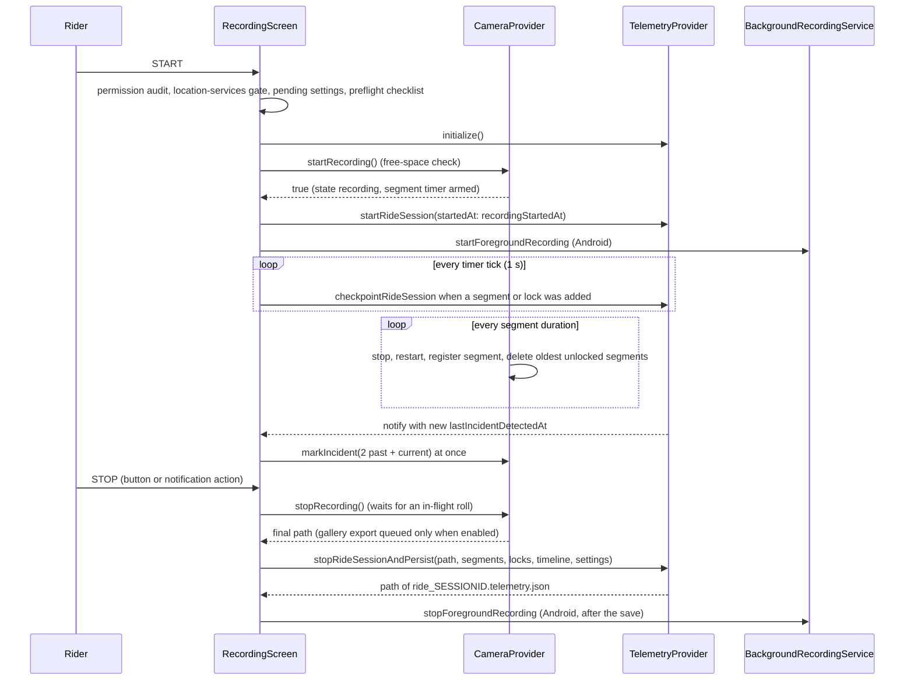
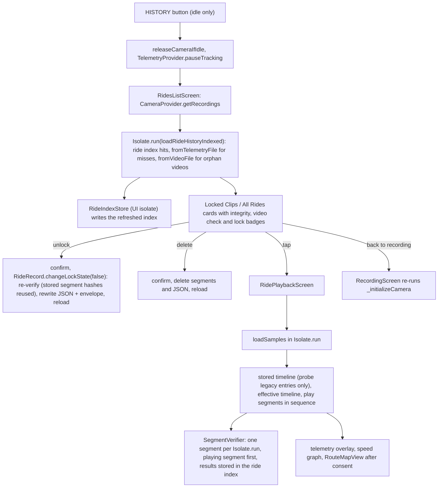

# Architecture

MotoCam is a Flutter motorcycle dashcam. One home screen coordinates three app-wide `ChangeNotifier`s, a handful of platform services and eight Android method channels to record segmented video with GPS and accelerometer telemetry. Recorded rides can later be reviewed as one continuous timeline. This page describes how those pieces fit together and links to the deep-dive documents for each area.

## Contents

- [What the app is](#what-the-app-is)
- [Module map](#module-map)
- [State management](#state-management)
- [Services and native bridges](#services-and-native-bridges)
- [App startup sequence](#app-startup-sequence)
- [Core flow: recording a ride](#core-flow-recording-a-ride)
- [Core flow: reviewing a ride](#core-flow-reviewing-a-ride)
- [Concurrency model](#concurrency-model)
- [Error handling as practised](#error-handling-as-practised)
- [Repository layout](#repository-layout)
- [Glossary](#glossary)

## What the app is

- **Recording.** The camera records in fixed-length segments (5 s to 10 min) with a rolling loop limit on the session's unlocked segments. While a ride is active, the app takes one GPS and accelerometer telemetry sample per second. Incident detection (a jolt of filtered linear acceleration at or above a trigger g-force, confirmed within 10 s by an abrupt stop or a tip-over) locks the surrounding segments automatically, and the rider can also lock them manually. Automatic retention never deletes locked footage.
- **Persistence.** While recording, the app writes the ride's telemetry JSON file next to the video segments as a checkpoint (`sessionComplete: false`) once the first segment is saved, again whenever a segment or lock is added, and every 30 s after the first checkpoint. At stop it writes the completed file (`sessionComplete: true`). Every write carries a SHA-256 integrity envelope whose payload hash also covers the per-segment hashes. On Android the final save is also signed with a non-exportable Android Keystore key of the phone (envelope version 3), so on that phone and install an edit by anyone without the key is detected; the hashes alone detect only accidental corruption and naive edits. The signature does not prove that the footage is genuine.
- **Review.** Ride history lists rides, checks their integrity and plays all segments as one timeline, with synced telemetry, a speed graph and an optional OpenStreetMap route map.

| Platform | Status |
|---|---|
| Android | Primary target. All eight native method channels are implemented in Kotlin. They provide the recording foreground service, Picture-in-Picture (PiP), battery and thermal status, free-space queries, gallery export, checking and removing gallery copies, the ride signing key, Storage Access Framework access to the old public recordings folder and ride export (the folder picker, copies with a read-back check, hashing and the share sheet). |
| Other | Not targeted; the repository has no web or desktop platform folders. A few generic branches exist: `CameraProvider` uses the application support directory, `TelemetryProvider` plain `LocationSettings`, and `path_utils` lower-cases paths on Windows. |

Current limitations of the recording pipeline:

- On Android, the camera plugin binds CameraX to `MainActivity`'s lifecycle. While a recording's foreground service runs, `MainActivity` holds the lifecycle it exposes at STARTED, so recording is designed to continue with the screen off or the app in the background; this has not yet been confirmed on a device. The keep-screen-on setting (on by default) is the fallback. Swiping the app away from Recents still ends the recording. See [platform-integration.md](platform-integration.md#camera-lifecycle-hold).
- Each segment roll stops and restarts the camera recording, which loses about 0.2 s of footage at every segment boundary (measured on the test phone on 2026-11-11 with 5 s segments and the preview on; about 1 s before rolls kept CameraX's video stream bound, third_party/camera_android_camerax/MOTOCAM_PATCHES.md patch 1). On the first real ride (2026-11-13: 3 min segments, Blackout on, unplugged) rolls lost about 0.9 s between files plus up to about 1.4 s of short gaps early in the next clip, and the camera reopened at every roll. On the bench with 3 min segments at 2160p60 and the preview on, each roll also lost about 4 to 8 s in two or three holes during the next 15 s: the camera plugin forwarded every CameraX recording Status event to Dart and kept it until the roll, and releasing about 8,000 of them flooded the main thread, where CameraX's MediaCodec callbacks also run. Since third_party/camera_android_camerax/MOTOCAM_PATCHES.md patch 5 (Status events are not forwarded) a check run (2026-11-17, one debug-build run, two rolls) had no hole over 0.25 s after either roll and about 0.45 to 0.6 s between the files. Rolls in Blackout, with the screen locked and on a real ride have not been re-measured since.

[recording-pipeline.md](recording-pipeline.md) describes each of them.

The UI is locked to portrait and always dark (Material 3, seeded from blue). The lock is no longer absolute: a build switch, `kLandscapeRecording` (`--dart-define=MOTOCAM_LANDSCAPE=true`, off by default, bench builds only until the UI redesign ships landscape layouts), lets the recording screen pin the UI to the orientation the phone is held in while idle and record each ride in the orientation it was started in; see [recording-pipeline.md](recording-pipeline.md#camera-initialization). With the switch off nothing changes: UI and capture stay portraitUp. There is no localization; `intl` is used only for `DateFormat` in the rides list.

There is no backend, account system, analytics or crash reporting. The only network traffic is the route map's OpenStreetMap tile requests (`MapSourceConfig.tileUrlTemplate`). The map is built only while it is expanded on the playback screen, and only after a one-time consent; the expanded state is remembered between rides. Recordings, telemetry and settings stay on the device.

## Module map

`lib/core` holds code that is not tied to a single screen: settings, platform-service wrappers and utilities. `lib/features` holds one folder per feature area. Each area may contain providers, models, screens, widgets and pure-logic files that are unit-tested without a device.

| File | Responsibility |
|---|---|
| [main.dart](../lib/main.dart) | Entry point: a no-op `debugPrint` in release builds, the diagnostic log and its error hooks for every build mode, the portrait lock (the starting pin; with the landscape switch on the recording screen re-pins it), the root `MultiProvider` and the `MaterialApp`, whose home is `RecordingScreen` |
| [core/diagnostics/diagnostic_log.dart](../lib/core/diagnostics/diagnostic_log.dart) | `DiagnosticLog`: the persistent diagnostic log (`<filesDir>/diagnostics/app.log`, rotated to `app.log.1` at about 1 MiB, two files kept), one line per event (UTC time, level, source, message), buffered and written off the hot path, web addresses cut to their host and the source excerpt of a `FormatException` (which can be a slice of a ride file) removed, a line seen twice among the last 16 distinct lines then only counted (the count, with the line's head, written by the next flush another line, a pause or a share causes). `DiagnosticLog.instance` (disabled until `main` installs one) and `debugPrintError` |
| [core/diagnostics/diagnostics.dart](../lib/core/diagnostics/diagnostics.dart) | Wiring of the log: `installErrorHooks` (`FlutterError.onError`, `PlatformDispatcher.instance.onError`), `flushDiagnosticsOnPause`, the session header and the process exits from the `diagnostics` channel (`DiagnosticsChannel`, `startDiagnosticSession`), and the share and clear actions of the settings sheet |
| [core/providers/app_settings_provider.dart](../lib/core/providers/app_settings_provider.dart) | `AppSettingsProvider`: rider settings stored in `SharedPreferences` (including the opt-in gallery export), plus quality presets, option lists, label helpers and the incident threshold and debounce derived from the sensitivity setting. See [settings.md](settings.md) |
| [core/services/app_permission_service.dart](../lib/core/services/app_permission_service.dart) | `AppPermissionService.ensureRequiredPermissions(audioEnabled, galleryExportEnabled)`: requests the permissions and returns a `PermissionAuditResult` that separates required items from recommended ones and lists permanently denied required ones. It reports the battery-optimization exemption status but never requests it. Also holds the shared `isPermissionGranted` predicate |
| [core/services/background_recording_service.dart](../lib/core/services/background_recording_service.dart) | Singleton bridge to the Android foreground service: start (returns whether the service started), update, stop, the battery-optimization exemption status and request, the offer-once flag and the `events` stream (`stopRequested`). Android only |
| [core/services/device_status_service.dart](../lib/core/services/device_status_service.dart) | `DeviceStatusService` returns a `DeviceStatusSnapshot` with battery %, battery temperature, thermal status and the Android API level. Android only; other platforms get `DeviceStatusSnapshot.empty` |
| [core/services/gallery_copies.dart](../lib/core/services/gallery_copies.dart) | `GalleryCopies` (the `gallery` channel: which gallery copies still exist, deleting them without a prompt, and the system delete prompt) and `GalleryCopyStatus`. Never throws |
| [core/services/legacy_recordings_access.dart](../lib/core/services/legacy_recordings_access.dart) | `LegacyRecordingsAccess` (the `legacy_recordings` channel: the folder picker, listing, copying and deleting the documents of the old public folder) and the `LegacyRideDocumentSource` interface the import is written against. Android only |
| [core/services/pip_service.dart](../lib/core/services/pip_service.dart) | Singleton PiP bridge: the static `enterPipMode` (returns whether PiP was entered), `isInPipMode` and `pipModeStream` |
| [core/services/ride_export_channel.dart](../lib/core/services/ride_export_channel.dart) | `RideExportChannel` (the `ride_export` channel: the folder picker, copies into the picked folder with a read-back check, hashing, the share sheet and the keep-screen-on request) and the `RideExportNative` interface the export is written against. Android only |
| [core/services/ride_signing_service.dart](../lib/core/services/ride_signing_service.dart) | `RideSigningService` (the `integrity` channel: this phone's signing key and `signPayloadHash`, `null` on any failure), `SignedRideRegistry` (the rides this install wrote signed, in SharedPreferences) and `loadRideSignerContext`. See [platform-integration.md](platform-integration.md#comexamplemotocamintegrity) |
| [core/ride_file/ride_telemetry_codec.dart](../lib/core/ride_file/ride_telemetry_codec.dart) | The ride-file codec: every rule of the ride telemetry JSON. Decoding (summary without samples, separate sample parsing, segment resolution with quarantine, timeline, locks), the segment-list and timeline rules, the writer's payload, sealing and file path, the lock-state rewrite, and the gallery and legacy public folder constants. See [data-formats.md](data-formats.md#ride-file-codec) |
| [core/ride_file/ride_integrity.dart](../lib/core/ride_file/ride_integrity.dart) | Part of the codec: `RideIntegrityStatus`, `RideIntegrityReport`, building, re-sealing and checking the integrity envelope, and `applySignerContext` |
| [core/ride_file/ride_signature.dart](../lib/core/ride_file/ride_signature.dart) | Part of the codec: the version 3 signature (`RideSignatureData`, `RideSignatureFacts`, `RideSignedBy`, `RideSignerContext`), strict P-256 key and DER signature parsing, ES256 verification with pointycastle, and `resolveRideSigner` |
| [core/utils/integrity_utils.dart](../lib/core/utils/integrity_utils.dart) | Canonical-JSON SHA-256, streamed file SHA-256, the per-path lock `runExclusiveForPath`, `writeTelemetryAtomically` (unique temp file, then rename) and pruning of stale temp files |
| [core/utils/path_utils.dart](../lib/core/utils/path_utils.dart) | Lexical path normalization, the `isPathInsideDirectory` containment check and file-name extraction |
| [core/utils/format_utils.dart](../lib/core/utils/format_utils.dart) | `formatElapsed`, the one `HH:MM:SS` elapsed-time format used by recording, Ride History and playback |
| [features/camera/providers/camera_provider.dart](../lib/features/camera/providers/camera_provider.dart) | `CameraProvider`: camera selection and initialization with resolution/FPS fallback, segmented recording and rollover, recording faults (`lastRecordingError`), stall recovery, incident locks, per-session retention, free-space checks, the recordings directory, recording listing, and the opt-in Android gallery export over the `media` channel |
| [features/camera/providers/gallery_export.dart](../lib/features/camera/providers/gallery_export.dart) | `GalleryExporter`: the persisted gallery export queue (enqueue, one-at-a-time drain that moves each copy to the links, relocation by file name with `locateGalleryExportSource`, up to three attempts, the storage permission asked at most once per drain and a denied entry left uncounted by a drain that does not ask, a copy whose entry was dropped meanwhile deleted through `deleteCopies`), `forgetMissingLinks` and `gallerySaveSummary` |
| [features/camera/providers/recording_retention.dart](../lib/features/camera/providers/recording_retention.dart) | Pure retention rules used by `CameraProvider`: which unlocked segments the loop deletes, which segment sequences an incident lock still has to cover, which telemetry files no longer have any video (starting from the codec's segment-list rule), and whether the LOCKED badge applies (`isActiveSegmentLocked`) |
| [features/camera/providers/recordings_migration.dart](../lib/features/camera/providers/recordings_migration.dart) | `RecordingsMigrator` (moves the rides of the Android legacy roots into the recordings directory: one-shot snapshot of the files to move, rename else verified staging copy, collisions, whole-ride free-space reserve, pause, split rides, atomic journal; no plugin code, tested with temporary directories and injected faults) and `RecordingsMigrationController` (progress, summary and the idle signal, owned by `CameraProvider`) |
| [features/camera/providers/storage_budget.dart](../lib/features/camera/providers/storage_budget.dart) | The storage budget: `selectRidesForStorageBudget` (pure: which whole rides to delete, oldest first, and what is never deleted), `scanStorageBudgetInventory` (the recordings root's top level, through the ride index, off the UI isolate) and the notice text |
| [features/recording/recording_screen.dart](../lib/features/recording/recording_screen.dart) | `RecordingScreen`, the home route and session coordinator. It runs the bootstrap, the start and stop flows, ride checkpoints, recording-fault handling, the incident auto-lock, blackout mode, the PiP layout, the settings apply step, the one-time battery-exemption offer, device-status polling, app lifecycle handling and navigation to history |
| [features/recording/recording_screen_logic.dart](../lib/features/recording/recording_screen_logic.dart) | Pure helpers for `RecordingScreen`: button colours and the contrast-ratio check, the lock notice text, the preview-area mode and failure-panel text (`cameraPreviewMode`, `cameraInitPanelFor`), `BackgroundStallTracker`, which decides when to attempt stall recovery, and `RideCheckpointTracker`, which decides when the ride needs a new checkpoint |
| [features/recording/widgets/recording_settings_sheet.dart](../lib/features/recording/widgets/recording_settings_sheet.dart) | `RecordingSettingsSheet`, a modal form that returns a `RecordingSettingsFormResult` and persists nothing itself |
| [features/camera/providers/camera_init_status.dart](../lib/features/camera/providers/camera_init_status.dart) | `CameraInitState`, `CameraInitFailure` and `cameraInitFailureForPermissions`: why a camera initialization failed |
| [features/recording/start_preflight_evaluator.dart](../lib/features/recording/start_preflight_evaluator.dart) | `StartPreflightEvaluator` and `StartPreflightInputs`: the pure pass, warn or fail logic of every start checklist row |
| [features/recording/widgets/start_preflight_sheet.dart](../lib/features/recording/widgets/start_preflight_sheet.dart) | `StartPreflightSheet` and `StartPreflightCheck`, which present the start checklist |
| [features/telemetry/providers/telemetry_provider.dart](../lib/features/telemetry/providers/telemetry_provider.dart) | `TelemetryProvider`: GPS stream with a fallback poll and location-off handling, speed filtering, gated distance, accelerometer incident detection (with a raw-accelerometer fallback), pausing while idle, the ride sample timer, checkpoints and the final per-ride telemetry JSON with its integrity envelope, and a retry queue for failed saves |
| [features/telemetry/models/telemetry_data.dart](../lib/features/telemetry/models/telemetry_data.dart) | `TelemetryData`, one immutable telemetry sample with fix validity (`hasFix`, `fixAgeMs`), with JSON conversion (a sample read from JSON parses its timestamp on first access) |
| [features/history/models/ride_record.dart](../lib/features/history/models/ride_record.dart) | `RideRecord`: the ride model built from a telemetry JSON through the ride-file codec (segment paths resolved against the telemetry file's directory, the rest quarantined, integrity verified), with or without its samples (`samplesLoaded`, `loadSamples`); rewrites lock state after a full re-check and interpolates samples for playback. Re-exports the codec's ride model types |
| [features/history/models/ride_history_loader.dart](../lib/features/history/models/ride_history_loader.dart) | `loadRideHistoryIndexed`: turns the recordings listing into sample-less rides, newest first, reusing ride index entries whose telemetry file is unchanged, and adds a video-only ride for each video that no ride JSON references. Runs off the UI isolate |
| [features/history/models/ride_index.dart](../lib/features/history/models/ride_index.dart) | The ride index cache (`RideIndex`, `RideIndexEntry`, `SegmentHashEntry`, `RideFileStamp`) and `RideIndexStore`, its one writer on the UI isolate |
| [features/history/models/segment_verifier.dart](../lib/features/history/models/segment_verifier.dart) | `SegmentVerifier`: checks segment hashes one at a time with a cancellation token and stores the results in the ride index; `RideVideoCheck` and `describeVideoCheck` for Ride History |
| [features/history/widgets/recordings_migration_banner.dart](../lib/features/history/widgets/recordings_migration_banner.dart) | `RecordingsMigrationBanner`: the one-line migration progress banner and dismissible summary, shown in Ride History and on the idle recording screen |
| [features/history/services/ride_deletion.dart](../lib/features/history/services/ride_deletion.dart) | `deleteRideFiles` and `filesOfRide`: the one routine that deletes a ride (its trusted files in its own directory, the JSON last) and keeps the ride index, the signed-ride registry and the gallery-link store (links and queued exports of the deleted files; never the gallery copies) consistent; used by Ride History and the storage budget |
| [features/history/services/gallery_links.dart](../lib/features/history/services/gallery_links.dart) | The gallery-link store: `GalleryLink`, `PendingGalleryExport`, `GalleryLinkData`, `galleryLinkKey`, `galleryKeysOfRide` and `GalleryLinkStore`, its one writer on the UI isolate (`<application support>/gallery_links/gallery_links.json`) |
| [features/history/services/gallery_copy_removal.dart](../lib/features/history/services/gallery_copy_removal.dart) | `removeGalleryCopies` (delete without a prompt, the storage permission on Android 9 and lower, the system prompt for the rest, then the store update) and `galleryRemovalSummary` |
| [features/history/services/legacy_ride_import.dart](../lib/features/history/services/legacy_ride_import.dart) | `LegacyRideImporter` (imports the rides of the v0.1.11/v0.1.12 public folder through a `LegacyRideDocumentSource`: staging, size checks, rename, journal, collisions, JSON last), `deleteImportedOriginals` and `LegacyRideImportController` (progress and idle signal, owned by `CameraProvider`) |
| [features/history/rides_list_screen.dart](../lib/features/history/rides_list_screen.dart) | `RidesListScreen`: discovers files, loads the history through the ride index in an isolate, lists rides with integrity, video check, incomplete, simulated-GPS and lock badges, unlocks and deletes rides after confirmation, imports rides from the old public folder (Android), and opens playback |
| [features/history/ride_playback_screen.dart](../lib/features/history/ride_playback_screen.dart) | `RidePlaybackScreen`: orchestration of playback (controller lifecycle, segment loading, seeking, scrubbing) as one timeline, with per-segment, cancellable hash verification off the UI isolate and a 'Check videos again' action. It publishes a `PlaybackPosition` through a `ValueNotifier` and builds `RidePlaybackBody`; it has no `ValueListenableBuilder` over the whole body |
| [features/history/widgets/playback_timeline.dart](../lib/features/history/widgets/playback_timeline.dart) | Pure playback timeline logic: segment order, the effective timeline, missing, failed-check and no-video ranges, seek targets, incident and lock marker offsets, position clamping, the nearest sample and speed-graph page rules, and speed-graph tap and drag targets |
| [features/history/widgets/ride_playback_body.dart](../lib/features/history/widgets/ride_playback_body.dart) and siblings | The playback body, split into widgets that take values, callbacks and a `ValueListenable<PlaybackPosition>` (`playback_position.dart`): `playback_video_area.dart` (the only widget holding the `VideoPlayerController`), `playback_telemetry_overlay.dart`, `playback_speed_graph.dart` with `speed_graph_painter.dart` (a cached curve page plus a cursor), `playback_seek_bar.dart`, `playback_legend.dart`, `playback_controls.dart` and `route_map_panel.dart`. A position tick rebuilds only the slider and time label, the overlay, the graph cursor and the map marker |
| [features/history/widgets/playback_seekbar_track_shape.dart](../lib/features/history/widgets/playback_seekbar_track_shape.dart) | `PlaybackSeekbarTrackShape`, the seekbar's slider track, which paints the timeline ranges and the incident and lock markers |
| [features/history/widgets/route_map_view.dart](../lib/features/history/widgets/route_map_view.dart) | `RouteMapView`, a `flutter_map` route on OSM tiles, fitted to the route bounds. It falls back to `StaticMapViewer` when fewer than two GPS fixes remain |
| [features/map/map_source_config.dart](../lib/features/map/map_source_config.dart) | `MapSourceConfig`, the tile URL, attribution, licence text, user agent with contact URL, zoom and tile-cache constants |
| [features/map/widgets/osm_attribution.dart](../lib/features/map/widgets/osm_attribution.dart) | `OsmAttribution`, the tappable OpenStreetMap attribution layer of every tile map; opens the copyright page with `url_launcher` |
| [features/map/map_licence.dart](../lib/features/map/map_licence.dart) | `registerMapLicence`, which adds the OpenStreetMap data notice to Flutter's licence page |
| [features/map/route_points.dart](../lib/features/map/route_points.dart) | The shared GPS-fix filter (`latLngFromSample`, `samplesWithGpsFix`, `routePointsFromSamples`) and `downsampleRoute` |
| [features/map/widgets/static_map_viewer.dart](../lib/features/map/widgets/static_map_viewer.dart) | `StaticMapViewer` and `MapPainter`, a tile-free `CustomPaint` drawing of the route, with a "No GPS fix" state |

Native code (Android only):

| File | Responsibility |
|---|---|
| [MainActivity.kt](../android/app/src/main/kotlin/com/example/motocam/MainActivity.kt) | Registers all eight channel handlers (the `integrity` one through `RideSigner.register`, see [RideSigner.kt](../android/app/src/main/kotlin/com/example/motocam/RideSigner.kt), the `legacy_recordings` one through `LegacyRecordingsAccess.register`, the `gallery` one through `GalleryCopies.register` and the `ride_export` one through `RideExport.register`). It routes `onActivityResult` by request code through `ActivityResultDispatcher`. It also triggers automatic PiP on leave/pause while recording, relays PiP mode changes, relays the notification "Stop" broadcast to Dart (its receiver is registered from `onCreate` to `onDestroy`), reports free space and exports clips to the gallery (returning the copy's content URI on every API level). When the activity is destroyed it stops the foreground service |
| [BackgroundRecordingService.kt](../android/app/src/main/kotlin/com/example/motocam/BackgroundRecordingService.kt) | Foreground service with an ongoing chronometer notification, a "Stop" action and a partial wake lock. On Android 11 and later its types (camera, microphone, location) are derived from the permissions actually granted. It is never restarted (`START_NOT_STICKY`) and tears itself down when the task is removed |
| [GalleryCopies.kt](../android/app/src/main/kotlin/com/example/motocam/GalleryCopies.kt) | The `gallery` channel: `galleryItemsExist`, `deleteGalleryItems` (`ContentResolver.delete`, no prompt) and `requestDeleteGalleryItems` (`MediaStore.createDeleteRequest` on API 30+, the `RecoverableSecurityException` action on API 29, request code 7102) |
| [LegacyRecordingsAccess.kt](../android/app/src/main/kotlin/com/example/motocam/LegacyRecordingsAccess.kt) | The `legacy_recordings` channel: `ACTION_OPEN_DOCUMENT_TREE` at `Movies/MotoCam/Recordings` (grant not persisted), listing, streamed copies and deletes of the tree's documents on a background thread; also `ActivityRequestCodes` and `ActivityResultDispatcher` |
| [RideExport.kt](../android/app/src/main/kotlin/com/example/motocam/RideExport.kt) | The `ride_export` channel: the folder picker (`ACTION_OPEN_DOCUMENT_TREE`, request code 7103), copies into the picked folder with a SHA-256 read-back, `hashFile`, the share sheet through a FileProvider and the keep-screen-on request, on its own single-thread executor with its own cancel flag |
| [RideSigner.kt](../android/app/src/main/kotlin/com/example/motocam/RideSigner.kt) | The `integrity` channel: an EC P-256 Android Keystore key (alias `motocam_ride_signing_v1`, StrongBox when available, no user authentication) created on first use, which returns its public key and signs a ride's `payloadHash` on a background thread |

**Dependency direction.** `features/*` depend on `core/*`. `core` does not depend on `features`; within `core`, `AppPermissionService` depends on `BackgroundRecordingService` and `DeviceStatusService`. Between features:

- `recording` depends on `camera`, `telemetry` and `history`.
- `camera` depends on `core` (`AppPermissionService.isPermissionGranted`, `integrity_utils`, `path_utils`, the codec, `legacy_recordings_access`) and, for the storage budget and the legacy-folder import, on `history` (`ride_history_loader`, `ride_index`, `services/ride_deletion` and `services/legacy_ride_import`).
- `telemetry` and `history` read and write ride files only through the ride-file codec in `core/ride_file`.
- `history` depends on `camera` (for file discovery), `telemetry/models` and `map`.
- `map` depends on `telemetry/models`.
- `CameraProvider` and `TelemetryProvider` do not know about each other. `RecordingScreen` is the only place that coordinates them (it also hands `CameraProvider` a callback that returns the telemetry ride's `rideSessionId`, for the storage budget).

## State management

State uses `provider` 6. [main.dart](../lib/main.dart) builds a `MultiProvider` above `MaterialApp`. Every pushed route and modal sheet can therefore read the providers.

| Provider | Created by (`MotoCamApp.build`) | First created when | Watched by (rebuilds) | Read without listening |
|---|---|---|---|---|
| `AppSettingsProvider` | `AppSettingsProvider()`, then `unawaited(settings.load())` | `context.read` at the start of `RecordingScreen`'s bootstrap, inside `initState` | `RecordingScreen` profile chip bar (`Consumer2<AppSettingsProvider, CameraProvider>`), controls (`Consumer2<CameraProvider, AppSettingsProvider>`) | `RecordingScreen` bootstrap, start, stop, camera init and settings apply; `RecordingSettingsSheet` |
| `TelemetryProvider` | `TelemetryProvider()` (sample interval 1 s) | `RecordingScreen.didChangeDependencies` | `Selector`s for speed, distance, the location-off and detection-unavailable banners, and the ride-saving state. `RecordingScreen` also adds a raw listener (`_onTelemetryChanged`) that drives the incident auto-lock | Camera init, start, stop, checkpoints and history navigation in `RecordingScreen` |
| `CameraProvider` | `CameraProvider(enableDebugLogging: kDebugMode)` | `RecordingScreen.didChangeDependencies`, right after `TelemetryProvider` | Root `Consumer` (back/PiP handling), camera preview, timer, controls, PiP view. `RecordingScreen` also adds a raw listener (`_onCameraChanged`) that reacts to recording faults and gallery-export results | `RecordingScreen` flows; `RidesListScreen` (`getRecordings`); `RecordingSettingsSheet` (FPS options, camera labels) |

Notes:

- All three providers are lazy because no `lazy:` argument is passed. They live for the life of the app.
- `AppSettingsProvider.load()` is guarded by `isLoaded`. That flag flips only after `SharedPreferences.getInstance()` completes, so on a cold start the `create` call and the bootstrap's own `await settings.load()` both run a full load.
- `AppSettingsProvider` never touches the camera or sensors. `RecordingScreen` pushes settings into `CameraProvider.initializeCamera` / `applyRecordingSettings`, into `CameraProvider.autoExportLockedClipsToGallery` at START, and into `TelemetryProvider.setSpeedUiRefreshInterval` / `setIncidentDetectionConfig`.
- `TelemetryProvider` throttles `notifyListeners()` to the "speed UI refresh" setting (100 to 1000 ms). Ride start and stop, sample capture, incidents, location-service and sensor-availability changes, the ride-saving state and `setSpeedUiRefreshInterval` force an immediate notify. `setIncidentDetectionConfig` does not notify.
- `RidePlaybackScreen` uses no provider. It receives a `RideRecord` through its constructor and keeps its own `State`.
- Widget-local state uses `StatefulWidget`. The other singletons (`BackgroundRecordingService.instance`, `PipService.instance`) are plain Dart singletons, not providers.

**Navigation.** `MaterialApp` sets only `home: RecordingScreen`; there are no named routes and no router package. `RecordingScreen._openRideHistory` pushes `RidesListScreen` with `Navigator.push` and a `MaterialPageRoute`, and tapping a ride card pushes `RidePlaybackScreen(ride:)` the same way. The settings sheet and the start checklist are modal bottom sheets (`showModalBottomSheet`) that hand their result back through `Navigator.pop`; the permission, location-services, battery-exemption, unlock, delete and online-map consent prompts are `AlertDialog`s. A new screen follows the same pattern and can read the providers, because they sit above `MaterialApp`.

## Services and native bridges

| Dart side | Channel `com.example.motocam/...` | Gating in Dart | Methods (Dart to native) | Native to Dart |
|---|---|---|---|---|
| `BackgroundRecordingService` | `background_recording` | `defaultTargetPlatform == android`; no-op or default elsewhere | `startForegroundRecording`, `updateForegroundRecording`, `releaseCameraHold`, `stopForegroundRecording`, `setKeepScreenOn`, `isIgnoringBatteryOptimizations`, `requestIgnoreBatteryOptimizations` | `onStopRequested`, `onForegroundStopped` |
| `DeviceStatusService` | `device_status` | `defaultTargetPlatform == android`; otherwise `empty` | `getBatteryStatus` | none |
| `PipService` | `pip` | Not gated. Failures are caught and return `false` | `enterPipMode` | `onPipModeChanged` |
| `CameraProvider.platform` | `media` | Gallery export runs only on Android; a failed free-space query returns `null` | `getAvailableStorageBytes`, `exportVideoToGallery` | none |
| `GalleryCopies` | `gallery` | Not gated; Ride History offers it only on Android. Errors report `failed` | `galleryItemsExist`, `deleteGalleryItems`, `requestDeleteGalleryItems` | none |
| `DiagnosticsChannel` | `diagnostics` | Not gated. Errors and a missing handler return an empty map or list | `getSessionInfo`, `takeExitReasons` | none |
| `RideExportChannel` | `ride_export` | Not gated; Ride History and playback offer the export only on Android. A cancel is `RideExportCancelled`, other errors are a `RideExportFailure` with the native code, and a missing handler is `UNAVAILABLE` | `pickExportFolder`, `prepareFolder`, `exportFile`, `hashFile`, `cancel`, `shareFiles`, `setKeepScreenOn` | none |
| `AppPermissionService` | none (uses `permission_handler`) | Android-only extras: notifications, legacy storage (gallery export on, Android 9 and lower), the battery-exemption status | n/a | n/a |

Every Kotlin handler is registered in `MainActivity.configureFlutterEngine` (the `integrity`, `diagnostics`, `legacy_recordings`, `gallery` and `ride_export` ones through their own classes). `MainActivity.onCreate` installs the native crash handler (`Diagnostics.installCrashHandler`) before `super.onCreate`. Channel contracts, manifest permissions, and the foreground service are covered in [platform-integration.md](platform-integration.md).

## App startup sequence

```mermaid
sequenceDiagram
    participant M as main()
    participant App as MotoCamApp
    participant RS as RecordingScreen
    participant S as AppSettingsProvider
    participant P as AppPermissionService
    participant C as CameraProvider
    participant T as TelemetryProvider
    M->>M: ensureInitialized, release: debugPrint no-op
    M->>M: DiagnosticLog.instance, set FlutterError.onError, PlatformDispatcher.onError
    M->>M: flush on pause; session header and exit reasons (unawaited)
    M->>M: await setPreferredOrientations(portraitUp)
    M->>App: runApp(MotoCamApp)
    App->>RS: MultiProvider (lazy) > MaterialApp > home
    RS->>RS: initState: addObserver, PiP bridge, background bridge
    RS->>RS: device status poll now and every 15 s
    RS->>S: bootstrap (unawaited): context.read creates provider
    RS->>T: didChangeDependencies creates provider, addListener
    RS->>C: didChangeDependencies creates provider, addListener
    S-->>RS: await load() if not yet loaded
    RS->>P: ensureRequiredPermissions(audio, galleryExport)
    P-->>RS: PermissionAuditResult (recovery dialog if blocking)
    Note over RS: Blocking issues remain: bootstrap returns without camera init (Retry, a resume with permissions granted or a return from history init it later)
    RS->>C: initializeCamera(preset, fps, bitrate, audio, camera, segment, loop)
    RS->>T: setSpeedUiRefreshInterval, setIncidentDetectionConfig
    RS->>T: initialize() starts GPS stream, poll timer, accelerometer
```

In code, `_bootstrapRuntimePrerequisites` calls `_initializeCamera`. The permission recovery dialog offers Later, Request Again and Open Settings; Open Settings waits until the app is resumed (at most two minutes) before it checks again. The camera may negotiate a lower resolution or FPS than the rider chose, but the saved settings are never overwritten with the negotiated values; the profile bar shows the applied values when they differ. `TelemetryProvider.initialize` returns without starting anything if location services are off or permission is denied. It runs again on the next camera init or START. Until the camera is initialized, the preview area shows a spinner or, after a failed attempt, a camera-unavailable panel with Retry and Open Settings.

## Core flow: recording a ride



- Each finished segment is moved (or, when the rename fails, copied) from the camera plugin's temporary file into the recordings directory. On Android that is `<application support>/MotoCam Recordings` (the private `filesDir`, on the same mount as the plugin's cache, so the move is a rename), which also holds a `.nomedia` marker. The directory is resolved once per process. When it is unavailable nothing is written elsewhere and recording cannot start. On Android, the legacy roots (app-specific external storage, the root until this build, and the documents and cache folders earlier builds fell back to) are still scanned until `RecordingsMigrator` has moved their rides into the recordings directory; see [recording-pipeline.md](recording-pipeline.md#legacy-roots-and-migration).
- `startRecording` refuses to start when the platform reports less free space than one more segment needs, and the same check runs before every segment roll.
- The ride session starts only after `CameraProvider.startRecording` succeeds, with the camera's start time as its zero point. Checkpoints and the final save write the same file, so one ride session produces at most one telemetry file. When stop resolves no video path, `_stopRecordingFlow` calls `TelemetryProvider.cancelRideSession` and no final file is written; a checkpoint written earlier stays on disk.
- When `startForegroundRecording` returns `false` or throws, recording continues and a SnackBar warns that background protection is unavailable.
- When a segment roll or a stall recovery cannot restart recording, or storage runs low, `CameraProvider` enters a recording fault (`lastRecordingError`). `RecordingScreen` then stops and saves the ride (`_stopAfterRecordingFault`) and tells the rider why.
- A failed ride save is kept in memory and offered again through a Retry action (`TelemetryProvider.retryPendingPersist`).
- After a ride is saved from the STOP button, the app offers the battery-optimization exemption if the app is not exempt, behind a dialog the rider can decline. The offer is made at most once (`BackgroundRecordingService.batteryOptimizationOfferedKey`).
- Settings saved while recording are persisted, but the camera is not reconfigured until the next START: `applyRecordingSettings` returns `false` while recording.

Deep dives: [recording-pipeline.md](recording-pipeline.md) covers segments, rollover, stall recovery, retention, PiP, blackout and the foreground service. [telemetry.md](telemetry.md) covers GPS, speed, incidents and persistence.

## Core flow: reviewing a ride



While recording, the HISTORY button reads MINIMISE, and both it and system back try to enter PiP instead of navigating. A locked ride must be unlocked before it can be deleted, unless its lock cannot be removed because it failed the integrity check. Deep dives: [playback-and-history.md](playback-and-history.md) for the list and the player, and [data-formats.md](data-formats.md) for the telemetry JSON, the integrity envelope and the quarantine rules.

## Concurrency model

- **Isolates.** Most work runs on the UI isolate as `async`/`await` code. Four classes run work in a background isolate through `Isolate.run`:
  - `CameraProvider`: the scan for telemetry files whose videos are gone.
  - `TelemetryProvider`: segment SHA-256 hashing and building the integrity envelope.
  - `RidesListScreen`: `loadRideHistoryIndexed`, and `SegmentVerifier` hashing (one segment per call) during an unlock.
  - `RidePlaybackScreen`: `RideRecord.loadSamples`, and `SegmentVerifier` hashing (one segment per call, cancelled between segments when the screen closes).
  - `RideIndexStore`: the first read of the ride index.

  The ride index file is written only by `RideIndexStore` on the UI isolate. `RideRecord.changeLockState` (which `setLockState` wraps) reads the ride JSON and computes its payload hashes on the UI isolate.
- **Timers.**

  | Owner | Timers and delays |
  |---|---|
  | `CameraProvider` | 1 s elapsed-time ticker; one-shot segment-roll timer; 2 s deferred-maintenance timer after stop; 2 s delay before draining the gallery-export queue (after a stop, and once per launch for a queue left by a killed process) |
  | `TelemetryProvider` | 1 s stale-location poll (the fallback position request backs off from 2 s to 30 s); ride sample timer (`sampleInterval`, 1 s); 30 s checkpoint timer |
  | `RecordingScreen` | 15 s device-status poll; in-app notice timer; 2 s blackout hold-to-exit timer; 200 ms delay before leaving the PiP layout; up to 2 min waiting for the return from system settings; the 700 ms PiP blink timer, owned and cancelled by `_BlinkingRecDot` |

- **Streams.**
  - Plugin streams: the Geolocator position and service-status streams, and the sensors_plus user-accelerometer stream (or the raw accelerometer stream on devices without a linear-acceleration sensor).
  - Broadcast `StreamController`s: `CameraProvider.timerStream`, `PipService.pipModeStream` and `BackgroundRecordingService.events`.
  - `TelemetryProvider` owns the plugin subscriptions and cancels them in `pauseTracking`, when the app goes to the background with no active ride, and in `dispose`. `RecordingScreen` holds its subscriptions to the broadcast streams and cancels them in its own `dispose`.
- **Re-entrancy.** Most guards are plain `bool` flags, for example `_isStartingRecording` and `_isStoppingRecording` in `CameraProvider` (exposed as `isStartingRecording` and `isStoppingRecording`), and `_isStartingRecording`, `_isStoppingRecording`, `_isApplyingSettings` and `_isNavigatingHistory` in `RecordingScreen`. `CameraProvider` serialises `initializeCamera` through an in-flight future, and `stopRecording` waits up to 60 s for an in-flight segment roll. `integrity_utils.runExclusiveForPath` queues reads and writes of the same ride JSON within one isolate.
- **Fire-and-forget.** Background work is started without awaiting, usually through `unawaited(...)`. UI code generally checks `mounted` before using `context` or `setState` after an `await`. The incident auto-lock runs synchronously in the telemetry listener; only its haptic feedback and notice wait for the next frame. An incident detected while frames are not rendered (app hidden or in PiP) is therefore locked right away.
- **Lifecycle.** `RecordingScreen` observes `AppLifecycleState`: it exits blackout on `hidden` or `paused` (not on `inactive`; see `leavesBlackoutOnLifecycle`). While recording, `BackgroundStallTracker` counts only the time spent `hidden` or `paused`, and on resume after 8 s or more `RecordingScreen` attempts `CameraProvider.recoverRecordingPipeline`. When the app resumes while idle and the camera is not initialized, it initializes the camera if the permissions it needs are granted, for example after the rider granted them in system settings. `TelemetryProvider` observes the lifecycle itself: with no active ride it pauses GPS and sensors in the background and resumes them on return.

## Error handling as practised

- **Global handlers.** In release builds `main` replaces `debugPrint` with a no-op. `FlutterError.onError` keeps Flutter's default reporting in debug and profile builds; in release it logs the error and stack with `debugPrintSynchronously` and skips errors reported as silent. `PlatformDispatcher.instance.onError` logs uncaught asynchronous errors in every build mode and keeps the app running. Both also write to the diagnostic log (below). No zone is used, and every isolate the app starts is an `Isolate.run`, which rethrows its error to the caller.
- **Diagnostic log.** `DiagnosticLog` keeps app errors on the phone so a tester can hand them over (Share diagnostic log in the recording settings sheet); there is no crash reporter and nothing is uploaded. It records framework errors (not silent ones), uncaught asynchronous errors, `CameraProvider._logError`, the error `debugPrint` paths (through `debugPrintError`, which still prints as before), uncaught JVM exceptions (`Diagnostics.kt`, written synchronously before the previous handler kills the process), a session header at each start (version, build mode and build switches, on this branch `MOTOCAM_LANDSCAPE=true` or `false`, phone, Android release and SDK) and, on Android 11 and later, every process exit the system recorded since the last start (crash, native crash, ANR with the head of its main-thread trace, low memory and so on). Writes never throw: lines are buffered, errors flushed at once, info lines within 2 s, everything on pause. It never holds a position, speed or route: callers log error text only web addresses lose their path (a map tile address reveals the ride area) and a `FormatException` loses the source excerpt it prints (a slice of a ride file can hold positions and speeds).
- **Catch, log, fall back.** Broad `catch (e)` blocks are the norm; `lib/` has a few typed clauses (`on CameraException`, `on PlatformException`, `on FileSystemException`). `CameraProvider` logs verbose messages through `_log`, which prints only when `enableDebugLogging` (`kDebugMode`) is true, and warnings and errors through `_logError` in every build mode. Other code uses `debugPrintError` for errors, `debugPrint` for the rest, or silent `catch (_)`.
- **Failure as a return value.** Most APIs report failure through their return value:
  - `CameraProvider.startRecording` and `applyRecordingSettings` return `false`; a refused start because of low storage also sets `lastRecordingError`.
  - `stopRecording` returns `null` or the best available path.
  - `RideRecord.fromTelemetryFile` returns `null`, and `loadRideHistoryIndexed` skips that file. A ride index that cannot be read is treated as empty.
  - `verifySegmentIntegrity` and `loadSamples` return the unchanged record when the telemetry file cannot be read.
  - `TelemetryProvider.stopRideSessionAndPersist` returns `null` on a failed save, sets `lastPersistError` and queues the save for `retryPendingPersist`. A failed checkpoint is logged and returns `null`.
  - The service wrappers return safe defaults: `DeviceStatusSnapshot.empty`, `false` for PiP, `false` from `startForegroundRecording` when the service did not start, and `true` for "is ignoring battery optimizations" on error.
- **Not wrapped.** Some calls have no `try/catch`, and an exception propagates to the caller:
  - `AppSettingsProvider.load` and the setters.
  - `BackgroundRecordingService.startForegroundRecording` and `stopForegroundRecording`. `RecordingScreen` catches both.

  `RecordingScreen._stopRecordingFlow` catches a failed stop, still tries to save the ride with the segments registered so far, and always stops the foreground service and leaves blackout in its `finally` block.
- **User feedback.** The UI reports problems through `SnackBar`s (the failed-save one has a Retry action), `AlertDialog`s (for permissions and location services), a short in-app notice overlay, the camera-unavailable panel and the playback screen's no-playable-video view with Retry. `ErrorWidget.builder` is not overridden.

## Repository layout

| Path | Contents |
|---|---|
| `lib/` | All Dart source, split into `core/` and `features/` (see [Module map](#module-map)) |
| `test/` | Unit and widget tests under `test/core/` and `test/features/`, grouped by `lib/` area, plus `widget_test.dart` (app smoke test), the ride-file fixtures in `test/fixtures/ride_files/` and shared test helpers in `test/support/` (a P-256 key standing in for the phone's signing key): 845 tests in 60 files |
| `android/` | Gradle project (`app/build.gradle.kts`), manifest, Kotlin `MainActivity` and `BackgroundRecordingService`, resources (themes, the monochrome notification icon, backup and data-extraction rules), ProGuard rules and `key.properties.template` |
| `scripts/` | `release-security-precheck.ps1` (used by CI) and `generate-keystore.ps1` |
| `release-notes/` | Per-release notes, `v0.1.8.md` through `v0.1.13.md` |
| `docs/` | This documentation set; start at [README.md](README.md). `docs/audits/` holds the project scan report |
| `.github/` | `workflows/ci.yml` (on pushes to `main` and on pull requests: dependencies from the lockfile, analyze, the security precheck, tests with coverage, a debug APK build and a format check) and `dependabot.yml` |
| `.gitattributes` | Line-ending policy: LF for text files, CRLF for `.bat` and `.cmd` |

Build, test and tooling details are in [development.md](development.md). Signing, versioning and tags are in [release.md](release.md).

## Glossary

| Term | Meaning in this codebase |
|---|---|
| **Ride / session** | One START-to-STOP recording. `TelemetryProvider.startRideSession` assigns a `rideSessionId` of the form `<UTC epoch ms>_<16 hex chars>`. One ride produces at most one telemetry JSON file, which history loads as one `RideRecord` |
| **Segment** | One video file of a ride, nominally `segmentDurationSeconds` long (the final segment, and one cut short by stall recovery, are shorter). Segments are rolled by `CameraProvider`'s segment timer and stored in the recordings directory. A ride's `segmentTimeline` holds `startMs`/`endMs` offsets for each segment, stamped when the segment's recording started and stopped |
| **Sidecar** | The ride's telemetry JSON, stored beside its segments. Current files are named `ride_<sessionId>.telemetry.json`. Older builds wrote `<video base name>.telemetry.json`, and `RideRecord` still recognizes that name for legacy recovery. History discovers rides by the `.telemetry.json` suffix |
| **Checkpoint** | A sealed write of the active ride's telemetry JSON with `sessionComplete: false`, made by `TelemetryProvider.checkpointRideSession` once the first segment is saved, whenever a segment or lock is added after that, and every 30 s, so a ride survives a crash or kill before STOP. A checkpoint lists only segments whose hash is already known |
| **Telemetry sample** | One `TelemetryData`: latitude, longitude, filtered speed (km/h), bearing, smoothed acceleration (g), elapsed ms, cumulative distance (km), a UTC timestamp, `hasFix` and `fixAgeMs`. It is captured every `sampleInterval` (1 s) during a ride. Samples without a fresh fix (older than 5 s) are kept out of the speed statistics and the map |
| **Incident** | A jolt (the 100 ms average of linear acceleration at or above the trigger g-force, 2.8, 3.5 or 4.5 g for high, medium or low sensitivity, for at least 60 ms) outside the debounce window, confirmed within 10 s by an abrupt near-stop or a 2 s tip-over (see [telemetry.md](telemetry.md#incident-detection)). It sets `TelemetryProvider.lastIncidentDetectedAt` and is saved in the ride's `incidents` list |
| **Lock** | A segment marked in `CameraProvider`'s locked set by `markIncident`, with reason `auto-crash` (incident) or `manual-emergency` (LOCK button). Each mark covers the two previous segments plus every segment not yet registered (the current one and, during a roll, the one being saved). Retention never deletes locked segments. On Android, locked segments are copied to the gallery at stop only when the rider turned gallery export on. In history, a ride with locked segments appears under "Locked Clips" and can be unlocked unless its integrity status is `modified` or a path is quarantined |
| **Integrity envelope** | The `integrity` object in the telemetry JSON: `algo` (`sha256`), `envelopeVersion` (2, or 3 for a signed final save on Android), `payloadHash`, `segmentHashes` (per-file SHA-256), `segmentCount`, `hashedSegmentCount`, `generatedAt` and, in version 3, `signature` (ES256 over `payloadHash` by the phone's Keystore key). From version 2 the payload hash covers the rest of the file and every other envelope field (except `signature`). `RideRecord` turns it into a `RideIntegrityReport` of `unknown`, `verified` or `modified`, with `signedBy` (`none`, `thisDevice`, `otherKey`, `unknownSigner`). It fails closed: a missing envelope on a completed ride with `schemaVersion` 3 or later counts as `modified`. The hash alone shows that a ride is unmodified since recording; the signature shows that nobody without this app's key on the recording phone changed it, not that the footage is genuine |
| **Quarantine** | Declared segment paths that fall outside the ride's trusted root, which is the directory the telemetry file was found in. A stale absolute path is first resolved to the same file name in that directory. Quarantined paths are not played or hashed, force the `modified` status and block unlocking |
| **Retention** | Deletion of recordings by `CameraProvider`. The per-session loop limit (`maxRollingSegments`, from the `loopSegmentCount` setting) counts and deletes only the session's unlocked segments. About 2 s after a stop, a background isolate finds telemetry files with no locked segments whose videos are all gone, and those files are deleted. Earlier rides are never deleted automatically; the rider can delete a ride in Ride History |
| **Blackout mode** | A recording-only mode that covers the screen in black (a Flutter overlay; the camera's use cases are not changed), while still showing notices, the REC indicator with the elapsed time and an exit hint. A 2 s hold anywhere exits it, as does the app going `hidden` or `paused`, and every stop |
| **PiP** | Android Picture-in-Picture. While recording, the activity enters PiP on leave/pause (native) or on back/MINIMISE (Dart via `PipService`), and `RecordingScreen` switches to a compact layout. Android only |
| **Preflight** | The checklist that START runs before recording (rows decided by `StartPreflightEvaluator`, shown by `StartPreflightSheet`). Blocking checks: camera, microphone (when audio is on) and location permissions, location services, camera readiness and media write access. Advisory checks: the foreground notification and the battery-optimization exemption (both Android only), incident detection availability, battery level and temperature. When every check passes, no sheet is shown. A failed blocking check or any warning opens it, except the battery-optimization warning once its one-time offer has been shown; that row is then listed only when another check opens the sheet |
