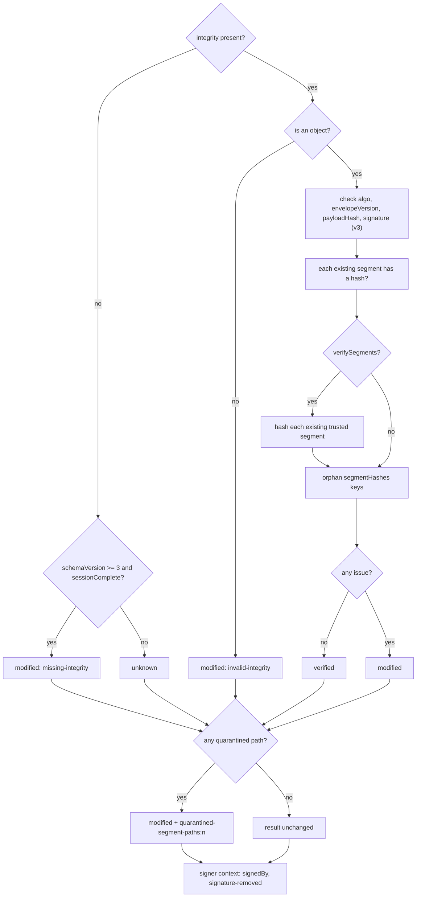

# On-disk data formats

This document describes every file MotoCam writes: where it goes, how it is named, the JSON schema of the per-ride telemetry file, and the SHA-256 integrity envelope (signed on Android since envelope version 3) inside it. It describes the code as it is today. Settings stored in SharedPreferences are covered in [settings.md](settings.md).

## Contents

- [Storage locations](#storage-locations)
- [Directory layout and file naming](#directory-layout-and-file-naming)
- [File inventory](#file-inventory)
- [Ride telemetry JSON](#ride-telemetry-json)
- [Ride-file codec](#ride-file-codec)
- [Checkpoints and the final save](#checkpoints-and-the-final-save)
- [Integrity envelope](#integrity-envelope)
- [Path scope and quarantine](#path-scope-and-quarantine)
- [Atomic-write procedure](#atomic-write-procedure)
- [Ride index (cache)](#ride-index-cache)
- [Gallery-link store](#gallery-link-store)
- [Ride export folder](#ride-export-folder)
- [Backward compatibility](#backward-compatibility)
- [Related documents](#related-documents)

## Storage locations

`CameraProvider._setupRecordingsDirectory` in [camera_provider.dart](../lib/features/camera/providers/camera_provider.dart) picks one recordings directory. It runs during camera initialization once the camera permission (and, with audio on, the microphone permission) is granted, and from `CameraProvider.getRecordings` if no directory has been set yet. The directory is resolved once per process and then kept: a later failure never moves rides to another root. Video segments are moved into that directory when they are registered (a segment that cannot be moved keeps its plugin path), and the telemetry file is written next to the segments.

| Platform | Base directory (path_provider) | Recordings directory |
|---|---|---|
| Android | `getApplicationSupportDirectory()`, which is `Context.getFilesDir()` (internal app storage, typically `/data/user/0/com.example.motocam/files`: private on every API level, not reachable over USB or by file managers, and on the same mount as the camera plugin's cache directory) | `<base>/MotoCam Recordings` |
| Any other platform | `getApplicationSupportDirectory()` | `<base>/MotoCam Recordings` |

There is no fallback root for writing. If the base directory is `null` or any step throws, `_setupRecordingsDirectory` returns `false` and camera initialization stops (the camera stays uninitialized). The directory is created recursively if it does not exist. The app requests no runtime storage permission for it, and app-specific storage needs none. The manifest's storage entries are covered in [platform-integration.md](platform-integration.md).

After the directory is set up:

- **Android only**: an empty `.nomedia` file is created in it if missing, so the media scanner does not index private loop footage. Errors are only logged.
- Once per process, `pruneStaleTelemetryTempFiles` (in [integrity_utils.dart](../lib/core/utils/integrity_utils.dart)) runs without being awaited. It deletes telemetry temp files directly inside the directory (not in subdirectories) whose modification time is more than 10 minutes old. Errors are ignored. It never runs on a legacy root or on the migration's staging directory.
- **Android only**: the [migration of the legacy roots](#legacy-roots-and-their-migration) starts when nothing records or prunes.

### Legacy roots and their migration

Until this build, Android recorded to `getExternalStorageDirectory()/MotoCam Recordings` (`Context.getExternalFilesDir(null)`, app-specific external storage, typically `/storage/emulated/0/Android/data/com.example.motocam/files/MotoCam Recordings`: readable by other apps holding the storage permission on Android 9 and lower, and over USB), and earlier builds fell back to `<documents>/MotoCam Recordings` (`app_flutter`) and `<cache>/MotoCam Recordings`. These three are legacy roots (`CameraProvider._legacyRecordingsDirectories`). They are listed by Ride History until they are empty, never written to, and never pruned (not by the loop, the orphan prune, the temp prune or anything else). A root whose base directory is `null` or throws (for example an unmounted card) is skipped.

`RecordingsMigrator` ([recordings_migration.dart](../lib/features/camera/providers/recordings_migration.dart)) moves their rides into the recordings directory, in the background, resumably and idempotently:

- **Units.** A ride moves as a unit: its trusted, existing segment files and main video as `resolveRideSegments` resolves them, then its telemetry JSON last. Videos that no ride JSON references move one by one. `.nomedia`, telemetry temp files and the write probe are ignored; other files and subdirectories stay. An unlocked ride JSON with no video left (here or already in the recordings directory) stays where it is, because the orphan prune would delete it in the recordings directory; a locked one, or one that cannot be parsed, moves. A ride JSON larger than 64 MB (`recordingsMigrationMaxDecodedRideBytes`, far above any file the app writes) is not decoded while planning: it moves as it is, and its videos move as lone videos.
- **Rename, else copy.** Each file is renamed first (the documents and cache roots are on the same mount as `filesDir`, so this is O(1)). When the rename fails (in practice the external root), the file is streamed (never loaded into memory) into `<application support>/ride_migration/staging/<name>.migrating`, flushed, checked to have the source's size (a JSON also its bytes), renamed into the recordings directory, checked again, and only then is the source deleted. A source is never deleted without that verified copy. The JSON is copied byte for byte, never re-encoded, so its `payloadHash`, its v3 signature and its signed-ride registration (which binds file names, see [Who signed a ride](#who-signed-a-ride)) stay valid.
- **Collisions.** A destination with the same name counts as already moved only when its size matches (for the JSON, its bytes); the source is then deleted. Otherwise the whole ride stays in its legacy root, still listed in Ride History, and the summary reports it.
- **Free space.** Before each copied file, `getAvailableStorageBytes` for the recordings directory must report at least the bytes the ride still has to move (that file and the ride's later files) plus the low-storage threshold (one estimated segment plus 100 MB, as for START); unknown free space does not block. Because the check covers the rest of the ride, a ride whose first rename fails is checked as a whole before anything of it is copied. When it does not fit, nothing more is copied in that run and those rides stay where they are, but rides of roots where the rename works (documents, cache) still move, so a large external root never holds back the others; the run then ends as a low-storage stop. On an old phone whose external root is a large SD card, the whole collection may not fit in internal storage: the rides that do not fit stay on the card and remain listed. The journal keeps the bytes the smallest such ride needed, and a later run returns at once, without planning or a banner, while the free space is still below that plus the threshold.
- **When it runs.** Only while no recording is starting, active or stopping, the deferred orphan prune is neither queued nor running, and Ride History does not hold it (a ride open in playback, being unlocked or being deleted; see `CameraProvider.holdRecordingsMigration`). START never waits: the run checks this between the ride JSONs it plans, between rides, between files and between 1 MB copy chunks, abandons the copy in flight (its staging file is deleted, the source untouched) and resumes after the next stop's orphan prune. A run that completes (or stops for free space) does not run again until the next launch, and once the migration is done (below) it never runs again. `CameraProvider.isRecordingsMigrationIdle` and `whenRecordingsMigrationIdle()` tell other bulk file work when no run is in progress.
- **One-shot.** The first run records every file it plans to move (`snapshot`, normalised paths) in the journal before it moves anything, and later runs (after a pause, a kill or a low-storage stop) move only files of that snapshot, and only with the content pinned then (`snapshotPins`, by normalised path: every file's `size`, a ride JSON's `sha256`, and for a video the ride JSON it moves with as `ride`, absent for a lone video). A ride JSON whose bytes changed since (replaced over USB, or locked or unlocked in Ride History while still in the old folder) stays where it is with the videos pinned to it (if an earlier run already moved some of them, those stay named in `split` for good, so the migration is then never marked done), a video whose size changed stays, and a video never moves with another ride JSON than its own. A run that reaches its end drops from the snapshot every file that has moved, so a file later created under its old name is never moved. When a run completes with no ride left split, the journal is marked `done` and every later run returns at once. Files that appear in a legacy root after the first run (for example placed over USB in the old app-specific external folder) are therefore never moved into private storage; they stay where they are and are still listed in Ride History. If listing a legacy root fails during the first run, no snapshot is recorded and the next run takes it.
- **Split rides.** A ride left with some files moved and others not (a copy that failed, or free space that ran out, in the middle of the ride) is named in the summary (`splitPaths`) and in the journal (`split`); Ride History leaves its files out until a later run finishes it, and the migration is not marked done until then. A ride is written to `split` as soon as a run leaves it split, and every later journal keeps the whole list: a ride drops out of it only once a run has moved it whole, so a run that pauses, is killed, skips the ride for space or fails on it again still names it. When a later run plans such a ride, its files already in the recordings root stay part of it (in the journal's `ride.files`, in `split` and in the summary), although they are never moved again; the storage budget never deletes a file the journal names in `ride` or `split` (see [recording-pipeline.md](recording-pipeline.md#storage-budget)).
- **Journal.** `<application support>/ride_migration/migration_journal.json` (compact JSON, written to `migration_journal.json.new`, flushed and renamed over the journal) holds `version` (1), `ride` (the ride in flight: `root`, `name`, `telemetry`, `files`, or `null`), `file` (the file in flight, or `null`) and `reportedSkips` (skips and low-storage stops already reported, so a summary is not shown again, and a skip already reported is not counted in the next run's total), plus the optional `snapshot`, `snapshotPins`, `split`, `lowStorageBytes` and `done` described above. The journal is only a hint: the file system is the truth, every step can be repeated, staging is discarded at the start of each run, and a leftover `.new` file is deleted. A kill at any point therefore rolls forward on the next launch, and no file is ever left only in staging.
- **Afterwards.** A legacy root left with nothing but ignored files is deleted. Ride index entries of the old paths drop out at the next history load, and stored video checks (keyed by path) run again when a moved ride is opened.

### Import from the old public folder

v0.1.11 and v0.1.12 recorded to `legacyPublicRecordingsDirectory` (`/storage/emulated/0/Movies/MotoCam/Recordings`, public, kept after uninstall). On Android, Ride History's "Import rides from an older version" copies them into the recordings directory through a folder the rider picks with the Storage Access Framework. `LegacyRideImporter` ([legacy_ride_import.dart](../lib/features/history/services/legacy_ride_import.dart)) follows the migration's rules, except that it never deletes or changes a source:

- **Units.** Only the picked folder's direct files count; names with a path separator are ignored. Each ride JSON (`*.telemetry.json`, not a temp file) is copied to staging and read: its videos are the folder's video files named by its `segmentPaths` and `videoPath` (by file name), or the `<base>.<video extension>` of a legacy-named `<base>.telemetry.json`. An unreadable JSON is still imported, as it is, with no videos. An unlocked ride JSON none of whose videos is in the folder or already in private storage stays in the folder and is reported ("left in the old folder: no video files are left"), because the orphan prune would delete it in private storage, as with the migration; a locked one is imported. Videos no ride names are imported one by one. Other files are ignored.
- **Copy.** Each video is streamed (never held in memory; natively in 1 MiB buffers, flushed and synced) into `<application support>/ride_import/staging/<name>.importing`, checked to have both the size the provider reports and the number of bytes copied, renamed into the recordings directory (never over an existing file) and checked again. The JSON goes last, byte for byte, so its `payloadHash`, any signature and the reader's results stay as they were.
- **Collisions.** A destination with the same name counts as already imported only when its size matches the reported size (for the JSON, its bytes match a staged copy); otherwise, or when the provider reports no size, the whole ride is skipped and reported, and nothing of it is copied.
- **Free space.** Before a ride, the free space of the recordings volume must cover its files still to copy plus the low-storage reserve (as for the migration); otherwise the run stops and reports the rides left.
- **Journal.** `<application support>/ride_import/import_journal.json` (written to `.new`, flushed and renamed) names the ride in flight (`version` 1, `ride`: `name` and `files`, or `null`); the next run imports it first. Staging is discarded at the start and end of every run, so no file is ever left only in staging. A ride whose import stopped between its videos and its JSON shows its videos as video-only rides until the next import completes it.
- **Originals.** Only after a completed run, and only when the rider confirms, `deleteImportedOriginals` deletes the documents with a verified copy in private storage (every file of a ride imported in this run, and every file of a ride whose files were all there already), ride JSONs first, through `DocumentsContract.deleteDocument`, and returns those it could not delete (including any the provider marks as not deletable). A lone video (one no ride JSON in the folder claims) is never offered for deletion, because it may be a gallery copy this build exported to the same folder or a video the rider put there: one with the same name and size as a private recording counts as already imported and is not copied again, and a gallery copy whose ride was since deleted is imported as a video-only ride while its public file stays.

The `ride_import` directory lies under `filesDir`, so the `file`-domain backup exclusion below covers it.

**Android only: public copies.** Segments are copied to shared storage in two cases (see [File inventory](#file-inventory)): when a recording stops, the segments locked in that session, only when the rider opted in (`CameraProvider.autoExportLockedClipsToGallery` defaults to `false` and is set from the `exportLockedClipsToGallery` setting at every START; see [settings.md](settings.md)); and every existing video file of a ride when the rider taps Save to gallery in Ride History. A telemetry JSON is never copied. Both go through the persisted queue in the [gallery-link store](#gallery-link-store) and `exportVideoToGallery` on the `com.example.motocam/media` channel ([MainActivity.kt](../android/app/src/main/kotlin/com/example/motocam/MainActivity.kt)) with `relativePath` `Movies/MotoCam/Recordings` and `reuseExisting: true`:

| API level | Destination |
|---|---|
| 29 and above | MediaStore item in `MediaStore.Video.Media.EXTERNAL_CONTENT_URI` with `RELATIVE_PATH` `Movies/MotoCam/Recordings`, `MIME_TYPE` `video/mp4`, `DISPLAY_NAME` = the segment's file name (MediaStore renames it when the name is taken). The item is inserted with `IS_PENDING` 1; if the copy fails, the pending item is deleted. An item this app inserted with the same name, folder and size is reused instead. |
| below 29 | `Environment.getExternalStorageDirectory()/Movies/MotoCam/Recordings/<file name>` (or `<name>_1.mp4` and so on when the name is taken by another file), written directly, synced and then media-scanned for its content URI; the private file is never scanned. This needs `WRITE_EXTERNAL_STORAGE`; without it the method returns `PERMISSION_DENIED`, and the Dart side requests `Permission.storage` once per export run (never in the launch retry) and retries that clip once. A file of the same name and size there is reused instead. |

Either way the call returns the copy's content URI, which the store keeps so that Ride History can offer to remove the copy. There is no Dart copy fallback: a clip that cannot be exported stays only in the recordings directory. The rider sees a summary SnackBar after each export run.

**Android backup.** The manifest sets `allowBackup="false"`. Both `backup_rules.xml` and `data_extraction_rules.xml` (cloud backup and device transfer) exclude `domain="root" path="."`, `domain="file" path="."` and `domain="external" path="."`. The `file` domain is `getFilesDir`, which holds the recordings and ride telemetry, the migration journal, the ride index and the gallery-link store; the `external` domain is `getExternalFilesDir`, the legacy root. See [platform-integration.md](platform-integration.md).

## Directory layout and file naming

All rides share one flat recordings directory. Nothing groups files by ride: the telemetry JSON lists which segments belong to which ride.

```text
<recordings dir>/                              e.g. /data/user/0/com.example.motocam/files/MotoCam Recordings
├── .nomedia                                   Android only, empty marker
├── REC1234567890123456789.mp4                 segment (Android CameraX name)
├── REC1234567890123456789_1.mp4               same name already taken -> _<n> suffix
├── ride_1792483200000_0a1b2c3d1e5f6a7b.telemetry.json      one per recorded ride
├── ride_1792483200000_0a1b2c3d1e5f6a7b.telemetry.json.<pid>-<µs>-<n>.tmp   only while a write is in progress
└── .__motocam_write_probe.tmp                 only during the start preflight's write check
```

| Item | Pattern | Produced by |
|---|---|---|
| Segment file | The camera plugin's own file name, kept unchanged. Android CameraX records to `<app cache>/REC<digits>.mp4` (via `File.createTempFile("REC", ".mp4")`). | Camera plugin, then `CameraProvider._persistSegmentToRecordingsDirectory` |
| Name collision | `<base>_1<ext>`, `<base>_2<ext>`, ... (the first name not already present) | `CameraProvider._buildUniqueSegmentPath` |
| Blank plugin file name | `segment_<epoch ms>.mp4` | `CameraProvider._buildUniqueSegmentPath` |
| Telemetry file | `ride_<rideSessionId>.telemetry.json`, with every character outside `[a-zA-Z0-9_-]` replaced by `_` | `rideTelemetryPathFor` in the ride-file codec |
| `rideSessionId` | `<UTC epoch ms of ride start>_<16 lowercase hex>`. The hex is two `Random.secure().nextInt(1 << 30)` values, each zero-padded to 8 digits. | `TelemetryProvider._buildRideSessionId` |
| Telemetry temp file | `<telemetry path>.<pid>-<microseconds since epoch>-<counter>.tmp` | `writeTelemetryAtomically` |

Plugin-generated segment names carry no timestamp or ride identifier; only the blank-name fallback contains a timestamp. The telemetry path is chosen at the first write of a ride (a checkpoint or the final save) and kept for the rest of the ride. It is the parent directory of the first path in the written `segmentPaths`. If that list is empty it is the directory of `videoPath`; if that is empty too, the file is written as a bare relative file name.

## File inventory

| File | Format | Written by | Read by | Deleted by |
|---|---|---|---|---|
| Video segment `*.mp4` | MP4 container produced by the `camera` plugin. The app adds no metadata. | Plugin; moved into the recordings directory by `CameraProvider._persistSegmentToRecordingsDirectory` on every roll, recovery and stop | Playback (`video_player`), integrity hashing, retention, history discovery | The per-session rolling limit, which deletes only unlocked segments of the current session (locked segments and earlier rides are never deleted automatically; see [recording-pipeline.md](recording-pipeline.md)), and the in-app ride delete in Ride History |
| Ride telemetry `ride_<id>.telemetry.json` | UTF-8 JSON, compact (not pretty-printed) | `TelemetryProvider.checkpointRideSession` (sealed checkpoints during recording), `TelemetryProvider.stopRideSessionAndPersist` (final save); rewritten by `RideRecord.setLockState`. See [Checkpoints and the final save](#checkpoints-and-the-final-save). | `RideRecord.fromTelemetryFile` (through `loadRideHistoryIndexed` when the ride index has no valid entry, and `RideRecord.loadSamples` when playback opens the ride), `RideRecord.verifySegmentIntegrity`, `RideRecord.setLockState`, `findOrphanTelemetryFiles` | Orphan pruning (below) and the in-app ride delete |
| Telemetry temp file `<telemetry path>.<suffix>.tmp` | Same content as the target | `writeTelemetryAtomically` | Nothing | Renamed over the target, or deleted after the copy fallback or a failure. A leftover is deleted by `pruneStaleTelemetryTempFiles` once it is more than 10 minutes old. Discovery ignores it. |
| `.nomedia` (Android only) | Empty file | `CameraProvider._ensureNoMediaMarker` | The Android media scanner | Never deleted by the app |
| Write probe `.__motocam_write_probe.tmp` | The text `ok` | `RecordingScreen._verifyRecordingDirectoryWritable` (the start preflight's Media Write Access check) | Nothing | Deleted straight after it is written |
| Android public copy `Movies/MotoCam/Recordings/<file name>` (Android only, opt-in or on request) | Byte copy of a locked segment (gallery export at stop) or of any segment (Save to gallery) | `GalleryExporter.drain` through the native exporter: about 2 s after stop, at the next launch for a queue left by a killed process, or at once for Save to gallery | The system gallery and any app with media access; it survives an uninstall | Only when the rider confirms in Ride History (after an unlock, before a delete, or from the ride's menu): `removeGalleryCopies` through the `gallery` channel. The ride delete itself, retention, the storage budget, the migration and the import never touch it |
| Gallery-link store `<application support>/gallery_links/gallery_links.json` (Android only) | UTF-8 JSON, compact; see [Gallery-link store](#gallery-link-store) | `GalleryLinkStore` on the UI isolate, through `writeTelemetryAtomically` | `GalleryLinkStore.read` (the export queue, Ride History) | Never deleted by the app; entries are removed as described in its section |
| Telemetry file with the legacy name `<video base>.telemetry.json` | Older telemetry JSON (see [Backward compatibility](#backward-compatibility)) | Builds before commit 76974c1 | Same readers as the ride telemetry file; `RideRecord.fromVideoFile` also looks for it next to an unreferenced video | Same as the ride telemetry file |
| Migration journal `<application support>/ride_migration/migration_journal.json` (Android only) | UTF-8 JSON, compact; see [Legacy roots and their migration](#legacy-roots-and-their-migration) | `RecordingsMigrator`, through a `.new` file plus rename | `RecordingsMigrator` at the start of each run; the storage budget (`RecordingsMigrator.protectedDestinationPaths`, read only, the `.new` file too) | Never deleted; a leftover `.new` file is deleted at the start of a run |
| Staging copy `<application support>/ride_migration/staging/<name>.migrating` (Android only) | Byte copy of a legacy file being moved | `RecordingsMigrator` when a rename fails | `RecordingsMigrator` (size check, then renamed into the recordings directory) | Renamed into the recordings directory, or deleted on a pause, a failed check and at the start of every run. Outside every scanned root, so no sweeper or history scan sees it. |
| Import journal `<application support>/ride_import/import_journal.json` (Android only) | UTF-8 JSON, compact; see [Import from the old public folder](#import-from-the-old-public-folder) | `LegacyRideImporter`, through a `.new` file plus rename | `LegacyRideImporter` at the start of each run; the storage budget (`LegacyRideImporter.protectedDestinationPaths`, read only, the `.new` file too) | Never deleted; a leftover `.new` file is deleted at the start of a run |
| Import staging copy `<application support>/ride_import/staging/<name>.importing` (Android only) | Byte copy of a document of the picked folder | `LegacyRideImporter` (streamed by the native `copyDocument`) | `LegacyRideImporter` (size checks, a JSON also read for planning or compared for a collision, then renamed into the recordings directory) | Renamed into the recordings directory, or deleted after planning, on a pause or a failed check, and at the start and end of every run. Outside every scanned root |
| Ride export folder `MotoCam ride <id> (<scope>)` in a folder the rider picked (Android only) | The ride's clips, its ride JSON byte for byte, `manifest.json` and `MOTOCAM-EXPORT.txt`; see [Ride export folder](#ride-export-folder) | `RideExporter.exportToFolder`, through the native `exportFile` into the picked Storage Access Framework tree | The rider, and any app the rider allows. MotoCam reads a file again only to hash it when an export is run again | The rider. MotoCam deletes only a leftover `manifest.json`, `MOTOCAM-EXPORT.txt` or cut-short clip of an earlier run of the same export; it never deletes any other file or overwrites a different file of the same name |
| Export staging `<app cache>/ride_export/<folder name>-<epoch ms>/` (Android only) | `manifest.json` and `MOTOCAM-EXPORT.txt` of one export, written before they are copied or shared | `RideExporter` | The native `exportFile` (folder) or the FileProvider (share) | A folder export deletes its staging directory when the run ends; each share deletes staging directories older than 24 hours when it starts. The system may clear the cache directory |
| Ride index `<application support>/ride_index/ride_index.json` | UTF-8 JSON, compact; see [Ride index (cache)](#ride-index-cache) | `RideIndexStore` on the UI isolate, through `writeTelemetryAtomically` (temp file plus rename) | `loadRideHistoryIndexed` (in the history isolate), `RideIndexStore.read` | Never deleted by the app; it is a cache and can be deleted at any time |
| Map tile cache `<app cache>/fm_cache/` | flutter_map's built-in tile cache | `BuiltInMapCachingProvider` (size limit `MapSourceConfig.maxTileCacheBytes`, 25 MB) in [route_map_view.dart](../lib/features/history/widgets/route_map_view.dart), only after the rider accepts the one-time online map consent | `flutter_map` | The package's size limit or the OS (cache directory). It is not cleared when rides are deleted. See [playback-and-history.md](playback-and-history.md). |

Private segments are not passed to the media scanner. Only the pre-API-29 public copy is media-scanned.

**Orphan pruning.** About 2 s after each stop, `CameraProvider._pruneOrphanTelemetryFiles` runs `findOrphanTelemetryFiles` ([recording_retention.dart](../lib/features/camera/providers/recording_retention.dart)) on a background isolate over the top level of the current recordings directory (subdirectories, the legacy roots and staging are never scanned). It starts from the reader's segment list (`segmentPaths`; when that is missing or empty, `[videoPath]`; when both are empty, a video named after a legacy `<video base>.telemetry.json` file) and deletes a telemetry file when that list is empty, or when none of its segments exists, either at the stored path or under the same file name next to the telemetry file. A file with any entry in `lockedSegmentPaths` is never deleted, and neither is a file that cannot be read or parsed.

**In-app delete.** The ride list's delete action removes the ride's segment files, its `videoPath` and its telemetry file, but never a quarantined path. A locked ride must be unlocked first, unless its lock cannot be removed (failed integrity check or quarantined paths); such a ride can be deleted after a confirmation that says so.

**Discovery.** `RidesListScreen._loadRides` calls `CameraProvider.getRecordings`, which lists every file under the recordings directory, recursively and without following symbolic links. On Android it also lists the [legacy roots](#legacy-roots-and-their-migration) that still exist; the migration's staging directory lies outside all of them. The files of a ride the migration is moving (or paused in the middle of) are left out until it is whole in one root. `loadRideHistoryIndexed` in [ride_history_loader.dart](../lib/features/history/models/ride_history_loader.dart) then runs in `Isolate.run` (or on the UI isolate if the isolate fails):

1. Every file whose lower-cased path ends with `.telemetry.json` becomes a sample-less ride: from its [ride index](#ride-index-cache) entry when that entry is still valid, otherwise from `RideRecord.fromTelemetryFile(file, loadSamples: false)`. Files that are gone or return `null` are skipped.
2. Every video file (`.mp4`, `.mov`, `.mkv`, `.avi`) that no loaded ride references as `videoPath`, segment or quarantined path is added through `RideRecord.fromVideoFile`. This shows the segments of a ride killed before its first checkpoint, or segments newer than the last checkpoint, as "VIDEO ONLY (RECOVERED)" rides with no telemetry.
3. Each ride's integrity report is derived for the signer context (this phone's public key and the rides this install wrote signed), which `_loadRides` reads on the UI isolate before the load; see [Who signed a ride](#who-signed-a-ride).
4. Rides are sorted newest first by `createdAt`.

The ride list is rebuilt on every load by scanning the directories, and the telemetry JSON is the only per-ride record. The ride index only caches what was decoded from it.

## Ride telemetry JSON

Each recording session produces at most one telemetry file. It is written by `TelemetryProvider` in [telemetry_provider.dart](../lib/features/telemetry/providers/telemetry_provider.dart): as sealed checkpoints while recording, and as the final file at stop. Every rule of the format lives in the ride-file codec (see [Ride-file codec](#ride-file-codec)): `encodeRidePayload` builds the payload, `sanitizeJsonValue` replaces every non-finite double (`NaN`, infinity) with `null`, and `sealRidePayload` (checkpoints) or `sealAndSignRidePayload` (the final save, signed when it can be) adds the `integrity` envelope. The file is `encodeRideFileJson({...payload, "integrity": envelope})` (compact `jsonEncode`), so keys appear on disk in the order of the table below. Later, `RideRecord.setLockState` rewrites the file in place with the codec's `applyLockState`. It replaces `lockedSegmentPaths` and the envelope's `payloadHash`, `envelopeVersion` and `signature` (renewed for a ride this phone signed, dropped otherwise) and passes every other key through unchanged, keeping their order. The reader is `RideRecord` in [ride_record.dart](../lib/features/history/models/ride_record.dart), which decodes the file with the codec's `decodeRideFile` and parses the samples with `decodeRideSamples`.

The reader accepts **no alternative key names**. Its only tolerances are absent keys, the fallbacks listed below, and the coercions in the last column. Every field is optional for the reader except that some video path must be found. In the Required column, "yes" means the reader returns `null` and the ride is not listed without the field. "Type-checked" means a value of the wrong type makes `fromTelemetryFile` throw internally, so it returns `null` and the ride is dropped from the list.

### Top-level fields

| Field | Type | Required (reader) | Meaning / written value | Read by | Reader behaviour |
|---|---|---|---|---|---|
| `schemaVersion` | int | no | `rideFileSchemaVersion` (also `TelemetryProvider.rideSchemaVersion`), `3` | `checkRideIntegrity` | A number is truncated to int; a string is parsed; anything else counts as `0`. Used only when `integrity` is absent (see [Verification procedure](#verification-procedure-checkrideintegrity)). |
| `rideSessionId` | string | no | Session id (see naming) | `RideRecord` (`rideSessionId`, not shown in the UI) | `toString().trim()`; empty or missing gives `null` |
| `sessionComplete` | bool | no | `false` in checkpoints, `true` in the final save | `RideRecord` (`isSessionComplete`) | bool; string `true`/`false` (trimmed, any case); number (non-zero = true); otherwise `true`. `false` shows the "RECOVERED (INCOMPLETE)" badge. |
| `storagePolicy` | string | no | `"hybrid-private-primary"` | nothing | Ignored |
| `publicExportRelativePath` | string | no | `"Movies/MotoCam/Recordings"` (`publicExportRelativePath`), written whether or not gallery export is on | nothing | Ignored |
| `storageDirectory` | string | no | Parent directory of the trimmed `videoPath`, or `""` | nothing | Ignored. It is not a trusted root. |
| `sampleRateMs` | int | no | `TelemetryProvider.sampleInterval` in ms (default 1000) | nothing | Ignored |
| `videoPath` | string | yes, unless `segmentPaths` or legacy recovery supplies a path | Final save: the path returned by `CameraProvider.stopRecording` (or the last session segment), trimmed. Checkpoint: the last segment the checkpoint lists. | `RideRecord` | Resolved like a segment path; quarantined and dropped if it is outside the telemetry file's directory. If empty, the last existing segment is used, otherwise the last trusted one. Appended to the segment list if missing. Becomes `RideRecord.videoPath`. |
| `videoFileName` | string | no | Last path component of `videoPath` | nothing | Ignored |
| `segmentPaths` | string[] | yes, unless `videoPath` or legacy recovery supplies a path | Session segments in recording order, trimmed and de-duplicated, with `videoPath` appended if missing. The writer keeps only paths that are lexically inside `storageDirectory` (when it is non-empty) and exist at write time. If none remain and `videoPath` exists, the value is `[videoPath]`. A checkpoint lists only segments whose hash is already known. | `RideRecord`, `findOrphanTelemetryFiles` | A non-list counts as absent. Elements `toString().trim()`; empty values and duplicates skipped; empty list falls back to `[videoPath]`. Each path is resolved and checked against the trusted directory (see [Path scope and quarantine](#path-scope-and-quarantine)). Paths whose files are missing are kept and listed in `missingSegmentPaths`. |
| `lockedSegmentPaths` | string[] | no | `CameraProvider.lockedSegmentPaths` (sorted), trimmed, de-duplicated and restricted to the written `segmentPaths` | `RideRecord`; rewritten by `setLockState`; `findOrphanTelemetryFiles` | A non-list counts as `[]`. Each element is resolved and kept only if it is in the ride's trusted segment list; duplicates skipped. A non-empty list makes the ride "locked" and protects the file from orphan pruning. |
| `segmentTimeline` | object[] | no; entries type-checked | One entry per segment (see below), sorted by `startMs` | `RideRecord` | A non-list counts as `[]`; non-object entries ignored; see the entry table |
| `recordingSettings` | object | no | Requested and applied capture settings (see below) | nothing | Ignored |
| `startedAt` | string | no | Ride start (`CameraProvider.recordingStartedAt`) as `toUtc().toIso8601String()`, for example `2026-10-20T08:00:00.000Z`. Dart prints 6 fractional digits when the microseconds are non-zero, and 3 otherwise. | `RideRecord` (`createdAt`) | `DateTime.tryParse`, then converted to local time. A value without an offset (older files) parses as local time. If missing or unparsable, the telemetry file's modification time is used. |
| `endedAt` | string | no | Ride end in UTC, same format. In a checkpoint, the time the checkpoint was built. | nothing | Ignored |
| `distanceKm` | number or null | no; type-checked | Cumulative GPS distance in km | `RideRecord` | Number converted to double; missing, `null` or not finite (such as `1e999`, which decodes to infinity) gives `0`; any other type drops the ride |
| `maxSpeedKmh` | number or null | no; type-checked | Maximum speed of samples with a GPS fix, in km/h | `RideRecord` | Same as `distanceKm` |
| `averageSpeedKmh` | number or null | no; type-checked | Mean speed of samples with a GPS fix, in km/h | `RideRecord` | Same as `distanceKm` |
| `mockLocationDetected` | bool | no | `true` if any fix during the ride came from a mock location provider (`Position.isMocked`) | `RideRecord` (`mockLocationDetected`) | Same coercions as `sessionComplete`; otherwise `false`. `true` shows the "SIMULATED GPS" badge in place of "SIGNED ON THIS PHONE", "DATA UNMODIFIED" or "UNVERIFIED" ("INTEGRITY WARNING" still takes precedence) and a playback notice. |
| `incidents` | object[] | no | Incidents detected live during the ride (see below), in detection order | `RideRecord` (`incidents`) | Key absent: `null`, and playback derives incident markers from the samples. Present but not a list: empty list. Non-object entries and entries without a usable `elapsedMs` are skipped; the rest are sorted by `elapsedMs`. |
| `samples` | object[] | no | Telemetry samples in capture order (see below) | `RideRecord` | A non-list counts as `[]`; non-object entries ignored; a sample that fails to parse is skipped and the ride is kept; order kept, not sorted |
| `integrity` | object | no (but see the rule for schema 3) | SHA-256 envelope, signed in version 3 (see [Integrity envelope](#integrity-envelope)) | `checkRideIntegrity` | Absent or `null`: `unknown`, or `modified` for a completed schema-3 file. Present but not an object: `modified`. |

If the JSON root is not an object, or the file cannot be read or decoded, `fromTelemetryFile` returns `null`.

### `samples[]` entries

These are written by `TelemetryData.toJson` and read by `TelemetryData.fromJson` in [telemetry_data.dart](../lib/features/telemetry/models/telemetry_data.dart). For how the values are produced, see [telemetry.md](telemetry.md). `fromJson` never throws on bad values: numbers and numeric strings are accepted, and a missing, `null`, unparsable or non-finite value becomes `0`.

| Field | Type | Meaning | Reader default |
|---|---|---|---|
| `latitude` | number | WGS84 degrees. `0.0` before the first fix. | `0.0` |
| `longitude` | number | WGS84 degrees. `0.0` before the first fix. | `0.0` |
| `speed` | number | Filtered speed, km/h | `0.0` |
| `bearing` | number | Course over ground in degrees, `[0, 360)`. The last valid course is kept when the platform reports none. | `0.0` |
| `accelerationG` | number | Smoothed linear-acceleration magnitude, in g | `0.0` |
| `elapsedMs` | int | ms since ride start (the same zero point as `segmentTimeline`) | `0` (a fractional value is truncated) |
| `distanceKm` | number | Cumulative ride distance at this sample | `0.0` |
| `timestamp` | string | Capture time as `toUtc().toIso8601String()` (ends in `Z`) | `DateTime.tryParse`, converted to local time; otherwise `DateTime.now()`. A value without an offset parses as local time. |
| `hasFix` | bool | `true` when a GPS fix arrived at most 5 s (`TelemetryProvider.maxFixAge`) before the sample. When `false`, the position and speed repeat stale values. | If not a bool (older files): `false` for a sample at exactly (0, 0), otherwise `true` |
| `fixAgeMs` | int | Age of the last GPS fix at capture time. Omitted when the provider has not received any fix yet. | Number or numeric string, truncated to int; otherwise `null` |

Samples with `hasFix: false` are left out of the speed statistics, the route map and position interpolation in playback (see [playback-and-history.md](playback-and-history.md)). Playback assumes samples are in ascending `elapsedMs` order (`RideRecord.sampleForPosition` uses a binary search, and `RideRecord.duration` uses the last sample).

### `incidents[]` entries

Written by `TelemetryProvider._detectCrash` for each incident confirmed while a ride is active. Since v0.1.14 an incident is a jolt confirmed by an abrupt stop or a tip-over within 10 s (see [telemetry.md](telemetry.md#incident-detection)); the entry keeps the jolt's time and peak, and the schema is unchanged. Incidents detected while no ride is active, and manual LOCK presses, are not recorded here (manual locks appear only in `lockedSegmentPaths`). Read by `RideIncident.fromJson` in [ride_record.dart](../lib/features/history/models/ride_record.dart).

| Field | Type | Meaning | Reader behaviour |
|---|---|---|---|
| `elapsedMs` | int | ms since ride start at the jolt (before v0.1.14: at detection) | Number or numeric string, truncated to int. The entry is skipped when it is missing, non-finite or negative. |
| `timestamp` | string | Jolt time, UTC ISO 8601 (before v0.1.14: detection time) | `DateTime.tryParse`, converted to local time; otherwise `null` |
| `gForce` | number | Peak raw linear-acceleration magnitude of the jolt, in g, raised by later jolts merged into it | Finite number or numeric string; otherwise `null` |
| `triggerGForce` | number | Trigger that applied, in g. Since v0.1.14 it applies to the 100 ms average of the acceleration vector, which never exceeds the raw peak `gForce` | As `gForce` |
| `reason` | string | `"auto-crash"` | Trimmed; empty gives `null` |

### `segmentTimeline[]` entries

These come from `CameraProvider.lastSessionSegmentTimeline` (`SegmentTimelineEntry.toJson`). Both values are ms since `CameraProvider.recordingStartedAt`, which is also the telemetry ride's zero point. `startMs` is when the segment's recording started and `endMs` is when its recording stopped, so the short gap at each segment roll shows up as a gap between one entry's `endMs` and the next entry's `startMs` (see [recording-pipeline.md](recording-pipeline.md)). The writer trims `path`, keeps entries for known segment paths only (first entry per path), clamps a negative `startMs` to 0 and an `endMs` below `startMs` up to `startMs`, then sorts by `startMs`. The reader applies the same function (`normalizeRideTimeline`) after mapping each path through segment resolution.

| Field | Type | Reader behaviour |
|---|---|---|
| `path` | string | Mapped to the resolved form of the matching declared segment path. The entry is kept only if the resolved path is non-empty, is in the ride's trusted segment list and was not seen before. The other fields are parsed only for kept entries. |
| `startMs` | int | Number converted to int; missing gives `0`; a negative value is clamped to `0`. A non-number in a kept entry drops the ride. |
| `endMs` | int | Number converted to int; missing gives `startMs`; clamped up to `startMs`. A non-number in a kept entry drops the ride. |

### `recordingSettings`

This object is built by `RecordingScreen._recordingSettingsSnapshot` in [recording_screen.dart](../lib/features/recording/recording_screen.dart), for every checkpoint and once at stop (taken before the camera stops). The codec's `resolveRideFileContent` trims the keys, drops empty keys and turns non-primitive values into strings with `toString()`. No code reads it back.

| Keys | Type |
|---|---|
| `requestedResolution`, `requestedFps`, `requestedBitrateMbps`, `requestedSegmentDurationSeconds`, `requestedLoopSegmentCount`, `requestedSpeedRefreshMs` | int (values from `AppSettingsProvider`) |
| `requestedAudioEnabled` | bool |
| `requestedCameraName` | string |
| `requestedIncidentSensitivity` | string (enum `.name`, see [settings.md](settings.md)) |
| `appliedResolution` (`CameraProvider.resolutionForPreset`), `appliedFps`, `appliedSegmentDurationSeconds`, `appliedLoopSegmentCount` | int (values from `CameraProvider`) |
| `appliedBitrateMbps` | int: the bitrate the camera was configured with, the encoder's target (`CameraProvider.appliedVideoBitrateMbps`); `null` in rides recorded on Android before the camera plugin applied it (third_party/camera_android_camerax/MOTOCAM_PATCHES.md patch 4, 2026-11-11) |
| `appliedAudioEnabled` | bool |
| `appliedCameraName` | string |

### Example (illustrative)

This example was put together by hand from the writer code; the app did not produce it. Paths are shortened with `…` (the real files contain full absolute paths), the hashes are placeholders, and only the first sample is shown (`startRideSession` captures it immediately, with speed and acceleration reset to 0). On disk, the file is a single line.

```json
{
  "schemaVersion": 3,
  "rideSessionId": "1792483200000_0a1b2c3d1e5f6a7b",
  "sessionComplete": true,
  "storagePolicy": "hybrid-private-primary",
  "publicExportRelativePath": "Movies/MotoCam/Recordings",
  "storageDirectory": "/data/user/0/com.example.motocam/files/MotoCam Recordings",
  "sampleRateMs": 1000,
  "videoPath": "…/MotoCam Recordings/REC222.mp4",
  "videoFileName": "REC222.mp4",
  "segmentPaths": ["…/MotoCam Recordings/REC111.mp4", "…/MotoCam Recordings/REC222.mp4"],
  "lockedSegmentPaths": ["…/MotoCam Recordings/REC111.mp4"],
  "segmentTimeline": [
    {"path": "…/MotoCam Recordings/REC111.mp4", "startMs": 0, "endMs": 60012},
    {"path": "…/MotoCam Recordings/REC222.mp4", "startMs": 61130, "endMs": 95380}
  ],
  "recordingSettings": {
    "requestedResolution": 1080, "requestedFps": 30, "requestedBitrateMbps": 8,
    "requestedSegmentDurationSeconds": 60, "requestedLoopSegmentCount": 12,
    "requestedAudioEnabled": true, "requestedCameraName": "0",
    "requestedIncidentSensitivity": "medium", "requestedSpeedRefreshMs": 100,
    "appliedResolution": 1080, "appliedFps": 30, "appliedBitrateMbps": 8,
    "appliedAudioEnabled": true, "appliedSegmentDurationSeconds": 60,
    "appliedLoopSegmentCount": 12, "appliedCameraName": "0"
  },
  "startedAt": "2026-10-20T08:00:00.000Z",
  "endedAt": "2026-10-20T08:01:35.400Z",
  "distanceKm": 1.42,
  "maxSpeedKmh": 61.3,
  "averageSpeedKmh": 38.9,
  "mockLocationDetected": false,
  "incidents": [
    {"elapsedMs": 42310, "timestamp": "2026-10-20T08:00:42.310Z",
     "gForce": 4.12, "triggerGForce": 3.5, "reason": "auto-crash"}
  ],
  "samples": [
    {"latitude": 12.9716, "longitude": 77.5946, "speed": 0.0, "bearing": 0.0,
     "accelerationG": 0.0, "elapsedMs": 35, "distanceKm": 0.0,
     "timestamp": "2026-10-20T08:00:00.035Z", "hasFix": true, "fixAgeMs": 412}
  ],
  "integrity": {
    "algo": "sha256",
    "envelopeVersion": 2,
    "segmentCount": 2,
    "hashedSegmentCount": 2,
    "segmentHashes": {
      "…/MotoCam Recordings/REC111.mp4": "<64 lowercase hex>",
      "…/MotoCam Recordings/REC222.mp4": "<64 lowercase hex>"
    },
    "generatedAt": "2026-10-20T08:01:36.120Z",
    "payloadHash": "<64 lowercase hex>"
  }
}
```

## Ride-file codec

Every rule of the ride JSON lives in one module, [ride_telemetry_codec.dart](../lib/core/ride_file/ride_telemetry_codec.dart), which also exports the integrity envelope code in [ride_integrity.dart](../lib/core/ride_file/ride_integrity.dart) and the signature code in [ride_signature.dart](../lib/core/ride_file/ride_signature.dart). It depends only on `core` (`path_utils`, `integrity_utils`) and the `crypto` and `pointycastle` packages. `RideRecord` re-exports its model types (`RideIntegrityStatus`, `RideIntegrityReport`, `RideIncident`, `RideSegmentTimelineEntry`), so feature code keeps importing them from [ride_record.dart](../lib/features/history/models/ride_record.dart).

| Concern | Codec API | Used by |
|---|---|---|
| Read the file | `readRideFileJson` (`null` when the root is not an object) | `RideRecord.fromTelemetryFile`, `verifySegmentIntegrity`, `setLockState` |
| Summary fields, without the samples | `decodeRideFileSummary` returns `RideFileSummary` (schema version, session id, completeness, start time, statistics, mock flag, incidents). It never reads `samples`. | `decodeRideFile` |
| Samples | `decodeRideSamples(json, parse)`, kept separate so a caller that needs only the summary skips them; `RideRecord` passes `TelemetryData.fromJson` | `RideRecord.fromTelemetryFile` |
| Segment paths | `resolveRideSegments` returns `ResolvedRideSegments` (trusted, missing and quarantined paths, `videoPath`, declared and resolved forms), using `resolveDeclaredRidePath` and `trustedRootsForTelemetryFile` | `RideRecord` |
| Timeline and locks | `decodeRideTimeline`, `decodeLockedSegmentPaths` | `decodeRideFile` |
| Integrity | `checkRideFileIntegrity` (`checkRideIntegrity` plus `applyQuarantineToIntegrity`); signature checks in `verifyRideSignature`; `applySignerContext` (who signed, `signature-removed`) | `RideRecord` |
| Everything except the samples | `decodeRideFile` returns `DecodedRideFile` | `RideRecord.fromTelemetryFile` |
| Lock-state rewrite | `applyLockState` | `RideRecord.setLockState` |
| Writer | `resolveRideFileContent` (`RideFileInput` to `RideFileContent`, with `restrictedTo` for checkpoints), `encodeRidePayload` (`RideFileSnapshot`), `sanitizeJsonValue`, `sealRidePayload` (checkpoints), `sealAndSignRidePayload` (final save), `encodeRideFileJson`, `rideTelemetryPathFor` | `TelemetryProvider` |
| Shared rules | `normalizeSegmentPathList`, `normalizeRideTimeline`, `normalizeTimelineSpan` | Writer, reader, playback (`orderedDeclaredSegmentPaths`, `buildEffectiveTimeline` in [playback_timeline.dart](../lib/features/history/widgets/playback_timeline.dart)), orphan pruning (`normalizeSegmentPathList` in `findOrphanTelemetryFiles`) |
| Constants | `rideFileSchemaVersion` (3), `rideFileStoragePolicy`, `publicExportRelativePath`, `legacyPublicRecordingsDirectory`, `rideTelemetryFileSuffix`, `rideVideoFileExtensions` | Writer, reader, `CameraProvider` (gallery export path), orphan pruning (`rideTelemetryFileSuffix`, `rideVideoFileExtensions`) |

Each rule exists once. Where the writer, the reader and playback used to differ, the rule kept is the one that reads every existing file the way the reader already did:

- **Segment list** (`normalizeSegmentPathList`): trim each entry, drop empty entries and repeats, keep the order, and append `videoPath` when it is not listed. The writer, playback and orphan pruning apply it to the declared paths (pruning then falls back to `[videoPath]` and the legacy sibling video, see [Orphan pruning](#file-inventory)). The reader applies it in two steps, because resolution can rewrite or quarantine entries: it normalises `segmentPaths` (falling back to `[videoPath]` only when the list is empty), resolves and trust-checks each entry, runs legacy sibling recovery when no trusted entry is left, and only then appends the resolved `videoPath` when it is missing. For every file the writer produces, both orders give the same list.
- **Timeline** (`normalizeRideTimeline`, `normalizeTimelineSpan`): keep the first entry per known segment, clamp a negative `startMs` to 0, raise `endMs` (missing: the start) to at least the start, and sort by `startMs`. `startMs` and `endMs` are read only for kept entries, and a non-number there makes the reader drop the ride. The writer and the reader call the same function. Playback adds presentation rules on top of the stored timeline that never reach the file: every entry lasts at least 1 ms, a short entry takes a probed length, segments without an entry are appended, and overlaps are pushed later (see [playback-and-history.md](playback-and-history.md)).
- **Envelope** (`buildIntegrityEnvelope`, `resealIntegrityEnvelope`): the writer sets `segmentCount` to the number of written `segmentPaths`. A lock change keeps every stored envelope field except `signature`, recomputes `payloadHash` and sets `envelopeVersion` to 2, or to 3 with a new signature for a ride this phone signed (see [Re-signing on lock change](#re-signing-on-lock-change)); it never re-derives the segment list or the counts. Readers never read `segmentCount`.
- **File names**: every layer uses `path_utils.fileNameFromPath`.
- **Legacy public folder**: `legacyPublicRecordingsDirectory` (`/storage/emulated/0/Movies/MotoCam/Recordings`, the v0.1.11 and v0.1.12 location) is the only copy of that path in the app. It is a literal on purpose and does not follow `publicExportRelativePath` (a unit test pins its value). It is neither a trusted root nor scanned. `resolveDeclaredRidePath` maps declared paths directly in it to the ride's own directory (see [Path scope and quarantine](#path-scope-and-quarantine)), and the [import](#import-from-the-old-public-folder) reaches the folder only through the Storage Access Framework (the native side opens its picker at `primary:Movies/MotoCam/Recordings`). The gallery export's `relativePath` and the written `publicExportRelativePath` both come from `publicExportRelativePath`.

The format is pinned by golden tests. [ride_file_golden_test.dart](../test/features/history/models/ride_file_golden_test.dart) reads 16 fixture files in [test/fixtures/ride_files](../test/fixtures/ride_files) (a legacy file without an envelope, schema 1, envelope versions 1 and 2, checkpoints with and without an envelope, a tampered file, relocated and quarantined paths, legacy sibling recovery and rejected files) and compares their payload hashes, read results, integrity reports and lock-state rewrites with values recorded before the codec existed. [ride_telemetry_codec_test.dart](../test/core/ride_file/ride_telemetry_codec_test.dart) runs the writer path with real segment files and reads the result back with `RideRecord.fromTelemetryFile`. Version 3 has no fixture file (an ECDSA signature differs on every run): [ride_signature_test.dart](../test/core/ride_file/ride_signature_test.dart) and [ride_signature_history_test.dart](../test/features/history/models/ride_signature_history_test.dart) build signed rides with a pointycastle P-256 key standing in for the phone's key.

## Checkpoints and the final save

The file of a ride in progress is a **checkpoint**: the same schema with `sessionComplete: false`. It is sealed with a full integrity envelope, like the final file, but always as version 2: only the final save is signed, so no Keystore call runs while recording.

- `RecordingScreen._checkpointRideIfChanged` calls `TelemetryProvider.checkpointRideSession` when `RideCheckpointTracker` sees a change in the session's segment list (its length or its newest path, so a roll at the loop limit that deletes one segment and adds one also counts) or in the number of locked segments (checked about once per second, and straight after a LOCK press or an automatic incident lock). After the first call, the provider also rewrites the checkpoint every 30 s with the latest samples, using the segment state of the last call.
- Once the loop is at its segment limit, a roll deletes one segment and adds one, so the counts do not change and no new call is made. The periodic rewrite then drops the deleted segments (they no longer exist) but does not list the newer ones, which only reach the file at the final save.
- Each call starts hashing new segments on a background isolate. A checkpoint lists only the segments whose hash is already known, together with their locks and timeline entries; newer segments follow in the next checkpoint or the final save.
- Nothing is written before the first segment completes. A checkpoint is never written after the ride has stopped, and an older checkpoint never replaces a newer one.

At stop, `stopRideSessionAndPersist` captures the ride state before its first `await`, then:

1. If any segment is already hashed, writes a checkpoint-form file (`sessionComplete: false`) with those segments, so the ride stays listed if the process dies while the remaining segments are hashed.
2. Hashes the remaining segments on a background isolate and writes the final file with `sessionComplete: true` to the same path, signed when it can be (`sealAndSignRidePayload`, see [Signature (version 3)](#signature-version-3)). A signed write then adds the ride's `rideSessionId`, with its segment file names, to the signed-ride registry.

If the app is killed during a ride, the last checkpoint stays on disk. The ride list shows it with the "RECOVERED (INCOMPLETE)" badge, it verifies like any sealed file, and each segment recorded after it appears as a separate "VIDEO ONLY (RECOVERED)" ride. Nothing finalises a recovered checkpoint later. How a failed save is kept for retry is described in [telemetry.md](telemetry.md#persistence).

## Integrity envelope

The envelope code is in [ride_integrity.dart](../lib/core/ride_file/ride_integrity.dart) and the signature code in [ride_signature.dart](../lib/core/ride_file/ride_signature.dart), both part of the ride-file codec; the generic hashing helpers (`hashJsonCanonical`, `hashFileSha256`) stay in [integrity_utils.dart](../lib/core/utils/integrity_utils.dart). The envelope is built by `buildIntegrityEnvelope`, which the codec's `sealRidePayload` (checkpoints) and `sealAndSignRidePayload` (final save) run in `Isolate.run`. `resealIntegrityEnvelope` updates it when the lock state changes (through `applyLockState`), and `checkRideIntegrity` checks it.

The SHA-256 hashes alone are a checksum: they show that the ride data and segments are unmodified since recording, or detect accidental corruption, but anyone who can rewrite the files can also recompute them. A version 3 envelope adds an ECDSA signature by a non-exportable Android Keystore key of the recording phone. It shows that the files were not changed by anyone without this app's key on that phone. It does not prove the footage is genuine: a rooted phone or a modified app can sign anything. Only the recording phone and install can tell that it signed a ride (see [Who signed a ride](#who-signed-a-ride)); on any other phone, or after a reinstall, a signed ride shows only as unmodified. Once a segment's hash is stored in the [ride index](#ride-index-cache), a later change to the segment is detected only when it also changes the file's size, modification time or change time; a change that keeps all three (silent storage corruption, for example) is found only by 'Check videos again', which re-reads every segment.

### Envelope fields

| Field | Type | Written value | Read |
|---|---|---|---|
| `algo` | string | `"sha256"` (`integrityAlgorithmSha256`) | Trimmed and lower-cased; must equal `sha256` |
| `envelopeVersion` | int | `3` (`signedIntegrityEnvelopeVersion`) for a signed final save; `2` (`boundIntegrityEnvelopeVersion`) for checkpoints, a final save that could not be signed, and a lock change on a ride not signed by this phone | Absent: version 1 (legacy). Present but not a number, or outside 1 to 3 (`maxIntegrityEnvelopeVersion`, the one constant for the highest accepted version): an issue. Selects how `payloadHash` is computed and whether `signature` is read. |
| `segmentCount` | int | Number of entries in the written `segmentPaths` | Never; kept unchanged by `setLockState` |
| `hashedSegmentCount` | int | Number of entries in `segmentHashes` | Never |
| `segmentHashes` | object `{path: hex}` | SHA-256 of each segment file, keyed by the exact path string from `segmentPaths`. A segment that could not be read is left out. | Non-object is treated as `{}`; keys trimmed; values trimmed and lower-cased; empty keys or values skipped. For each segment the reader looks up its declared path, then its resolved path, then its plain file name. |
| `generatedAt` | string | Sealing time, `DateTime.now().toUtc().toIso8601String()` | Never |
| `payloadHash` | string | 64 lowercase hex characters (below) | Trimmed, lower-cased and compared |
| `signature` | object | Version 3 only: `{alg, keyId, publicKey, sig}`, see [Signature (version 3)](#signature-version-3) | Read only when `envelopeVersion` is 3. Absent there: `missing-signature`. In a version 1 or 2 envelope it is never read (in version 2 it is covered by the payload hash like any other field). |

### Signature (version 3)

`integrity.signature` holds four strings:

| Field | Content |
|---|---|
| `alg` | `ES256`: ECDSA on P-256 with SHA-256 (`rideSignatureAlgorithmEs256`) |
| `publicKey` | Base64 (standard alphabet, padded, no line breaks) of the signer's X.509 SubjectPublicKeyInfo DER: an EC P-256 key with an uncompressed point, 91 bytes, 124 characters |
| `keyId` | The first 16 lowercase hex characters of the SHA-256 of that DER. For display and logs only; the app never compares keyIds |
| `sig` | Base64 of the DER ECDSA signature, `SEQUENCE { INTEGER r, INTEGER s }`, as `SHA256withECDSA` returns it |

- **What is signed:** the UTF-8 bytes of the envelope's `payloadHash` string (64 lowercase hex characters). `payloadHash` covers the whole ride JSON and every envelope field except itself and `signature`, so the signature binds the ride data, `segmentHashes` (and so every segment file), the counts and `generatedAt`.
- **Who signs:** the phone's key under the Android Keystore alias `motocam_ride_signing_v1`, through the `com.example.motocam/integrity` channel (see [platform-integration.md](platform-integration.md#comexamplemotocamintegrity)).
- **The key identifies the install:** every ride signed by one install carries the same `publicKey` (and `keyId`), so anyone holding several ride JSON files can tell they were recorded by the same install, even with the location data removed. A reinstall creates a new key. The key is kept because offline verification needs it.
- **Writing** (`sealAndSignRidePayload`, final save only): one background isolate builds both a version 2 envelope and a version 3 envelope without its signature; the UI isolate asks the phone to sign the version 3 `payloadHash` (5 s channel timeout, 6 s overall); a background isolate checks the answer with the verifier below; the file is written once. If signing is unavailable (tests), fails, times out or returns a signature that does not verify, the version 2 envelope is written, exactly as before version 3 existed. Signing never makes a save fail.
- **Verification** (`verifyRideSignature`, pure Dart with pointycastle, so it runs in the history isolate): `alg` must be `ES256`; `publicKey` and `sig` must be canonical base64 (re-encoding gives the same string) of at most 256 characters; the key must be the exact P-256 SubjectPublicKeyInfo prefix followed by an uncompressed point whose coordinates are below the field prime and on the curve; the signature must be strict DER (short-form lengths, minimal positive integers, nothing trailing); `keyId` must match the key; and the ECDSA check must pass over the stored `payloadHash`. Both low-S and high-S signatures are accepted, because the Android Keystore does not normalise S; r and s outside 1 to n-1 fail. Malformed input is an issue, never an exception.

### What is hashed

- **Payload hash, version 3** (`computeRidePayloadHash`): the whole ride JSON, with `integrity` replaced by the envelope minus `payloadHash` and `signature`, hashed with `hashJsonCanonical`. `envelopeVersion` (3) is covered, so a version 3 hash differs from the version 2 hash of the same ride.
- **Payload hash, version 2** (`computeRidePayloadHash`): the whole ride JSON, with `integrity` replaced by the envelope minus its own `payloadHash`, hashed with `hashJsonCanonical`. Every top-level field and every other envelope field, including `segmentHashes`, `segmentCount` and `generatedAt`, is covered.
- **Payload hash, version 1** (envelope without `envelopeVersion`): the ride JSON with the `integrity` key removed. The envelope's own fields, including `segmentHashes`, are not covered.
- **`hashJsonCanonical`**: `sha256(utf8.encode(jsonEncode(canonicalizeJsonValue(value))))` as lowercase hex.
- **Canonicalization** (`canonicalizeJsonValue`): map keys are turned into strings and sorted with `String.compareTo` (UTF-16 code-unit order, so `B` sorts before `a`), recursively. List order is kept. `null`, strings, numbers and booleans are unchanged. Any other value becomes `toString()`. The output is compact `jsonEncode`, so numbers hash exactly as Dart prints them (`2` and `2.0` differ). Non-finite doubles never reach it, because the writer replaces them with `null` first.
- The writer hashes the in-memory map it is about to write. The reader hashes the map decoded from the file. Both produce the same bytes for files the app writes.
- **Segment hashes** (`hashFileSha256`): the raw bytes of each file, streamed with `openRead()`. An empty path, a missing file or a `FileSystemException` gives no hash. The writer hashes on a background isolate and caches each hash by path, size and modification time, so checkpoints and the final save do not re-hash unchanged files.
- The hashes use no key or salt. The device binding is the version 3 signature over `payloadHash` (above).

### Verification procedure (`checkRideIntegrity`)

`RideRecord` runs it through the codec's `checkRideFileIntegrity`, which passes the ride's trusted segments (resolved path, declared path, missing or not) and applies step 9.

1. If `integrity` is absent or `null`: when `schemaVersion` is at least 3 (`mandatoryIntegritySchemaVersion`) and `sessionComplete` is not `false`, the result is `modified` with `missing-integrity`; otherwise it is `unknown`. The remaining steps do not run.
2. If `integrity` is not a JSON object, the result is `modified` with `invalid-integrity`. The remaining steps do not run.
3. If `algo` is not `sha256`, add `unsupported-integrity-algorithm:<algo>`. Checking continues.
4. If `envelopeVersion` is present but not a number, or below 1 or above 3, add `unsupported-integrity-version:<value>`.
5. If `payloadHash` is empty or missing, add `missing-payload-hash`. Otherwise recompute the payload hash for the envelope's version; if it differs, add `payload-hash-mismatch`.
   - Version 3 only: without `signature`, add `missing-signature`. Otherwise check it against the stored `payloadHash` ([Signature (version 3)](#signature-version-3)): an `alg` other than `ES256` adds `unsupported-signature-alg:<alg>`, a `keyId` that does not match the key adds `signature-key-mismatch`, and anything malformed or a signature that does not verify adds `signature-invalid`. The outcome (the signer's public key and whether the signature is valid) is kept in the report as `signature`.
6. For each trusted segment path in the ride's list:
   - no expected hash: `missing-segment-hash:<path>` if the file exists (a missing file is not an issue here);
   - only when segment verification is requested and the file exists: a file that cannot be read adds `unreadable-segment-file:<path>`, and a different hash adds `segment-hash-mismatch:<path>`.
7. Each `segmentHashes` key that matched no segment adds `orphan-integrity-hash:<key>`.
8. No issues gives `verified`. Any issue gives `modified`.
9. Afterwards, `applyQuarantineToIntegrity` runs: if any path was quarantined, the result becomes `modified`, with the extra issue `quarantined-segment-paths:<count>`. This also applies to a ride with no envelope.
10. Steps 1 to 9 depend on the file alone (the *content report*, which the ride index caches). `applySignerContext` then adds what the reading phone knows ([Who signed a ride](#who-signed-a-ride)): `signedBy`, and for a ride this install wrote signed that is now unsigned or signed by another key, `modified` with `signature-removed`.

Segment files that no longer exist are not integrity issues. They are listed in `RideRecord.missingSegmentPaths`, the list shows an "INCOMPLETE" badge, and playback marks the missing footage.

Where each mode runs:

- The ride list decodes a file with `fromTelemetryFile(file, loadSamples: false)` inside `loadRideHistoryIndexed` when the ride index has no valid entry for it (otherwise the stored report is reused). Segment verification is off there, so step 6 checks only that each existing segment has a hash; no segment file is read.
- `RidePlaybackScreen` runs step 6's segment hashing itself, one segment at a time, through `SegmentVerifier` ([segment_verifier.dart](../lib/features/history/models/segment_verifier.dart)): each segment's expected hash comes from `expectedSegmentHashesFor` (the same lookup as step 6), and a mismatch or an unreadable file adds the same `segment-hash-mismatch` or `unreadable-segment-file` issue to the load-time report. Results are stored in the ride index.
- `RideRecord.setLockState` runs all steps before it rewrites a file. Step 6 hashes through an injectable `SegmentFileHasher`; Ride History passes `SegmentVerifier.lockHasher`, which answers from a still-valid ride index result and hashes the other segments on a background isolate, storing their results.
- `RideRecord.verifySegmentIntegrity` (re-read plus all steps) is still available but the app no longer calls it.

| Status | Exact condition | Shown as |
|---|---|---|
| `unknown` | `integrity` absent, the file is not a completed schema-3 file, and nothing quarantined | List: "UNVERIFIED" badge, with "Integrity: not available (recorded by an older version)" or, for `sessionComplete: false`, "(ride was not saved completely)"; "SIMULATED GPS" replaces the badge when `mockLocationDetected` is `true`. Playback: a notice that the ride has no integrity record. |
| `verified` | Envelope present, no issue from steps 3-7 or 10, nothing quarantined | List: "SIGNED ON THIS PHONE" badge when `signedBy` is `thisDevice`, otherwise "DATA UNMODIFIED" (payload-level checks; videos are checked when the ride is opened, and the stored result shows as "VIDEOS VERIFIED" or "VIDEO CHECK FAILED"), or "SIMULATED GPS" when `mockLocationDetected` is `true` |
| `modified` | At least one of the 16 issue codes above | List: "INTEGRITY WARNING" badge; the unlock button is disabled. Playback: a notice that the ride data may have changed, that its signature does not match or was removed, and how many segments could not be confirmed; those segments are marked purple on the seekbar. |
| quarantined (not a status) | `quarantinedSegmentPaths` is non-empty; always paired with `modified` | "QUARANTINED n" badge |

See [playback-and-history.md](playback-and-history.md) for the screens.



### Who signed a ride

The verdict depends on the phone that reads the ride, so it is derived on every load from the content report and a `RideSignerContext`: this phone's public key (`thisDevicePublicKey`), the `rideSessionId`s this install wrote signed (`signedRideIds`), their telemetry file names (`signedTelemetryFileNames`, `ride_<id>.telemetry.json` from `rideTelemetryFileNameFor`) and their segment file names (`signedSegmentFileNames`). `RidesListScreen._loadRides` builds it on the UI isolate with `loadRideSignerContext` (the key from `RideSigningService.sessionSigningKey`, read once per session; the registry from SharedPreferences) and passes it into the loader isolate; the rides it returns carry it to playback, whose re-read (`RideRecord.loadSamples`) applies it again.

`signedBy` (`RideSignedBy`, from `resolveRideSigner`):

| Value | Condition | Shown as |
|---|---|---|
| `none` | No signature, or one that failed its check | As before signatures existed |
| `thisDevice` | A valid signature whose public key bytes equal this phone's key byte for byte (keyIds are never compared) | "SIGNED ON THIS PHONE" (when the status is `verified` and the GPS was not simulated) |
| `otherKey` | A valid signature by a key known to differ: another phone, or this phone before a reinstall | "DATA UNMODIFIED", with "signed by another phone or an earlier install" in the card line |
| `unknownSigner` | A valid signature while this phone's key could not be read (a Keystore error) | "DATA UNMODIFIED", with "signed, but this phone's key could not be read" in the card line. Never `thisDevice` and never `otherKey` |

The `unknownSigner` value is a fourth state beyond none, this phone and another key: it keeps "validly signed, signer unknown" apart from "unsigned".

**Downgrade check (`signature-removed`).** The signed-ride registry (SharedPreferences key `signed_ride_registry`, see [settings.md](settings.md)) lists the `rideSessionId`s this install wrote signed and each one's segment file names, stored with the SHA-256 fingerprint of the key that signed them. A ride is added only after its signed file was written. Deleting a ride in the app removes its entry only when the deleted telemetry file has the ride's own name (`ride_<id>.telemetry.json`), so deleting a copy or a decoy that carries a registered id keeps the real ride registered. The registry is read only for this phone's current key: with another fingerprint it reads as empty, and while this phone's key is unknown it is not read at all. A ride counts as registered when its `rideSessionId`, its telemetry file name or any of its segment file names (file names only, no directory; segment names are matched only for a ride read from a telemetry file) is registered, so editing or removing `rideSessionId` in the JSON does not take a ride out of the check. A registered ride that loads unsigned (envelope version 2, no envelope, or a version 3 envelope without `signature`) or validly signed by a key known to differ from this phone's key becomes `modified` with `signature-removed`. A signed ride is never flagged while this phone's key is unknown. The check works only on the recording install: a copy on another phone, or this phone after a reinstall (which also empties the registry), has no registry entry for it.

### Re-signing on lock change

`RideRecord.changeLockState(locked, {hashSegment, signer})` rewrites the file and returns a `RideLockChangeResult`: `saved`, `refused` (an integrity or quarantine failure, or a missing or unreadable file; nothing written), `signingFailed` (a ride signed on this phone could not be signed again; nothing written) or `failed` (the write failed or something threw). `setLockState` takes the same arguments and returns whether the result is `saved`. It returns `refused` straight away if the in-memory status is `modified` (including `signature-removed`), if any path is quarantined, or if the ride has no telemetry file. Otherwise, holding `runExclusiveForPath` for the file, it:

1. Re-reads the file and resolves its segments. A missing or unreadable file, or any quarantined path, returns `refused`.
2. Runs the full verification, including segment hashes, then applies the record's signer context to that fresh report (with the file's own `rideSessionId`, file name and segment names), so who signed the ride is decided from the file just read, not from the list. A `modified` result, `signature-removed` included, returns `refused`.
3. Sets `lockedSegmentPaths` to every segment of the ride (in the form written in the file) when locking, or to `[]` when unlocking.
4. For a `verified` ride with a valid signature whose signer is not known to be another key (`signedBy` `thisDevice` or `unknownSigner`): calls `resealIntegrityEnvelope` with version 3 (the old `signature` is dropped and `payloadHash` recomputed), asks `signer` (default: this phone's key through `RideSigningService`) to sign the new hash, and checks the answer on a background isolate (`verifyRideSignatureInBackground`, a top-level helper, so the isolate closure captures only the signature and the hash). If the answer is `null`, throws, does not verify, or comes from another key for a ride signed by this phone, the result is `signingFailed` and the file is left untouched. If the signer was unknown and the answer comes from another key, the ride was signed elsewhere and is re-sealed as version 2.
5. For any other `verified` ride (unsigned, or signed by another key), calls `resealIntegrityEnvelope`: the stored `segmentHashes` and other envelope fields are kept, any `signature` is dropped (a foreign signature cannot be renewed and would no longer match), `envelopeVersion` is set to 2 (so a version 1 envelope is upgraded), and `payloadHash` is recomputed. A ride without an envelope (`unknown`) is written without one, so it stays unverified.
6. Writes the file with the atomic-write helper.

Any other exception returns `failed`. The app only ever calls `changeLockState(false)`, from the ride list's unlock action after a confirmation dialog. Steps 1 to 6 run on the UI isolate (the signer uses a platform channel); in step 2, segments with a still-valid result in the [ride index](#ride-index-cache) are not hashed again, and the others are hashed one per `Isolate.run` call.

### What it does and does not protect against

- **Detected when the list loads** (when the file's stamp changed, so it is decoded again; see [Ride index (cache)](#ride-index-cache)): any edit to a top-level field, or (version 2 and 3) to an envelope field such as `segmentHashes`; removal of `payloadHash`; removal of the envelope from a completed schema-3 file; an existing segment without a hash. In a version 3 file, an edit with a recomputed `payloadHash` (the signature no longer matches) and a changed or swapped signature. On the recording install, a ride it signed that was stripped back to version 2 (or of its envelope) or re-signed with another key (`signature-removed`), also when `rideSessionId` was edited or removed, or the telemetry file renamed, as long as the file name or one segment file name still matches the registry. **Detected when a ride is opened for playback**: changed, replaced or unreadable segment files, for a segment without a still-valid stored result (a change that keeps the segment's size, modification time and change time reuses the stored result; 'Check videos again' re-reads every segment).
- **Not detected as `modified`**:
  - Anyone who can write the files can recompute every hash, because the hashes use no secret. Without the signature only the recording install's registry can tell that a signed ride lost its signature.
  - A copy of a ride on another phone, or on this phone after a reinstall: it can be stripped to version 2 (or re-signed with any key) unnoticed, since no registry entry exists there. Such phones show a signed ride only as "DATA UNMODIFIED".
  - On the recording install, changing `rideSessionId`, renaming the telemetry file and renaming every segment file together: that amounts to deleting the signed ride and making up an unsigned one, and the app does not report registered rides whose files are gone.
  - An older genuine version of a ride signed on this phone (for example the file from before an unlock) written back over the current one: its signature is valid and its id is registered, so it loads as signed on this phone, and the lock state silently returns to the old one. The registry stores no version of a ride.
  - On a phone that cannot sign, a ride signed elsewhere shows `unknownSigner`, and its lock state cannot be changed there: re-signing is attempted and fails, so the change is refused (`signingFailed`).
  - Anything signed on a rooted phone or by a modified app: the signature proves that the app's key on that phone signed the data, not that the footage is genuine.
  - Removing the envelope and also setting `sessionComplete` to `false` or `schemaVersion` below 3 gives `unknown` ("UNVERIFIED").
  - In a version 1 envelope, `segmentHashes` is outside the payload hash, so it can be rewritten to match changed segment files.
  - Deleting a telemetry file removes the ride; its videos then appear as "VIDEO ONLY (RECOVERED)" rides.
  - Files written before the envelope existed show `unknown`.
- Missing segment files, including segments deleted by retention (see [recording-pipeline.md](recording-pipeline.md)), show "INCOMPLETE", not an integrity warning.

## Path scope and quarantine

`RideRecord` only exposes segment paths that are inside a trusted root, so only those are played, verified, locked, deleted in-app or placed on the timeline. Path helpers are in [path_utils.dart](../lib/core/utils/path_utils.dart).

The only trusted root is the directory the telemetry file was found in (`trustedRootsForTelemetryFile` in the codec), normalized with `normalizePath`. No field of the JSON being checked (such as `storageDirectory` or `videoPath`) is trusted, and the legacy public folder (`legacyPublicRecordingsDirectory`, see [Ride-file codec](#ride-file-codec)) is not a trusted root.

Declared path resolution (`resolveDeclaredRidePath`, called by `resolveRideSegments`), applied to `segmentPaths` and `videoPath`. Entries of `lockedSegmentPaths` and timeline paths are mapped through the same results, so they match only when they equal a declared segment path:

- A plain file name (no separator) is resolved inside the telemetry file's directory.
- An existing path inside the telemetry file's directory is kept.
- A path directly inside the legacy public folder (`legacyPublicRecordingsDirectory`), read from any other directory, always maps to the same name inside the telemetry file's directory, whether that file or the original exists or not. An [imported](#import-from-the-old-public-folder) v0.1.11/v0.1.12 ride therefore reads the same (segments, missing list, locks, status) whether or not its originals are still in the public folder, and a clip that was already gone counts as missing, not quarantined. Nothing in the public folder is read. A path in a subdirectory of it is not covered.
- Otherwise, when the same file name exists inside the telemetry file's directory, that sibling is used, even when the declared path also exists elsewhere. This keeps rides working after the data directory moved and after a ride was moved or copied byte for byte to another root while its source copy still exists (during the [migration](#legacy-roots-and-their-migration)).
- A path outside the directory, with no sibling, whose parent directory has the same name as the telemetry file's directory (for example both are `MotoCam Recordings`) is mapped to that missing sibling, whether a file exists at the declared path or not: a segment that was already gone before a move stays missing rather than quarantined. Nothing outside the directory is read or even checked for existence, so a file someone places at a moved ride's old path (for example in the old app-specific external folder) cannot turn the ride's missing segment into a quarantined one and its status into failed.
- Anything else is kept as declared, so an existing path outside the directory with no sibling, or a missing one in a differently named directory, is quarantined below.

Containment check (`isPathInsideDirectory`):

- Both paths are normalized: trimmed, `\` turned into `/`, empty and `.` segments dropped, `..` resolved, separators converted to the platform separator, and the result lower-cased on Windows only.
- A path is inside a root if it equals the root, or if every segment of the root matches the start of the path. `/a/bc` is therefore not inside `/a/b`.
- The check is purely lexical: symbolic links are not resolved and the file is not touched.

Rules applied when a file is read:

- Each resolved segment path outside the trusted root is moved to `quarantinedSegmentPaths`. A debug build logs it.
- A non-empty `videoPath` outside the trusted root is quarantined and replaced by a segment path.
- If no allowed segment path remains, legacy recovery runs. For a file named `*.telemetry.json`, it looks for `<base>.mp4`, `.mov`, `.mkv` and `.avi`, in that order. A match is used if trusted and quarantined otherwise.

Effects of quarantine:

- Quarantined paths are excluded from playback, hashing, lock state, the timeline and the in-app delete.
- They force `modified`.
- They block `setLockState` and the list's unlock button.
- History discovery counts them as referenced, so they do not appear as video-only rides.

Separately, the writer (`resolveRideFileContent`) keeps only segment paths inside the parent directory of `videoPath` (skipped when `videoPath` is empty), then drops paths whose files do not exist at write time.

## Atomic-write procedure

`writeTelemetryAtomically` in [integrity_utils.dart](../lib/core/utils/integrity_utils.dart) is used by both telemetry writers:

1. Wait for every earlier write to the same target from this isolate (`runExclusiveForPath` with the key `write-lock:<target>`). Writes to one target run one after another, and the last one wins.
2. Create the parent directory, recursively, if it is missing.
3. Write the full content to a uniquely named temp file in the same directory, `<target>.<pid>-<microseconds since epoch>-<counter>.tmp`, with `flush: true`.
4. Rename the temp file over the target. The rename replaces an existing target in one step; the target is never deleted first.
5. If the rename throws, copy the temp file onto the target instead. This is not atomic. An error from the copy propagates to the caller.
6. Always try to delete the temp file afterwards. A temp file left by a killed process is removed by `pruneStaleTelemetryTempFiles` (see [Storage locations](#storage-locations)).

Notes:

- The lock is an in-memory map, so it serializes writes within one isolate only. All telemetry writes run on the UI isolate; only hashing and sealing run on background isolates.
- `TelemetryProvider` also queues its own writes (`_enqueueWrite`), so checkpoints and the final save never overlap. `RideRecord.changeLockState` (and so `setLockState`) holds `runExclusiveForPath` on the file path (a separate key from the write lock) for its whole read-modify-write cycle.
- Segment files are not written this way. When `rename` fails, `_persistSegmentToRecordingsDirectory` copies the segment directly to its final name and deletes a partial copy if the copy fails.

## Ride index (cache)

[ride_index.dart](../lib/features/history/models/ride_index.dart) keeps a cache that spares Ride History from decoding every ride file on every visit and spares playback from hashing an unchanged segment twice.

- **Location**: `getApplicationSupportDirectory()/ride_index/ride_index.json`, outside the recordings directory, so discovery never sees it and backups of the recordings do not carry it. The directory is resolved with path_provider on the UI isolate (`RideIndexStore.shared`); when it cannot be resolved the app works without the cache.
- **Lifetime**: it is only a cache. A missing or unreadable file, content that is not JSON, or a `format` other than the current `rideIndexFormatVersion` (2; format 1 had no signature facts) gives an empty index that the next load rebuilds; a malformed entry is skipped. Nothing ever fails because of it, and it can be deleted at any time. The app never deletes it.
- **One writer**: `RideIndexStore` on the UI isolate. It reads the file once (parsed in `Isolate.run`, or adopted from the history isolate's read), keeps it in memory, applies every change there and writes the whole index with `writeTelemetryAtomically` (unique temp file in the same directory, renamed over the target). Writes are queued; a queued write that finds the index already written skips. A temp file left by a killed write (`ride_index.json.<suffix>.tmp`) is deleted once it is 10 minutes old by a prune that the store's first `read` starts, whether that read parses the file or adopts the history isolate's index. Listeners of the store (it is a `ChangeNotifier`) are notified after each `update` has changed the in-memory index. The history isolate reads the file (or receives the in-memory copy) but never writes it.

Content (all fields are written; readers need them all, and an entry missing one is ignored):

| Field | Content |
|---|---|
| `format` | `2` |
| `rides` | Object keyed by the telemetry file's normalised path (`rideIndexKey`, which is `normalizePath`). Each entry: `path` (the path as listed), `size`, `modifiedUs`, `changedUs` (`FileStat.size`, `modified` and `changed` in microseconds, taken before the file was decoded) and `ride`. |
| `rides.*.ride` | The sample-less `RideRecord`: `videoPath`, `segmentPaths`, `missingSegmentPaths`, `quarantinedSegmentPaths`, `lockedSegmentPaths`, `segmentTimeline` (`path`, `startMs`, `endMs`), `createdAtUs`, `rideSessionId`, `sessionComplete`, `distanceKm`, `maxSpeedKmh`, `averageSpeedKmh` (a non-finite value is written as `0`, since JSON cannot hold it), `sampleCount`, `lastSampleElapsedMs`, `incidents` (`null`, or entries in the ride-file `incidents[]` form), `mockLocationDetected`, `integrity` (`status`, `hasMetadata`, `issues` of the payload-level check from the file alone, and `signature`: `null`, or `publicKey` (the signer's base64 key, `null` when it could not be decoded) and `valid`, so ECDSA runs once per file version) and `expectedSegmentHashes` (resolved segment path to the hash the envelope records). The signer context is never stored: `signedBy` and `signature-removed` are derived again on every load, for cached and decoded rides alike. |
| `segmentHashes` | Object keyed by the segment's normalised resolved path. Each entry: `size`, `modifiedUs`, `changedUs` of the segment file taken before it was hashed, `expectedHash` (the envelope's hash at that time) and `sha256` (the computed hash). |

**Ride entry key.** An entry is used only when the telemetry file still has the same normalised path, the same listed path, size, modification time and change time, and each of the ride's segments exists exactly when the entry says it does (resolution, `missingSegmentPaths` and the integrity report depend on that). `FileStat.changed` is the inode change time on Android and Linux, which `touch` cannot set back, so restoring a modification time after an edit does not hide it. On Windows `changed` is the creation time; tests inject the stat source. A hit costs one stat of the telemetry file plus one per segment and no read of the file. Any other file is decoded in the history isolate and gets a fresh entry. Entries whose files are gone are dropped when the load result is stored, and so are `segmentHashes` entries for segments no remaining ride lists.

**Segment hash key.** A stored hash is reused only when the segment file still has the same normalised resolved path, size, modification time and change time, and the envelope still records the same `expectedHash`. Anything else hashes the file again. Results are never carried across paths: a ride whose files move to another directory is checked again when it is opened.

**What is cached where.**

| Reader | Uses |
|---|---|
| Ride History | Ride entries (a hit skips the decode); segment hashes for the video check state of each ride whose payload check passed. Nothing is hashed. |
| Playback | Segment hashes: a segment with a still-valid result is not hashed again; every new result is stored. |
| Unlock (`setLockState`) | Segment hashes, as playback. The ride entry is removed after the rewrite (the JSON, and so its key, changed). |

Samples are never cached: `RideRecord` instances built from the index are sample-less (`samplesLoaded: false`), and playback reads the full ride in `Isolate.run` with `RideRecord.loadSamples`. Sample timestamps are parsed on first access (`TelemetryData.timestamp`).

## Gallery-link store

[gallery_links.dart](../lib/features/history/services/gallery_links.dart) remembers, outside the ride JSON (which is hashed and signed, so it stays byte-identical), the gallery copies MotoCam made and the segments still waiting to be copied.

- **Location**: `getApplicationSupportDirectory()/gallery_links/gallery_links.json` (Android), resolved with path_provider on the UI isolate (`GalleryLinkStore.shared`); when it cannot be resolved nothing is exported or remembered. It is under `filesDir`, so it is excluded from backup and deleted with the app.
- **One writer**: `GalleryLinkStore` on the UI isolate keeps the content in memory once read and writes the whole file with `writeTelemetryAtomically` after every `update` (queued; `update` completes once its write finished). Listeners are notified after each change.
- **Corrupt file**: content that is not JSON, not an object or with a `format` other than 1 reads as empty, and the next write replaces it (the links in it are lost: those copies are no longer offered for removal); a malformed entry is skipped.
- **Keys**: `<rideSessionId>|<segment file name>`, or the file name alone for a video without a ride id (`galleryLinkKey`). Keys never contain a path, so the migration and the import, which move rides, leave the store valid; the entry's own fields decide its key when the file is read.

| Field | Content |
|---|---|
| `format` | `1` |
| `links` | Object by key. Each entry: `rideSessionId` (String or `null`), `fileName` (the private segment's name), `contentUri` (as `exportVideoToGallery` returned it), `displayName` (the name requested for the copy), `relativePath` (`Movies/MotoCam/Recordings`) and `exportedAtMs`. `fileName`, `contentUri` and `exportedAtMs` are required; the others default to the file name and `""` |
| `pending` | Object by key, in queue order. Each entry: `rideSessionId`, `fileName`, `sourcePath` (where the segment was when queued), `queuedAtMs` and `attempts` (failed attempts so far; optional, default 0). `fileName`, `sourcePath` and `queuedAtMs` are required |

How entries come and go:

- **Queued** by `GalleryExporter.enqueue` before anything is copied: at stop for the session's locked segments (with gallery export on) and by Save to gallery for a ride's existing video files. A key that is already queued or linked is not queued again.
- **Drained** by `GalleryExporter.drain`, one at a time: an entry whose key is linked is dropped (never copied twice); its file is found at `sourcePath` when that still exists inside the recordings directory or a legacy root, else by file name directly in the recordings directory and then each legacy root; when none exists the entry is dropped (on `SOURCE_NOT_FOUND` the file is looked up once more and copied from its new place, because the migration may have just moved it). A copy moves the entry to `links`; when the entry was dropped while the copy ran (the ride was deleted or unlocked, or its copies removed), the fresh copy is deleted at once with `deleteGalleryItems` instead, and linked only when that fails. A failure increments `attempts`, and the third failure drops it; a `PERMISSION_DENIED` in a drain that does not ask for the permission (the launch retry and the drain after a stop that queued nothing) leaves the entry as it is. A queue left by a killed process is drained once per launch when nothing records, and after every stop that queued nothing new.
- **Cancelled** (pending entries dropped) when the rider removes a ride's gallery copies (`removeGalleryCopies` with the ride's keys drops them first) and when a ride is unlocked in Ride History (`GalleryLinkStore.dropPending`).
- **Forgotten** when the copy is removed (`removeGalleryCopies` drops the links reported `deleted` or `missing`, and on Android 9 and lower those reported `changed`, whose URI now names a file outside the gallery folder), when Save to gallery finds through `galleryItemsExist` that a linked copy no longer exists (the segment is then copied again), and when `deleteRideFiles` deleted a ride's video files (their links and pending entries go, the gallery copies stay). The storage budget deletes through `deleteRideFiles` and never touches a gallery copy.

A copy made by a build before this store existed has no link and is never offered for removal. On API 29 and above, a copy that a killed process finished but did not record is linked on the next try through `reuseExisting` (only a MediaStore row added since the entry's `queuedAtMs`) instead of being copied again. Below API 29 nothing is reused: a copy is written under a hidden temporary name (`.<file name>.partial`) and renamed when complete, so a killed copy never shows in the gallery, and a copy killed after the rename is made again under a numbered name.

## Ride export folder

Android only. Ride History and playback can copy a ride out of private storage: into a folder the rider picks (**Export to folder**) or to the share sheet (**Share**). The rider-facing behaviour is in [features.md](features.md#export-to-folder-and-share); the native channel is in [platform-integration.md](platform-integration.md#comexamplemotocamride_export). This section is the format of what an export holds. The code is in [ride_export.dart](../lib/features/history/services/ride_export.dart) (planning and running) and [ride_export_text.dart](../lib/features/history/services/ride_export_text.dart) (manifest and README). The fixed strings below are part of the format: change them in the code only together with this section.

An export never changes the ride in private storage, and the ride JSON is copied as raw bytes (never decoded and written again), so its `payloadHash` and signature stay valid.

### Where it is written

- **Folder.** One subfolder of the tree the rider picks with `ACTION_OPEN_DOCUMENT_TREE` (see [platform-integration.md](platform-integration.md#ride-export-folder-and-share)). If the picked folder's own display name already equals the export folder's name, that folder itself is used. The grant is never persisted.
- **Share.** Nothing is written to shared storage. The clips and the ride JSON are shared from their private paths through a FileProvider, and the manifest and README are staged in `<cache directory>/ride_export/<folder name>-<epoch ms>/`. A folder export stages them in a directory of the same form and deletes it when the run ends; a share keeps its staging directory for the receiving app, and the next share deletes staging directories older than 24 hours.

### Folder name

`MotoCam ride <id> (<scope>)`:

- `<id>` is the ride's `rideSessionId`, or for a ride without one (older rides) the base name of its video file (the file name without its extension). Every character outside `[A-Za-z0-9_-]` becomes `_`, the rule of the ride file's name (see [Directory layout and file naming](#directory-layout-and-file-naming)).
- `<scope>` is `locked clips` or `all clips`, each followed by `, video only` when the ride data is left out, or, for a section, `section <from> to <to>`: the section's start and end in ride time (from the ride start) as `05m12s` (minutes and seconds, two digits each) or `1h05m12s` once the time is an hour or more. A section is always video only, so its name has no `video only` suffix. For example `locked clips, video only` and `section 05m12s to 06m40s`.

The name depends only on the ride and the rider's choices (which clips, or the section's two times; with or without ride data). Exporting the same choice again lands in the same folder, which is how a stopped export is continued; a different choice never mixes with it. Example: `MotoCam ride 1794558143532_1aec41b3127e1626 (locked clips)`; a section: `MotoCam ride 1794558143532_1aec41b3127e1626 (section 05m12s to 06m40s)`.

### Files and their order

| Order | File | Name | Notes |
|---|---|---|---|
| 1 | Clips | The original file names (`REC<digits>.mp4`), in recording order | Each is copied, read back and hashed. Which clips: see below |
| 2 | Ride data | `ride_<id>.telemetry.json`, or `<video base>.telemetry.json` for a legacy ride | Only when "Include ride data" is on and the ride has a ride file. Raw bytes |
| 3 | `manifest.json` | `manifest.json` | UTF-8 JSON, 2-space indent, one trailing newline. Not signed |
| 4 | README | `MOTOCAM-EXPORT.txt` | Plain text, wrapped near 72 columns, one trailing newline. Not signed. Always last |

- **Clips.** The ride's trusted segments (`segmentPaths`; a quarantined path is never exported). "All clips" is every segment file that still exists. A **section** is an exact time range of the ride, `fromMs` to `toMs` in milliseconds from the ride start, at whole seconds (the rider picks it in the dialog; the minimum length is 1 s). It needs the ride's segment timeline. What it exports is under [Sections](#sections-exact-per-second-video-only). "Locked and incident clips" is the locked segments plus, for each recorded incident at time `t`, the timeline entry that holds `t` (entries sorted by `startMs`: the last entry with `startMs <= t`, and `t <= endMs + 1000`) and, when `t` is less than 10 s after that entry's start, the entry before it (the lead-up). An incident that fits no entry is listed in the README ("Incident at mm:ss not in any kept clip"). Without a segment timeline only the locked clips are selected. A clip whose file is gone is never copied; it is listed as `missing`.
- **MIME types** passed to the folder app: `video/mp4` for `.mp4`, `application/json` for `.json`, `text/plain` for `.txt`, else `application/octet-stream`.
- **The folder must be empty or an earlier export of the same choice.** Before the first clip, the folder is listed: a file whose name is not one the export would write (the plan's clip and ride-data names, `manifest.json`, `MOTOCAM-EXPORT.txt`) refuses the folder (`FOLDER_NOT_EMPTY`), and an old `manifest.json` and `MOTOCAM-EXPORT.txt` there are deleted, so a failed re-run never leaves a manifest that describes other files.
- **An existing file of the same name** is never overwritten (the one exception is a trimmed copy of a section, see [Sections](#sections-exact-per-second-video-only)). If it is shorter than the source (a partial copy left by a killed run) it is deleted and copied again. If the size is equal, both are hashed: equal means it is skipped (nothing is written); different fails the export with `EXISTS_DIFFERENT`. A longer file also fails with `EXISTS_DIFFERENT` (a killed run never leaves a longer copy). Both rules exist because that file may be the only intact copy of a clip that changed on the phone since.

### A half-finished folder

The README is written last and the manifest second to last, so **a folder without `MOTOCAM-EXPORT.txt` is an incomplete export** (the README says so too). A stopped, failed or killed export can leave any of these:

- Some of the clips, one of them possibly cut short (the next run deletes and rewrites a clip shorter than its source).
- If a clip fails to copy (or its copy differs from its source), the run still tries the remaining clips, then stops: no ride data, no manifest and no README are written.
- If the ride file changed while it was copied (see [The ride file is read once](#the-ride-file-is-read-once-and-checked-again)), the folder keeps that copy of the ride data, with no manifest and no README.
- The ride data without the manifest or README, when the run was killed or stopped between them.
- `manifest.json` without the README, when the run was killed between the last two files.

Running Export again with the same choice and the same folder continues it: files already there and equal to their source are skipped (each skip reads both files again to hash them).

### Sections (exact per-second, video only)

A section is the part of the ride between two whole seconds of ride time. It carries no ride data and no signature: the ride JSON is never copied, the manifest and README hold no key, no integrity state and no recorded hashes, and nothing in the export can be checked against the ride's checksums or signature.

- **Which files.** Each clip whose timeline entry overlaps the range, in recording order. A clip that lies fully inside the range is copied unchanged (byte for byte, with the same copy and read-back check as any clip). A clip cut by either end is **trimmed**: its video and audio are remuxed without re-encoding (rotation kept, timestamps rebased to start at 0) and the result is copied into the folder under the **original clip's file name**. A range that starts or ends in the roll gap between two clips simply starts at the next clip or ends at the previous one. A clip inside the range whose file is gone is listed as missing and never copied.
- **The keyframe snap.** Without re-encoding a clip can only start on a keyframe, so the start of a trimmed clip snaps back to the video keyframe at or before the chosen second: the file starts up to a moment early (usually under 1 s; where the encoder left a gap between keyframes, at most a few seconds). It never starts late. The end is exact: samples after it are dropped. The manifest and the README give the actual range of every file.
- **Trimmed copies are not the original recordings.** Their bytes differ from the original clip's, so their SHA-256 does not match the clip's recorded hash, and the file name is still the original's. The README says so.
- **Re-runs.** The same range lands in the same folder. A whole clip is skipped when an equal file is already there, as in any export. A trimmed copy is made again every time and **replaces** a file of the same name in that section folder (the native `exportFile` is called with `replace`), because the muxer writes the current time into the MP4 header, so two trims never give the same bytes. Only trimmed outputs are replaced; a whole clip keeps the never-overwrite rule.
- **Share.** A section can be shared. The trimmed copies are made in the share's staging folder (under their own names) and shared from there together with the unchanged clips; the staging folder is cleaned after 24 hours like the rest. A folder export makes each trimmed copy in `<cache directory>/ride_export/trim/`, copies it and deletes it.
- **Manifest.** `clips` is `"section"`, and `section` is `{"fromMs": a, "toMs": b, "actualFromMs": c}`: the chosen range in ms from the ride start, and where the first file starts in ride time after the keyframe snap (`null` when there is no file). `rideDataIncluded` is `false`; `rideData` and `integrity` are `null`. Each `files[]` entry is `{"name", "bytes", "sha256", "trimmed", "clipFromMs", "clipToMs"}`: `trimmed` is `true` for a cut file, and `clipFromMs` and `clipToMs` are the file's range inside its original clip in ms. For a trimmed file `clipFromMs` is the keyframe the trim snapped back to and `clipToMs` is the requested end (the end is exact); for a whole clip they are 0 and the clip's length. There is no `kind`, `recordedSha256`, `recorded` or `locked`. `notExported` lists only the clips inside the range that are missing, as `{"name", "reason": "missing"}`, without `recordedSha256`.
- **README.** The title block has `Ride:`, `Exported:` and `Local time:`, then `Section: MM:SS to MM:SS of the ride (clock time HH:mm:ss to HH:mm:ss)` (the clock times are the ride's start time plus the offset, in the phone's local time; minutes do not wrap at 60), `Ride data: not included (video only)` and `Destination:`. A **Files** section follows: the SHA-256 sentence of the destination, then per file `<name> (trimmed)` or `<name> (whole clip)`, `  In the clip: mm:ss.mmm to mm:ss.mmm`, the bytes and the SHA-256, then `<name>: missing on the phone` for each missing clip, and the paragraph `Files keep their original clip names. Trimmed files are cut copies made without re-encoding: they are not the original recordings and do not match the original clips' checksums. This export carries no ride data and no signature.` **Privacy** holds the road users sentence and, for a folder, the shared-storage sentence. There is no Integrity, Signer key, Not exported or How to check section, and no `Clips:` line.

### Two checks per file

- **Copy equals source.** The native side hashes the source bytes while it streams them, then reads the written document back through the content resolver and hashes it; the byte counts must match too. A difference fails the export (`COPY_MISMATCH`). In `manifest.json` and the README, `sha256` of a folder export is the hash of the copy, which by this check equals the source.
- **Source equals recorded hash.** For a clip, the source hash is compared with the hash the ride's integrity envelope recorded for it (the `segmentHashes` entry for that segment, found by the rules in [Envelope fields](#envelope-fields)). The result is `match`, `differs` or `none` (no hash was recorded). `differs` and `none` never fail an export: they are labelled in the manifest and the README. The hash recorded for a clip is written even when the clip differs, so a reader can compare both.

### The ride file is read once and checked again

Before planning, a background isolate reads the ride file's bytes and hashes them (H0), builds the ride record from the file (no samples), applies the screen's signer context, and hashes the file again; a different hash fails with "The ride file changed; try again." The plan, the manifest and the README come from that record and those bytes, never from the record on screen. When the ride data is copied, the streamed hash of the source must equal H0 (else "The ride file changed during export; run Export again." for a folder, "The ride file changed while preparing the share; run Share again." for a share), and the copy runs while holding the same per-file lock as a lock change.

### `manifest.json` (format 1)

Keys are written in this order. `integrity` is `null` when ride data is not included, except for a video-only export of a ride whose state is `failed` or `none` (see below).

```json
{
  "format": "motocam-ride-export",
  "formatVersion": 1,
  "rideSessionId": "1794558143532_1aec41b3127e1626",
  "exportedAt": "2026-11-19T13:05:00.000Z",
  "destination": "folder",
  "clips": "evidence",
  "section": null,
  "rideDataIncluded": true,
  "sha256Of": "copy",
  "integrity": {
    "state": "signed",
    "signed": true,
    "alg": "ES256",
    "keyId": "0123456789abcdef",
    "publicKey": "<base64 SubjectPublicKeyInfo DER>",
    "signedBy": "exportingPhone",
    "envelopeVersion": 3,
    "sessionComplete": true,
    "mockLocationDetected": false,
    "issues": []
  },
  "files": [
    {
      "name": "REC1234567890123456789.mp4",
      "kind": "clip",
      "bytes": 123456789,
      "sha256": "<64 lowercase hex>",
      "recordedSha256": "<64 lowercase hex>",
      "recorded": "match",
      "locked": true
    }
  ],
  "rideData": {
    "name": "ride_1794558143532_1aec41b3127e1626.telemetry.json",
    "bytes": 456789,
    "sha256": "<64 lowercase hex>"
  },
  "notExported": [
    {
      "name": "REC1234567890123456790.mp4",
      "recordedSha256": "<64 lowercase hex>",
      "reason": "notSelected"
    }
  ]
}
```

| Field | Value |
|---|---|
| `format` | `"motocam-ride-export"` |
| `formatVersion` | `1` |
| `rideSessionId` | The ride's `rideSessionId`, or `null` for a ride without one |
| `exportedAt` | UTC ISO 8601 with millisecond precision and `Z` (for example `2026-11-19T13:05:00.000Z`) |
| `destination` | `"folder"` or `"share"` |
| `clips` | `"evidence"` (locked and incident clips), `"all"` or `"section"` (an exact time range, see [Sections](#sections-exact-per-second-video-only)) |
| `section` | Always present. `null` for `evidence` and `all`. For `section`: `{"fromMs": a, "toMs": b, "actualFromMs": c}`: the chosen range in milliseconds from the ride start, and where the first file starts in ride time after the keyframe snap (`null` without a file) |
| `rideDataIncluded` | `true` when the ride file is part of the export, else `false` (video only) |
| `sha256Of` | `"copy"` (folder: each `sha256` is of the copy read back) or `"source"` (share: each `sha256` is of the file on the phone, because MotoCam cannot read the receiving app's copy) |
| `integrity` | When `rideDataIncluded` is `false` (video only): `null`, because nothing in the export can be checked against the ride's checksums or signature, and no key material is written. One exception: a video-only export of a ride whose state is `failed` or `none` writes `{"state": "failed"}` or `{"state": "none"}` and no other key (see [The five integrity states](#the-five-integrity-states)). With ride data: the block below |
| `files` | The clips exported (hashed, for a share), in recording order. May be empty |
| `rideData` | `{name, bytes, sha256}`, or `null` when not included |
| `notExported` | The ride's clips that are not in the export, in recording order. May be empty |

`integrity` block:

| Field | Value |
|---|---|
| `state` | One of the five states below |
| `signed`, `alg`, `keyId`, `publicKey` | Written **only** when `state` is `signed` (left out, not `false` or `null`, otherwise, even if a signature on a failed ride verifies). `signed` is `true`, `alg` is `"ES256"`, `keyId` the signature's `keyId`, `publicKey` the signer's base64 SubjectPublicKeyInfo DER (see [Signature (version 3)](#signature-version-3)) |
| `signedBy` | Always written: `"exportingPhone"` (the exporting phone's current key signed it), `"otherKey"` (another phone, or this phone before a reinstall), `"unknownSigner"` (the exporting phone could not read its own key) or `"none"`. It is `"none"` unless `state` is `signed` |
| `envelopeVersion` | The ride file's envelope version (1 when the envelope has no `envelopeVersion`), or `null` when the file has no envelope |
| `sessionComplete` | `false` when the ride ended without Stop (a recovered checkpoint) |
| `mockLocationDetected` | `true` when the phone reported mock locations during the ride |
| `issues` | The integrity check's issue codes, sanitised: the code keeps its prefix, the private path after the first `:` is replaced by its file name (for example `missing-segment-hash:REC1234567890123456789.mp4`), control characters are removed, at most 80 characters. Empty unless `state` is `failed` |

`files[]` entry:

| Field | Value |
|---|---|
| `name` | The file name |
| `kind` | `"clip"` (the only value) |
| `bytes` | Bytes exported |
| `sha256` | See `sha256Of` |
| `recordedSha256` | The hash the ride's envelope recorded for this clip, or `null`. A recorded value that is not 64 lowercase hex characters is treated as absent: `null`, so `recorded` is `none`, and the README prints it as invalid |
| `recorded` | `"match"`, `"differs"` (the exported bytes differ from `recordedSha256`) or `"none"` (`recordedSha256` is `null`) |
| `locked` | `true` when the clip is a locked segment of the ride |

`notExported[]` entry: `name`; `recordedSha256` (written only when the ride recorded one); `reason`: `"notSelected"` (the rider chose the locked and incident clips and this is neither) or `"missing"` (the file is no longer on the phone). A section's manifest has its own `files[]` entry and lists only missing clips, see [Sections](#sections-exact-per-second-video-only).

### The five integrity states

The state is the ride file's own integrity check (the payload-level check of [Verification procedure](#verification-procedure-checkrideintegrity), without hashing the clip files) plus the exporting phone's signer context, taken from the file as read at the start of the export. **No clip is hashed for it**, so a `signed` export can still hold clips whose `recorded` is `differs`: that is a separate, per-file result. The README repeats the state as one of these lines (the manifest holds only the state):

| `state` | When | README line |
|---|---|---|
| `signed` | Check `verified`, envelope version 3, and a valid signature | `SIGNED: the ride data and the listed clip hashes were not changed after the holder of this key signed them (ECDSA P-256, SHA-256).` followed by a second paragraph: `The key was made by the phone and is not certified by anyone. It identifies the signer only if you already know this key from another source (for example the rider's earlier exports). It does not prove the footage is genuine: a rooted phone or a modified app can sign anything.` |
| `checksums` | Check `verified`, envelope version 2 (unsigned: a recovered checkpoint, a save that could not be signed, a lock change on a ride not signed by the exporting phone) | `Unsigned: SHA-256 checksums only. They show accidental corruption, not deliberate edits: anyone who can edit the files can recompute them.` |
| `checksumsUnbound` | Check `verified`, envelope version 1 (no `envelopeVersion`) | `Older format: the clip checksums are not covered by the ride checksum, so they show accidental corruption of the clips only.` |
| `failed` | Check `modified` (any issue, including quarantined paths and a removed signature) | `INTEGRITY CHECK FAILED when exported: <issues>.` with the sanitised issues joined by `, ` (`no details` when there are none) |
| `none` | Check `unknown`: no envelope (an older ride, a ride saved without completing, a video-only recovery) | `No integrity data (older ride format or a video-only recovery).` |

When ride data is not included, the README replaces the line above with `Video only: the ride data is not included, so nothing in this export can be checked against the ride's checksums or signature.` (or the `No integrity data` line, when the ride has no ride file at all).

A video-only export of a ride whose state is `failed` or `none` keeps that fact, because the recorded hashes in `files` and `notExported` then cannot be relied on: the manifest writes `integrity` as `{"state": "failed"}` or `{"state": "none"}` with no key fields (no `signed`, `alg`, `keyId`, `publicKey`, `signedBy` and the other fields of the block), and the README carries a line saying that the recorded hashes cannot be relied on. Every other video-only export keeps `integrity` `null`.

### MOTOCAM-EXPORT.txt

This is the README of a full export (locked and incident clips, all clips); a section's README is described under [Sections](#sections-exact-per-second-video-only). Sections in order (underlined with `-`), after a title block. Every name the README prints (the ride, the clip and file names) is printed on one line: control characters and bidirectional control characters are removed.

1. Title block: `MotoCam ride export`; `Ride:` (the `rideSessionId`, or the video file name); `Exported:` (UTC); `Local time:` (with the UTC offset); `Clips:` (`locked and incident clips` or `all clips`; a section's README has a `Section:` line instead, see [Sections](#sections-exact-per-second-video-only)); `Ride data:` (`included (<name>)` or `not included (video only)`); `Destination:` (`a folder picked on the phone` or `the Android share sheet`).
2. **Integrity**: the line of the state (above), then, with ride data only: `This ride ended without Stop: the ride data ends at its last checkpoint; clips recorded after it are separate rides and are not covered.` when `sessionComplete` is false, and `SIMULATED GPS: the phone reported mock locations during this ride.` when `mockLocationDetected` is true. Always: `Recorded-hash results mean something only when the integrity line is SIGNED or Unsigned.` and `N of M exported clips match their recorded hash; K differ; L have none.`
3. **Signer key** (state `signed` with ride data only): the `keyId`, the full `publicKey` and its fingerprint (the SHA-256 of the key DER, as hex), with `Compare the full public key (or its fingerprint) with a key you already know, not the short keyId.` and one sentence on the signer: the exporting phone holds this key, this is not the key of the phone that made the export, or the exporting phone could not read its own key. A video-only README prints no key, keyId or fingerprint, so a video-only export cannot be linked to the ride's other exports.
4. **Files**: each clip (name, `locked` when locked, bytes, SHA-256, recorded hash `matches`, `DIFFERS, recorded <hash>`, `none` or `invalid` (a recorded value that is not 64 lowercase hex characters, treated as absent)) and the ride data, preceded by `Each SHA-256 is of the copy in this folder, read back after copying.` (folder) or `Each SHA-256 is of the file on the phone: MotoCam cannot read the copy the receiving app made.` (share).
5. **Not exported** (when there is something): each clip with `not selected` or `missing on the phone` and its recorded SHA-256, and each `Incident at mm:ss not in any kept clip`.
6. **How to check**: the steps of the next section (with ride data), or only the clip hash step (video only).
7. **Privacy**: `Videos show other road users: share them only for your own records, the police or your insurer.`; with ride data `The ride data holds the route, the speed every second and private file paths of the phone.` and `All exports from this phone carry the same public key, so they can be linked to each other.`; for a folder `The folder you pick is shared storage: other apps with media or storage access, and gallery backups, may see these files.` and `A folder without MOTOCAM-EXPORT.txt is an incomplete export.`; always `manifest.json and this file are not signed.`

### Checking an export (verification chain)

Every step is required; a step that fails says what is wrong, not that the ride is false. For a ride with ride data in state `none` (no integrity block), only step 1 applies and the README says so: `Only step 1 applies: this ride has no integrity data, so steps 2 and 3 (payloadHash and signature) do not apply.` The README sentences for an unreliable video-only export are `The phone's integrity check of this ride failed when exported, so the recorded hashes listed below cannot be relied on.` (state `failed`) and `This ride has no integrity data, so the recorded hashes listed below cannot be relied on.` (state `none`).

1. **Clip hashes.** Hash each clip (`sha256sum FILE` on Linux or macOS, `certutil -hashfile FILE SHA256` on Windows). It must equal the `sha256` listed in `manifest.json` and the README, **and** the value in the ride data's `integrity.segmentHashes` whose key ends in that file name (the keys are the recording phone's private paths, so match by file name). A clip whose `recorded` is `differs` fails this comparison, and one whose `recorded` is `none` has nothing to compare with: it cannot be tied to the ride data. In a version 1 envelope `segmentHashes` is not covered by the payload hash (see [What is hashed](#what-is-hashed)), so step 1 means less there.
2. **Payload hash.** Recompute `payloadHash` from the ride data and compare it with the stored `integrity.payloadHash`:
   - envelope version 3: remove `integrity.payloadHash` and `integrity.signature`;
   - version 2: remove `integrity.payloadHash`;
   - version 1 (no `envelopeVersion`): remove the whole `integrity` key;
   - then take the SHA-256 (lowercase hex) of the canonical JSON of the result: keys sorted by UTF-16 code unit at every level, list order kept, compact, numbers printed as Dart prints them. The canonical form is defined in [What is hashed](#what-is-hashed) (`hashJsonCanonical`).

   The README prints this Python 3 recipe (the Dart constant `_payloadHashRecipe`) at column 1, to save as `check.py` and run as `python3 check.py RIDEDATA` (Linux or macOS) or `py check.py RIDEDATA` (Windows) on the ride data file. It prints the hash and `MATCH` or `MISMATCH`:

   ```python
   import hashlib, json, sys
   d = json.load(open(sys.argv[1], encoding='utf-8'))
   i = dict(d['integrity'])
   stored = i.pop('payloadHash')
   v = i.get('envelopeVersion')
   if v == 3: i.pop('signature', None)
   if v in (2, 3): d['integrity'] = i
   else: del d['integrity']
   s = json.dumps(d, sort_keys=True, separators=(',', ':'), ensure_ascii=False)
   h = hashlib.sha256(s.encode('utf-8')).hexdigest()
   print(h, 'MATCH' if h == stored else 'MISMATCH')
   ```

   It reproduced the stored `payloadHash` of a real signed export (envelope version 3, a bench ride without motion) and of a real version 2 ride, and gave `MISMATCH` for a copy with one speed changed. It gives a false `MISMATCH` on a real version 2 checkpoint whose `distanceKm` was `0.00005255301962689643` (Python prints `5.255301962689643e-05`). The README follows it with: `Numbers are hashed as Dart prints them. Python prints a float nearer to 0 than 0.0001 (other than 0), or of 1e16 or more, differently (5e-05 for 0.00005), and real rides contain such values (a small distanceKm, for example), so a MISMATCH from this recipe or another JSON encoder alone is not proof of tampering.`
3. **Signature** (version 3 only), in a POSIX shell (Linux, macOS, or Git Bash or WSL on Windows; the recipe uses `printf` and `>`, which `cmd` and PowerShell do not provide in the same form). The message is the 64 ASCII characters of the lowercase `payloadHash`, with no newline. `integrity.signature.sig` is base64 of a **DER** ECDSA signature (`SEQUENCE { r, s }`), not JOSE `r||s`. `integrity.signature.publicKey` is base64 of an X.509 SubjectPublicKeyInfo DER holding a P-256 key, and `alg` is `ES256`. With OpenSSL (checked with 3.5), where `PAYLOADHASH`, `SIG` and `PUBLICKEY` are the three values from the ride data:

   ```sh
   printf %s PAYLOADHASH > m
   printf %s 'SIG' | openssl base64 -d -A > sig.der
   printf -- '-----BEGIN PUBLIC KEY-----\n%s\n-----END PUBLIC KEY-----\n' 'PUBLICKEY' > pub.pem
   openssl dgst -sha256 -verify pub.pem -signature sig.der m
   ```

   It prints `Verified OK`; a changed `PAYLOADHASH`, `SIG` or `PUBLICKEY` prints `Verification failure` (with error details). The README prints both lines. If an older OpenSSL rejects the 124-character key line, wrap the key at 64 characters (for example with `fold -w 64`).

**Canonical-JSON caveat.** Step 2 depends on reproducing Dart's `jsonEncode` of the canonicalised value exactly, including how numbers are printed (`2` and `2.0` hash differently). A tool written in another language that prints a number differently gets a `payloadHash` mismatch without anything having been changed, so a mismatch from another language's JSON encoder is not by itself evidence of tampering; the README says so after its Python recipe (step 2). The signature check of step 3 needs no JSON at all (only the stored `payloadHash`, `sig` and `publicKey`), but it proves nothing about the ride data unless step 2 holds. The README prints the URL of this document at the release tag (the Dart constant `rideExportFormatDocUrl`, bumped at each release); the link resolves only once that tag is pushed.

**What the signature does and does not show.** The key was made by the phone and no one certifies it. It identifies the signer only if the reader already knows the key from another source; the README prints the full public key and its fingerprint for that comparison, and says to compare the full key, not the 16-character `keyId`. It does not prove the footage is genuine (see [What it does and does not protect against](#what-it-does-and-does-not-protect-against)). `manifest.json` and the README are not signed: they are a convenience, and the signed ride data and the clip hashes it covers are the evidence.

### Video only

With "Include ride data" off, no ride data, key, `keyId` or fingerprint is written anywhere in the export: `rideDataIncluded` is `false`, `rideData` is `null`, `integrity` is `null` (or `{"state": "failed"}` or `{"state": "none"}` for a ride in that state, see [The five integrity states](#the-five-integrity-states)), and the README has no **Signer key** section. Each clip's `recordedSha256` stays, because it comes from the ride's envelope but is not a key. Such an export can show only that a copy matches the manifest; it cannot be checked against the ride's checksums or signature, and it carries nothing that links it to other exports from the same phone.

### Share variant

A share has `destination` `"share"` and `sha256Of` `"source"`: native `hashFile` hashes each clip (and the ride file, which must equal H0; a section has none) before the share sheet opens, nothing is read back, and the README omits the folder-only sentences. The shared files are the clips, the ride data (when included), the staged `manifest.json` and the staged README, all under their own names. A share cannot be checked afterwards or continued: MotoCam cannot know whether the receiving app read every file or whether the rider sent them. A clip in a legacy root that was not migrated cannot be shared (`NOT_SHAREABLE`); export it to a folder.

### Notes for a later checker and for restore

These are design notes, not code.

- **Checker (roadmap T0-2).** An exported ride JSON still declares the recording phone's private paths and, for a "locked and incident" export, lists clips that are not in the folder. Stage the JSON in a directory named `MotoCam Recordings` (so `resolveDeclaredRidePath` maps the declared paths to siblings and does not quarantine the clips), and treat the names in `notExported` as missing rather than as failures. Match `segmentHashes` by file name.
- **Restore (roadmap T0-12).** Walk the `MotoCam ride *` subfolders and accept `*.telemetry.json`, including the legacy `<video base>.telemetry.json` names. The folder name holds the sanitised `rideSessionId`, but the ride data is the source of truth.

## Backward compatibility

The reader handles every generation through the same code, so older files load with defaults for the fields they lack. `schemaVersion` is read only to decide whether a missing envelope is allowed.

| Generation (commit, date) | File name | Changes |
|---|---|---|
| 5e5abe6, 2026-03-19 | `<video path without extension>.telemetry.json` (legacy name) | `schemaVersion: 1`; `sampleRateMs`, `videoPath`, `videoFileName`, `startedAt`, `endedAt`, the three stats, `samples` |
| 83b2a00, 2026-03-22 | legacy name | `schemaVersion: 2`; adds `segmentPaths`, `lockedSegmentPaths` |
| a51a2b3, 2026-03-22 | legacy name | adds `segmentTimeline` |
| 76974c1, 2026-04-05 | `ride_<id>.telemetry.json` | adds `rideSessionId`, `sessionComplete`, `storagePolicy` (`"public-folder-only"`), `storageDirectory`, `recordingSettings` |
| cd39097, 2026-07-07 | `ride_<id>.telemetry.json` | `storagePolicy` becomes `"hybrid-private-primary"`; adds `publicExportRelativePath` and `integrity` (version 1 envelope) |
| schema 3 before signing | `ride_<id>.telemetry.json` | `schemaVersion: 3`; sealed checkpoints with `sessionComplete: false`; timestamps in UTC with `Z`; adds `mockLocationDetected`, `incidents`, sample `hasFix` and `fixAgeMs`; version 2 envelope (`envelopeVersion: 2`, bound payload hash); `appliedBitrateMbps` is `null` on Android; non-finite numbers written as `null` |
| current code | `ride_<id>.telemetry.json` | Final saves on Android carry a version 3 envelope with `signature`; checkpoints and saves that could not be signed stay version 2; `appliedBitrateMbps` is an int on Android too (camera plugin patch 4, 2026-11-11) |

Consequences:

- **Pre-envelope files** (schema 1 and 2) load with status `unknown` ("UNVERIFIED"). Unlocking such a ride rewrites `lockedSegmentPaths` without adding an envelope.
- **Version 1 envelopes** are verified with the legacy payload hash. Unlocking such a ride upgrades the envelope to version 2 after a full verification.
- **Version 2 envelopes** verify as before; they are never flagged, except as `signature-removed` for a ride the recording install registered as signed. Readers older than version 3 report a version 3 file as `unsupported-integrity-version:3`.
- **Schema 3 files** that are complete must carry an envelope; without one they are `modified`.
- **Timestamps without an offset** (all files before schema 3) are read as local time. Schema 3 timestamps are UTC and shown in local time.
- **Samples without `hasFix`** are treated as having no fix only at exactly (0, 0).
- **Files without `incidents`** get incident markers derived from the samples in playback (3.2 g, 5 s debounce; see [playback-and-history.md](playback-and-history.md)).
- **Schema 1 files** have no `segmentPaths`, so the reader uses `[videoPath]`. If even that is empty, the telemetry file's sibling video is recovered (see [quarantine](#path-scope-and-quarantine)). Orphan pruning starts from the same list (`segmentPaths`, then `[videoPath]`, then the sibling video), so a schema 1 file whose video still exists is kept.
- **Recordings directories**: the current recordings directory is scanned, and on Android also the legacy roots (`getExternalStorageDirectory()`, `<documents>` and `<cache>`, each plus `/MotoCam Recordings`) until the migration has emptied them. Orphan and temp-file pruning run only in the current directory. Earlier Android builds also wrote rides to `/storage/emulated/0/MotoCam Recordings` (v0.1.3-v0.1.5), the app temporary directory itself from `getTemporaryDirectory()`, not a `MotoCam Recordings` subfolder (v0.1.6-v0.1.9) and `/storage/emulated/0/Movies/MotoCam/Recordings` (v0.1.11-v0.1.12, the codec constant `legacyPublicRecordingsDirectory`). These locations are not scanned and the migration does not read them, so rides left there are not listed. The v0.1.11-v0.1.12 public folder can be imported on Android through the Storage Access Framework ([Import from the old public folder](#import-from-the-old-public-folder)); imported ride files are byte for byte and keep reading through the public-folder rule of path resolution.
- **Legacy file names**: `<video base>.telemetry.json` files are discovered like any `*.telemetry.json` file. `RideRecord.fromVideoFile` also checks for one next to an unreferenced video and uses it when it references that video.
- **Absolute paths** are stored as written. A same-named file in the telemetry file's directory wins over a stored path outside it (see [Path scope and quarantine](#path-scope-and-quarantine)).

## Related documents

- [settings.md](settings.md): SharedPreferences keys. The playback keys `ride_playback_show_route_map` and `ride_playback_online_map_consent` are stored by `RidePlaybackScreen`, not by `AppSettingsProvider`.
- [recording-pipeline.md](recording-pipeline.md): segment rollover, retention and gallery export.
- [telemetry.md](telemetry.md): how samples, statistics and incidents are produced, and how saves are retried.
- [playback-and-history.md](playback-and-history.md): how rides are listed, verified and played back.
- [platform-integration.md](platform-integration.md): the `com.example.motocam/media` channel and Android manifest.
