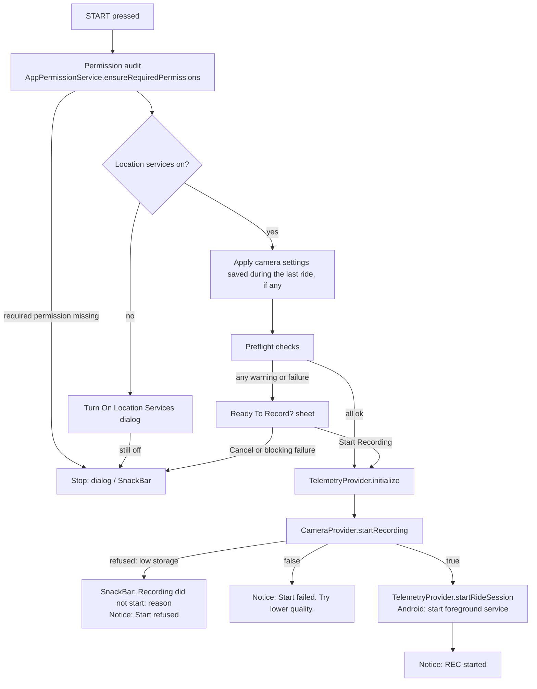

# MotoCam features

This guide describes what a rider can do in MotoCam and what the code does behind each feature, with pointers into the source. It describes the code as it is today, including behaviour that may not be intended; deep dives live in the sibling documents linked from each section. The UI is English only; there is no localization.

## Contents

- [Recording](#recording)
- [Live HUD and telemetry strip](#live-hud-and-telemetry-strip)
- [Incident detection and segment locking](#incident-detection-and-segment-locking)
- [Blackout mode](#blackout-mode)
- [Picture-in-Picture and screen-off recording](#picture-in-picture-and-screen-off-recording)
- [Storage and retention](#storage-and-retention)
- [Rides list](#rides-list)
- [Playback](#playback)
- [Integrity statuses](#integrity-statuses)
- [Export to gallery](#export-to-gallery)
- [Settings overview](#settings-overview)
- [Permissions](#permissions)
- [Platform availability](#platform-availability)

## Recording

The home screen is [recording_screen.dart](../lib/features/recording/recording_screen.dart) (`RecordingScreen`). It coordinates [CameraProvider](../lib/features/camera/providers/camera_provider.dart), [TelemetryProvider](../lib/features/telemetry/providers/telemetry_provider.dart) and the native bridges. Pure helpers (button colours, the lock notice text, the stall and checkpoint trackers) are in [recording_screen_logic.dart](../lib/features/recording/recording_screen_logic.dart). The app is portrait-only. See [recording-pipeline.md](recording-pipeline.md) for the full pipeline.

### Camera unavailable

When camera initialization has been attempted and failed (permission denied, no camera, recordings storage unavailable, or the camera is busy in another app), the preview area names the reason (`CameraProvider.initFailure`, mapped by `cameraInitPanelFor`) instead of a spinner: **Camera permission needed** (Retry and Open Settings), **Microphone denied: grant it or turn off audio** (Retry and Open Settings), **Location permission needed** (setup stopped at the permission audit; Retry and Open Settings), **No camera found** (Retry), **Camera unavailable** (no resolution preset could be opened, usually another app holds the camera; Retry), **Recording storage unavailable** (Retry) and **Camera error** with the error text for anything else (Retry). **Retry** re-runs the permission audit and camera initialization. **Open Settings** opens the app's system settings and retries once the rider comes back. A failed initialization never shows the loading spinner: the spinner is only for an initialization that is pending or running. While idle, returning to the app also re-initializes the camera when the camera (and, with audio on, microphone) permission is granted.

### Start

The **START RECORDING** button runs `_startRecordingFlow`. It ignores the press while a start or stop is already running or while the previous ride is still being saved.

- The permission audit runs on every START. It never opens the battery-optimization system screen; see [Permissions](#permissions).
- "Open Settings" in the permissions dialog and "Open Location Settings" in the location dialog wait until the rider returns to the app (at most 2 minutes) before checking again.
- While the flow runs, the main button reads `STARTING...`. Other states of the same button are `PREPARING CAMERA...`, `SAVING RECORDING...` and `APPLYING SETTINGS...`; the button is disabled in all of them.
- `CameraProvider.startRecording` refuses to start when the platform reports less free space than one segment needs; see [Storage and retention](#storage-and-retention). If recording fails to start at the chosen resolution, `_startVideoRecordingWithFallback` retries at lower resolution presets. The saved settings are not changed by this; the chip bar shows the applied values next to the saved ones.
- If the Android foreground service cannot start, or stops on its own during a recording, recording continues and a SnackBar reads `Background protection unavailable: recording may stop if the app is in the background or the screen turns off.`

### Preflight checks

The screen gathers the platform status in `_buildStartPreflightChecks`, [start_preflight_evaluator.dart](../lib/features/recording/start_preflight_evaluator.dart) (`StartPreflightEvaluator.evaluate`, pure) decides each row, and the result is shown by [start_preflight_sheet.dart](../lib/features/recording/widgets/start_preflight_sheet.dart). If every check is `ok`, no sheet appears. A blocking check that fails disables the sheet's Start button. Warnings never block, and any warning opens the sheet, except the battery-optimization row once its one-time exemption offer has been shown: from then on it is listed only when another row opens the sheet.

| Check | Blocking | Shown when |
|---|---|---|
| Camera Permission | yes | always |
| Microphone Permission | yes | audio recording is enabled |
| Location Permission (when-in-use) | yes | always |
| Location Services | yes | always |
| Camera Ready (controller initialized) | yes | always; the preflight initializes the camera first if needed |
| Media Write Access (writes and deletes a `.__motocam_write_probe.tmp` file in the recordings directory) | yes | always |
| Foreground Notification | no (warning) | Android only |
| Battery Optimization Exemption | no (warning) | Android only |
| Incident Detection ("Unavailable: no motion sensor. Clips are not auto-locked; use LOCK.") | no (warning) | no accelerometer could be opened |
| Battery Level (warning below 15 %) | no | a battery reading exists (Android only in practice) |
| Device Temperature (warning at 43.0 °C or above, battery temperature) | no | a temperature reading exists (Android only in practice) |

Battery and temperature come from the 15 s device-status poll, so they can be up to 15 s old. Thermal status is fetched natively but not checked. The battery-optimization row stays a warning until the rider exempts the app, but after the one-time exemption offer it no longer opens the sheet by itself.

### Stop

Recording stops from the **STOP RECORDING** button or from the **Stop** action on the Android recording notification (`_stopRecordingFlow`). The flow calls `CameraProvider.stopRecording`, which waits for a segment roll in progress, then `TelemetryProvider.stopRideSessionAndPersist`, which hashes the segments on a background isolate and writes the ride's telemetry JSON. The foreground service and its wake lock stay up until the ride is saved and are stopped last. Blackout mode always ends with the stop.

- The notice is `Recording + telemetry saved` (or `Recording saved` when no ride JSON was written). A stop from the notification shows no notice.
- If the ride JSON cannot be written, a SnackBar reads `Telemetry could not be saved. The video was kept.` with a **Retry** action (shown for 20 s). The ride stays in memory until the retry succeeds (`Telemetry saved`). While a retry is saving, the main button reads `SAVING RECORDING...` and START is disabled. Only the failure of the current stop shows Retry: an earlier failed save stays pending in memory without any indicator once a later ride has been saved.
- After the first ride that saves normally from the STOP button, MotoCam may offer the battery-optimization exemption once; see [Permissions](#permissions).

### Recording faults

When recording cannot be restarted after a segment ends (two attempts), a segment stop fails twice in a row or leaves the camera not recording, or storage runs low at a roll, the camera provider records a fault. The screen then stops and saves the ride by itself, shows the notice `Recording stopped` and a SnackBar `Recording stopped: <reason>` followed by `The ride so far was saved.` or `The video recorded so far was kept.` when that is what happened.

### Segments

A ride is recorded as a series of separate video files. A one-shot timer (`_armSegmentTimer`) fires after the segment length (default 5 min; options 5 s to 10 min), and `_rollSegmentIfNeeded` stops the recording, restarts it immediately and registers the finished file while the next one records. Each roll loses about a second of footage between segments: the time taken to stop and restart CameraX. Each finished file is moved from the camera plugin's temporary location into the recordings directory, keeping the plugin's file name (`REC…mp4` on Android), with `_1`, `_2`, … added on a name clash. On Android the two locations are on different mounts, so the file is copied and the original deleted.

Each segment's start and end, measured from the ride start, are stored in the ride's `segmentTimeline`. Once the first segment has been registered, the ride JSON is also written as a checkpoint whenever a segment or a lock is added and every 30 s, so a ride interrupted by a crash or kill keeps its JSON.

### Audio and quality

- Audio is recorded when **Record audio** is on (`enableAudio` on the `CameraController`). Microphone permission is required only in that case. With audio off, the Android camera plugin still opens the microphone and records a muted track.
- Resolution is requested as 480p/720p/1080p/2160p and mapped to a camera `ResolutionPreset` (`CameraProvider.presetForResolution`: 480 to `medium`, 720 to `high`, 1080 to `veryHigh`, 2160 to `ultraHigh`). Presets and frame rates that fail on the device are remembered in memory until the app restarts and are skipped; when every preset fails (for example because another app holds the camera), that memory is cleared so the next attempt retries the rider's choice. While idle with a known-failing resolution saved, an orange notice under the START button reads `Current <n>p is unstable on this device. Recording will auto-fallback to <m>p.`, or asks the rider to choose `<m>p or lower` (or a lower resolution) in Settings when no fallback preset is known.
- The bitrate setting is passed to the camera plugin, but the Android implementation (camera_android_camerax 0.7.2) does not read it. On Android the settings sheet says so under the bitrate field, and the ride's `appliedBitrateMbps` is `null`.

## Live HUD and telemetry strip

Below the preview, `_buildTelemetryStats` shows five tiles. Values shrink to fit at large system font sizes instead of being cut off. While recording, a red `REC` pill sits on the preview; while the segment being recorded is locked (a lock is pending for it) it also shows a lock icon and `LOCKED`. The badge ends when that segment rolls or the recording stops, so a later lock is needed to show it again.

| Tile | Value | Source |
|---|---|---|
| Speed | `<n> km/h`, no decimals | `TelemetryProvider.currentData.speed` (filtered GPS speed; it updates whether or not a ride is active) |
| Duration | `HH:MM:SS` | `CameraProvider.timerStream`, 1 s ticks; frozen after stop, reset at next start |
| Distance | `<x.xx> km` | `TelemetryProvider.rideDistanceKm`; reset at ride start, kept after stop |
| Battery | `<n>%` or `--` | Android `device_status` channel, polled every 15 s |
| Temp | `<t.t> C` or `--` | Battery temperature from the same poll |

Above the preview, a chip bar shows the saved settings (camera name once one has been saved, resolution, FPS, bitrate, audio, segment length x loop, incident sensitivity, speed refresh). When the initialized camera runs at a different resolution or FPS than saved, the chip shows both, for example `720p (set 1080p)` or `30 FPS (set 60)`. Orange lines under the chips report:

- `Incident detection unavailable (no motion sensor): clips are not auto-locked. Use LOCK.`
- `Location is off: no speed, distance or route is recorded.` (while telemetry is running and location services are off)
- `High incident sensitivity may increase auto-lock frequency.` (sensitivity High)

There is no GPS-fix or accuracy indicator on the HUD. Speed and distance internals are in [telemetry.md](telemetry.md).

## Incident detection and segment locking

`TelemetryProvider` reads the gravity-removed accelerometer (`userAccelerometerEventStream` at `SensorInterval.gameInterval`, 20 ms). An incident is recorded when the raw linear-acceleration magnitude stays at or above the trigger for at least two consecutive samples spanning 40 ms or more, and the previous incident is older than the debounce. Devices without a linear-acceleration sensor fall back to the raw accelerometer with gravity removed by a low-pass filter; if no accelerometer works, detection is reported as unavailable (see the HUD and preflight warnings). Detection runs whenever telemetry is running, recording or not. `TelemetryProvider.initialize` starts the accelerometer only if location services are on and location permission is granted, so incident detection depends on location access. While no ride is active, sensors and GPS pause when the app is in the background or Ride History is open. Details: [telemetry.md](telemetry.md).

| Incident sensitivity | Trigger (g) | Debounce |
|---|---|---|
| Low | 4.5 | 10 s |
| Medium (default) | 3.5 | 6 s |
| High | 2.8 | 3 s |

The trigger values have not been calibrated against real riding data.

Locking (`CameraProvider.markIncident`):

- **Automatic.** When `lastIncidentDetectedAt` changes while recording, `RecordingScreen._handleIncidentAutoLock` calls `markIncident(protectPastSegments: 2, protectCurrentSegment: true, reason: 'auto-crash')` at once, also while the app is hidden. Only the feedback (a haptic pulse and the notice) waits for the next frame. The notice reads `Incident detected. Locked: current clip` or `Incident detected. Locked: current clip + <n> previous`.
- **Manual.** The **LOCK** button (enabled only while recording and not stopping) makes the same call with reason `manual-emergency`, gives a haptic pulse (as does an automatic lock) and shows `Locked: current clip` or `Locked: current clip + <n> previous` (`incidentLockNotice`).
- **Effect.** Up to two already-saved segments of the current ride are locked at once. Every segment not yet registered is also marked for locking: the one being recorded and, during a roll, the one still being saved. Repeated calls within one segment lock nothing extra.
- Locked segments are never deleted automatically, in the current ride or in past rides. With gallery export turned on, they are copied to the gallery after the stop (Android; see [Export to gallery](#export-to-gallery)). Detected incidents (not manual locks) are saved in the ride JSON's `incidents` list and shown on the playback seekbar.

## Blackout mode

Blackout hides the preview while recording continues.

- **Enter.** The moon icon in the header is enabled only while recording. `_enterBlackoutMode` calls `CameraController.pausePreview()` and covers the whole screen with a black overlay.
- **Overlay.** Near the bottom, in dim text: a small red dot with `REC HH:MM:SS` (the running elapsed time) and `Hold 2 s anywhere to exit`. In-app notices (for example lock and incident notices) are drawn above the overlay and stay visible. The header toggle is covered.
- **Hold to exit.** Touching the overlay starts a 2 s timer; releasing earlier cancels it and shows `Hold for 2 seconds to exit blackout`. When the timer fires, the phone vibrates, `_exitBlackoutMode` calls `resumePreview()`, removes the overlay and shows `Blackout off`. Moving the finger beyond the tap slop also cancels the hold. Screen readers get a long-press action that exits.
- **Auto-exit.** Blackout ends on any `inactive`, `hidden` or `paused` app lifecycle state (notification shade, a system dialog, PiP, screen off, app switch) and at the end of every stop, including a notification Stop or a failed stop.

## Picture-in-Picture and screen-off recording

PiP and the foreground service are Android-only; see [platform-integration.md](platform-integration.md).

- **Automatic PiP.** `MainActivity.onUserLeaveHint` and `onPause` enter a 9:16 PiP window while recording, on API 26 or later.
- **Explicit PiP.** System back while recording (`PopScope(canPop: !camera.isRecording)`) and the **MINIMISE** button call `PipService.enterPipMode`. The button next to LOCK reads **HISTORY** when idle and **MINIMISE** while recording. `enterPipMode` returns false on API below 26, on devices without the PiP system feature, on iOS, or when the system refuses; the notice `Recording active. Stop first to exit.` then appears.
- **PiP layout.** No camera preview: a blinking red dot with `REC`, the elapsed time and `Return to app for controls`.
- **Foreground service.** After a successful start, `BackgroundRecordingService` runs as a foreground service. On API 30 and later its types are taken from the permissions actually granted (camera, location, microphone); below that the manifest types (camera, microphone, location) apply. It holds a partial wake lock (12 h timeout) and shows an ongoing notification, `MotoCam recording in progress` / `Designed to keep recording with the screen off`, with a running chronometer, a monochrome recording icon and a **Stop** action.
- **Notification Stop.** The service changes the notification to `MotoCam is stopping the recording` / `Saving the ride - open MotoCam to check` and asks the app to run the normal stop flow; the activity's receiver for this request is registered for the whole activity lifetime. The service stays up until the ride is saved. If the app does not stop it within 10 minutes, the service removes itself. Removing the app from recents, or the activity being destroyed, also stops the service. That still ends the recording: the activity and the Flutter engine are destroyed, and the segment in progress is not finalised.
- **Screen-off recording.** The camera plugin binds CameraX to the activity's lifecycle. Once the foreground service has started for a recording, `MainActivity` keeps the lifecycle it gives CameraX at STARTED when the activity stops (screen timeout, power button, Home without PiP), so the camera stays open and recording is designed to continue while the recording notification shows. This has not yet been confirmed on a device. When the service could not start, the camera still closes when the activity stops. PiP keeps the activity started in any case.
- **Keep screen on.** The **Keep screen on while recording** setting (Android, on by default) keeps the display awake while a recording is active, the fallback in case screen-off capture fails on a phone. It applies from START, and at once when changed during a recording; it ends at every stop. The power button still turns the screen off.
- **Stall recovery.** When the rider returns to the app during a recording after 8 s or more with the app hidden or paused (screen off, app in the background), the screen first checks on Android whether the clip file kept growing in the background. If it did, nothing is restarted and a SnackBar reads `Recording continued in the background.` Otherwise (or on iOS, or when the check is inconclusive) `CameraProvider.recoverRecordingPipeline` stops and restarts the recording (adding a segment boundary). A SnackBar reports `Recording was restarted after <n>s in the background in case the video feed stalled.` or, when the restart fails, `Recording resumed from background. If video appears frozen, stop and restart recording.` Time in PiP, under the notification shade or behind a system dialog does not count. See [recording-pipeline.md](recording-pipeline.md).

## Storage and retention

Recordings live in one flat folder, `MotoCam Recordings`, created by `CameraProvider._setupRecordingsDirectory`. The folder is resolved once per process:

| Platform | Base directory |
|---|---|
| Android | `getApplicationSupportDirectory()` (the app's private `files` directory: other apps cannot read it on any Android version, and it is not reachable over USB or with a file manager) |
| iOS | App documents directory |
| Other | App support directory |

If the base directory is unavailable, camera initialization stops and the camera-unavailable panel is shown; nothing is recorded to another folder. On Android the folder holds a `.nomedia` file, and segments are not passed to the media scanner. Recording needs no storage permission. Android backup and device transfer exclude these files, and they are deleted with the app, as before.

**Moving older rides into private storage (Android).** Earlier builds recorded to `Android/data/com.example.motocam/files/MotoCam Recordings` (app-specific external storage, which other apps with the storage permission could read on Android 9 and lower, and which was reachable over USB) and could fall back to `MotoCam Recordings` under the app documents and cache directories. After the update, the app moves those rides into the private folder in the background, whenever it is not recording: a banner in Ride History and on the idle recording screen shows "Moving N rides to private storage (x of N)", then a summary. Each ride keeps its files byte for byte, so its badges (DATA UNMODIFIED, SIGNED ON THIS PHONE, LOCKED) stay; its video check runs again when it is opened. Pressing START pauses the move at once; it continues after the ride stops. A ride whose file names clash with different files already in the private folder, or that would not fit in the free space (for example a large SD card on an old phone), stays in the old folder and is still listed. Only the rides present when the update first runs are moved: files that appear in the old folder later are listed but never moved. What this changes for riders: rides are no longer reachable over USB or with a file manager; use the gallery export to get clips out of the app. The rules are in [data-formats.md](data-formats.md#legacy-roots-and-their-migration). On iOS the folder is in Documents and nothing excludes it from iCloud or device backups. Each ride's telemetry file, `ride_<sessionId>.telemetry.json`, is written as checkpoints during the ride and completed at stop. Formats: [data-formats.md](data-formats.md).

**Importing rides from v0.1.11 and v0.1.12 (Android).** Those versions recorded to the public folder `Movies/MotoCam/Recordings`, where other apps can read the videos and the ride files with their GPS routes, and where they stay after MotoCam is uninstalled. This install usually cannot see them, so Ride History has a menu action, **Import rides from an older version**. It explains the folder, opens the system folder picker there (tap "Use this folder" and allow access; the access is not kept), refuses any other folder (naming the folder picked, nothing is imported), and copies every video and ride file into private storage, videos first and each ride file last, byte for byte, so each ride keeps its badges and lock. A line under the app bar shows "Importing rides from the old folder (x of N)". Files already imported (same name and size) are counted as such; a ride whose file names clash with different files is skipped. It never runs while recording or while rides are being moved, and pressing START stops it (import again to continue). The summary SnackBar lists the rides imported, imported before, skipped and failed. After a complete import a dialog asks, with Keep originals as the default, whether to delete the imported originals from the old folder; only files that were imported are deleted, and any that could not be deleted are named. Imported rides read the same whether or not the originals are still there.

What gets deleted, and when:

| Rule | When it runs | What it deletes |
|---|---|---|
| Per-session loop (`_registerCompletedSegment`, `selectSegmentsToEvict`) | Each time a segment is registered | While the ride holds more **unlocked** segments than the loop buffer size (default 24), the oldest unlocked segment of the ride. Locked segments do not count and are never selected. The newest segment is always kept. |
| Orphan telemetry prune (`_pruneOrphanTelemetryFiles`) | 2 s after each stop, on a background isolate | Telemetry JSON files whose `segmentPaths` is empty or none of whose segments exists (at the stored path or under the same name next to the JSON). Files that list locked segments, or cannot be parsed, are kept. |
| Stale write temp files (`pruneStaleTelemetryTempFiles`) | Once per process, when the folder is set up | Temporary files of interrupted telemetry writes, older than 10 minutes. |
| Storage budget (off by default; setting "Storage budget for all rides": Off, 4, 8, 16, 32 or 64 GB) | While recording: 5 s after START and 3 s after each segment roll, only while no migration or import runs | When all rides in the recordings folder together exceed the budget, whole rides, oldest first, until they fit. Never a ride with a locked segment, the ride being recorded (by its id and its segment files), a ride with quarantined paths, a ride that the move to private storage or an import left half-moved, any video without a ride file while a ride file in the folder cannot be read, or anything outside the folder (old folders, gallery copies). If those alone exceed the budget, nothing is deleted. One SnackBar per recording, for example "Storage budget: deleted 2 oldest unlocked rides (3.1 GB)." |

Free space:

- Before START and before each roll, the free space on the recordings volume (native `getAvailableStorageBytes`) must cover one more segment: the segment length at the higher of the requested bitrate and 20 Mbps, plus a 100 MB margin. At a roll, the space the loop is about to free counts toward the margin.
- START is refused with `Storage is almost full. Free up space on the phone to keep recording.` At a roll, the same message ends the recording as a [fault](#recording-faults) and the ride is saved.
- When the platform does not report free space (iOS has no native handler), the check never blocks.

Consequences:

- With the storage budget off (the default), earlier rides are never deleted automatically, by age, size or count; the rider deletes them in Ride History. With it on, only whole unlocked rides are deleted, oldest first, and the free-space stop stays the hard limit.
- Gallery copies are removed only when the rider confirms it in Ride History (see [Export to gallery](#export-to-gallery)); no automatic deletion, the storage budget included, touches them. Files left in the camera plugin's temporary folder (such as the segment in progress when the app is killed) are never cleaned up. The on-device map tile cache (up to 25 MB) is not cleared with ride history.
- If the app is killed during a ride, the segments already registered stay on disk and the last checkpoint keeps the ride JSON; the ride appears in history marked `RECOVERED (INCOMPLETE)`. A ride killed before its first segment was registered has no JSON. Video files that no ride JSON lists appear as separate `VIDEO ONLY (RECOVERED)` entries.

## Rides list

[rides_list_screen.dart](../lib/features/history/rides_list_screen.dart) (`RidesListScreen`, title "Ride History") opens from the **HISTORY** button when not recording. The recording screen releases the camera and pauses idle telemetry first, and re-initializes both on return.

- The list is built on a background isolate (`loadRideHistoryIndexed` in [ride_history_loader.dart](../lib/features/history/models/ride_history_loader.dart)): every `*.telemetry.json` file becomes a ride without its samples, taken from the ride index when the file is unchanged and decoded otherwise (`RideRecord.fromTelemetryFile`), and video files that no ride references become video-only rides (`RideRecord.fromVideoFile`). Rides are sorted newest first. The index is a cache in the app's support directory and can be deleted at any time ([data-formats.md](data-formats.md#ride-index-cache)).
- A **Locked Clips** section lists rides with any locked segment; **All Rides** lists the rest.
- Each card is titled with the ride's date and time, with the video file name under it. Badges, as shown in the UI:
  - `VIDEO ONLY (RECOVERED)`: a video with no ride JSON.
  - One of `INTEGRITY WARNING`, `SIMULATED GPS`, `SIGNED ON THIS PHONE`, `DATA UNMODIFIED` or `UNVERIFIED`; see [Integrity statuses](#integrity-statuses).
  - `VIDEOS VERIFIED` or `VIDEO CHECK FAILED`: the result of the segment checks stored when the ride was opened or unlocked. Nothing is hashed in the list.
  - `QUARANTINED n`: segment paths outside the recordings folder.
  - `INCOMPLETE`: some listed segment files are missing.
  - `RECOVERED (INCOMPLETE)`: the JSON is a checkpoint; the app stopped before the ride was saved normally.
  - `LOCKED`.
- The card also shows distance, duration, `Video: <kept> of <duration> kept` when loop deletion removed part of the ride's video, max and average speed, `Segments: n` (or `Segments: a of n available`), sample count, the integrity line, a video check line ("Videos verified: unmodified since recording", "Videos not checked yet (open the ride to check)", "Videos: k of n segments checked, no failure so far (open the ride to finish)" or "Videos: f of n segment(s) failed the check") and whether telemetry is available.
- **Unlock clip** (locked rides only) asks `Unlock this clip?` first. Unlocking only removes the lock marker, and the ride moves from Locked Clips to All Rides. The dialog says past rides are never deleted automatically, or, with the storage budget on, that an unlocked ride can be deleted automatically once it is among the oldest. `RideRecord.setLockState(false)` re-reads and fully re-verifies the ride, including segment hashes (segments with a still-valid stored result are not hashed again), and refuses when any check fails. A progress ring counts the checked segments. The SnackBar reads `Clip unlocked.` or `Could not unlock this clip: its files failed the integrity check or could not be saved.` The button is disabled for rides with an integrity warning, quarantined paths or a stored failed video check. After an unlock, the ride's queued gallery copies are cancelled, and a ride with gallery copies that MotoCam recorded gets the offer to remove them (default: keep; Android). Unlock and delete wait while the ride is being saved to the gallery or its copies removed.
- **Delete ride** asks `Delete this ride?` and then deletes the ride's segment files, main video and telemetry JSON (never quarantined paths or files outside the ride's folder) through the same routine as the storage budget, which also updates the ride index, the signed-ride registry and the gallery-link store. When the ride has gallery copies that MotoCam recorded (Android), it first offers to remove them (default: keep); see [Export to gallery](#export-to-gallery). A locked ride must be unlocked first. A locked ride that cannot be unlocked (integrity warning or quarantined paths) can still be deleted after the dialog warns about it.
- **Import rides from an older version** (Android, app bar menu): see [Storage and retention](#storage-and-retention).
- **Gallery menu** (Android, the "more" button on every card): **Save to gallery** and, for a ride with gallery copies, **Remove gallery copies**; a card with copies shows `Gallery copies: n (readable by other apps)`. See [Export to gallery](#export-to-gallery).
- Pull to refresh reloads the list (not available when it is empty). There is no share action.

## Playback

[ride_playback_screen.dart](../lib/features/history/ride_playback_screen.dart) (`RidePlaybackScreen`) plays a ride's segments as one timeline. The timeline logic is in [playback_timeline.dart](../lib/features/history/widgets/playback_timeline.dart). Details: [playback-and-history.md](playback-and-history.md).

- **Multi-segment.** Segment offsets and lengths come from the stored `segmentTimeline`; only segments without a usable stored length are probed by opening them. Segments play one at a time, each in a new `VideoPlayerController` that replaces the previous one, advancing automatically when one completes. The next segment is not preloaded. A segment that fails during playback is skipped.
- **No playable video.** When no segment can be opened, the screen shows `No playable video for this ride` (with the missing and unreadable counts) or `This ride has no video segments.`, with **Back** and **Retry**.
- **Seekbar.** `PlaybackSeekbarTrackShape` paints ranges and markers inside the slider track, and a legend under it names those present:
  - `Missing segment` (red): declared segments that are missing or unreadable. A SnackBar reports `Some ride segments are unavailable (<n> missing, <m> unreadable). They are marked red on the seekbar and skipped.`
  - `Failed integrity check` (purple): segments that could not be confirmed unmodified. They still play.
  - `No video` (grey): spans of the ride without footage, for example the start of a long ride removed by loop deletion.
  - `Incident` and `Locked` markers.
  Seeking into a missing range or gap lands at the start of the next playable segment, or reports `No playable video at <time> or later.`
- **Controls.** Seekbar scrub, -10 s / play-pause / +10 s, a `Segment i/n` counter and a fullscreen toggle (tap the video). Tapping the seekbar near a marker jumps to it (`Jumped to incident marker at <time>`). No playback-speed control. Playback pauses when the app leaves the foreground and does not resume by itself.
- **Telemetry.** When the ride has samples, an overlay shows `Speed`, `Dist`, `G` and `GPS` for the sample interpolated at the current position (`RideRecord.sampleForPosition`). A speed graph covers a 10 to 60 s window around the current time and can be tapped or dragged to seek. The segment timeline and the samples share the ride's start time as their zero point.
- **Markers.** Incident markers come from the ride's saved `incidents`. Rides saved without that list fall back to markers recomputed from the samples with a fixed 3.2 g threshold and 5 s spacing, independent of the sensitivity setting. Lock markers sit at the start of each locked segment. Markers appear on the seekbar and as ticks on the speed graph.
- **Simulated GPS.** When any fix of the ride came from a mock location provider, a SnackBar on open says `GPS in this ride came from a simulated (mock) location provider.`

### Route map

When the ride has samples, a collapsible **Route Map** card ([route_map_view.dart](../lib/features/history/widgets/route_map_view.dart)) draws the route on OpenStreetMap tiles, with start, end and current-position markers and a `GPS fixes: <n>` label. Samples without a GPS fix are left out. The map does not follow the current position.

- **Consent.** Until the rider has agreed, expanding the card first opens a dialog `Show online map?` that explains that tiles are downloaded from `tile.openstreetmap.org`, which sends the ride's area and the IP address to the OpenStreetMap Foundation, and that tiles are cached on the device. **Not now** keeps the card collapsed; **Show map** stores the consent. The map is built, and tiles are requested, only while the card is expanded.
- **State.** The expanded or collapsed state is saved and restored on the next playback (only once consent was given). Both preferences are listed in [settings.md](settings.md).
- **Offline.** The map background is dark; when tiles fail to load, a `Map tiles unavailable (offline?)` badge appears. Zoom is capped at level 19.
- **Attribution.** flutter_map's attribution button (an info icon, bottom right) opens a box with `© OpenStreetMap contributors` (and the flutter_map credit). Tapping that line opens `https://www.openstreetmap.org/copyright` in the browser (`url_launcher`); if no browser can be started, a SnackBar names the address. The recording settings sheet ends with an **About and licences** entry that opens Flutter's licence page, which includes the OpenStreetMap data notice.
- Rides with fewer than two GPS fixes show a static fallback that needs no network, or `No GPS fix recorded for this ride`.

## Integrity statuses

`TelemetryProvider` stores an `integrity` envelope in every ride JSON it writes, checkpoints included. It holds a SHA-256 of each segment file and a SHA-256 of the canonicalized JSON payload together with the rest of the envelope, so the segment hashes are covered by the payload hash. On Android the final save at stop also carries a signature of that payload hash by a key that never leaves this phone's Android Keystore (envelope version 3); checkpoints, iOS rides and a save that could not be signed are not signed. `RideRecord` checks it with the ride-file codec (`checkRideIntegrity` in [ride_integrity.dart](../lib/core/ride_file/ride_integrity.dart)) and produces exactly one of three statuses ([ride_record.dart](../lib/features/history/models/ride_record.dart)):

| Status | Meaning |
|---|---|
| `unknown` | The file has no `integrity` object, and either predates the format that requires one or is marked incomplete (`sessionComplete: false`). Video-only rides are also `unknown`. |
| `verified` | No issue was found by the checks that ran. In the rides list, that means the payload hash, the envelope algorithm and version, the signature of a version 3 envelope, a recorded hash for every segment on disk, and no orphan hash keys. Segment files are not hashed there. |
| `modified` | At least one check failed, the envelope is missing from a completed ride that requires one, or the ride has quarantined paths. The checks and their issue codes are listed in [data-formats.md](data-formats.md#integrity-envelope). |

The rides list shows the status like this:

| Badge | Integrity line |
|---|---|
| `SIGNED ON THIS PHONE` (`verified`, signed with this phone's current key) | `Integrity: ride data unmodified and signed by this phone's MotoCam key (it shows no edit by anyone without that key; it does not prove the footage is genuine)` |
| `DATA UNMODIFIED` (`verified`) | `Integrity: ride data unmodified since recording`; for a signed ride `Integrity: ride data unmodified; signed by another phone or an earlier install of MotoCam`, or, when this phone's key could not be read, `Integrity: ride data unmodified; signed, but this phone's key could not be read to check by whom` (the video check line and badge follow it) |
| `INTEGRITY WARNING` (`modified`) | `Integrity: check failed`, or `Integrity: check failed (this phone signed this ride, but the signature was removed or replaced)` |
| `UNVERIFIED` (`unknown`, with a ride JSON) | `Integrity: not available (recorded by an older version)` or `Integrity: not available (ride was not saved completely)` |
| none (video-only ride) | `Integrity: not available` |
| `SIMULATED GPS` (replaces `SIGNED ON THIS PHONE`, `DATA UNMODIFIED` and `UNVERIFIED`) | The line above, followed by `GPS came from a simulated (mock) location provider.` |

- **Missing files.** A segment file that no longer exists is not an integrity failure. It is reported as `INCOMPLETE` and in the segment count.
- **Quarantine.** The only trusted root is the folder the telemetry file was found in. Fields of the JSON itself, such as `storageDirectory`, are never trusted. A stored path whose file no longer exists is resolved to the file of the same name in that folder, when there is one (for example after the iOS app container moved). Other paths outside the folder are dropped from playback and counted in the `QUARANTINED n` badge, which always comes with `modified`.
- **Full check.** Opening playback hashes the segments one at a time on background isolates, starting with the segment about to play; leaving the screen stops after the segment in flight. Results are stored in the ride index, so an unchanged segment is not hashed again, and the app bar's **Check videos again** action re-hashes every segment. A failed segment is marked purple as soon as it is found. Findings appear in one SnackBar starting `Integrity check:`, for example `this phone signed this ride, but its signature was removed or replaced, so the ride data may have changed since recording`, `the ride's signature does not match its data`, `the ride data may have changed since recording`, `<n> segments could not be confirmed unmodified since recording (marked purple on the seekbar)` or `<n> segment paths outside the recordings folder were skipped`. A ride without an envelope shows `This ride has no integrity record, so its files cannot be checked.` Issue codes are never shown verbatim. Back in the list, the ride's video check badge and line show the stored result.
- **Signed rides.** The signature shows that the files were not changed by anyone without this app's key on the recording phone: an edit that recomputes the hashes no longer matches the signature, and the recording install remembers which rides it signed, by id, telemetry file name and segment file names (`signature-removed` when one comes back unsigned or signed by another key, also when its id was edited). Unlocking a ride signed on this phone signs it again; if that fails, the ride stays locked, the file is untouched and the list says the ride could not be signed again.
- **What it does not guarantee.** The signature does not prove the footage is genuine: a rooted phone or a modified app can sign anything. A ride shows as signed only on the phone and install that recorded it; a copy on another phone shows only as `DATA UNMODIFIED`, and there it could be stripped back to an unsigned file unnoticed. A reinstall creates a new key, so older rides then show as signed by another key, and the record of signed rides starts empty. iOS rides are not signed, and unsigned rides (older versions, checkpoints, saves that could not be signed) keep only the checksum, which anyone who can rewrite the files can recompute. On the recording phone, a ride whose id, telemetry file and every segment file were all renamed counts as deleted and replaced by an unsigned ride, and an older genuine signed version of a ride (for example from before an unlock) written back over the current one still shows as signed. On iOS the lock state of a ride signed elsewhere cannot be changed. Every signed ride carries the install's public key, so ride files shared from one install can be linked to each other; a reinstall changes the key.

## Export to gallery

Android only. A gallery copy is a public copy of a video segment in `Movies/MotoCam/Recordings`: other apps can read it, it includes the audio when it was recorded, and it stays on the phone when MotoCam is uninstalled. The ride's telemetry JSON (the GPS route) is never copied. There are two ways to make copies:

- **Automatic, opt-in.** The settings sheet switch **Copy locked clips to gallery** is off by default. When it is on, the ride's locked segments are written to a saved export queue at stop and copied about 2 s later. If the app is killed before they are copied, they are copied at the next launch (when nothing records), exactly once. Copies a recording paused are made after the next stop.
- **Save to gallery.** In Ride History, the ride's menu offers **Save to gallery** for any ride, locked or not, whatever the switch says. A dialog explains what a gallery copy means first; a progress ring counts the segments; a summary such as `Saved 3 segments to Movies/MotoCam/Recordings; 1 segment already in the gallery.` follows. Segments already in the gallery are not copied again (one deleted in a gallery app is copied again).

How copies are made (`exportVideoToGallery` on the `media` channel, through the persisted queue in the gallery-link store; see [platform-integration.md](platform-integration.md#media-scanning-and-gallery-export)):

- API 29 and later: inserted through MediaStore. A failed copy removes its unfinished MediaStore item.
- Below API 29: copied into `Movies/MotoCam/Recordings` on shared storage under a hidden temporary name, then renamed (never over another file) and media-scanned, so a copy cut short by a killed app never shows in the gallery; the private recording is never scanned. This needs the storage permission: the permission audit asks for it when the switch is on, Save to gallery asks when a copy is refused for lack of it, and a denial is explained in the summary (`... not saved: storage access was denied. Allow Storage for MotoCam in the phone's settings to save to the gallery.`). The launch retry never asks, and a clip it cannot copy for lack of the permission stays queued without using up its three tries.
- After an automatic export run, a SnackBar summarizes it, for example `2 locked clips copied to the gallery.`, `1 locked clip not copied (storage permission denied).` or `1 locked clip could not be copied to the gallery.` A failed copy is tried again at the next run, up to three times.

**Removing copies.** MotoCam stores each copy's content URI (in `gallery_links.json`, outside the ride file, which stays unchanged). When a ride with copies is unlocked, before it is deleted, and from **Remove gallery copies** in its menu, Ride History asks `Remove N gallery copies?` with **Keep copies** as the default. **Remove copies** deletes them without a prompt where it can (MotoCam owns what it inserted); when Android requires consent, one system prompt covers all of the ride's copies (Android 11 and later; one prompt per copy on Android 10), and on Android 9 and lower the storage permission is asked for. A copy already gone counts as removed. The SnackBar says what was not removed. Removing copies also cancels the ride's copies still queued. Copies made by versions before this one were not recorded and are not offered; neither are copies of a deleted ride the rider chose to keep. A copy that finishes after its ride was deleted or unlocked, or after its copies were removed, is deleted at once. Retention, the storage budget, the migration and the import never touch gallery copies.

## Settings overview

The gear icon opens [recording_settings_sheet.dart](../lib/features/recording/widgets/recording_settings_sheet.dart). Values are persisted by [AppSettingsProvider](../lib/core/providers/app_settings_provider.dart). The full reference, with keys and validation, is in [settings.md](settings.md).

| Setting (sheet label) | Default | Options |
|---|---|---|
| Quality group / Recording quality preset | Balanced / `1080p / 30 FPS / 8 Mbps` | Balanced or High Detail presets, or Custom |
| Camera lens | first back camera | cameras reported by the device (the field is hidden when the list is empty) |
| Recording resolution | 1080p | 480p, 720p, 1080p, 4K (2160p). Resolutions known to fail on this device are greyed out as `(unsupported)` and listed under the field |
| Frame rate (FPS) | 30 | 24, 30, 60 (minus rates that failed). If the saved rate is no longer offered, the sheet starts at 30 (or the last offered rate) |
| Video bitrate | 8 Mbps | 4, 8, 12, 16 Mbps. On Android: "No effect on this device: the Android camera plugin records at its own bitrate for the chosen resolution." |
| Segment length | 5 min | 5 s to 10 min |
| Loop buffer size | 24 segments | 6, 12, 18, 24, 36, 48 (unlocked segments kept per ride) |
| Storage budget for all rides | Off | Off, 4, 8, 16, 32, 64 GB ("When recordings exceed it, the oldest unlocked rides are deleted while you record. Locked rides are never deleted."). Takes effect at the next START |
| Speed UI refresh | 100 ms | 100, 200, 300, 500 ms (throttles GPS- and accelerometer-driven UI updates) |
| Incident sensitivity | Medium | Low (fewer auto-locks), Medium, High (more auto-locks) |
| Record audio | on | on/off ("Disable for lower CPU and storage usage") |
| Copy locked clips to gallery (Android only) | off | on/off |
| Keep screen on while recording (Android only) | on | on/off ("Recording is designed to continue with the screen off, but this is not yet confirmed on every phone. Keeping the screen on is the safe fallback; it uses more battery.") |

- **SAVE SETTINGS** persists every value first, then applies them. While that runs, the main button reads `APPLYING SETTINGS...` with "Applying settings... camera controls are temporarily locked." under it, and START/STOP, HISTORY, the gear and the blackout toggle are disabled. The gear is also disabled while a recording starts or stops.
- Camera settings are applied by re-initializing the camera, and only when idle. The outcome is a SnackBar: `Settings applied: ...`, `Requested <n>p is not supported on this device. Applied <m>p ...` when the camera fell back, or `Unable to initialize camera with the selected settings on this device.`
- Saved while recording, settings are persisted and shown in the chip bar, the camera keeps its current configuration, and the SnackBar reads `Camera settings saved. They apply to the next recording.` They are applied before the next START's preflight. Telemetry settings (speed refresh, incident sensitivity) apply at once.
- The saved values are never overwritten with what the camera negotiated.

## Permissions

Requested by `AppPermissionService.ensureRequiredPermissions` ([app_permission_service.dart](../lib/core/services/app_permission_service.dart)) at launch and on every START. Every permission that is not granted is requested again, including ones the plugin reports as permanently denied. `CameraProvider.initializeCamera` also requests camera and, when audio is on, microphone. Manifest details and native behaviour: [platform-integration.md](platform-integration.md).

| Permission | Requested | Why |
|---|---|---|
| Camera | required | Video recording |
| Microphone | required only if audio is on | Audio track |
| Location when in use | required | Speed, distance, route, and starting the accelerometer. During a ride the location-type foreground service keeps GPS working in the background; no background-location permission is requested |
| Notifications (Android) | recommended | Visible foreground-service notification |
| Storage (Android 9 and lower) | recommended, only when gallery export is on; also asked by Save to gallery and by the removal of gallery copies when needed | Writing and deleting gallery copies in shared storage |
| Battery optimization exemption (Android) | never requested automatically | Offered once, see below |

- A missing required permission shows the **Permissions Required** dialog (Later / Request Again / Open Settings) and blocks START. Its note about permanently denied permissions lists only required ones.
- Missing recommended items are listed in a SnackBar, `Recommended for reliable background recording: ...`. The battery-optimization exemption is listed there until it has been offered.
- **Battery-optimization offer.** After a ride is saved from the STOP button, if the app is not exempt and the offer was never made, a dialog `Keep recording with the screen off?` explains the trade-off. **Open setting** opens the system screen; **Not now** closes it. The offer is recorded before the dialog opens and is never repeated, whatever the answer.

The Android manifest also declares the foreground-service permissions (camera, microphone, location), wake lock, the battery-optimization request, internet (map tiles), network state, an app-internal broadcast permission, and `WRITE_EXTERNAL_STORAGE` up to API 28. iOS declares usage strings for camera, microphone, location when in use and motion, and the `location` background mode.

## Platform availability

Based on the platform checks in the code today. In the iOS column, "Yes" means the Dart code path is not platform-gated, not that it works. iOS has no native method-channel handlers, so the iOS rows describe code paths only. See [platform-integration.md](platform-integration.md).

| Feature | Android | iOS |
|---|---|---|
| Segmented recording, loop deletion, locking | Yes | Yes (Dart only). Nothing disables the idle timer, so Auto-Lock interrupts the capture session during a ride |
| Low-storage refusal | Yes | No (free space is not reported, so it never blocks) |
| Speed, distance, duration tiles | Yes | Yes (Dart only) |
| Battery and temperature tiles, battery/temperature preflight rows | Yes | No (`--`; rows omitted) |
| Notification and battery-optimization preflight rows, battery-optimization offer | Yes | No (omitted) |
| Incident detection and auto-lock | Yes | Yes (Dart only; needs location permission) |
| Blackout mode | Yes | Yes (Dart only) |
| Picture-in-Picture | API 26+ with the PiP system feature | No (`Recording active. Stop first to exit.`) |
| Foreground service, notification Stop, wake lock | Yes | No |
| Stall recovery on resume | Yes | Yes (Dart lifecycle logic) |
| Gallery export (automatic opt-in, Save to gallery, removal of copies) | Yes | No (the switch and the menu are hidden) |
| Rides list, delete, playback, route map, integrity checks | Yes | Yes (Dart only) |
| Storage budget | Yes | Yes (Dart only) |
| Import rides from an older version | Yes (Storage Access Framework) | No (the menu is not shown) |
