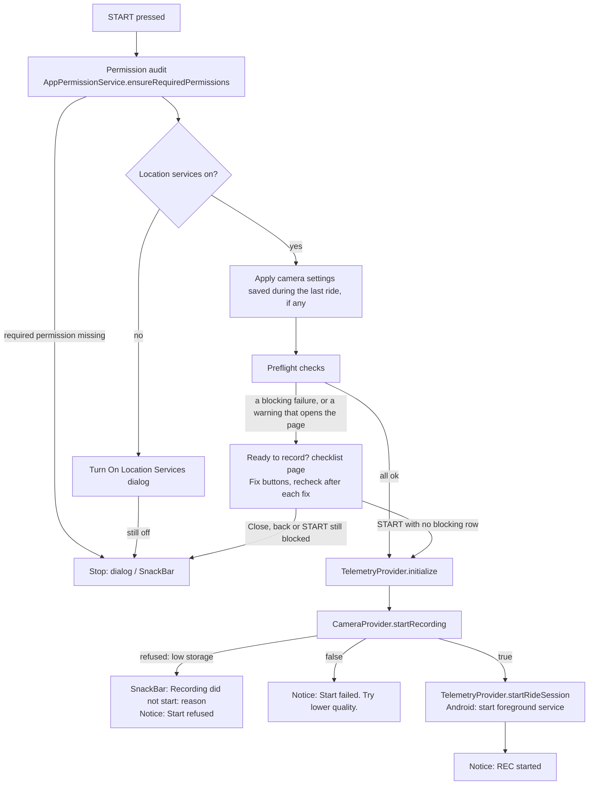

# MotoCam features

This guide describes what a rider can do in MotoCam and what the code does behind each feature, with pointers into the source. It describes the code as it is today, including behaviour that may not be intended; deep dives live in the sibling documents linked from each section. The UI is English only; there is no localization.

## Contents

- [Recording](#recording)
- [Live HUD and telemetry strip](#live-hud-and-telemetry-strip)
- [Incident detection and segment locking](#incident-detection-and-segment-locking)
- [Blackout mode](#blackout-mode)
- [Picture-in-Picture and screen-off recording](#picture-in-picture-and-screen-off-recording)
- [Storage and retention](#storage-and-retention)
- [Rides list](#rides-list)
- [Playback](#playback)
- [Integrity statuses](#integrity-statuses)
- [Export to gallery](#export-to-gallery)
- [Export to folder and share](#export-to-folder-and-share)
- [Settings overview](#settings-overview)
- [Permissions](#permissions)
- [Platform availability](#platform-availability)

## Recording

The home screen is [recording_screen.dart](../lib/features/recording/recording_screen.dart) (`RecordingScreen`). It coordinates [CameraProvider](../lib/features/camera/providers/camera_provider.dart), [TelemetryProvider](../lib/features/telemetry/providers/telemetry_provider.dart) and the native bridges. Pure helpers (button colours, the lock notice text, the stall and checkpoint trackers) are in [recording_screen_logic.dart](../lib/features/recording/recording_screen_logic.dart). The app is locked to portrait unless built with the landscape recording switch (`--dart-define=MOTOCAM_LANDSCAPE=true`, off by default). With it on, the UI follows the phone's orientation while no ride runs (Ride History, playback and Settings too) and keeps a ride's orientation from START to STOP, and the recording screen has its own landscape layout: a rail with Rides and Settings (Dark and Pop-out while recording), the chips, details and live view in the middle, and START, or STOP above the big LOCK, under the right thumb (see [recording-pipeline.md](recording-pipeline.md#camera-initialization)). A portrait window shorter than about 680 dp (a split screen, for example) gets smaller START and LOCK buttons and scrolls. The whole app is drawn in one dark look, "Instrument": the Barlow and Barlow Condensed fonts, a fixed set of colour tokens and a small kit of large, glove-friendly components (see [architecture.md](architecture.md#theme-and-component-kit)). The screens in this guide follow it; control labels that the phone test harness reads (`START RECORDING`, `STOP RECORDING`, `HISTORY`, `LOCK`, `Settings`, `SAVE SETTINGS`, the checklist's `Start Recording`) keep their old accessibility text while the visible words are shorter. See [recording-pipeline.md](recording-pipeline.md) for the full pipeline.

### Camera unavailable

When camera initialization has been attempted and failed (permission denied, no camera, recordings storage unavailable, or the camera is busy in another app), the preview area names the reason (`CameraProvider.initFailure`, mapped by `cameraInitPanelFor`) instead of a spinner: **Camera permission needed** (Retry and Open Settings), **Microphone denied: grant it or turn off audio** (Retry and Open Settings), **Location permission needed** (setup stopped at the permission audit; Retry and Open Settings), **No camera found** (Retry), **Camera unavailable** (no resolution preset could be opened, usually another app holds the camera; Retry), **Recording storage unavailable** (Retry) and **Camera error** with the error text for anything else (Retry). **Retry** re-runs the permission audit and camera initialization. **Open Settings** opens the app's system settings and retries once the rider comes back. A failed initialization never shows the loading spinner: the spinner is only for an initialization that is pending or running. While idle, returning to the app also re-initializes the camera when the camera (and, with audio on, microphone) permission is granted.

### Start

The **START RECORDING** button runs `_startRecordingFlow`. It ignores the press while a start or stop is already running or while the previous ride is still being saved.

- The permission audit runs on every START. It never opens the battery-optimization system screen; see [Permissions](#permissions).
- "Open Settings" in the permissions dialog and "Open Location Settings" in the location dialog wait until the rider returns to the app (at most 2 minutes) before checking again.
- While the flow runs, the state band reads STARTING and the main button shows STARTING. Other busy words are PREPARING (the camera is getting ready), SAVING (a stop or a ride save is running) and APPLYING (saved settings are being applied); the button is disabled in all of them. Its accessibility label keeps the long text: `STARTING...`, `PREPARING CAMERA...`, `SAVING RECORDING...` and `APPLYING SETTINGS...`.
- `CameraProvider.startRecording` refuses to start when the platform reports less free space than one segment needs; see [Storage and retention](#storage-and-retention). If recording fails to start at the chosen resolution, `_startVideoRecordingWithFallback` retries at lower resolution presets. The saved settings are not changed by this; the profile chip shows the applied values, and the details panel names the ones that were asked for.
- If the Android foreground service cannot start, or stops on its own during a recording, recording continues and a SnackBar reads `Background protection unavailable: recording may stop if the app is in the background or the screen turns off.`

### Preflight checks

The screen gathers the platform status in `_buildStartPreflightChecks`, [start_preflight_evaluator.dart](../lib/features/recording/start_preflight_evaluator.dart) (`StartPreflightEvaluator.evaluate`, pure) decides each check, and [start_preflight_sheet.dart](../lib/features/recording/widgets/start_preflight_sheet.dart) shows the result as the **Ready to record?** checklist: a full-screen page (`showStartPreflightPage`) pushed over the recording screen. A check `ok` everywhere means no page. A blocking check that fails always opens it and keeps its START button disabled. A warning never blocks, and it opens the page only when its check has `opensSheet` set. Incident detection, battery level and the phone temperature never open it by themselves, because the rider cannot fix them before START; they are listed only when the page opens for another check. The battery-optimization row opens it until the one-time exemption offer has been shown, and from then on only when another row does.

| Check | Blocking | Shown when |
|---|---|---|
| Camera Permission | yes | always |
| Microphone Permission | yes | audio recording is enabled |
| Location Permission (when-in-use) | yes | always |
| Location Services | yes | always |
| Camera Ready (controller initialized) | yes | always; the preflight initializes the camera first if needed |
| Media Write Access (writes and deletes a `.__motocam_write_probe.tmp` file in the recordings directory) | yes | always |
| Foreground Notification | no (warning) | Android only |
| Battery Optimization Exemption | no (warning) | Android only |
| Incident Detection ("Unavailable: no motion sensor. Clips are not auto-locked; use LOCK.") | no (warning) | no accelerometer could be opened |
| Battery Level (warning below 15 %) | no | a battery reading exists (Android only in practice) |
| Device Temperature (warning at 43.0 °C or above, battery temperature) | no | a temperature reading exists (Android only in practice) |

**The page.** Under the title `Ready to record?` and a Close button, the checks are grouped into rows in this order: **Permissions**, **Camera**, **Storage**, **GPS**, **Battery**, **Notification**, **Crash detection**, then any other check under its own title. A group whose checks are all OK is one row with a summary (for the permissions, for example `Camera, microphone, location`). A group with a check that is not OK shows one row per such check with that check's text, and its OK checks are not repeated. A row shows a check mark (OK), a block mark (`Blocks START`) or a warning mark (`Needs attention`). The phone temperature is not a row: it is a chip above the rows (`Phone temperature normal` or `Warm`, with the reading, for example `43.0 C`; it never blocks).

- **Fix buttons.** A row that the rider can fix has a **Fix** button: the permission rows open the app's system settings, the GPS row opens the location settings, the Camera row initializes the camera again, the Notification row opens the app's system settings and the Battery row asks the system to exempt MotoCam from battery optimization, only on that tap. Each fix waits until the rider is back in the app (at most 2 minutes), then the checks are evaluated again and the rows are replaced; while that runs, the buttons are disabled and START reads `Checking again...`. A fixed blocking row therefore enables START without leaving the page.
- **START.** A 170 dp button under the rows, with a caption: `Blocked. Fix <names> to start.` while a blocking row is open (the button is grey and disabled), `All checks OK.`, or `n item(s) open. Recording still works.` It completes the flow only when no blocking row is open at that moment. Close and the system back gesture end the flow without recording. Its accessibility label is `Start Recording`.
- A note under the rows says that the page opens by itself only for things the rider can fix now.

Battery and temperature come from the 15 s device-status poll, so they can be up to 15 s old. The checklist's temperature check uses the battery temperature only; the recording screen's thermal chip also reads the platform thermal status (see [Live HUD and telemetry strip](#live-hud-and-telemetry-strip)).

### Stop

Recording stops from the **STOP** button (one tap; the press-and-hold variant exists in the component kit but is switched off, see `kHoldToStop` in [architecture.md](architecture.md#build-flags)) or from the **Stop** action on the Android recording notification (`_stopRecordingFlow`). The flow calls `CameraProvider.stopRecording`, which waits for a segment roll in progress, then `TelemetryProvider.stopRideSessionAndPersist`, which hashes the segments on a background isolate and writes the ride's telemetry JSON. The foreground service and its wake lock stay up until the ride is saved and are stopped last. Blackout mode always ends with the stop.

- The notice is `Recording + telemetry saved` (or `Recording saved` when no ride JSON was written). A stop from the notification shows no notice.
- If the ride JSON cannot be written, a SnackBar reads `Telemetry could not be saved. The video was kept.` with a **Retry** action (shown for 20 s). The ride stays in memory until the retry succeeds (`Telemetry saved`). While a retry is saving, the band and the main button read SAVING and START is disabled. Only the failure of the current stop shows Retry: an earlier failed save stays pending in memory without any indicator once a later ride has been saved.
- After the first ride that saves normally from the STOP button, MotoCam may offer the battery-optimization exemption once; see [Permissions](#permissions).

### Recording faults

When recording cannot be restarted after a segment ends (two attempts), a segment stop fails twice in a row or leaves the camera not recording, or storage runs low at a roll, the camera provider records a fault. The screen then stops and saves the ride by itself, shows the notice `Recording stopped` and a SnackBar `Recording stopped: <reason>` followed by `The ride so far was saved.` or `The video recorded so far was kept.` when that is what happened.

### Segments

A ride is recorded as a series of separate video files. A one-shot timer (`_armSegmentTimer`) fires after the segment length (default 5 min; options 5 s to 10 min), and `_rollSegmentIfNeeded` stops the recording, restarts it immediately and registers the finished file while the next one records. Each roll loses about 0.2 s of footage between segments (measured on the test phone on 2026-11-11 with 5 s segments and the preview on): the time taken to stop one recording and start the next. On the first real ride (2026-11-13: 3 min segments, Blackout on, unplugged) rolls lost about 0.9 s between files plus up to about 1.4 s of short gaps early in the next clip, and the camera reopened at every roll; a 3 min roll without Blackout has not been measured yet. Rolls keep CameraX's video stream bound (third_party/camera_android_camerax/MOTOCAM_PATCHES.md patch 1); before that each roll rebuilt the capture session and lost about 1 s. Each finished file is moved from the camera plugin's temporary location into the recordings directory, keeping the plugin's file name (`REC…mp4` on Android), with `_1`, `_2`, … added on a name clash. On Android the two locations are on different mounts, so the file is copied and the original deleted.

Each segment's start and end, measured from the ride start, are stored in the ride's `segmentTimeline`. Once the first segment has been registered, the ride JSON is also written as a checkpoint whenever a segment or a lock is added and every 30 s, so a ride interrupted by a crash or kill keeps its JSON.

### Audio and quality

- Audio is recorded when **Record audio** is on (`enableAudio` on the `CameraController`). Microphone permission is required only in that case. With audio off, the Android camera plugin still opens the microphone and records a muted track.
- Resolution is requested as 480p/720p/1080p/2160p and mapped to a camera `ResolutionPreset` (`CameraProvider.presetForResolution`: 480 to `medium`, 720 to `high`, 1080 to `veryHigh`, 2160 to `ultraHigh`). Presets and frame rates that fail on the device are remembered in memory until the app restarts and are skipped; when every preset fails (for example because another app holds the camera), that memory is cleared so the next attempt retries the rider's choice. While idle with a known-failing resolution saved, an orange notice under the START button reads `Current <n>p is unstable on this device. Recording will auto-fallback to <m>p.`, or asks the rider to choose `<m>p or lower` (or a lower resolution) in Settings when no fallback preset is known.
- The bitrate setting is the video encoder's target. On Android the vendored camera plugin applies it (third_party/camera_android_camerax/MOTOCAM_PATCHES.md patch 4, a backport of upstream 0.7.3). Rides recorded on Android before that patch (2026-11-11) used the plugin's default instead (about 20 Mbps for FHD on the test phone) and have `appliedBitrateMbps: null`.

## Live HUD and telemetry strip

The recording screen is one column: the state band, a row of chips, the middle area and the thumb controls at the bottom. The widgets are in [lib/features/recording/widgets/](../lib/features/recording/widgets/) and read one immutable `RecordingViewState` that the screen builds on each rebuild; speed, the time, the battery, the temperature and the free space have their own listeners, so a tick rebuilds only the widget that shows it.

- **State band** (`RecordingHeader`, the kit's `StateBand`). READY (an outlined band with an open ring), STARTING (outlined in the REC colour, with a ring and a dot), REC (a solid band with a filled dot and the running time), SAVING (a grey band with a square and the time) and, under the REC band while the segment being recorded is locked, a blue LOCKED band with a padlock. The time reads `MM:SS` (`H:MM:SS` from one hour). Each state has its own shape, so the states differ by more than colour. The yellow NOT WRITING band (`kShowStalled`) and the line `Writing, last 0.4 s ago` (`kShowWriteAge`) wait for data the app does not have and are not drawn. The LOCKED band ends when the locked segment rolls or the recording stops, so a later lock is needed to show it again.
- **Chips** (`RecordingProfileBar`), 52 dp high, under the band:
  - **Phone temperature**: a thermometer with three level bars. The level comes from the platform thermal status (`none` and `light` normal, `moderate` warm, `severe` or worse hot) and from the battery temperature, which is the fallback where the status is missing (Android 9 and older) and a floor everywhere: 43.0 °C or above is always hot. With neither reading the chip shows no filled bar. Warm is outlined in amber, hot is filled amber.
  - **Storage**: `up to 6.2 h`, the free space for recordings divided by the bitrate, with at least 20 Mbps assumed (the same floor as the camera's free-space check). It is an upper bound: it counts neither the loop nor locked clips. One decimal below 10 h, whole hours up to 99, then `99+`; filled amber under 1 h. Free space and temperature are polled every 15 s.
  - **Profile**: the recording profile, for example `1080p30 / 20 Mbps`, under a caption. The caption reads `APPLIED` when the camera reports its values, `NEXT START` when settings saved during a ride wait for the next START (the camera still runs the old ones) and `SET` for saved values the camera has not reported. While recording, the profile and the bitrate are stacked. A dashed amber outline marks a resolution or frame rate the camera chose instead of the one asked; the bitrate has no "asked" variant because it always equals the request.
  - **Blackout**: a moon button, only while recording (tooltip `Enter blackout`, `Exit blackout` while it is on). See [Blackout mode](#blackout-mode).
- **Middle area.** Idle, the camera preview fills it (`Live view` caption), or a spinner, or the camera-unavailable panel (see [Camera unavailable](#camera-unavailable)). While recording, the preview shrinks to a 120 x 68 dp live thumbnail at the top right and the **speed** fills the rest in very large type (`BigNumeral`, `km/h`, tabular figures, filtered GPS speed, rounded to whole km/h; it updates whether or not a ride is active). Nothing is built under the Blackout overlay.
- **Details panel** (`RecordingDetailsPanel`). Shown while the rider is parked: always while idle (above the preview) and, while recording, only below 5 km/h (under the thumbnail, with the speed shrunk beside it). It lists, as they apply: `Phone hot.` or `Phone warm.` with the battery temperature; `Storage low.` with the hours left (under 1 h); `<applied> applied, <asked> asked.` when the camera chose another resolution or frame rate; `Applying settings... camera controls are temporarily locked.`; the warning about a resolution known to fail on this device (`Current <n>p is unstable on this device. Recording will auto-fallback to <m>p.`, or it asks for `<m>p or lower` in Settings when no fallback preset is known); `Incident detection unavailable (no motion sensor): clips are not auto-locked. Use LOCK.`; `Location is off: no speed, distance or route is recorded.` (while telemetry is running and location services are off); and `High incident sensitivity may increase auto-lock frequency.` Under the lines come three readings: **Battery** (`<n>%` or `--`), **Distance** (`<x.xx> km`, from `TelemetryProvider.rideDistanceKm`, reset at ride start and kept after stop) and **Temp** (`<t.t> C` or `--`, the battery temperature), then the rest of the profile as one line, for example `Cam 0, audio on, 3 min x 5 loop, incident MEDIUM, speed 500 ms`. While recording it also holds **Settings** and **Pop-out** buttons. Above 5 km/h while recording the panel is hidden, so the rider sees only the band, the chips, the thumbnail, the speed and the controls.
- **Thumb controls** (`RecordingControls`). Idle: **Rides** and **Settings** (76 dp, side by side) over a 220 dp **START**. Recording: a single-tap **STOP** (72 dp) over a 240 dp **LOCK**, which turns into a blue **LOCKED** while the clip being recorded is locked. START and LOCK keep their word size at any system text size and give up height first on a phone shorter than 844 dp (by up to 90 dp), so the speed keeps its room. Rides and Settings are disabled while a start or stop runs or settings are being applied. The reserved parts are not drawn: the Undo after LOCK (`kLockUndo`), the lock tone (`kLockTone`), the orientation chip (`kOrientationChip`), resolution chips on the recording screen (`kResolutionChips`) and hold-to-stop (`kHoldToStop`).
- A one-line banner under the chips reports rides moving into private storage while idle (see [Storage and retention](#storage-and-retention)).

There is no GPS-fix or accuracy indicator on the screen. Speed and distance internals are in [telemetry.md](telemetry.md).

## Incident detection and segment locking

`TelemetryProvider` reads the gravity-removed accelerometer (`userAccelerometerEventStream` at `SensorInterval.gameInterval`, 20 ms) and the raw accelerometer for orientation. Detection is "jolt + confirm". A jolt is the 100 ms average of the acceleration vector at or above the trigger for at least 60 ms, so handlebar vibration (which averages out) does not count but an impact does. A jolt becomes an incident only if, within 10 s, the bike nearly stops abruptly (from 20 km/h or more to under 8 km/h by the GPS receiver's own speed, faster than a normal stop) or the phone stays tipped more than 60 degrees from its pre-jolt orientation for 2 s (bike on its side, phone thrown off the mount; leaning in turns does not count). Without a GPS fix only the tip-over can confirm. The incident keeps the jolt's time and peak; the lock, haptic pulse and notice come at the confirmation. Further jolts while one waits are merged into it, and the debounce counts from the confirmation. Devices without a linear-acceleration sensor fall back to the raw accelerometer with gravity removed by a low-pass filter; if no accelerometer works, detection is reported as unavailable (see the HUD and preflight warnings). Detection runs whenever telemetry is running, recording or not. `TelemetryProvider.initialize` starts the accelerometer only if location services are on and location permission is granted, so incident detection depends on location access. While no ride is active, sensors and GPS pause when the app is in the background or Ride History is open. Details: [telemetry.md](telemetry.md).

| Incident sensitivity | Trigger (g) | Debounce |
|---|---|---|
| Low | 4.5 | 10 s |
| Medium (default) | 3.5 | 6 s |
| High | 2.8 | 3 s |

The trigger values have not been calibrated against 50 Hz riding data; the sensitivity mostly decides which knocks are checked, and the confirmation decides what locks.

Locking (`CameraProvider.markIncident`):

- **Automatic.** When `lastIncidentDetectedAt` changes (at the confirmation) while recording, and the incident was confirmed after this recording started (`shouldAutoLockIncident`), `RecordingScreen._handleIncidentAutoLock` calls `markIncident(protectCurrentSegment: true, reason: 'auto-crash')` at once, also while the app is hidden. It keeps two previous segments plus every segment that ended after the jolt (`autoIncidentProtectPastSegments`), so a roll between the jolt and the confirmation does not drop the footage before the jolt. Only the feedback (a haptic pulse and the notice) waits for the next frame. The notice reads `Incident detected. Locked: current clip` or `Incident detected. Locked: current clip + <n> previous`.
- **Manual.** The **LOCK** button (enabled only while recording and not stopping) makes the same call with reason `manual-emergency`, gives a haptic pulse (as does an automatic lock) and shows `Locked: current clip` or `Locked: current clip + <n> previous` (`incidentLockNotice`).
- **Effect.** Up to two already-saved segments of the current ride are locked at once. Every segment not yet registered is also marked for locking: the one being recorded and, during a roll, the one still being saved. Repeated calls within one segment lock nothing extra.
- Locked segments are never deleted automatically, in the current ride or in past rides. With gallery export turned on, they are copied to the gallery after the stop (Android; see [Export to gallery](#export-to-gallery)). Detected incidents (not manual locks) are saved in the ride JSON's `incidents` list and shown on the playback seekbar.

## Blackout mode

Blackout hides the preview while recording continues. It is only a black overlay drawn by Flutter: the camera keeps its Preview use case bound, so turning Blackout on or off, and segment rolls while it is on, cost no extra video.

- **Enter.** The moon button in the chip row is shown, and enabled, only while recording (idle, it is left out). `_enterBlackoutMode` covers the whole screen with a black overlay and stops building the `CameraPreview` widget under it. It never calls `pausePreview()` or `resumePreview()`: the CameraX plugin implements those by unbinding and binding the Preview use case, which left a hole of about 1.2 s at each toggle and made every roll close and reopen the camera (ride on the phone, 2026-11-13).
- **Overlay.** Near the bottom, in dim text: a small red dot with `REC HH:MM:SS` (the running elapsed time) and `Hold 2 s anywhere to exit`. In-app notices (for example lock and incident notices) are drawn above the overlay and stay visible. The chip-row button is covered.
- **Hold to exit.** Touching the overlay starts a 2 s timer; releasing earlier cancels it and shows `Hold for 2 seconds to exit blackout`. When the timer fires, the phone vibrates, `_exitBlackoutMode` removes the overlay and shows `Blackout off`. Moving the finger beyond the tap slop also cancels the hold. Screen readers get a long-press action that exits.
- **Auto-exit.** Blackout ends on the `hidden` or `paused` app lifecycle state (screen off, or another app in front when Picture-in-Picture is refused or its window is dismissed), so the rider comes back to the live preview, and at the end of every stop, including a notification Stop or a failed stop. It stays on through `inactive` (notification shade, a system dialog, the start of a power press). In Picture-in-Picture the window shows its own REC view, never the black overlay; Blackout is still on when the app returns to full screen.

## Picture-in-Picture and screen-off recording

PiP and the foreground service are Android-only; see [platform-integration.md](platform-integration.md).

- **Automatic PiP.** `MainActivity.onUserLeaveHint` and `onPause` enter a 9:16 PiP window while recording, on API 26 or later.
- **Explicit PiP.** System back while recording (`PopScope(canPop: !camera.isRecording)`) and the **Pop-out** button of the details panel call `PipService.enterPipMode`. Pop-out is shown only while recording and parked (the details panel is hidden above 5 km/h), so a rider on the move uses system back; idle, the button beside Settings is **Rides**, which opens Ride History. `enterPipMode` returns false on API below 26, on devices without the PiP system feature, or when the system refuses; the notice `Recording active. Stop first to exit.` then appears.
- **PiP layout.** No camera preview: a blinking red dot with `REC`, the elapsed time and `Return to app for controls`.
- **Foreground service.** After a successful start, `BackgroundRecordingService` runs as a foreground service. On API 30 and later its types are taken from the permissions actually granted (camera, location, microphone); below that the manifest types (camera, microphone, location) apply. It holds a partial wake lock (12 h timeout) and shows an ongoing notification, `MotoCam recording in progress` / `Designed to keep recording with the screen off`, with a running chronometer, a monochrome recording icon and a **Stop** action.
- **Notification Stop.** The service changes the notification to `MotoCam is stopping the recording` / `Saving the ride - open MotoCam to check` and asks the app to run the normal stop flow; the activity's receiver for this request is registered for the whole activity lifetime. The service stays up until the ride is saved. If the app does not stop it within 10 minutes, the service removes itself. Removing the app from recents, or the activity being destroyed, also stops the service. That still ends the recording: the activity and the Flutter engine are destroyed, and the segment in progress is not finalised.
- **Screen-off recording.** The camera plugin binds CameraX to the activity's lifecycle. Once the foreground service has started for a recording, `MainActivity` keeps the lifecycle it gives CameraX at STARTED when the activity stops (screen timeout, power button, Home without PiP), so the camera stays open and recording is designed to continue while the recording notification shows. This has not yet been confirmed on a device. When the service could not start, the camera still closes when the activity stops. PiP keeps the activity started in any case.
- **Keep screen on.** The **Keep screen on while recording** setting (Android, on by default) keeps the display awake while a recording is active, the fallback in case screen-off capture fails on a phone. It applies from START, and at once when changed during a recording; it ends at every stop. The power button still turns the screen off.
- **Stall recovery.** When the rider returns to the app during a recording after 8 s or more with the app hidden or paused (screen off, app in the background), the screen first checks on Android whether the clip file kept growing in the background. If it did, nothing is restarted and a SnackBar reads `Recording continued in the background.` Otherwise (or when the check is inconclusive) `CameraProvider.recoverRecordingPipeline` stops and restarts the recording (adding a segment boundary). A SnackBar reports `Recording was restarted after <n>s in the background in case the video feed stalled.` or, when the restart fails, `Recording resumed from background. If video appears frozen, stop and restart recording.` Time in PiP, under the notification shade or behind a system dialog does not count. See [recording-pipeline.md](recording-pipeline.md).

## Storage and retention

Recordings live in one flat folder, `MotoCam Recordings`, created by `CameraProvider._setupRecordingsDirectory`. The folder is resolved once per process:

| Platform | Base directory |
|---|---|
| Android | `getApplicationSupportDirectory()` (the app's private `files` directory: other apps cannot read it on any Android version, and it is not reachable over USB or with a file manager) |
| Other | App support directory |

If the base directory is unavailable, camera initialization stops and the camera-unavailable panel is shown; nothing is recorded to another folder. On Android the folder holds a `.nomedia` file, and segments are not passed to the media scanner. Recording needs no storage permission. Android backup and device transfer exclude these files, and they are deleted with the app, as before.

**Moving older rides into private storage (Android).** Earlier builds recorded to `Android/data/com.example.motocam/files/MotoCam Recordings` (app-specific external storage, which other apps with the storage permission could read on Android 9 and lower, and which was reachable over USB) and could fall back to `MotoCam Recordings` under the app documents and cache directories. After the update, the app moves those rides into the private folder in the background, whenever it is not recording: a banner in Ride History and on the idle recording screen shows "Moving N rides to private storage (x of N)", then a summary. Each ride keeps its files byte for byte, so its badges (DATA UNMODIFIED, SIGNED ON THIS PHONE, LOCKED) stay; its video check runs again when it is opened. Pressing START pauses the move at once; it continues after the ride stops. A ride whose file names clash with different files already in the private folder, or that would not fit in the free space (for example a large SD card on an old phone), stays in the old folder and is still listed. Only the rides present when the update first runs are moved: files that appear in the old folder later are listed but never moved. What this changes for riders: rides are no longer reachable over USB or with a file manager; use the gallery export to get clips out of the app. The rules are in [data-formats.md](data-formats.md#legacy-roots-and-their-migration). Each ride's telemetry file, `ride_<sessionId>.telemetry.json`, is written as checkpoints during the ride and completed at stop. Formats: [data-formats.md](data-formats.md).

**Importing rides from v0.1.11 and v0.1.12 (Android).** Those versions recorded to the public folder `Movies/MotoCam/Recordings`, where other apps can read the videos and the ride files with their GPS routes, and where they stay after MotoCam is uninstalled. This install usually cannot see them, so Ride History has a menu action, **Import rides from an older version**. It explains the folder, opens the system folder picker there (tap "Use this folder" and allow access; the access is not kept), refuses any other folder (naming the folder picked, nothing is imported), and copies every video and ride file into private storage, videos first and each ride file last, byte for byte, so each ride keeps its stamps and lock. A line under the filter chips shows "Importing rides from the old folder (x of N)". Files already imported (same name and size) are counted as such; a ride whose file names clash with different files is skipped. It never runs while recording or while rides are being moved, and pressing START stops it (import again to continue). The summary SnackBar lists the rides imported, imported before, skipped and failed. After a complete import a dialog asks, with Keep originals as the default, whether to delete the imported originals from the old folder; only files that were imported are deleted, and any that could not be deleted are named. Imported rides read the same whether or not the originals are still there.

What gets deleted, and when:

| Rule | When it runs | What it deletes |
|---|---|---|
| Per-session loop (`_registerCompletedSegment`, `selectSegmentsToEvict`) | Each time a segment is registered | While the ride holds more **unlocked** segments than the loop buffer size (default 24), the oldest unlocked segment of the ride. Locked segments do not count and are never selected. The newest segment is always kept. |
| Orphan telemetry prune (`_pruneOrphanTelemetryFiles`) | 2 s after each stop, on a background isolate | Telemetry JSON files whose `segmentPaths` is empty or none of whose segments exists (at the stored path or under the same name next to the JSON). Files that list locked segments, or cannot be parsed, are kept. |
| Stale write temp files (`pruneStaleTelemetryTempFiles`) | Once per process, when the folder is set up | Temporary files of interrupted telemetry writes, older than 10 minutes. |
| Storage budget (off by default; setting "Storage budget for all rides": Off, 4, 8, 16, 32 or 64 GB) | While recording: 5 s after START and 3 s after each segment roll, only while no migration or import runs | When all rides in the recordings folder together exceed the budget, whole rides, oldest first, until they fit. Never a ride with a locked segment, the ride being recorded (by its id and its segment files), a ride with quarantined paths, a ride that the move to private storage or an import left half-moved, any video without a ride file while a ride file in the folder cannot be read, or anything outside the folder (old folders, gallery copies). If those alone exceed the budget, nothing is deleted. One SnackBar per recording, for example "Storage budget: deleted 2 oldest unlocked rides (3.1 GB)." |

Free space:

- Before START and before each roll, the free space on the recordings volume (native `getAvailableStorageBytes`) must cover one more segment: the segment length at the higher of the requested bitrate and 20 Mbps, plus a 100 MB margin. At a roll, the space the loop is about to free counts toward the margin.
- START is refused with `Storage is almost full. Free up space on the phone to keep recording.` At a roll, the same message ends the recording as a [fault](#recording-faults) and the ride is saved.
- When the platform does not report free space, the check never blocks.

Consequences:

- With the storage budget off (the default), earlier rides are never deleted automatically, by age, size or count; the rider deletes them in Ride History. With it on, only whole unlocked rides are deleted, oldest first, and the free-space stop stays the hard limit.
- Gallery copies are removed only when the rider confirms it in Ride History (see [Export to gallery](#export-to-gallery)); no automatic deletion, the storage budget included, touches them. Files left in the camera plugin's temporary folder (such as the segment in progress when the app is killed) are never cleaned up. The on-device map tile cache (up to 25 MB) is not cleared with ride history.
- If the app is killed during a ride, the segments already registered stay on disk and the last checkpoint keeps the ride JSON; the ride appears in Ride History as an incomplete ride (the amber `INCOMPLETE RIDE` row). A ride killed before its first segment was registered has no JSON. Video files that no ride JSON lists appear as separate `VIDEO ONLY (RECOVERED)` entries.

## Rides list

[rides_list_screen.dart](../lib/features/history/rides_list_screen.dart) (`RidesListScreen`, the top bar reads "Rides" and the screen is called Ride History) opens from the **Rides** button when not recording. The recording screen releases the camera and pauses idle telemetry first, and re-initializes both on return. The list, its filters, its stamps and its menu are built from pure functions in [ride_list_model.dart](../lib/features/history/widgets/ride_list_model.dart) and widgets in [ride_list_widgets.dart](../lib/features/history/widgets/ride_list_widgets.dart).

- The list is built on a background isolate (`loadRideHistoryIndexed` in [ride_history_loader.dart](../lib/features/history/models/ride_history_loader.dart)): every `*.telemetry.json` file becomes a ride without its samples, taken from the ride index when the file is unchanged and decoded otherwise (`RideRecord.fromTelemetryFile`), and video files that no ride references become video-only rides (`RideRecord.fromVideoFile`). Rides are sorted newest first. The index is a cache in the app's support directory and can be deleted at any time ([data-formats.md](data-formats.md#ride-index-cache)).
- **Top bar.** On Android an **Import** button (tooltip `Import rides from an older version`) starts the import described under [Storage and retention](#storage-and-retention). The slot for "Check a received export" (`kCheckReceivedExport`) is reserved and not in the tree. Under it, while rides move into private storage or an import runs, the migration or import banner shows.
- **Filter chips.** Three chips under the top bar, kept in memory only: **Locked** (rides with a locked clip), **Incidents** (rides with at least one detected incident) and **Recovered** (a video with no ride file, or a ride file that Stop never closed). Chips combine: with several on, a ride must match all of them. When nothing matches the list says `No rides match these filters.`; with a filter on, an empty section is left out.
- **Order.** A **Locked Clips** section comes first (rides with any locked segment), then **All Rides** with a month header at each new month (`NOVEMBER`, and `NOVEMBER 2025` for a year other than the current one). Newest first within each. Only the visible rows are built.
- **Row.** The ride's date (`13 Nov, 13:21`, with the year when it is not the current one) and a summary such as `41 min, 1.7 GB, 6 clips` (the duration as `45 s`, `41 min` or `1 h 52 min`; the size of the segment files that exist, left out when unknown or zero; `4 of 6 clips` when some are missing), then the stamps, then detail lines: `Video: <kept> of <duration> kept` when loop deletion removed part of the ride's video, and on Android `Gallery copies: n (readable by other apps)`. Pressing and holding the stamps shows the ride's full integrity sentence and its video check line as a tooltip (the sentences are in [Integrity statuses](#integrity-statuses)). Tapping the row opens playback. The right end of the row is the actions menu, or a progress ring while the ride is busy.
- **Stamps** (`rideStamps`, in this order). Every honesty label of the older badges is kept:
  - `Video only`: a video with no ride JSON.
  - `Check failed`: the ride data failed its integrity check, or a checked video differs from its recorded hash. Then no signed or unmodified stamp is shown.
  - `Simulated GPS`: the GPS came from a mock-location provider. It replaces the signed, unmodified and unsigned stamps, so a mock-GPS ride never reads as signed.
  - Otherwise one of `Signed on this phone` (verified and signed with this phone's key), `Unmodified` (verified, any other signer or none) or `Unsigned` (a ride file without an integrity envelope).
  - `Videos verified`: every video with a recorded hash was checked and matched (the stored result from when the ride was opened or unlocked; nothing is hashed in the list).
  - `Quarantined n`: segment paths outside the recordings folder. `Incomplete`: some listed segment files are missing.
  - `n locked` (the locked clips) and `n incident(s)`.
- **Incomplete ride row.** A ride with a ride file that Stop never closed (the app stopped first, so the file is a checkpoint) is an amber row titled `INCOMPLETE RIDE`: `Recording ended without Stop at about 14:02. 41 minutes saved, 3 locked clips.` (the end time is the start plus the saved duration, so it says "about"), the note `Unsigned: it was not closed with Stop, so MotoCam cannot prove the files are unchanged.` when the ride has no checked envelope, the stamps, the video kept and gallery copies lines, an **Open** button and the actions menu. **Keep** and **Recover last clip** (`kRideKeep`, `kRecoverLastClip`) are reserved: the row shows no such buttons. A video with no ride file is not an incomplete row; it is a normal row with the `Video only` stamp.
- **Actions menu** (the "more" button on every row, tooltip `Ride actions`). On Android a **SHARE AND EXPORT** group first: **Export to folder**, **Share**, **Save to gallery** and, for a ride with gallery copies, **Remove gallery copies**; then **Unlock** (locked rides only) and **Delete**. Unlock and Delete are disabled while a gallery job or an export of that ride runs (`Wait for the gallery copies to finish`, `Wait for the export to finish`). In place of the menu the row shows, in this order of priority, the export ring (indeterminate until the first file is done, then the files done out of the total; tapping it, tooltip `Stop export`, stops the export), the gallery job ring, the unlock check ring or the delete spinner. See [Export to gallery](#export-to-gallery) and [Export to folder and share](#export-to-folder-and-share).
- **Unlock** (in the actions menu, locked rides only) asks `Unlock this clip?` first. Unlocking only removes the lock marker, and the ride moves from Locked Clips to All Rides. The dialog says past rides are never deleted automatically, or, with the storage budget on, that an unlocked ride can be deleted automatically once it is among the oldest. `RideRecord.setLockState(false)` re-reads and fully re-verifies the ride, including segment hashes (segments with a still-valid stored result are not hashed again), and refuses when any check fails. While it runs, a progress ring replaces the menu button (tooltip `Checking the videos before unlocking`) and counts the checked segments. The SnackBar reads `Clip unlocked.` or `Could not unlock this clip: its files failed the integrity check or could not be saved.` The entry is disabled, with the reason `Integrity warning: lock state changes disabled`, for rides with an integrity warning, quarantined paths or a stored failed video check. After an unlock, the ride's queued gallery copies are cancelled, and a ride with gallery copies that MotoCam recorded gets the offer to remove them (default: keep; Android). Unlock and delete wait while the ride is being saved to the gallery or its copies removed.
- **Delete** (in the actions menu, every ride) asks `Delete this ride?` and then deletes the ride's segment files, main video and telemetry JSON (never quarantined paths or files outside the ride's folder) through the same routine as the storage budget, which also updates the ride index, the signed-ride registry and the gallery-link store. When the ride has gallery copies that MotoCam recorded (Android), it first offers to remove them (default: keep); see [Export to gallery](#export-to-gallery). A locked ride must be unlocked first (the entry then says `Unlock the ride to delete it`, and the tap shows `This ride has locked clips. Unlock it first to delete it.`). A locked ride that cannot be unlocked (integrity warning or quarantined paths) can still be deleted after the dialog warns about it.
- **Import rides from an older version** (Android, the **Import** button of the top bar): see [Storage and retention](#storage-and-retention).
- Pull to refresh reloads the list (not available when it is empty). While it loads the screen shows a spinner, `Failed to load rides: ...` on an error and `No rides found yet. Record a ride to see it here.` when there are none.

## Playback

[ride_playback_screen.dart](../lib/features/history/ride_playback_screen.dart) (`RidePlaybackScreen`) plays a ride's segments as one timeline. The timeline logic is in [playback_timeline.dart](../lib/features/history/widgets/playback_timeline.dart). Details: [playback-and-history.md](playback-and-history.md).

- **Layout.** Portrait: the header, the integrity strip, the video box, then a scrolling pane with the transport row, the timeline with its legend, the speed graph card and the Route Map card, and the ride actions pinned at the bottom. When the window is wider than tall (the app is locked to portrait, so this is a split screen or a wide window) the layout splits: the video, the timeline and the legend on the left, and a scrolling right pane with the header, the integrity strip, the transport row, the speed graph, the Route Map card and the actions. The reserved trip report card (`kTripReport`) is not drawn.
- **Header.** A back button (tooltip `Back to rides`), the ride's date (`13 Nov, 13:21`) and its summary (`41 min, 1.7 GB, 6 clips`), the same text as the row in Ride History.
- **Integrity strip.** A badge with a shield and a short label, and, when the ride has recorded video hashes, **Check videos again** (`Checking videos` with a spinner while a check runs). A tap on the badge shows its full sentence: the ride's integrity line from [ride_integrity_text.dart](../lib/features/history/services/ride_integrity_text.dart) (the sentences in [Integrity statuses](#integrity-statuses)) plus, when videos failed, `<n> video(s) could not be confirmed unmodified since recording.` The label is `Signed on this phone` (a filled shield, only when the ride data is verified and signed here, the GPS was real, no video failed and the ride file could be read again), `Unmodified`, `Unsigned`, `Simulated GPS` (amber), `Check failed` (red; a failed ride-data check or a failed video check always wins, so the strip never contradicts the timeline's failed-check ranges), `Not checked` (the ride file could not be read again, so its videos were not checked) or `Video only` (a ride with no ride file).
- **Multi-segment.** Segment offsets and lengths come from the stored `segmentTimeline`; only segments without a usable stored length are probed by opening them. Segments play one at a time, each in a new `VideoPlayerController` that replaces the previous one, advancing automatically when one completes. The next segment is not preloaded. A segment that fails during playback is skipped.
- **No playable video.** When no segment can be opened, the screen shows `No playable video for this ride` (with the missing and unreadable counts) or `This ride has no video segments.`, with **Back** and **Retry**. The header, the integrity strip and, while an export of this ride runs, the export ring stay on screen above it (so a running export stays stoppable).
- **Video box.** The video in a rounded box, the telemetry overlay (left out when the box is under 220 dp high), a chip `Clip 2 of 6` at the top left (only when the ride has more than one clip) and a fullscreen button at the top right (tooltip `Fullscreen` or `Exit fullscreen`). Tapping the video also toggles fullscreen. In fullscreen only the video remains, edge to edge, with the hint `Tap video to show controls` and the system bars hidden (immersive mode); the bars come back on exit and when the screen closes.
- **Transport row.** `Back 10 seconds`, a round play or pause button (tooltip `Play` or `Pause`), `Forward 10 seconds`, and the elapsed and total time. No playback-speed control. Playback pauses when the app leaves the foreground and does not resume by itself.
- **Timeline.** A seekbar (`Ride timeline`) whose track `PlaybackSeekbarTrackShape` paints the ranges and markers inside the slider track, with a legend under it that names, with the same shape, only what is present:
  - `Incident` (an amber triangle above the track) and `Locked` (a blue diamond under it).
  - `Clip edge`: a notch across the track and a small grey tick under it where one clip ends and the next begins.
  - `No video` (grey): spans of the ride without footage, for example the start of a long ride removed by loop deletion.
  - `Missing segment` (red): declared segments that are missing or unreadable. A SnackBar reports `Some ride segments are unavailable (<n> missing, <m> unreadable). They are marked red on the seekbar and skipped.` The clip-edge ticks are painted under the failed-check, missing and no-video ranges, so a short range at a clip edge still shows.
  - `Failed integrity check` (purple): segments that could not be confirmed unmodified. They still play.
  Seeking into a missing range or gap lands at the start of the next playable segment, or reports `No playable video at <time> or later.` Tapping the seekbar near a marker jumps to it (`Jumped to incident marker at <time>`).
- **Telemetry.** When the ride has samples, the overlay on the video shows `Speed`, `Dist`, `G` and `GPS` for the sample interpolated at the current position (`RideRecord.sampleForPosition`). The **speed graph** card (`Speed, km/h`, with `Max <n>` at its right) covers a 10 to 60 s window around the current time and can be tapped or dragged to seek. The segment timeline and the samples share the ride's start time as their zero point.
- **Markers.** Incident markers come from the ride's saved `incidents`. Rides saved without that list fall back to markers recomputed from the samples with a fixed 3.2 g threshold and 5 s spacing, independent of the sensitivity setting. Lock markers sit at the start of each locked segment. Incident markers are amber triangles above the timeline and lock markers are blue diamonds under it; both also appear as ticks on the speed graph.
- **Simulated GPS.** When any fix of the ride came from a mock location provider, a SnackBar on open says `GPS in this ride came from a simulated (mock) location provider.`
- **Ride actions.** Pinned at the bottom (Android): **Export** (to a folder) and **Share**, both through the same export flow as Ride History, with the playhead passed in so the section option starts around it (see [Export to folder and share](#export-to-folder-and-share)). They are disabled while the ride loads or when it could not be read. While an export of this ride runs, a ring (tooltip `Stop export`, with the files done out of the total) replaces them and stops the export when tapped. **Unlock** is reserved (`kPlaybackUnlock`) and not drawn; unlocking stays in the Ride History menu. There is no app bar menu.

### Route map

When the ride has samples, a collapsible **Route Map** card ([route_map_view.dart](../lib/features/history/widgets/route_map_view.dart)) draws the route on OpenStreetMap tiles, with start, end and current-position markers and a `GPS fixes: <n>` label. Samples without a GPS fix are left out. The map does not follow the current position.

- **Consent.** Until the rider has agreed, expanding the card first opens a dialog `Show online map?` that explains that tiles are downloaded from `tile.openstreetmap.org`, which sends the ride's area and the IP address to the OpenStreetMap Foundation, and that tiles are cached on the device. **Not now** keeps the card collapsed; **Show map** stores the consent. The map is built, and tiles are requested, only while the card is expanded.
- **State.** The expanded or collapsed state is saved and restored on the next playback (only once consent was given). Both preferences are listed in [settings.md](settings.md).
- **Offline.** The map background is dark; when tiles fail to load, a `Map tiles unavailable (offline?)` badge appears. Zoom is capped at level 19.
- **Attribution.** flutter_map's attribution button (an info icon, bottom right) opens a box with `© OpenStreetMap contributors` (and the flutter_map credit). Tapping that line opens `https://www.openstreetmap.org/copyright` in the browser (`url_launcher`); if no browser can be started, a SnackBar names the address. The recording settings sheet ends with an **About and licences** entry that opens Flutter's licence page, which includes the OpenStreetMap data notice.
- Rides with fewer than two GPS fixes show a static fallback that needs no network, or `No GPS fix recorded for this ride`.

## Integrity statuses

`TelemetryProvider` stores an `integrity` envelope in every ride JSON it writes, checkpoints included. It holds a SHA-256 of each segment file and a SHA-256 of the canonicalized JSON payload together with the rest of the envelope, so the segment hashes are covered by the payload hash. On Android the final save at stop also carries a signature of that payload hash by a key that never leaves this phone's Android Keystore (envelope version 3); checkpoints and a save that could not be signed are not signed. `RideRecord` checks it with the ride-file codec (`checkRideIntegrity` in [ride_integrity.dart](../lib/core/ride_file/ride_integrity.dart)) and produces exactly one of three statuses ([ride_record.dart](../lib/features/history/models/ride_record.dart)):

| Status | Meaning |
|---|---|
| `unknown` | The file has no `integrity` object, and either predates the format that requires one or is marked incomplete (`sessionComplete: false`). Video-only rides are also `unknown`. |
| `verified` | No issue was found by the checks that ran. In the rides list, that means the payload hash, the envelope algorithm and version, the signature of a version 3 envelope, a recorded hash for every segment on disk, and no orphan hash keys. Segment files are not hashed there. |
| `modified` | At least one check failed, the envelope is missing from a completed ride that requires one, or the ride has quarantined paths. The checks and their issue codes are listed in [data-formats.md](data-formats.md#integrity-envelope). |

Ride History shows the status as a stamp on each row, and playback as the badge of its integrity strip (the same labels). The full sentence is the tooltip of the row's stamps and the detail of the playback badge:

| Stamp | Integrity line |
|---|---|
| `Signed on this phone` (`verified`, signed with this phone's current key) | `Integrity: ride data unmodified and signed by this phone's MotoCam key (it shows no edit by anyone without that key; it does not prove the footage is genuine)` |
| `Unmodified` (`verified`) | `Integrity: ride data unmodified since recording`; for a signed ride `Integrity: ride data unmodified; signed by another phone or an earlier install of MotoCam`, or, when this phone's key could not be read, `Integrity: ride data unmodified; signed, but this phone's key could not be read to check by whom` (the video check line and its stamp follow it) |
| `Check failed` (`modified`, or a stored video check that failed) | `Integrity: check failed`, or `Integrity: check failed (this phone signed this ride, but the signature was removed or replaced)` |
| `Unsigned` (`unknown`, with a ride JSON) | `Integrity: not available (recorded by an older version)` or `Integrity: not available (ride was not saved completely)` |
| `Video only` (no ride JSON) | `Integrity: not available` |
| `Simulated GPS` (replaces `Signed on this phone`, `Unmodified` and `Unsigned`) | The line above, followed by `GPS came from a simulated (mock) location provider.` |

- **Missing files.** A segment file that no longer exists is not an integrity failure. It is reported by the `Incomplete` stamp and in the clip count (`4 of 6 clips`).
- **Quarantine.** The only trusted root is the folder the telemetry file was found in. Fields of the JSON itself, such as `storageDirectory`, are never trusted. A stored path whose file no longer exists is resolved to the file of the same name in that folder, when there is one. Other paths outside the folder are dropped from playback and counted in the `Quarantined n` stamp, which always comes with `modified`.
- **Full check.** Opening playback hashes the segments one at a time on background isolates, starting with the segment about to play; leaving the screen stops after the segment in flight. Results are stored in the ride index, so an unchanged segment is not hashed again, and the **Check videos again** button of the integrity strip re-hashes every segment. A failed segment is marked purple as soon as it is found. Findings appear in one SnackBar starting `Integrity check:`, for example `this phone signed this ride, but its signature was removed or replaced, so the ride data may have changed since recording`, `the ride's signature does not match its data`, `the ride data may have changed since recording`, `<n> segments could not be confirmed unmodified since recording (marked purple on the seekbar)` or `<n> segment paths outside the recordings folder were skipped`. A ride without an envelope shows `This ride has no integrity record, so its files cannot be checked.` Issue codes are never shown verbatim. Back in the list, the ride's `Videos verified` or `Check failed` stamp and the video check line in its tooltip show the stored result.
- **Signed rides.** The signature shows that the files were not changed by anyone without this app's key on the recording phone: an edit that recomputes the hashes no longer matches the signature, and the recording install remembers which rides it signed, by id, telemetry file name and segment file names (`signature-removed` when one comes back unsigned or signed by another key, also when its id was edited). Unlocking a ride signed on this phone signs it again; if that fails, the ride stays locked, the file is untouched and the list says the ride could not be signed again.
- **What it does not guarantee.** The signature does not prove the footage is genuine: a rooted phone or a modified app can sign anything. A ride shows as signed only on the phone and install that recorded it; a copy on another phone shows only as `Unmodified`, and there it could be stripped back to an unsigned file unnoticed. A reinstall creates a new key, so older rides then show as signed by another key, and the record of signed rides starts empty. Unsigned rides (older versions, checkpoints, saves that could not be signed) keep only the checksum, which anyone who can rewrite the files can recompute. On the recording phone, a ride whose id, telemetry file and every segment file were all renamed counts as deleted and replaced by an unsigned ride, and an older genuine signed version of a ride (for example from before an unlock) written back over the current one still shows as signed. Every signed ride carries the install's public key, so ride files shared from one install can be linked to each other; a reinstall changes the key.

## Export to gallery

Android only. A gallery copy is a public copy of a video segment in `Movies/MotoCam/Recordings`: other apps can read it, it includes the audio when it was recorded, and it stays on the phone when MotoCam is uninstalled. The ride's telemetry JSON (the GPS route) is never copied. There are two ways to make copies:

- **Automatic, opt-in.** The switch **Copy locked clips to gallery** (Settings, Storage) is off by default. When it is on, the ride's locked segments are written to a saved export queue at stop and copied about 2 s later. If the app is killed before they are copied, they are copied at the next launch (when nothing records), exactly once. Copies a recording paused are made after the next stop.
- **Save to gallery.** In Ride History, the ride's menu offers **Save to gallery** for any ride, locked or not, whatever the switch says. A dialog explains what a gallery copy means first; a progress ring counts the segments; a summary such as `Saved 3 segments to Movies/MotoCam/Recordings; 1 segment already in the gallery.` follows. Segments already in the gallery are not copied again (one deleted in a gallery app is copied again).

How copies are made (`exportVideoToGallery` on the `media` channel, through the persisted queue in the gallery-link store; see [platform-integration.md](platform-integration.md#media-scanning-and-gallery-export)):

- API 29 and later: inserted through MediaStore. A failed copy removes its unfinished MediaStore item.
- Below API 29: copied into `Movies/MotoCam/Recordings` on shared storage under a hidden temporary name, then renamed (never over another file) and media-scanned, so a copy cut short by a killed app never shows in the gallery; the private recording is never scanned. This needs the storage permission: the permission audit asks for it when the switch is on, Save to gallery asks when a copy is refused for lack of it, and a denial is explained in the summary (`... not saved: storage access was denied. Allow Storage for MotoCam in the phone's settings to save to the gallery.`). The launch retry never asks, and a clip it cannot copy for lack of the permission stays queued without using up its three tries.
- After an automatic export run, a SnackBar summarizes it, for example `2 locked clips copied to the gallery.`, `1 locked clip not copied (storage permission denied).` or `1 locked clip could not be copied to the gallery.` A failed copy is tried again at the next run, up to three times.

**Removing copies.** MotoCam stores each copy's content URI (in `gallery_links.json`, outside the ride file, which stays unchanged). When a ride with copies is unlocked, before it is deleted, and from **Remove gallery copies** in its menu, Ride History asks `Remove N gallery copies?` with **Keep copies** as the default. **Remove copies** deletes them without a prompt where it can (MotoCam owns what it inserted); when Android requires consent, one system prompt covers all of the ride's copies (Android 11 and later; one prompt per copy on Android 10), and on Android 9 and lower the storage permission is asked for. A copy already gone counts as removed. The SnackBar says what was not removed. Removing copies also cancels the ride's copies still queued. Copies made by versions before this one were not recorded and are not offered; neither are copies of a deleted ride the rider chose to keep. A copy that finishes after its ride was deleted or unlocked, or after its copies were removed, is deleted at once. Retention, the storage budget, the migration and the import never touch gallery copies.

## Export to folder and share

Android only. These two actions copy a ride out of MotoCam's private storage so the rider can keep it, hand it to the police or an insurer, or move it to a computer. **Export to folder** writes the ride into a folder the rider picks; **Share** opens the Android share sheet. Unlike Export to gallery, they can include the ride data (the JSON), they check every copy, and they write a `manifest.json` and a `MOTOCAM-EXPORT.txt` that say what the files are and how to check them. What an export holds, field by field, is in [data-formats.md](data-formats.md#ride-export-folder). The export code is in [ride_export.dart](../lib/features/history/services/ride_export.dart); the native side is in [platform-integration.md](platform-integration.md#ride-export-folder-and-share).

**Where.** The `SHARE AND EXPORT` group of a ride's actions menu in Ride History (tooltip `Ride actions`) and the **Export** and **Share** buttons at the bottom of playback.

**The dialog** (the title is `Export ride` or `Share ride`; buttons Cancel and a filled Export or Share, the latter disabled when nothing would be exported) is drawn in the Instrument look: the `CLIPS` choices are outlined tiles, and the section slider and its marks are styled with the tokens. It asks:

- **Clips**: `Locked and incident clips (N, SIZE)` or `All clips (N, SIZE)`. The first is the ride's locked clips plus the clips that hold an incident (and, for an incident early in a clip, the clip before it); it is the default when it holds a clip and is disabled, with `All clips` preselected, when it holds none. Sizes count only files that still exist.
- **A section of the ride** (a third choice, shown whenever the ride has a segment timeline, also for a one-clip ride): an exact range of the ride in whole seconds, video only. A two-handle slider runs over the ride (0 to its length rounded up to a whole second, no dense tick row on a long ride); under it small ticks mark where each clip starts, a lock mark sits at the middle of each locked clip and an incident mark at its ride time (screen-reader labels `Locked clip at MM:SS` and `Incident at MM:SS`). Each end has a row (`Start`, `End`) with `-1 s` and `+1 s` buttons for exact seconds on a long ride; the minimum length is 1 s. A live label under the slider gives the range, its length, the number of files and an estimated size, for example `05:12 to 06:40 (1 min 28 s), 2 files, about 310 MB` (`1 file` for one; minutes do not wrap at 60; the length joins the non-zero parts of `h`, `min` and `s`, for example `1 h 2 min 5 s`; the size is estimated from each clip's share of its bytes). The range starts on the first minute of the ride (0 to 60 s) from Ride History, and from playback on the playhead's second minus 30 s to plus 30 s, clamped to the ride. The dialog says `A section is video only: it carries no ride data and no signature.`
  - Clips that lie fully inside the range are copied unchanged. A clip cut by either end is **trimmed**: remuxed without re-encoding and written under the clip's **original file name**. Because it is not re-encoded, a trimmed clip can only start on a keyframe: its start snaps back to the keyframe at or before the chosen second, so the file begins up to a moment early (usually under 1 s, at most a few seconds where the encoder left a gap). The end is exact. The README and the manifest give the actual range of each file.
  - Trimmed files are cut copies, not the original recordings: they do not match the original clips' checksums, and a section carries no ride data, no signature and no integrity claim. Only whole clips and the ride's full exports can be checked against the signed hashes.
  - Running the same section again lands in the same folder: whole clips are skipped as usual, and trimmed copies are made again and replace the files of the same name in that folder (a trim never gives the same bytes twice). A section can also be shared.
  - Clock times in the dialog and the README are the ride's start time (`createdAt`) plus the offset, in the phone's local time; for a ride without `startedAt`, `createdAt` is the file's modification time, so these clock times can then be wrong (the manifest's `fromMs`, `toMs` and `actualFromMs` are offsets from the ride start and are not affected). The marks assume the slider's default 24 px edge inset (the app sets no slider theme); their position is not checked on a phone. If a clip cannot be cut, the export fails with `Could not cut <file name> for this section. Pick another section, or export whole clips.`
- **Include ride data** (on by default; off and disabled for a ride with no ride file): the route, the speed every second and the private file paths of the phone. It is needed to check the signature. Turn it off to hand over video only: the export then carries no key, no `keyId` and nothing that links it to the rider's other exports. A section never includes ride data: the checkbox is hidden while the section is chosen.
- Notes, under a heading `Before you hand this over` that is open when the dialog opens and can be folded away and back (so no warning is hidden unless the rider folds it): videos show other road users, so share them only for the rider's own records, the police or the insurer; for Export to folder, the folder picked is shared storage that other apps with storage access, and gallery backups, may see; for Share instead, MotoCam cannot check a share, and in a messenger the files should be sent as documents, not as video, or the video is re-encoded; with ride data, all exports from this phone carry the same public key, so they can be linked to each other; and always `Keep MotoCam open until the export finishes.`

After **Export** the system folder picker opens (Share has no picker). Cancelling the dialog or the picker ends the action without a message.

**What is exported, in this order:** the chosen clips, then the ride JSON (byte for byte), then `manifest.json`, then `MOTOCAM-EXPORT.txt`. The folder is named `MotoCam ride <id> (<choice>)` (`locked clips`, `all clips`, with `, video only` added when the ride data is left out, or `section 05m12s to 06m40s` for a section, or `1h05m12s` past an hour), so running the same choice again continues the same folder and a different choice, including a different section, never mixes with it. Files already in the folder and equal to their source are skipped, a file with the same name and different content is never overwritten (except a section's trimmed copy, which replaces the earlier one), and a folder that holds other files is refused (`This folder holds other files; pick another folder.`). Each copy is read back and hashed, and a difference fails the export. The clip hashes are also compared with the ones recorded when the ride was saved; a clip that differs, or has no recorded hash, is still exported and is labelled in the manifest and the README. A section is not compared with the recorded hashes and has no ride data. If a clip fails, the remaining clips are still tried and then the export stops without the ride data, the manifest and the README: a folder without `MOTOCAM-EXPORT.txt` is incomplete. Run Export again to continue.

**When it is refused.** One export runs at a time, app-wide. The rider gets a 3 s message instead of the dialog, the first that applies: `Export is available on Android only.`, `Stop recording before exporting.` (a recording is starting, running or stopping), the migration, import or storage-budget message of Ride History (`Rides are being moved to private storage. Try again when the move finishes.` and so on), `A ride is still being saved. Try again in a moment.`, `MotoCam is tidying up after the last recording. Try again in a moment.` or `An export is already running.` The check runs again after the dialog and the folder picker, and once more when the export starts. While an export runs, **Unlock** and **Delete** of every ride are refused with `A ride is being exported. Try again when the export finishes.` (the exported ride's own menu entries are disabled with the reason `Wait for the export to finish`), and Import rides from an older version is refused with the same sentence; opening a ride stays allowed. The export holds the migration off from the moment it passes the first check until it ends.

**While it runs.** The ring (Ride History, replacing the ride's menu button; playback, replacing its Export and Share buttons) is indeterminate until the first file is done and then shows the files done out of the total, per file and not per byte; tapping it (tooltip `Stop export`) stops the export. The dialog tells the rider `Keep MotoCam open until the export finishes.` The screen stays on while the export runs. If a recording starts, the export stops at once and says `Export stopped because a recording started. Run it again to continue.` The grant for the folder is not kept, so a killed export is continued by running it again and picking the folder again.

**When it ends,** an 8 s message says what happened, with a check mark only for a folder export that finished with every clip matching its recorded hash and an amber mark for every other outcome (a share never gets the check mark, because MotoCam cannot see what the receiving app got). An **Open folder** action (`kOpenExportFolder`) is reserved and not drawn. For example:

- `Exported 5 files (1.6 GB) to "MotoCam ride 1794558143532_1aec41b3127e1626 (locked clips)". All copies checked.` The count includes the manifest and the README. If the folder app could not flush every copy to storage, it says `Copied and checked; the storage app may still be saving them.` instead of `All copies checked.`
- `1 clip differs from the hash recorded when the ride was saved; this is noted in MOTOCAM-EXPORT.txt.` (or `N clips differ ...`), added to the line above.
- `Could not copy 1 file (the folder may be full or was removed). Run Export again: files already exported are skipped.`
- `Export stopped. Run it again to continue: files already exported are skipped.` (the rider stopped it).
- For Share: `Opened the share sheet with N files. Check that the receiving app got all of them.` MotoCam cannot know whether the files were sent.
- Other failures name the cause: `A different file named <name> is already in the folder.`, `This folder cannot be written; pick another.`, `The ride file changed during export; run Export again.`, `The ride file could not be read.`

**Known limits.**

- No resume journal and no persisted grant: continuing means picking the folder again; each skipped file is read again to hash it.
- Progress is per file, not per byte, and free space on the target is not checked beforehand (a full target fails the copy).
- A share cannot be verified or continued. The shared files are the ride's private files, so keep the ride (do not delete or unlock it) until the receiving app has finished reading them.
- A ride still in an old storage folder (not yet moved to private storage) can be exported to a folder but not shared.
- The manifest and the README are not signed, and the manifest holds no app version.
- The signature identifies a signer only to someone who already knows the key; it does not prove the footage is genuine. See [Integrity statuses](#integrity-statuses).

## Settings overview

The **Settings** button of the recording screen pushes the Settings page, [recording_settings_page.dart](../lib/features/recording/widgets/recording_settings_page.dart) (`showRecordingSettingsPage`, which completes with the rider's choices on SAVE and with nothing when the rider goes back). [recording_settings_sheet.dart](../lib/features/recording/widgets/recording_settings_sheet.dart) keeps the result type (`RecordingSettingsFormResult`) and the start-up frame-rate rule, and the page works on a `RecordingSettingsForm` ([recording_settings_form.dart](../lib/features/recording/widgets/recording_settings_form.dart)), so nothing is saved until SAVE. Values are persisted by [AppSettingsProvider](../lib/core/providers/app_settings_provider.dart). The full reference, with keys and validation, is in [settings.md](settings.md).

**The main page** has a `RECORDING` section with **Resolution** (720p, 1080p, 4K), **Frame rate** (read-only: `Fixed at 30 fps` when the camera offers one rate, otherwise the chosen rate, which is changed on Advanced), **Bitrate** (8, 12 or 16 Mbps), **Clip length** (1, 2 or 3 min) and a **Record audio** switch. A saved value that is not one of these choices is added to the row. While the camera is initialized, each row names what the camera runs: `Applied 1080p`; `Applied 1080p, 4K when you save` for an unsaved change; `Applied 1080p, 4K from next recording` for an unsaved change during a ride, or for a value saved during a ride that waits for the next START; and `Applied 1080p. 4K could not apply` when the camera did not take a saved value. Below it are the link rows **Advanced**, **Storage**, **Safety**, **Privacy and data** and **About and licences** (Flutter's licence page, which also lists the bundled fonts and the OpenStreetMap data notice), each with a one-line summary. **Controls** and **Backup** (`kControlsRow`, `kBackupRow`) are reserved and not drawn. The footer holds the note `Recording settings apply to the next recording.` (or, during a ride, that resolution, frame rate, bitrate, clip length, lens and audio apply to the next recording) and the **SAVE** button (accessibility label `SAVE SETTINGS`).

**The sub-pages** (a back arrow, a scrolling list, and the footer `Changes here are kept until you tap SAVE on Settings.`): **Advanced** (the quality group and preset, the camera lens, every resolution, frame rate, bitrate and clip length, the loop buffer, the speed refresh), **Storage** (the storage budget and, on Android, Copy locked clips to gallery), **Safety** (crash detection and, on Android, Keep screen on while recording) and **Privacy and data** (Record audio). Resolutions known to fail on this device are disabled and listed under the row (`Known unsupported on this device: ...`).

| Setting (page label) | Default | Options |
|---|---|---|
| Quality group / Recording quality preset | Balanced / `1080p / 30 FPS / 8 Mbps` | Balanced or High Detail presets, or Custom |
| Camera lens | first back camera | cameras reported by the device (the field is hidden when the list is empty) |
| Resolution | 1080p | 480p, 720p, 1080p, 4K (2160p). Resolutions known to fail on this device are disabled and listed under the row |
| Frame rate (FPS) | 30 | 24, 30, 60 (minus rates that failed). If the saved rate is no longer offered, the page starts at 30 (or the last offered rate) |
| Bitrate | 8 Mbps | 4, 8, 12, 16 Mbps (the video encoder's target; the main page offers 8, 12 and 16). |
| Clip length | 5 min | 5 s to 10 min (the main page offers 1, 2 and 3 min) |
| Loop buffer | 24 segments | 6, 12, 18, 24, 36, 48 (unlocked segments kept per ride) |
| Storage budget for all rides | Off | Off, 4, 8, 16, 32, 64 GB ("When recordings exceed it, the oldest unlocked rides are deleted while you record. Locked rides are never deleted."). Takes effect at the next START |
| Speed refresh | 100 ms | 100, 200, 300, 500 ms (throttles GPS-driven UI updates; an update inside the interval is shown when it ends) |
| Crash detection | Medium | Low (fewer auto-locks), Medium, High (more auto-locks) |
| Record audio | on | on/off ("Disable for lower CPU and storage usage") |
| Copy locked clips to gallery (Android only) | off | on/off |
| Keep screen on while recording (Android only) | on | on/off ("Recording is designed to continue with the screen off, but this is not yet confirmed on every phone. Keeping the screen on is the safe fallback; it uses more battery.") |

- **SAVE** persists every value first, then applies them. While that runs, the main button reads APPLYING (accessibility label `APPLYING SETTINGS...`) with "Applying settings... camera controls are temporarily locked." in the details panel, and START/STOP, Rides, Settings and the blackout button are disabled. Settings is also disabled while a recording starts or stops.
- Camera settings are applied by re-initializing the camera, and only when idle. The outcome is a SnackBar: `Settings applied: ...`, `Requested <n>p is not supported on this device. Applied <m>p ...` when the camera fell back, or `Unable to initialize camera with the selected settings on this device.`
- Saved while recording, settings are persisted and the profile chip reads `NEXT START`, the camera keeps its current configuration, and the SnackBar reads `Camera settings saved. They apply to the next recording.` They are applied before the next START's preflight. Telemetry settings (speed refresh, incident sensitivity) apply at once.
- The saved values are never overwritten with what the camera negotiated.

## Permissions

Requested by `AppPermissionService.ensureRequiredPermissions` ([app_permission_service.dart](../lib/core/services/app_permission_service.dart)) at launch and on every START. Every permission that is not granted is requested again, including ones the plugin reports as permanently denied. `CameraProvider.initializeCamera` also requests camera and, when audio is on, microphone. Manifest details and native behaviour: [platform-integration.md](platform-integration.md).

| Permission | Requested | Why |
|---|---|---|
| Camera | required | Video recording |
| Microphone | required only if audio is on | Audio track |
| Location when in use | required | Speed, distance, route, and starting the accelerometer. During a ride the location-type foreground service keeps GPS working in the background; no background-location permission is requested |
| Notifications (Android) | recommended | Visible foreground-service notification |
| Storage (Android 9 and lower) | recommended, only when gallery export is on; also asked by Save to gallery and by the removal of gallery copies when needed | Writing and deleting gallery copies in shared storage |
| Battery optimization exemption (Android) | never requested automatically | Offered once, see below |

- A missing required permission shows the **Permissions Required** dialog (Later / Request Again / Open Settings) and blocks START. Its note about permanently denied permissions lists only required ones.
- Missing recommended items are listed in a SnackBar, `Recommended for reliable background recording: ...`. The battery-optimization exemption is listed there until it has been offered.
- **Battery-optimization offer.** After a ride is saved from the STOP button, if the app is not exempt and the offer was never made, a dialog `Keep recording with the screen off?` explains the trade-off. **Open setting** opens the system screen; **Not now** closes it. The offer is recorded before the dialog opens and is never repeated, whatever the answer.

The Android manifest also declares the foreground-service permissions (camera, microphone, location), wake lock, the battery-optimization request, internet (map tiles), network state, an app-internal broadcast permission, and `WRITE_EXTERNAL_STORAGE` up to API 28.

## Platform availability

Based on the platform checks in the code today. See [platform-integration.md](platform-integration.md).

| Feature | Android |
|---|---|
| Segmented recording, loop deletion, locking | Yes |
| Low-storage refusal | Yes |
| Speed, distance, duration tiles | Yes |
| Battery and temperature tiles, battery/temperature preflight rows | Yes |
| Notification and battery-optimization preflight rows, battery-optimization offer | Yes |
| Incident detection and auto-lock | Yes |
| Blackout mode | Yes |
| Picture-in-Picture | API 26+ with the PiP system feature |
| Foreground service, notification Stop, wake lock | Yes |
| Stall recovery on resume | Yes |
| Gallery export (automatic opt-in, Save to gallery, removal of copies) | Yes |
| Ride export (Export to folder, Share) | Yes (Storage Access Framework, FileProvider) |
| Rides list, delete, playback, route map, integrity checks | Yes |
| Storage budget | Yes |
| Import rides from an older version | Yes (Storage Access Framework) |
