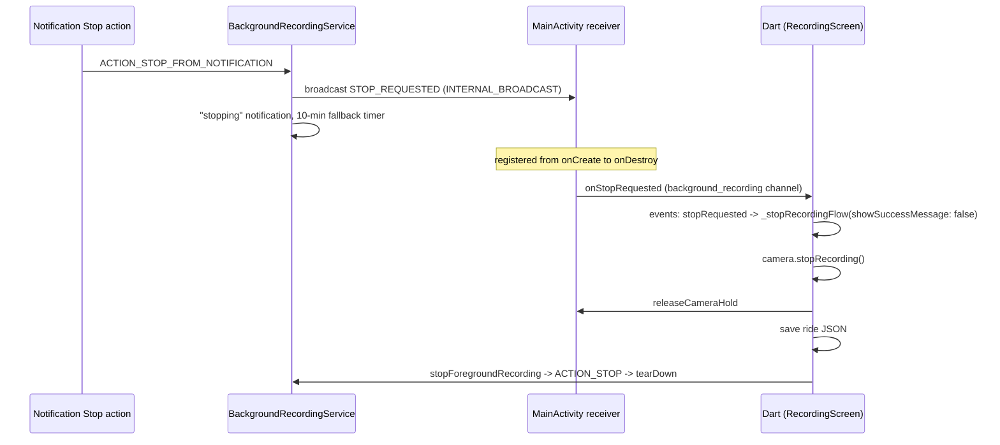
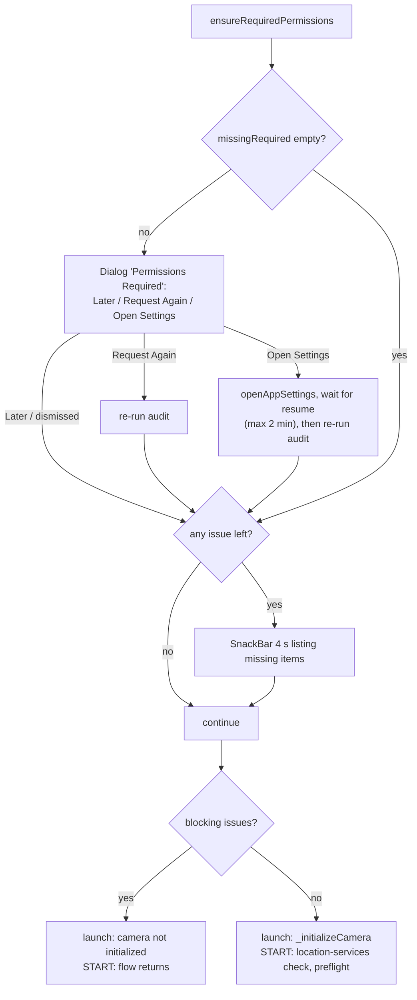

# Native platform integration

How MotoCam's Dart code talks to native Android code through seven method channels, and what the Android manifest, resources and runtime permission flow look like.

## Contents

- [Native code overview](#native-code-overview)
- [Method-channel reference](#method-channel-reference)
  - [background_recording](#comexamplemotocambackground_recording)
  - [device_status](#comexamplemotocamdevice_status)
  - [pip](#comexamplemotocampip)
  - [media](#comexamplemotocammedia)
  - [integrity](#comexamplemotocamintegrity)
  - [legacy_recordings](#comexamplemotocamlegacy_recordings)
  - [gallery](#comexamplemotocamgallery)
- [Android details](#android-details)
  - [Foreground service](#foreground-service)
  - [Camera lifecycle hold](#camera-lifecycle-hold)
  - [Picture-in-Picture](#picture-in-picture)
  - [Battery-optimization exemption](#battery-optimization-exemption)
  - [Media scanning and gallery export](#media-scanning-and-gallery-export)
  - [Battery and thermal status](#battery-and-thermal-status)
  - [Ride signing key](#ride-signing-key)
  - [Activity results and request codes](#activity-results-and-request-codes)
  - [Old public folder access (Storage Access Framework)](#old-public-folder-access-storage-access-framework)
- [Android manifest permission matrix](#android-manifest-permission-matrix)
- [Runtime permission flow](#runtime-permission-flow)
- [How to add a new method channel](#how-to-add-a-new-method-channel)
- [Related documents](#related-documents)

## Native code overview

| File | Platform | Role |
|---|---|---|
| [MainActivity.kt](../android/app/src/main/kotlin/com/example/motocam/MainActivity.kt) | Android | `MainActivity : FlutterActivity`. `configureFlutterEngine` registers the handlers for four channels and, with one line each, the `integrity` channel of `RideSigner`, the `legacy_recordings` channel of `LegacyRecordingsAccess` and the `gallery` channel of `GalleryCopies` (the last two created once per activity, their request codes registered with the activity's `ActivityResultDispatcher`). `onActivityResult` calls `super` first and then dispatches by request code (see [Activity results and request codes](#activity-results-and-request-codes)). Also owns the PiP hooks (`onUserLeaveHint`, `onPause`, `onPictureInPictureModeChanged`), the camera lifecycle hold (it overrides `lifecycle`; see [Camera lifecycle hold](#camera-lifecycle-hold)), the keep-screen-on window flag, the `BroadcastReceiver` for the notification Stop and the service's stopped broadcast (registered in `onCreate`, unregistered in `onDestroy`), `readBatteryStatus`, `thermalStatusLabel`, `isPipSupported`, `stopBackgroundRecordingService` and the gallery export helpers `findExistingGalleryCopy`, `uniqueTarget` and `scanForUri`. `onDestroy` also disposes `LegacyRecordingsAccess` (an open picker call is answered with `null` and a copy in progress is cancelled) and `GalleryCopies` (an open delete prompt call is answered with `denied` for every copy not yet removed), clears the keep-screen-on flag, releases the hold and stops the foreground service if this activity started it. There are no `onResume` or `onNewIntent` overrides. |
| [BackgroundRecordingService.kt](../android/app/src/main/kotlin/com/example/motocam/BackgroundRecordingService.kt) | Android | `BackgroundRecordingService : Service`. The foreground service that shows the recording notification and holds a partial wake lock while recording. Not bound (`onBind` returns `null`); driven entirely by intent actions. Overrides `onCreate` (creates the notification channel), `onStartCommand`, `onTaskRemoved` and `onDestroy`. Its `companion object` holds the action and extra constants and `grantedForegroundServiceTypes(context)`. When it stops it sends `FOREGROUND_STOPPED` with the hold token it was started with. |
| [LegacyRecordingsAccess.kt](../android/app/src/main/kotlin/com/example/motocam/LegacyRecordingsAccess.kt) | Android | `LegacyRecordingsAccess : MethodChannel.MethodCallHandler`, the `legacy_recordings` channel: Storage Access Framework access to the v0.1.11/v0.1.12 public folder (see [Old public folder access](#old-public-folder-access-storage-access-framework)). The same file holds `ActivityRequestCodes` and `ActivityResultDispatcher`. |
| [GalleryCopies.kt](../android/app/src/main/kotlin/com/example/motocam/GalleryCopies.kt) | Android | `GalleryCopies : MethodChannel.MethodCallHandler`, the `gallery` channel: checking and removing the gallery copies MotoCam made (see [gallery](#comexamplemotocamgallery)). |
| [RideSigner.kt](../android/app/src/main/kotlin/com/example/motocam/RideSigner.kt) | Android | `RideSigner : MethodChannel.MethodCallHandler`, the `integrity` channel: the device-bound ride signing key (see [Ride signing key](#ride-signing-key)). `RideSigner.register(messenger)` creates the channel; Keystore work runs on one background thread shared by every engine. |

The Dart side of each channel lives in a small service class:

| Dart file | Class | Channel |
|---|---|---|
| [background_recording_service.dart](../lib/core/services/background_recording_service.dart) | `BackgroundRecordingService` (singleton, `instance`) | `background_recording` |
| [device_status_service.dart](../lib/core/services/device_status_service.dart) | `DeviceStatusService` | `device_status` |
| [pip_service.dart](../lib/core/services/pip_service.dart) | `PipService` (singleton, `instance`) | `pip` |
| [camera_provider.dart](../lib/features/camera/providers/camera_provider.dart) | `CameraProvider.platform` (public static constant) | `media` |
| [ride_signing_service.dart](../lib/core/services/ride_signing_service.dart) | `RideSigningService` (`instance`); the same file holds `SignedRideRegistry` and `loadRideSignerContext` | `integrity` |
| [legacy_recordings_access.dart](../lib/core/services/legacy_recordings_access.dart) | `LegacyRecordingsAccess` (static `pickRecordingsTree`, and the pure `isRecordingsFolder` and `describeTree` checks of a picked tree URI; an instance per picked tree implements `LegacyRideDocumentSource`) | `legacy_recordings` |
| [gallery_copies.dart](../lib/core/services/gallery_copies.dart) | `GalleryCopies` (static methods) | `gallery` |
| [app_permission_service.dart](../lib/core/services/app_permission_service.dart) | `AppPermissionService` | none (uses `permission_handler`, `BackgroundRecordingService` and a `DeviceStatusService`, an optional const-constructor parameter that defaults to `const DeviceStatusService()`) |

The four service classes above other than `CameraProvider` and `RideSigningService` are created or first used by [recording_screen.dart](../lib/features/recording/recording_screen.dart) (`RecordingScreen` is the app's home screen), whose `initState` calls `PipService.initialize`, `BackgroundRecordingService.initialize`, starts device-status polling and runs the permission bootstrap. The `media` channel belongs to `CameraProvider`, which `main.dart` creates in its `MultiProvider`. The `integrity` channel is used by `TelemetryProvider` (signing the final save), `RidesListScreen` (reading this phone's key) and `RideRecord.setLockState` (re-signing). The `legacy_recordings` channel is used only by `RidesListScreen`'s import (the picker, and the source it hands to `CameraProvider.importLegacyRides`). The `gallery` channel is used by `CameraProvider.saveRideToGallery` (to forget links whose copy is gone) and by `removeGalleryCopies` ([gallery_copy_removal.dart](../lib/features/history/services/gallery_copy_removal.dart)), which Ride History calls.

Platform gating on the Dart side:

- `BackgroundRecordingService`, `DeviceStatusService` and the Android block of `AppPermissionService` check `defaultTargetPlatform == TargetPlatform.android`. Under `flutter test`, `defaultTargetPlatform` is Android, so these calls reach the channels in tests; the widget test mocks them.
- `PipService` is not gated; it relies on catching the exception and returning `false`.
- `RideSigningService` is not gated: in tests the `MissingPluginException` (like a `PlatformException`, a malformed reply or the 5 s timeout) gives `null`, so rides are saved unsigned (envelope version 2) and no ride shows as signed by this phone.
- `LegacyRecordingsAccess` is not gated itself: Ride History builds the import menu only when `Platform.isAndroid`, and `CameraProvider.legacyImportBlockedReason` refuses off Android.
- `GalleryCopies` is not gated: Ride History builds the gallery menu only when `Platform.isAndroid` and loads links only there; off Android every call reports `failed` (or `null` for `existingUris`) and never throws.
- In `CameraProvider`, the gallery export (the stop queue, the launch retry and `saveRideToGallery`) is gated with `dart:io` `Platform.isAndroid`. `availableStorageBytes` is not gated: when the call fails it returns `null`, and an unknown free space never blocks recording.

## Method-channel reference

All channel names are identical on both sides, and every Dart method name and argument key has a matching Kotlin case. Unless a row says otherwise, a Kotlin handler that throws is converted by the Flutter embedding into a `PlatformException` with code `error`. Methods marked "N→D" are invoked by native code and handled in Dart.

### com.example.motocam/background_recording

Dart: `BackgroundRecordingService` (every method that calls the channel returns early off Android). Kotlin: `MainActivity.configureFlutterEngine`, field `backgroundRecordingMethodChannel` (retained so native code can call back).

| Method | Dir | Arguments | Return | Errors | Dart caller | Kotlin handler behaviour |
|---|---|---|---|---|---|---|
| `startForegroundRecording` | D→N | `elapsedMs` (int; Kotlin reads `Number`, default 0) | `bool`: `true` when the service was asked to start, `false` when it was refused. Dart returns `started ?? true` | Kotlin catches the start exception and returns `false`. Dart does not catch; the caller does | `_runStartRecordingFlow`, once with `Duration.zero` after `camera.startRecording()` succeeds, inside try/catch. `false` or an exception shows "Background protection unavailable: recording may stop if the app is in the background or the screen turns off." | Sets `isRecordingActive = true` and applies the keep-screen-on flag. On API 34+ returns `false` without starting anything when `grantedForegroundServiceTypes` is 0. Otherwise sends `ACTION_START` with the elapsed and hold-token extras via `startForegroundService` (API 26+) or `startService` (API 24-25), records `foregroundStartWallMs = now - elapsedMs`, sets `isForegroundServiceStarted` and engages the camera lifecycle hold. A refused or failed start leaves the hold off |
| `updateForegroundRecording` | D→N | `elapsedMs` (int) | `bool` / `void` | Kotlin: `startService` exception → `false`. Dart catches `PlatformException` and logs it; the call is not awaited | On every `camera.timerStream` tick (1 s) while recording | Replies `true` and does nothing unless `isRecordingActive` and `isForegroundServiceStarted` are set and the implied start time (`now - elapsedMs`) differs from `foregroundStartWallMs` by more than 2000 ms. Then sends `ACTION_UPDATE` with the elapsed extra and stores the new start time |
| `stopForegroundRecording` | D→N | none | `true` / `void` | Dart: not caught in the service; `RecordingScreen._stopForegroundServiceSafely` catches and logs | `_stopForegroundServiceSafely`, from the `finally` block of `_stopRecordingFlow` (after `camera.stopRecording()` and the ride save), from `_stopRecordingFlow` when nothing is recording, and from `RecordingScreen.dispose` (not awaited). Also called by the Dart `onStopRequested` handler when nothing listens to `events` | Clears `isRecordingActive`, `isForegroundServiceStarted` and the keep-screen-on request (clearing `FLAG_KEEP_SCREEN_ON`), releases the camera lifecycle hold, then `stopBackgroundRecordingService()`: `startService(ACTION_STOP)`, falling back to `stopService` if that throws |
| `releaseCameraHold` | D→N | none | `true` / `void` | Dart catches `PlatformException` and `MissingPluginException` and logs them | `_stopRecordingFlow`, right after `camera.stopRecording()` returns or throws, before the ride is saved | Releases the camera lifecycle hold only. `isRecordingActive`, `isForegroundServiceStarted`, the keep-screen-on flag, the service and its wake lock stay until `stopForegroundRecording` |
| `setKeepScreenOn` | D→N | `enabled` (bool; Kotlin default `false`) | `true` / `void` | Dart catches `PlatformException` and `MissingPluginException` and logs them | `_runStartRecordingFlow` after `startForegroundRecording` (with `keepScreenOnWhileRecording`, whatever the service result), and `_openSettingsSheet` when the setting is saved during a recording | Stores the request and sets `FLAG_KEEP_SCREEN_ON` on the window only while `isRecordingActive` is also true, otherwise clears it. Cleared again by `stopForegroundRecording` and `onDestroy` |
| `isIgnoringBatteryOptimizations` | D→N | none | `bool` | Dart: exception or `null` → `true` | `AppPermissionService.ensureRequiredPermissions` (report only), the start preflight checklist, `shouldOfferBatteryOptimizationExemption` | `PowerManager.isIgnoringBatteryOptimizations(packageName)`; `true` below API 23 (unreachable with minSdk 24) |
| `requestIgnoreBatteryOptimizations` | D→N | none | `bool`: `true` when the system dialog was launched, not when the exemption was granted | Kotlin: exception → `false`. Dart: exception or `null` → `false` | Only `RecordingScreen._maybeOfferBatteryOptimizationExemption`, after the rider accepts the offer-once dialog | Starts `Settings.ACTION_REQUEST_IGNORE_BATTERY_OPTIMIZATIONS` with `package:<packageName>` and `FLAG_ACTIVITY_NEW_TASK`, then replies immediately |
| `onStopRequested` | N→D | `null` | Dart handler returns `null` | Unknown methods also return `null` | Handler registered by `BackgroundRecordingService.initialize` (Android only). If `events` has a listener it emits `BackgroundRecordingEvent.stopRequested`; otherwise it calls `stopForegroundRecording` itself | Invoked by `MainActivity.backgroundStopReceiver` when the notification Stop broadcast arrives |
| `onForegroundStopped` | N→D | `null` | Dart handler returns `null` | Kotlin catches and logs an exception from `invokeMethod` | Same handler. Emits `BackgroundRecordingEvent.protectionLost`; nothing happens when nobody listens. `RecordingScreen` shows "Background protection unavailable: recording may stop if the app is in the background or the screen turns off." while a recording is active | Invoked by `MainActivity.backgroundStopReceiver` when a `FOREGROUND_STOPPED` broadcast matches the engaged hold while `isRecordingActive` is still true (the service stopped on its own during a recording) |

`isIgnoringBatteryOptimizations` and `requestIgnoreBatteryOptimizations` also call `initialize()` before invoking the channel. Two methods never touch the channel: `hasOfferedBatteryOptimizationExemption` and `markBatteryOptimizationExemptionOffered` read and write the SharedPreferences key `battery_optimization_exemption_offered` (`batteryOptimizationOfferedKey`). `shouldOfferBatteryOptimizationExemption` combines `hasOfferedBatteryOptimizationExemption` with `isIgnoringBatteryOptimizations` and returns `true` only on Android, when the offer was never made and the app is not exempt. The service is an app-lifetime singleton and its `events` stream is never closed.

### com.example.motocam/device_status

Dart: `DeviceStatusService.getBatteryAndThermalStatus`. Kotlin: an unretained channel in `configureFlutterEngine`.

| Method | Dir | Arguments | Return | Errors | Dart caller | Kotlin handler behaviour |
|---|---|---|---|---|---|---|
| `getBatteryStatus` | D→N | none | Map: `batteryLevelPercent` (Int or null), `batteryTemperatureC` (Double or null), `thermalStatus` (String), `sdkInt` (Int, `Build.VERSION.SDK_INT`) | Dart: `null` or any exception → `DeviceStatusSnapshot.empty`. Unknown method → `notImplemented` | `RecordingScreen._refreshDeviceStatus` (immediately and every 15 s); `AppPermissionService.ensureRequiredPermissions` when gallery export is on, to decide whether legacy storage is needed | `readBatteryStatus()`, see [Battery and thermal status](#battery-and-thermal-status) |

`DeviceStatusSnapshot.fromMap` accepts any `num` for the numeric keys and ignores values of the wrong type. `sdkInt` becomes `androidSdkInt`.

### com.example.motocam/pip

Dart: `PipService` (static `enterPipMode`; instance `initialize`, `pipModeStream`, `isInPipMode`). Kotlin: field `pipMethodChannel`, constant named `CHANNEL`.

| Method | Dir | Arguments | Return | Errors | Dart caller | Kotlin handler behaviour |
|---|---|---|---|---|---|---|
| `enterPipMode` | D→N | none | `bool`: the result of `enterPictureInPictureMode`; `false` when PiP is not supported or the call throws | Dart: any exception → `false` | `RecordingScreen._handleBackPressWhileRecording` (system back and the MINIMISE button while recording) | If `isPipSupported()`, builds `PictureInPictureParams` with aspect ratio 9:16 and calls `enterPictureInPictureMode` inside try/catch |
| `onPipModeChanged` | N→D | `bool` | Dart handler returns `null` | n/a | Handler registered by `PipService.initialize` on every platform; sets `isInPipMode` (`arguments == true`) and adds to `pipModeStream` | Invoked from `onPictureInPictureModeChanged` |

### com.example.motocam/media

Dart: `CameraProvider.platform`, used by `availableStorageBytes` and `_exportVideoToGallery` (the copy call of the `GalleryExporter`). Kotlin: an unretained channel in `configureFlutterEngine`.

| Method | Dir | Arguments | Return | Errors | Dart caller | Kotlin handler behaviour |
|---|---|---|---|---|---|---|
| `getAvailableStorageBytes` | D→N | `path` (String, the recordings directory) | Long: free bytes on that volume | `STORAGE_QUERY_FAILED` (exception message). Dart catches everything and returns `null` | `CameraProvider.availableStorageBytes`, from the free-space check before START and at each segment roll | `StatFs(path).availableBytes`; uses `filesDir` when `path` is null or blank |
| `exportVideoToGallery` | D→N | `sourcePath`, `displayName`, `relativePath` (Strings); optional `reuseExisting` (Boolean, default `false`, honoured on API 29+ only) and `queuedAtMs` (Long, default `0`: no limit; with it only a copy added since then is reused) | String: the copy's MediaStore content URI on every API level. Dart stores it in the gallery-link store | `INVALID_ARGS` (missing or blank `sourcePath`/`displayName`), `PERMISSION_DENIED` (API 24-28 without `WRITE_EXTERNAL_STORAGE`), `SOURCE_NOT_FOUND`, `EXPORT_FAILED` (exception message, also when the scan of an API 24-28 copy gives no URI) | `GalleryExporter.drain`, one awaited call per pending segment (the drain after a stop with gallery export on, the launch retry and Save to gallery) | Checks the permission on the calling thread, then on a new `Thread`: with `reuseExisting`, looks for a finished copy first; otherwise copies. Replies via `runOnUiThread`. See [Media scanning and gallery export](#media-scanning-and-gallery-export) |

Dart always sends `relativePath` `Movies/MotoCam/Recordings`, `reuseExisting: true` and the pending entry's `queuedAtMs`. Kotlin uses `Movies/MotoCam/Videos` only when `relativePath` is absent. Both native branches honour it.

### com.example.motocam/integrity

Dart: `RideSigningService` ([ride_signing_service.dart](../lib/core/services/ride_signing_service.dart)). Kotlin: `RideSigner` ([RideSigner.kt](../android/app/src/main/kotlin/com/example/motocam/RideSigner.kt)), registered by `RideSigner.register(flutterEngine.dartExecutor.binaryMessenger)` in `configureFlutterEngine`. Both methods run the Keystore work on a single background thread (so the key is created once even when calls overlap) and reply on the main thread. The Dart wrapper returns `null` on `MissingPluginException`, any `PlatformException`, a reply of the wrong shape (or a `publicKey` that is not canonical base64) and after a 5 s timeout; it never throws.

| Method | Dir | Arguments | Return | Errors | Dart caller | Kotlin handler behaviour |
|---|---|---|---|---|---|---|
| `getSigningKey` | D→N | none | Map: `keyId` (String, first 16 lowercase hex characters of the SHA-256 of the key DER, for display and logs only), `publicKey` (String, base64 `NO_WRAP` of the X.509 SubjectPublicKeyInfo DER) | `KEY_UNAVAILABLE` (exception message) | `RideSigningService.sessionSigningKey` (first success cached for the app session), from `loadRideSignerContext` when Ride History loads | Loads the key under alias `motocam_ride_signing_v1`, creating it first when it does not exist |
| `signPayloadHash` | D→N | `payloadHash` (String, 64 lowercase hex characters) | Map: `alg` (`ES256`), `keyId`, `publicKey` (as above), `sig` (base64 `NO_WRAP` of the DER ECDSA signature from `SHA256withECDSA` over the UTF-8 bytes of `payloadHash`) | `INVALID_ARGS` (missing or not 64 lowercase hex characters, checked before any Keystore work), `SIGNING_FAILED` (exception message) | `TelemetryProvider._persistRide` (final save only, through `sealAndSignRidePayload`) and `RideRecord.setLockState` (re-signing a ride this phone signed) | Loads or creates the key, then signs |

Dart checks every signature it receives (on a background isolate) before storing it; one that does not verify is treated as a failure.

### com.example.motocam/legacy_recordings

Dart: `LegacyRecordingsAccess` ([legacy_recordings_access.dart](../lib/core/services/legacy_recordings_access.dart)). Kotlin: `LegacyRecordingsAccess` ([LegacyRecordingsAccess.kt](../android/app/src/main/kotlin/com/example/motocam/LegacyRecordingsAccess.kt)), registered in `configureFlutterEngine`. Listing, copying and deleting run on one background thread per activity (`Executors.newSingleThreadExecutor`) and reply on the main thread; the picker runs on the main thread. See [Old public folder access](#old-public-folder-access-storage-access-framework).

| Method | Dir | Arguments | Return | Errors | Dart caller | Kotlin handler behaviour |
|---|---|---|---|---|---|---|
| `pickRecordingsTree` | D→N | none | String: the picked tree URI, or `null` when the rider cancelled (or the activity was destroyed meanwhile) | `BUSY` (a picker is already open), `NO_PICKER` (`ActivityNotFoundException`). Dart throws them as `PlatformException` | `RidesListScreen._importFromOlderVersion` | Starts `ACTION_OPEN_DOCUMENT_TREE` (read and write grant flags; on API 26+ `EXTRA_INITIAL_URI` = `DocumentsContract.buildDocumentUri("com.android.externalstorage.documents", "primary:Movies/MotoCam/Recordings")`) with `startActivityForResult` and request code `PICK_LEGACY_RECORDINGS_TREE` (7101). The `Result` is kept until `onTreePicked` answers it. The grant is never persisted |
| `listTree` | D→N | `treeUri` (String) | List of maps: `uri` (document URI built with `buildDocumentUriUsingTree`), `name`, `size` (Long, -1 when unknown; Dart turns it into `null`), `canDelete` (`FLAG_SUPPORTS_DELETE`) | `INVALID_ARGS`, `LIST_FAILED` (exception message) | `LegacyRideImporter.run`, through `LegacyRecordingsAccess.list` (malformed entries are dropped) | Queries the tree's child documents (`buildChildDocumentsUriUsingTree`) for id, display name, size, MIME type and flags, and skips directories |
| `copyDocument` | D→N | `uri`, `targetPath` (Strings) | Long: bytes copied | `INVALID_ARGS`, `CANCELLED` (Dart: `LegacyCopyCancelled`), `COPY_FAILED` (exception message); a partial target is deleted | `LegacyRideImporter` (staging copies) | Resets the cancel flag on the main thread, then on the background thread streams `openInputStream(uri)` into a `FileOutputStream` in 1 MiB buffers, checking the cancel flag before each buffer, then `flush` and `fd.sync()` |
| `cancelCopy` | D→N | none | `true` | Dart ignores every error | `LegacyRideImporter`, when its pause check turns true during a copy | Sets the cancel flag (an `AtomicBoolean`), so the copy in progress, or one already queued, stops at its next buffer |
| `deleteDocuments` | D→N | `uris` (List of Strings) | List of Strings: the URIs that could not be deleted | `DELETE_FAILED` (exception message) | `deleteImportedOriginals`, after the rider confirms | `DocumentsContract.deleteDocument` for each URI in order; a `false` result or an exception adds the URI to the returned list |

### com.example.motocam/gallery

Dart: `GalleryCopies` ([gallery_copies.dart](../lib/core/services/gallery_copies.dart)). Kotlin: `GalleryCopies` ([GalleryCopies.kt](../android/app/src/main/kotlin/com/example/motocam/GalleryCopies.kt)), created once per activity in `configureFlutterEngine`, with its request code registered on the `ActivityResultDispatcher`. Queries and deletes run on one background thread per activity and reply on the main thread; prompts start on the main thread. Every method takes `uris` (List of content URI Strings, as `exportVideoToGallery` returned them). The Dart wrapper never throws: an error or a missing handler reports every URI as `failed`, or `null` from `existingUris`. Statuses are parsed by `GalleryCopyStatus.parse`; an unknown one is `failed`.

| Method | Dir | Arguments | Return | Errors | Dart caller | Kotlin handler behaviour |
|---|---|---|---|---|---|---|
| `galleryItemsExist` | D→N | `uris`, optional `relativePath` (default `Movies/MotoCam/Recordings`; Dart sends `publicExportRelativePath`) | List of Strings: the URIs that still have a MediaStore row this app can see (API 24-28: only a row whose `_data` file is directly in `relativePath` under shared storage) | `QUERY_FAILED` (Dart: `null`) | `GalleryCopies.existingUris`, from `CameraProvider.saveRideToGallery` through `GalleryExporter.forgetMissingLinks` | `ContentResolver.query(uri, [_ID])` per URI; a URI whose query throws counts as existing, so a copy is never reported gone when it could not be checked |
| `deleteGalleryItems` | D→N | `uris`, optional `relativePath` (as above) | Map `{uri: status}`: `deleted`, `missing` (already gone), `changed` (API 24-28: the row's `_data` file is not directly in `relativePath`, for example after a rebuilt media database gave its ID to another video; nothing is deleted), `needsConsent` (a `SecurityException` on API 29+), `needsPermission` (API 24-28 without `WRITE_EXTERNAL_STORAGE`, or a `SecurityException` there) or `failed` | `DELETE_FAILED` (Dart: all `failed`) | `GalleryCopies.delete`, from `removeGalleryCopies` | `ContentResolver.delete(uri, null, null)` per URI, with no prompt (the app owns the media it inserted); on API 24-28, where no ownership check or prompt exists, only after a query of `_data` finds the row's file directly in `relativePath`. 0 rows: `missing` when a query finds no row, else `failed` |
| `requestDeleteGalleryItems` | D→N | `uris` | Map `{uri: status}`: `deleted`, `missing`, `denied` (prompt declined) or `failed` | `BUSY` while a request is open (Dart: all `failed`) | `GalleryCopies.requestDelete`, from `removeGalleryCopies` for the `needsConsent` copies | API 30+: one `MediaStore.createDeleteRequest` prompt for all URIs (`startIntentSenderForResult`, request code 7102); on `RESULT_OK` each URI is re-queried (`deleted` when gone, `failed` when still there), otherwise `denied` (or `missing` when already gone). API 29: per URI in turn, `delete` again and, on a `RecoverableSecurityException`, its `userAction` prompt (same request code), then `delete` once more when allowed. Below API 29 every URI is `failed` (no such prompt) |

## Android details

Build targets that affect the native code ([build.gradle.kts](../android/app/build.gradle.kts)): `applicationId` and `namespace` `com.example.motocam`, `compileSdk` and `targetSdk` 36, `minSdk = flutter.minSdkVersion` (24 in Flutter 3.41.2), NDK 28.2.13676358, Java and JVM target 17. The plugins in [settings.gradle](../android/settings.gradle) are AGP 8.11.1 and Kotlin 2.2.20. Because minSdk is 24, the `SDK_INT < M` (API 23) branches in `MainActivity` never run, while the `< O` (API 26), `< Q` (API 29) and `< R` (API 30) branches are live on older devices. Build and signing are covered in [development.md](development.md) and [release.md](release.md).

### Foreground service

`BackgroundRecordingService` is declared in the manifest with `android:exported="false"` and `android:foregroundServiceType="camera|microphone|location"`. It has no `android:stopWithTask` attribute; `onTaskRemoved` tears the service down instead.

**Service types.** `grantedForegroundServiceTypes(context)` builds the type mask from the permissions granted at that moment: camera for `CAMERA`, location for `ACCESS_FINE_LOCATION` or `ACCESS_COARSE_LOCATION`, microphone for `RECORD_AUDIO`. It returns 0 below API 30. On API 30+ `ACTION_START` calls the three-argument `startForeground(4001, notification, mask)`; below API 30 it calls the two-argument form, so the manifest types apply. On API 34+, where a missing type permission throws a `SecurityException`, `MainActivity` refuses to start the service when the mask is 0 and `startForegroundRecording` returns `false`.

**Intent actions** (constants in the service's `companion object`):

| Action | Sent by | Service behaviour |
|---|---|---|
| `com.example.motocam.action.START_RECORDING_FOREGROUND` (`ACTION_START`) | `startForegroundRecording` handler | Cancels a pending stop timeout, clears `isStopRequested`, reads `elapsedMs` and the optional `holdToken` extra, acquires the wake lock and calls `startForeground` with the granted types. If `startForeground` throws, it logs and tears down |
| `...UPDATE_RECORDING_FOREGROUND` (`ACTION_UPDATE`) | `updateForegroundRecording` handler, only when the clock drifted | If the service is not in the foreground, `stopSelf(startId)`. If a stop was requested, ignored. Otherwise `NotificationManager.notify(4001, …)` with the new start time |
| `...STOP_RECORDING_FOREGROUND` (`ACTION_STOP`) | `stopForegroundRecording` handler, and `MainActivity.onDestroy` | `tearDown()`: cancels the stop timeout, releases the wake lock, `stopForeground(STOP_FOREGROUND_REMOVE)`, sends `FOREGROUND_STOPPED`, `stopSelf()` |
| `...STOP_FROM_NOTIFICATION` (`ACTION_STOP_FROM_NOTIFICATION`) | Notification Stop action | If the service is not in the foreground, `tearDown()`. Otherwise sets `isStopRequested`, sends the `STOP_REQUESTED` broadcast, replaces the notification with the "stopping" notification and schedules `tearDown()` after 10 minutes. The service and wake lock stay up |
| `...STOP_REQUESTED` (`ACTION_STOP_REQUESTED`) | Broadcast from the service | Received by `MainActivity.backgroundStopReceiver` |
| `...FOREGROUND_STOPPED` (`ACTION_FOREGROUND_STOPPED`) | Broadcast from the service, once per hold token, from `tearDown()` and `onDestroy` (so also after the `stopService` fallback or a system stop) | Received by `MainActivity.backgroundStopReceiver`: when its `holdToken` extra matches the engaged hold, clears `isForegroundServiceStarted` and releases the hold, then, if `isRecordingActive` is still true, calls `onForegroundStopped` so Dart warns the rider. The keep-screen-on flag stays; stopping the recording is up to Dart |

A null intent or an unknown action calls `stopSelf(startId)` when the service is not in the foreground. `onStartCommand` returns `START_NOT_STICKY` for every intent, so the system never restarts the service. `onTaskRemoved` (the task is swiped away in Recents) calls `tearDown()`. That still ends the recording, because the activity and the Flutter engine are destroyed; the segment in progress is not finalised. The service never measures time itself; the notification's chronometer does.

**Recording notification.** Channel `motocam_recording_channel` ("MotoCam Recording", description "Shows active recording controls and elapsed time", `IMPORTANCE_LOW`, no badge) is created in `onCreate` on API 26+ if it does not exist; its importance is fixed by Android after creation. The notification is ongoing, alert-once, low priority, category `service`, small icon `R.drawable.ic_stat_recording`, title "MotoCam recording in progress", text "Designed to keep recording with the screen off". The elapsed time is a system chronometer: `setWhen(now - elapsedMs)` with `setUsesChronometer(true)`, so the notification is not re-posted every second. Tapping the body opens the app's launch intent (request code 0) with its flags set to `FLAG_ACTIVITY_SINGLE_TOP | FLAG_ACTIVITY_CLEAR_TOP`. The **Stop** action is a `PendingIntent.getService` for `ACTION_STOP_FROM_NOTIFICATION` (request code 1). Both pending intents use `FLAG_UPDATE_CURRENT | FLAG_IMMUTABLE` and are built once per service instance.

**Stopping notification.** After Stop is tapped, the notification reads "MotoCam is stopping the recording" / "Saving the ride - open MotoCam to check". It has the same icon, priority, category and tap intent, no Stop action and no chronometer. A late `ACTION_UPDATE` cannot replace it.

**Notification icon.** [ic_stat_recording.xml](../android/app/src/main/res/drawable/ic_stat_recording.xml) is a 24 dp vector camera glyph, white on transparent, because Android draws notification small icons from the alpha channel only.

**Wake lock.** `PARTIAL_WAKE_LOCK` tagged `MotoCam:RecordingWakeLock`, not reference counted, acquired on START with a 12-hour timeout (not re-armed on UPDATE), released by `tearDown()` and in `onDestroy`.

**Stop relay and the INTERNAL_BROADCAST permission.** The manifest declares `com.example.motocam.permission.INTERNAL_BROADCAST` with `protectionLevel="signature"` and the app also `uses-permission`s it, so only apps signed with the same key can send or receive the stop broadcast. The service sends `Intent(ACTION_STOP_REQUESTED).setPackage(packageName)` with that permission as the required receiver permission. `MainActivity.onCreate` registers the receiver with the same permission as the required broadcaster permission (on API 33+ also with `RECEIVER_NOT_EXPORTED`), and `onDestroy` unregisters it, ignoring `IllegalArgumentException`. The receiver therefore exists for the whole activity lifetime, including while the activity is stopped. Kotlin builds the permission name as `"$packageName.permission.INTERNAL_BROADCAST"`, while the manifest hard-codes `com.example.motocam`, so the two match only while the applicationId stays `com.example.motocam`. The release precheck asserts that the `<permission>` element exists with `protectionLevel="signature"`.



How the pieces fit together:

- The foreground service and wake lock stay up until Dart has stopped the camera and saved the ride, for both the notification Stop and the in-app STOP. `_stopRecordingFlow` calls `stopForegroundRecording` in its `finally` block. The camera lifecycle hold ends earlier, when capture stops (`releaseCameraHold` right after `camera.stopRecording()`), not when the save finishes.
- If no Dart listener exists when `onStopRequested` arrives, the Dart handler calls `stopForegroundRecording` itself. If Dart never answers, the service tears itself down after 10 minutes.
- If the stop request arrives when nothing is recording, `_stopRecordingFlow` only stops the service.
- `MainActivity.onDestroy` clears `isRecordingActive` and the keep-screen-on flag, releases the camera lifecycle hold and, if it started the service for the current recording, sends `ACTION_STOP`, so the service, wake lock and notification do not outlive the activity.

The Dart-side recording lifecycle is described in [recording-pipeline.md](recording-pipeline.md#lifecycle-background-and-the-foreground-service).

### Camera lifecycle hold

camera_android_camerax 0.7.2 binds every CameraX use case, and observes its LiveData, with the attached activity as `LifecycleOwner` (`ProxyApiRegistrar.getLifecycleOwner`), and CameraX closes the camera when that lifecycle drops below STARTED. With `FlutterActivity`'s own lifecycle, every screen timeout, power-button lock or Home press without PiP stopped capture although the camera-typed foreground service kept running.

`MainActivity` overrides `lifecycle` (`getLifecycle()`) to return `recordingLifecycle`, a `LifecycleRegistry` that mirrors `FlutterActivity`'s registry through an observer added in the constructor. While the hold is engaged it does not drop below STARTED: when the real state falls to CREATED and the mirror is at least STARTED, the mirror stays at STARTED. The hold never raises the mirror, and DESTROYED is always forwarded, so the hold never outlives the activity. `FlutterActivity` dispatches its own events to its private registry, so only external callers see the mirror: the plugin binding (`FlutterActivityAndFragmentDelegate` passes `host.getLifecycle()` to every plugin) and CameraX through the camera plugin. Of the app's Android plugins only camera_android_camerax observes the activity lifecycle; geolocator_android, jni_flutter, package_info_plus, permission_handler_android, sensors_plus, shared_preferences_android and video_player_android do not, and path_provider_android 2.3.1 has no Android plugin class. This relies on how the camera plugin binds CameraX, so it must be re-checked on every camera plugin upgrade.

- **Engaged** in the `startForegroundRecording` handler, only after `startForegroundService` (or `startService`) returned without throwing. A refused start (API 34+ with no permitted type) or a start that throws leaves it off.
- **Released** by `releaseCameraHold`, which `_stopRecordingFlow` calls as soon as `camera.stopRecording()` returns or throws (so the camera can close while the ride is saved), by `stopForegroundRecording` as the backstop, by a `FOREGROUND_STOPPED` broadcast carrying the current hold token (the service stopped for any reason: `startForeground` failure, the 10-minute Stop fallback, task removal, a system stop; during a recording Dart is then told with `onForegroundStopped` and shows the "Background protection unavailable" warning), and in `onDestroy` before `super.onDestroy()`. Releasing while the activity is stopped moves the mirror to CREATED, so CameraX closes the camera and the privacy indicator goes off. The token, a counter sent as the `holdToken` extra of `ACTION_START`, keeps a late stop of an earlier service instance from releasing a newer recording's hold.
- On the Dart side every path that ends a recording reaches `stopForegroundRecording`: STOP, notification Stop, a fault stop (`lastRecordingError`, via `_stopAfterRecordingFault`), a failed stop (the `finally` of `_stopRecordingFlow`), `RecordingScreen.dispose`, and the `onStopRequested` fallback when nothing listens. A camera that fails to start never starts the service.
- Everything runs on the main thread (method-channel handlers, the receiver and lifecycle observers).

**Not yet confirmed on a device.** Recording is designed to continue with the screen off or the app in the background while the recording notification shows, but no phone has confirmed it yet. The keep-screen-on setting (on by default, `setKeepScreenOn`) is the fallback. While the activity is stopped, the engine may release the preview's surface, which makes CameraX request a new one for the Preview use case; the effect on the recording is unverified. Swiping the app away from Recents still ends the recording: the activity and the Flutter engine are destroyed and the segment in progress is not finalised.

### Picture-in-Picture

The activity is declared with `android:supportsPictureInPicture="true"`, `android:resizeableActivity="true"`, `launchMode="singleTop"` and `android:taskAffinity=""`. PiP requires API 26.

- **Automatic.** `onUserLeaveHint` and `onPause` both call `maybeEnterRecordingPip`, which enters PiP (9:16) only if `isRecordingActive` is true, the API is 26+, and the activity is not already in PiP. It does not check the PiP system feature, and exceptions are swallowed. Because of the `onPause` hook, PiP is also attempted whenever another activity comes in front of MotoCam while recording, not only when the user leaves the app. The code never calls `setPictureInPictureParams` or `setAutoEnterEnabled`.
- **Explicit.** System back while recording (`PopScope(canPop: !camera.isRecording)`) and the MINIMISE button (the HISTORY button relabelled while recording) call `PipService.enterPipMode()`. If it returns `false` (API 24-25, no PiP feature, PiP turned off for the app, or any channel error) the screen shows "Recording active. Stop first to exit."
- **Mode changes.** `onPictureInPictureModeChanged` sends `onPipModeChanged(bool)`. `RecordingScreen` switches to its compact PiP view immediately on entry and back to the full view 200 ms after exit.

`isRecordingActive` lives on the activity instance, is not persisted, and is set by the `startForegroundRecording` handler (also when the service is refused) and cleared by `stopForegroundRecording` and `onDestroy`. The PiP layout and the stall recovery after returning from PiP are covered in [features.md](features.md#picture-in-picture-and-screen-off-recording) and [recording-pipeline.md](recording-pipeline.md#lifecycle-background-and-the-foreground-service).

### Ride signing key

`RideSigner` keeps one Android Keystore key per install for the ride integrity envelope (version 3, see [data-formats.md](data-formats.md#signature-version-3)):

| Property | Value |
|---|---|
| Alias | `motocam_ride_signing_v1` in `AndroidKeyStore` |
| Algorithm | EC P-256 (`secp256r1`), purposes `SIGN` and `VERIFY`, digest `SHA256` |
| Created | On first use (the first `getSigningKey` or `signPayloadHash`), by `KeyPairGenerator` |
| Hardware | StrongBox (`setIsStrongBoxBacked(true)`) on API 28+; when that fails (`StrongBoxUnavailableException` or any other error) the key is created in the TEE (or software keystore) instead |
| Export | The private key never leaves the Keystore; only the public key's SubjectPublicKeyInfo DER is returned |
| Authentication | None (`setUserAuthenticationRequired(false)`), and `setUnlockedDeviceRequired` is not set: rides are saved while the phone is locked (Stop from the notification) |
| Lifetime | Deleted with the app. A reinstall creates a new key, so rides signed before it show as signed by another key, and the signed-ride registry (SharedPreferences, also cleared) starts empty. `allowBackup` is `false`, so neither the key nor the registry is restored from a backup |

The key only proves which app install signed a ride. It does not prove the footage is genuine: on a rooted phone, or with a modified app, anything can be signed with it. No manifest permission is needed.

### Activity results and request codes

`FlutterActivity` is not a `ComponentActivity`, so the Activity Result API (`registerForActivityResult`) is not available. `MainActivity.onActivityResult` calls `super.onActivityResult` first (plugins receive their results through `FlutterActivity`'s delegate), then `ActivityResultDispatcher.dispatch(requestCode, resultCode, data)`, which calls the handler registered for that request code, if any. Handlers are registered once per activity in `configureFlutterEngine`; registering a code twice throws. `ActivityRequestCodes` lists the app's codes, which are unique in the app (plugins use their own, for example permission_handler 209 to 214 and geolocator 109) and below 65536:

| Code | Constant | Used by |
|---|---|---|
| 7101 | `PICK_LEGACY_RECORDINGS_TREE` | `LegacyRecordingsAccess.pickRecordingsTree` (answered by `onTreePicked`) |
| 7102 | `MEDIA_STORE_DELETE_REQUEST` | `GalleryCopies.requestDeleteGalleryItems`: the `createDeleteRequest` prompt (API 30+) or a `RecoverableSecurityException` prompt (API 29), answered by `onDeleteRequestResult` |

The dispatcher has no unit test (the project has no Android unit-test source set); its routing is a map lookup.

### Old public folder access (Storage Access Framework)

v0.1.11 and v0.1.12 recorded to the public `Movies/MotoCam/Recordings` folder. This install usually cannot read it directly: it has another signing key, so on Android 10 and later (scoped storage) it does not own those files, and it has no all-files access (only `WRITE_EXTERNAL_STORAGE` up to API 28, for the gallery export). The import therefore asks the rider for the folder with `ACTION_OPEN_DOCUMENT_TREE`, which needs no manifest permission:

- **Picker.** It opens at `primary:Movies/MotoCam/Recordings` on API 26+ (`EXTRA_INITIAL_URI`; the hint is ignored below). Android 11+ blocks picking the root of shared storage, `Download` and `Android/data`, but not this folder.
- **Grant.** `takePersistableUriPermission` is never called: the temporary grant lasts while the activity lives, so the import and the optional delete of the originals happen in the same visit to Ride History. A new import asks again.
- **Threading.** One single-thread executor per `LegacyRecordingsAccess` runs the listing, every copy and the deletes in order; replies are posted to the main looper. A copy streams 1 MiB buffers and is never held in memory; `cancelCopy` sets an `AtomicBoolean` checked before each buffer. `onDestroy` answers an open picker with `null`, cancels a copy and shuts the executor down.
- **Deletes.** `DocumentsContract.deleteDocument` through the external storage provider, only for the documents Dart passes (those with a verified copy in private storage, after the rider confirms).

The Dart side (planning, collisions, staging and journal) is in [data-formats.md](data-formats.md#import-from-the-old-public-folder).

### Battery-optimization exemption

The manifest declares `REQUEST_IGNORE_BATTERY_OPTIMIZATIONS`. The app never requests the exemption on its own. It is checked or offered in three places:

1. **Permission audit** (`ensureRequiredPermissions`, Android only): checks `isIgnoringBatteryOptimizations` and, if the app is not exempt, adds "Ignore battery optimizations" to the recommended list. `RecordingScreen` drops that item from its SnackBar once the offer has been made.
2. **Offer-once dialog** (`_maybeOfferBatteryOptimizationExemption`): after an in-app STOP that saved the ride JSON, if `shouldOfferBatteryOptimizationExemption()` is true, the screen marks the offer as made and shows "Keep recording with the screen off?" with **Not now** and **Open setting**. Only **Open setting** calls `requestIgnoreBatteryOptimizations`. The flag is persisted whatever the rider answers, so the dialog appears at most once per install. A notification Stop or a fault stop does not show it.
3. **Start preflight checklist**: a non-blocking "Battery Optimization Exemption" row (`Enabled` / `Recommended for stable screen-off recording`). Until the one-time offer has been shown, this warning opens the sheet like any other; after it, the row is listed only when another row opens the sheet.

### Media scanning and gallery export

Recordings are written to the app's private files directory (`filesDir`); segments are copied to shared storage only when the rider turns gallery export on (locked segments, at stop) or saves a ride to the gallery. Rides of earlier builds in app-specific external storage are moved into `filesDir` by the migration (see [data-formats.md](data-formats.md#legacy-roots-and-their-migration)); `getAvailableStorageBytes` is called with the recordings directory, so every free-space check, the migration's included, measures the `filesDir` volume. The storage layout is in [recording-pipeline.md](recording-pipeline.md#storage-layout-and-file-naming) and the rider-facing behaviour in [features.md](features.md#export-to-gallery).

- **Free space.** Before START and at each segment roll, `CameraProvider` asks `getAvailableStorageBytes` for the recordings directory. It needs room for one estimated segment (segment duration at the higher of the requested bitrate and 20 Mbps) plus a 100 MiB margin; at a roll, the bytes the loop will free count towards the margin. When there is not enough room, recording does not start or stops with "Storage is almost full. Free up space on the phone to keep recording." An unknown free space (`null`) never blocks.
- **No media scan of private segments.** Loop segments are not handed to the media scanner. The recordings directory holds a `.nomedia` marker.
- **Gallery export queue.** Every copy goes through the persisted queue of `GalleryExporter` ([gallery_export.dart](../lib/features/camera/providers/gallery_export.dart)) in the gallery-link store ([data-formats.md](data-formats.md#gallery-link-store)). Automatic export is off by default: the setting `AppSettingsProvider.exportLockedClipsToGallery` is copied to `CameraProvider.autoExportLockedClipsToGallery` at every START, and at stop the session's locked segments are written to the queue at once (keyed by the ride's `rideSessionId`, still set at that point, and the file name) and drained about 2 s later. A queue that a killed process left behind is drained once per launch, 2 s after the recordings directory is set up, when nothing records, and a stop that queues nothing drains whatever is still queued about 2 s later. **Save to gallery** in Ride History queues every existing video file of a ride and drains only those at once. Drains run one at a time, hold the migration while they run, and stop before the next copy when a recording starts (the rest stays queued for the next stop). Each entry is found again by file name in the recordings directory and then the legacy roots, dropped when its file is gone or its key is already linked, and copied with one awaited `exportVideoToGallery` call (`relativePath` `Movies/MotoCam/Recordings`, `reuseExisting: true`, `queuedAtMs`). A copy moves the entry to the links with the returned content URI; a copy whose entry was dropped while it ran (its ride deleted or unlocked, or its copies removed) is deleted at once through `deleteGalleryItems` (linked only when that fails); a failure keeps it queued for up to three attempts.
- **API 29+ native branch.** With `reuseExisting`, first queries `MediaStore.Video.Media` for a row with the same `DISPLAY_NAME` and `RELATIVE_PATH` and the source's size, and with `queuedAtMs` above 0 a `DATE_ADDED` at or after it (in seconds), so a recording an older version wrote there is never taken for a copy (the query sees only rows this app inserted; pending rows are not matched) and returns its URI: a copy that a killed process finished before Dart recorded it is linked, not made twice. Otherwise inserts a row (`DISPLAY_NAME`, `MIME_TYPE video/mp4`, `RELATIVE_PATH` from the argument, `IS_PENDING 1`), streams the file into it, then sets `IS_PENDING 0`. If the copy or the update fails, the pending row is deleted and `EXPORT_FAILED` is returned. MediaStore renames a copy whose name is taken.
- **API 24-28 native branch.** Returns `PERMISSION_DENIED` unless `WRITE_EXTERNAL_STORAGE` is granted. `reuseExisting` is ignored: a file of the same name there may be the rider's own (an original kept after the import). Copies to `Environment.getExternalStorageDirectory()/<relativePath>` under the hidden name `.<displayName>.partial` (not a video name, so the media scanner skips it; one left by a killed process is deleted first), syncs it, renames it to `<displayName>` (or `<name>_1.mp4`, `_2` and so on when the name is taken: another file is never overwritten), and scans only that public copy with `MediaScannerConnection.scanFile`, waiting up to 15 s for its content URI. The private source is never scanned. When the rename fails or the scan gives no URI, the copy is deleted and `EXPORT_FAILED` is returned.
- **Dart error handling.** On `PERMISSION_DENIED`, the drain after a stop that queued locked clips and Save to gallery request `Permission.storage` once per drain and retry that segment once; the launch retry and the drain after a stop that queued nothing never ask, and leave the entry queued without counting an attempt. `SOURCE_NOT_FOUND` looks the file up once more and copies it from a new place, and otherwise drops the entry; other errors count as failures, and the private copy stays in the recordings directory. There is no `dart:io` copy fallback. A drain after a stop ends with a summary such as "2 locked clips copied to the gallery" or "1 locked clip not copied (storage permission denied)." (the launch retry says "clip"), and Save to gallery with its own summary in Ride History.
- **Removal.** When a ride with linked copies is unlocked or deleted in Ride History, or from the ride's menu, the rider may remove them (default: keep). `removeGalleryCopies` first drops the ride's queued exports (and adds the ride's links recorded since the dialog opened), then calls `deleteGalleryItems` (no prompt), asks for `Permission.storage` and tries again for `needsPermission` copies (API 24-28), and sends `needsConsent` copies to `requestDeleteGalleryItems` (one system prompt on API 30+, one per copy on API 29). Copies reported `deleted` or `missing` are removed from the store; a link reported `changed` (API 24-28: its URI now names a file outside the gallery folder) is dropped without deleting anything and counts as not removed; the rest stay linked and the SnackBar names them. The API-level branches live in Kotlin. The storage budget never touches gallery copies.

### Battery and thermal status

`MainActivity.readBatteryStatus` runs on the main thread and reads the sticky `ACTION_BATTERY_CHANGED` intent:

| Key | Computation | `null` when |
|---|---|---|
| `batteryLevelPercent` | `(level * 100.0 / scale).toInt()` | `level < 0` or `scale <= 0`, or no sticky intent |
| `batteryTemperatureC` | `EXTRA_TEMPERATURE / 10.0` (signed tenths of °C; 0 °C and below are kept) | the extra is missing, or no sticky intent |
| `thermalStatus` | `PowerManager.currentThermalStatus` mapped to `none`, `light`, `moderate`, `severe`, `critical`, `emergency`, `shutdown`, else `unknown` (API 29+) | never; `"unsupported"` below API 29 |
| `sdkInt` | `Build.VERSION.SDK_INT` | never |

The UI shows battery level and temperature, and the preflight adds Battery Level and Device Temperature rows when they are known. `thermalStatus` is parsed but not read by any UI code. `AppPermissionService` uses `sdkInt` to request legacy storage only below API 29. See [telemetry.md](telemetry.md#device-status-android-only).

## Android manifest permission matrix

Source: [AndroidManifest.xml](../android/app/src/main/AndroidManifest.xml). The debug and profile manifests add only `INTERNET`.

| Permission | Why | Requested at runtime | API-level notes |
|---|---|---|---|
| `INTERNET` | Map tiles from `tile.openstreetmap.org` ([map_source_config.dart](../lib/features/map/map_source_config.dart)) | No (normal permission) | n/a |
| `ACCESS_NETWORK_STATE` | No app Dart or Kotlin code references it | No (normal permission) | n/a |
| `CAMERA` | Video capture; camera service type | `AppPermissionService` (`Permission.camera`, required) and `CameraProvider.initializeCamera` | n/a |
| `RECORD_AUDIO` | Audio track; microphone service type | Same two places, only when audio is enabled (required then) | n/a |
| `ACCESS_FINE_LOCATION`, `ACCESS_COARSE_LOCATION` | GPS telemetry; location service type | `AppPermissionService` (`Permission.locationWhenInUse`, required); `TelemetryProvider` also calls `Geolocator.requestPermission` if denied | On API 31+ the user can grant approximate location only |
| `FOREGROUND_SERVICE` | `BackgroundRecordingService` | No (normal permission) | API 28+ |
| `FOREGROUND_SERVICE_CAMERA`, `_MICROPHONE`, `_LOCATION` | The three types in the service's `foregroundServiceType` | No (normal permissions) | API 34+ requires the type permissions; on API 30+ the service starts with only the types whose runtime permission is granted |
| `POST_NOTIFICATIONS` | Visible foreground-service notification | `AppPermissionService` (`Permission.notification`, recommended) | Runtime permission on API 33+ |
| `WAKE_LOCK` | Partial wake lock in the service | No (normal permission) | n/a |
| `REQUEST_IGNORE_BATTERY_OPTIMIZATIONS` | Lets the app launch the direct exemption dialog | Only from the offer-once dialog, see [above](#battery-optimization-exemption) | n/a |
| `com.example.motocam.permission.INTERNAL_BROADCAST` | Protects the notification-stop broadcast | No (signature permission, granted at install) | Declared in the same manifest |
| `WRITE_EXTERNAL_STORAGE` (`maxSdkVersion="28"`) | Gallery copies on API 24-28: writing them to `Movies/MotoCam/Recordings` and deleting them through MediaStore | `AppPermissionService` (`Permission.storage`, recommended) when gallery export is on and `sdkInt < 29`; the export drain after a stop and Save to gallery after a `PERMISSION_DENIED` (once per drain; the launch retry never asks); `removeGalleryCopies` after a `needsPermission` | Ignored on API 29+ |

`ACCESS_BACKGROUND_LOCATION` is not declared and no Dart code requests it: while-in-use location is enough because the location-typed foreground service, started while the app is visible, keeps GPS running. The release precheck fails if `ACCESS_BACKGROUND_LOCATION` or `MANAGE_EXTERNAL_STORAGE` is declared in the source manifest or in a fresh merged release manifest.

Other manifest settings relevant to native integration:

- A `<queries>` element with an intent filter for `android.intent.action.VIEW` on the `https` scheme, which `url_launcher` needs on Android 11 and later to open the OpenStreetMap copyright page from the map attribution. It grants no permission.
- `uses-feature` `android.hardware.camera` and `android.hardware.location.gps`, both `required="false"`.
- `MainActivity`: `exported="true"`, `launchMode="singleTop"`, `taskAffinity=""`, theme `@style/LaunchTheme` with `NormalTheme` as the Flutter normal theme, and the PiP attributes listed [above](#picture-in-picture).
- `MainActivity` sets the property `android.window.PROPERTY_COMPAT_ALLOW_RESTRICTED_RESIZABILITY` to `true`. The app is portrait-only (`SystemChrome.setPreferredOrientations` in `main.dart`), and Android 16 ignores that lock on large screens (smallest width 600 dp and up) for apps targeting API 36 unless this opt-out is set.
- `android:allowBackup="false"`, with [backup_rules.xml](../android/app/src/main/res/xml/backup_rules.xml) and [data_extraction_rules.xml](../android/app/src/main/res/xml/data_extraction_rules.xml) excluding the `root`, `file` and `external` domains (in full-backup content, cloud backup and device transfer). The `file` domain is `getFilesDir()`, where every recording and ride telemetry file, the migration journal (`ride_migration`), the import journal (`ride_import`), the ride index (`ride_index`) and the gallery-link store (`gallery_links`) live; the `external` domain is `getExternalFilesDir()`, the legacy recordings root of earlier builds.

**Themes.** `LaunchTheme` and `NormalTheme` inherit `@android:style/Theme.Black.NoTitleBar` in both [values/styles.xml](../android/app/src/main/res/values/styles.xml) and `values-night/styles.xml`, so the window is dark in light and dark system mode. `LaunchTheme` uses `@drawable/launch_background` as the window background. With minSdk 24 the `drawable-v21` variant applies (`?android:colorBackground`, black under `Theme.Black`); the plain `drawable/launch_background.xml` (`@android:color/black`) is the pre-API-21 fallback.

## Runtime permission flow

`AppPermissionService.ensureRequiredPermissions({required bool audioEnabled, bool galleryExportEnabled = false})` runs sequentially. For each permission the local `ensure` helper reads `status`; if it is not granted it calls `request()` whatever the status, including permanently denied (the OS answers at once when the permission really is blocked, while a permission reset to "Ask every time" gets a real prompt). If the result is still not granted, it records the label as required or recommended, and for a required permission whose result is permanently denied it also adds the label to `permanentlyDeniedRequired`. `AppPermissionService.isPermissionGranted` treats granted and limited as granted.

| Order | Permission (`permission_handler`) | Label | Class | Platforms |
|---|---|---|---|---|
| 1 | `camera` | Camera | required | all |
| 2 | `microphone` (only if `audioEnabled`) | Microphone | required | all |
| 3 | `locationWhenInUse` | Location | required | all |
| 4 | `notification` | Notifications (foreground recording status) | recommended | Android |
| 5 | `storage` (only if `galleryExportEnabled` and `getBatteryStatus` reports `sdkInt < 29`) | Storage (gallery copy of locked clips) | recommended | Android |
| 6 | battery-optimization exemption (native check only, never requested) | Ignore battery optimizations | recommended | Android |

`PermissionAuditResult.hasPermanentlyDenied` is true only when a required permission is permanently denied. The audit runs at launch (`_bootstrapRuntimePrerequisites`), at every START press (`_runStartRecordingFlow`), and after each recovery action. The launch bootstrap is guarded against running twice at once; the `ensure` helper has no try/catch.



Details:

- The dialog text is "Recording cannot start until these permissions are granted:" followed by the missing required labels. When `hasPermanentlyDenied` is true it adds "Permanently denied: <labels>. Use Open Settings to enable them."
- **Settings deep link.** "Open Settings" calls `permission_handler`'s `openAppSettings()`, which opens the app's system settings page. `_openSystemSettingsAndWaitForReturn` then waits until the app is resumed (or two minutes pass) before the re-audit runs.
- The dialog is shown once per audit; after Request Again or Open Settings the result is not re-checked for a second dialog. These two re-audits do not pass `galleryExportEnabled`, so they skip the storage step.
- The SnackBar reads "Required permissions missing: …" when a required permission is missing, otherwise "Recommended for reliable background recording: …". The battery item is left out once the offer-once dialog has been shown.
- Location services (the system switch, not the permission) are checked separately at START by `_ensureLocationServiceEnabled`, which offers "Open Location Settings" (`Geolocator.openLocationSettings`) and also waits for the app to resume before re-checking.
- When the app returns to the foreground while idle and the camera is not initialized, `RecordingScreen` re-initializes it if the camera (and, with audio on, microphone) permission is granted by then.
- `CameraProvider.initializeCamera` requests camera and, if audio is on, microphone, and aborts if either is not granted. It does not request notifications.
- The start preflight checklist re-reads the statuses of camera, microphone and location as blocking rows, adds blocking Location Services, Camera Ready and Media Write Access rows, and on Android adds non-blocking notification and battery-exemption rows. See [features.md](features.md#preflight-checks).

## How to add a new method channel

The project keeps one channel per concern, all registered in `MainActivity.configureFlutterEngine`, and wraps every channel except `media` (which `CameraProvider` calls directly) in a small Dart service. Follow the service pattern.

**1. Name the channel.** Use `com.example.motocam/<concern>`. Method names are lowerCamelCase verbs; argument maps use String keys.

**2. Dart service** (for example `lib/core/services/<concern>_service.dart`):

```dart
class FooService {
  static const MethodChannel _channel = MethodChannel('com.example.motocam/foo');

  Future<bool> doThing(String path) async {
    // Document the non-Android result.
    if (defaultTargetPlatform != TargetPlatform.android) return false;
    try {
      return await _channel.invokeMethod<bool>('doThing', {'path': path}) ?? false;
    } catch (_) {
      return false; // PlatformException / MissingPluginException
    }
  }
}
```

- Gate on `defaultTargetPlatform == TargetPlatform.android`, as the existing services do, so the call also runs (against a mock) under `flutter test`; decide and document the non-Android return value.
- Use a typed `invokeMethod<T>` and treat `null` explicitly.
- Wrap calls in try/catch unless the caller is meant to see the error. Wrap a fire-and-forget call in `unawaited(...)` (the `discarded_futures` lint requires it) and catch its errors. An uncaught async error reaches the `PlatformDispatcher.instance.onError` handler in `main.dart`, which logs it in every build mode and keeps the app running; it does not recover the failed call.

**3. Kotlin handler** in `MainActivity.configureFlutterEngine`:

```kotlin
MethodChannel(flutterEngine.dartExecutor.binaryMessenger, "com.example.motocam/foo")
    .setMethodCallHandler { call, result ->
        when (call.method) {
            "doThing" -> {
                val path = call.argument<String>("path")
                if (path == null) {
                    result.error("INVALID_ARGS", "path is required", null)
                } else {
                    result.success(true)
                }
            }
            else -> result.notImplemented()
        }
    }
```

- Read numbers as `call.argument<Number>(…)?.toLong()`, as the existing handlers do, because Dart ints arrive as `Integer` or `Long`.
- Reply exactly once on every path. For slow work, do it off the main thread and reply through `runOnUiThread`, as `exportVideoToGallery` does.
- Guard API-specific calls with `Build.VERSION.SDK_INT`; remember minSdk is 24. Check runtime permissions with `checkSelfPermission` before work that needs them and return a distinct code, as `exportVideoToGallery` does with `PERMISSION_DENIED`.
- Reuse the existing error-code style (`INVALID_ARGS`, `PERMISSION_DENIED`, `<THING>_FAILED`).

**4. Native-to-Dart calls (optional).** Keep the `MethodChannel` in a field (like `pipMethodChannel`), call `invokeMethod` from the main thread, and register the Dart handler with `setMethodCallHandler` in an `initialize()` method that is called early (the existing ones are called from `RecordingScreen.initState`). Dart handlers should return `null` for unknown methods or throw `MissingPluginException`. If the activity must hear a broadcast while it is stopped, register the receiver in `onCreate` and unregister it in `onDestroy`, as `backgroundStopReceiver` does.

**5. Permissions and manifest.** Add any `uses-permission`, service or receiver entries to `AndroidManifest.xml`. If a runtime permission is involved, add it to `AppPermissionService` as required or recommended, and to the matrix in this document. Do not add `MANAGE_EXTERNAL_STORAGE` or `ACCESS_BACKGROUND_LOCATION`; the release precheck rejects both. For internal broadcasts, reuse the `INTERNAL_BROADCAST` signature permission.


**6. Tests and docs.** The service tests in [test/core/services/](../test/core/services/) mock the `background_recording`, `device_status` and `pip` channels (and the `permission_handler` channel) with `TestDefaultBinaryMessengerBinding.instance.defaultBinaryMessenger.setMockMethodCallHandler`. [widget_test.dart](../test/widget_test.dart) mocks the permissions, `background_recording`, `device_status` and `pip` channels before pumping `MotoCamApp`. No test mocks the `media` channel. [ride_signing_service_test.dart](../test/core/services/ride_signing_service_test.dart) mocks the `integrity` channel (replies, `PlatformException`, a malformed reply, the timeout) and runs without a handler for the `MissingPluginException` case. [legacy_recordings_access_test.dart](../test/core/services/legacy_recordings_access_test.dart) mocks the `legacy_recordings` channel (listing, a cancelled and a failed copy, deletes); the import itself is tested against a fake `LegacyRideDocumentSource`. Add a service test for the new channel, add the channel to the widget-test mocks if `RecordingScreen` reaches it, and add it to the [method-channel reference](#method-channel-reference) above.

## Related documents

- [architecture.md](architecture.md): where the services sit in the app.
- [recording-pipeline.md](recording-pipeline.md): recording start/stop, lifecycle, storage layout.
- [telemetry.md](telemetry.md): GPS, accelerometer and device status.
- [features.md](features.md): rider-facing behaviour, permissions and platform availability.
- [development.md](development.md) and [release.md](release.md): build, signing, CI and the release precheck.
