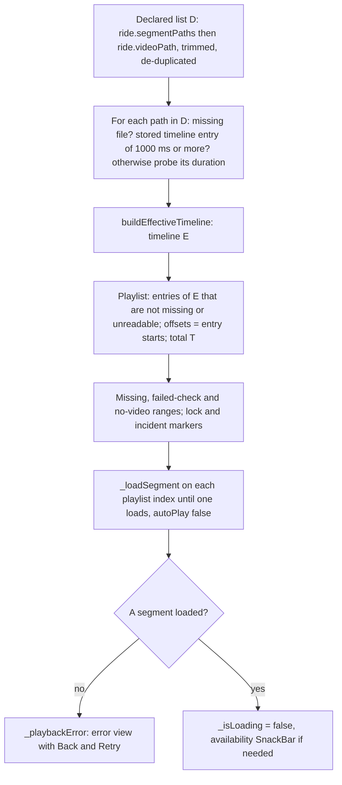

# Ride History and playback

This document covers how MotoCam finds recorded rides on disk, lists them in Ride History, and plays a ride's video segments as one continuous timeline with telemetry and a route map. It describes the code as it is today. For the JSON and integrity envelope these screens read, see [data-formats.md](data-formats.md).

## Contents

- [Ride discovery and loading](#ride-discovery-and-loading)
- [Rides list UI and actions](#rides-list-ui-and-actions)
- [Opening a ride and integrity verification](#opening-a-ride-and-integrity-verification)
- [Playback engine](#playback-engine)
- [Effective timeline synthesis](#effective-timeline-synthesis)
- [Missing segments and the seekbar track](#missing-segments-and-the-seekbar-track)
- [Telemetry sync during playback](#telemetry-sync-during-playback)
- [Route map](#route-map)
- [Ride actions and their effect on disk](#ride-actions-and-their-effect-on-disk)

Key files:

| File | Main symbols |
|---|---|
| [rides_list_screen.dart](../lib/features/history/rides_list_screen.dart) | `RidesListScreen` |
| [ride_history_loader.dart](../lib/features/history/models/ride_history_loader.dart) | `loadRideHistory`, `findOrphanVideoPaths` |
| [ride_record.dart](../lib/features/history/models/ride_record.dart) | `RideRecord`, `RideIntegrityStatus`, `RideIntegrityReport`, `RideIncident`, `RideSegmentTimelineEntry` |
| [ride_playback_screen.dart](../lib/features/history/ride_playback_screen.dart) | `RidePlaybackScreen` (state and playback logic are in the private `_RidePlaybackScreenState`; the speed-graph painter is the private `_SpeedGraphPainter`) |
| [playback_timeline.dart](../lib/features/history/widgets/playback_timeline.dart) | Pure timeline functions (`buildEffectiveTimeline`, `locateSegment`, `uncoveredRanges`, marker and integrity helpers), `PlaybackRange`, `PlaybackMarker`, `SegmentSeekTarget` |
| [playback_seekbar_track_shape.dart](../lib/features/history/widgets/playback_seekbar_track_shape.dart) | `PlaybackSeekbarTrackShape` and the seekbar colour constants |
| [route_map_view.dart](../lib/features/history/widgets/route_map_view.dart) | `RouteMapView` |
| [route_points.dart](../lib/features/map/route_points.dart) | `latLngFromSample`, `samplesWithGpsFix`, `routePointsFromSamples`, `downsampleRoute` |
| [static_map_viewer.dart](../lib/features/map/widgets/static_map_viewer.dart) | `StaticMapViewer`, `MapPainter` |
| [map_source_config.dart](../lib/features/map/map_source_config.dart) | `MapSourceConfig` |

## Ride discovery and loading

A ride is one start-to-stop recording session, persisted as one `*.telemetry.json` file. `TelemetryProvider.stopRideSessionAndPersist` writes the completed file at STOP, and `TelemetryProvider.checkpointRideSession` writes checkpoints (`sessionComplete: false`) during the ride. Every write is sealed with an integrity envelope; a checkpoint lists only the segments whose hash is already known (see [telemetry.md](telemetry.md)). Ride History is opened from the recording screen's HISTORY button by `_RecordingScreenState._openRideHistory` in [recording_screen.dart](../lib/features/recording/recording_screen.dart). While recording, the button reads MINIMISE and tries picture-in-picture instead, and `_openRideHistory` itself returns early. Otherwise it releases the idle camera, calls `TelemetryProvider.pauseTracking()` (GPS and sensors stop while history is open), pushes `RidesListScreen`, and re-initializes the camera when the user returns.

`_RidesListScreenState._loadRides` builds the list:

1. `CameraProvider.getRecordings()` ([camera_provider.dart](../lib/features/camera/providers/camera_provider.dart)) recursively lists every file under the recordings directory and, on Android, under the legacy fallback roots (`MotoCam Recordings` under the app documents and app cache directories). Paths are de-duplicated by normalized path. Errors are swallowed: with no recordings directory it returns an empty list, and an unreadable directory is skipped.
2. The paths go to `loadRideHistory` ([ride_history_loader.dart](../lib/features/history/models/ride_history_loader.dart)), run on a background isolate with `Isolate.run`. If the isolate fails, it runs on the UI isolate instead.
3. Files whose lower-cased path ends with `.telemetry.json` are loaded one at a time with `RideRecord.fromTelemetryFile(file)`, using the default `verifySegments: false`. A `null` result or an exception skips that file.
4. `findOrphanVideoPaths` returns the video files (`.mp4`, `.mov`, `.mkv`, `.avi`) that no loaded ride references as its `videoPath`, a segment path or a quarantined path, for example segments of an interrupted ride that no checkpoint lists. Each one goes through `RideRecord.fromVideoFile`: if a `<base>.telemetry.json` next to the video (the video's name without its extension) references it, the ride is loaded from that file; otherwise a video-only ride is built (`telemetryPath` `null`, no samples, integrity `unknown`, `createdAt` from the file's modification time).
5. Rides are sorted by `createdAt`, newest first. For a telemetry ride `createdAt` is the parsed `startedAt` field converted to local time, or the telemetry file's modification time if it cannot be parsed.

Every ride's samples are parsed during the load, copied back to the UI isolate, and kept in memory while the screen is open.

What `RideRecord.fromTelemetryFile` produces (details of each field are in [data-formats.md](data-formats.md)):

- Path resolution: each declared path (the `segmentPaths` list, or `[videoPath]` if it is empty, trimmed and de-duplicated) is resolved against the telemetry file's directory. A plain file name is taken from that directory. An existing path is kept. A path that no longer exists, but whose file name exists in that directory, is relocated there (for example after the iOS data-container path changed). Anything else is kept as declared.
- Trusted root: only the directory the telemetry file was found in, subdirectories included. Fields of the JSON being checked, such as `storageDirectory` or `videoPath`, are never trusted. Resolved paths outside that directory go to `quarantinedSegmentPaths`.
- `segmentPaths`: the trusted resolved paths. They are not filtered by existence; paths whose file no longer exists are also listed in `missingSegmentPaths`. If no trusted path is left, a video named like the telemetry file (`<base>.mp4`, `.mov`, `.mkv` or `.avi`) is used when it exists.
- `videoPath`: the resolved JSON `videoPath` if trusted, otherwise the last existing segment, otherwise the last trusted one. It is appended to `segmentPaths` if missing from it. If no path is left at all, the ride is dropped (`null`).
- `segmentTimeline`: entries whose resolved `path` is one of the segment paths, first entry per path, negative `startMs` clamped to 0, `endMs` raised to at least `startMs`, sorted by `startMs`.
- `lockedSegmentPaths`: resolved entries that are one of the segment paths.
- `samples`: the `samples` array in file order. A malformed sample is skipped; the ride is kept.
- `incidents`: the optional top-level `incidents` list as `RideIncident` objects (entries without a usable non-negative `elapsedMs` are skipped), sorted by `elapsedMs`. It is `null` when the key is absent.
- `mockLocationDetected` (default `false`) and `isSessionComplete` (from `sessionComplete`, default `true`).
- `integrity`: a payload-level check (see [below](#opening-a-ride-and-integrity-verification)).

## Rides list UI and actions

The screen has the app bar "Ride History", a spinner while loading, "Failed to load rides: ..." on error, and "No rides found yet. Record a ride to see it here." when empty. Otherwise it shows a "Locked Clips" section (rides where `isLocked`, that is `lockedSegmentPaths` is non-empty) followed by an "All Rides" section that contains only the unlocked rides. Both keep the newest-first order.

Each card shows:

| Element | Content or condition |
|---|---|
| Title | `createdAt` as `dd MMM yyyy, hh:mm a` |
| File name | `RideRecord.fileName` (last component of `videoPath`), one line |
| `VIDEO ONLY (RECOVERED)` badge | `telemetryPath == null` |
| Integrity badge | The first that applies: `INTEGRITY WARNING` (`integrity.status == modified`), `SIMULATED GPS` (`mockLocationDetected`), `DATA UNMODIFIED` (`verified`), `UNVERIFIED` (`unknown` with a telemetry file) |
| `QUARANTINED n` badge | `quarantinedSegmentPaths` non-empty |
| `INCOMPLETE` badge | `missingSegmentPaths` non-empty |
| `RECOVERED (INCOMPLETE)` badge | A telemetry file with `sessionComplete: false` (a checkpoint: the app stopped before the ride was saved normally) |
| `LOCKED` badge | `isLocked` |
| Subtitle lines | Distance (2 dp), duration (`HH:MM:SS` from the last sample's `elapsedMs`), "Video: X of Y kept" when the stored timeline leaves spans of 2 s or more without video, max and average speed (1 dp), "Segments: n" or "Segments: a of n available", sample count, the integrity line, "Quarantined paths: n" when present, "Telemetry: Available" or "Telemetry: Not available" |
| Unlock button | Locked rides only. Enabled when the status is not `modified` and there are no quarantined paths; otherwise disabled with the tooltip "Integrity warning: lock state changes disabled". A spinner replaces it while the unlock runs |
| Delete button | Every ride. Tooltip "Delete ride", or "Unlock the ride to delete it" for a locked ride that can be unlocked. A spinner replaces it while the files are deleted |

The badges wrap onto further lines instead of squeezing the file name. `DATA UNMODIFIED` covers the ride JSON only; segment files are hashed when the ride is opened.

The integrity line is one of:

| Status | Text |
|---|---|
| `verified` | "Integrity: ride data unmodified since recording (videos are checked on playback)" |
| `modified` | "Integrity: check failed" |
| `unknown`, video-only ride | "Integrity: not available" |
| `unknown`, otherwise | "Integrity: not available (recorded by an older version)" |
| `unknown`, `sessionComplete: false` | "Integrity: not available (ride was not saved completely)" |

When `mockLocationDetected` is set, ". GPS came from a simulated (mock) location provider." is appended.

Behaviour:

- Tapping a card pushes `RidePlaybackScreen(ride: ride)`. An `_isOpeningRide` flag ignores further taps until the route is popped. The list is not reloaded on return.
- Pull to refresh reloads everything (the list is replaced by the spinner while it runs). It is only available when the list is non-empty.
- Unlock and delete are described under [Ride actions](#ride-actions-and-their-effect-on-disk). The screen has no lock, export, share or search action.

## Opening a ride and integrity verification

`_RidePlaybackScreenState.initState` runs, in order:

1. Records whether the app is in the foreground and registers the lifecycle observer.
2. Computes the ride's maximum sample speed for the speed graph.
3. `_loadPlaybackPreferences()` (not awaited): reads the route-map panel preference and the online-map consent.
4. `_showInitialIntegrityWarning()`: shows the load-time notices after the first frame, and marks segments that have no recorded hash (`missing-segment-hash` issues are known before any hashing).
5. `_verifySegmentsAsync()` (not awaited): runs the full segment check, described below.
6. `_initializePlayback()` (not awaited): builds the playlist and loads the first segment ([Playback engine](#playback-engine)).

Steps 3, 5 and 6 then run concurrently. `dispose` cancels segment loads, but not the hashing job: its result is ignored once the screen is gone.

The two verification levels differ (the envelope format and the issue codes are in [data-formats.md](data-formats.md)):

| | Ride History load | Playback screen |
|---|---|---|
| Call | `fromTelemetryFile(file)` with `verifySegments: false` | `verifySegmentIntegrity()` (re-reads the JSON, `verifySegments: true`) |
| Checks | Envelope presence and format, `algo`, `envelopeVersion`, `payloadHash`, a recorded hash for every existing segment, orphan keys in `segmentHashes`, quarantine | The same, plus a full SHA-256 of every existing trusted segment file (`segment-hash-mismatch`, `unreadable-segment-file`) |
| Result | Card badges | Seekbar ranges and the integrity notice |

Verification fails closed. A completed ride whose `schemaVersion` is 3 or later and that has no envelope is `modified` (`missing-integrity`), and so is an envelope that is not an object (`invalid-integrity`). A ride without an envelope is `unknown` only when its `schemaVersion` is below 3 or it is marked `sessionComplete: false`. A segment file that is missing is not an integrity issue: it makes the ride incomplete (`missingSegmentPaths`, the `INCOMPLETE` badge and the red seekbar ranges) without counting as modification.

The full check runs `RideRecord.verifySegmentIntegrity` on a background isolate with `Isolate.run` (or on the UI isolate if that fails), and only the issue list and the quarantine count come back. Results are kept in the static `_integrityJobs` map, at most 16 entries, keyed by the telemetry path plus the size and modification time of the telemetry file and every segment. Re-opening an unchanged ride does not hash its segments again, and concurrent opens share one job. Nothing is written to disk and the result is not passed back to Ride History.

What the playback screen shows:

| When | Playback screen |
|---|---|
| Load-time issues or quarantined paths | SnackBar (5 s) with the text from `describeIntegrityIssues` (below) |
| Status `unknown` with a telemetry file | "This ride has no integrity record, so its files cannot be checked." in the same SnackBar |
| `mockLocationDetected` | "GPS in this ride came from a simulated (mock) location provider." in the same SnackBar |
| The full check finds issues | Segments that failed are painted purple on the seekbar, and a SnackBar (6 s) with the `describeIntegrityIssues` text, unless it is the notice already shown |

`describeIntegrityIssues` builds "Integrity check: ..." from up to three parts, joined with "; ": "the ride data may have changed since recording" (any issue other than a segment or quarantine issue), "N segment(s) could not be confirmed unmodified since recording (marked purple on the seekbar)" (`segment-hash-mismatch`, `missing-segment-hash` or `unreadable-segment-file`, counted once per segment), and "N segment path(s) outside the recordings folder was/were skipped".

The status never blocks playback or seeking. Quarantined paths are not in the playlist. A segment that fails the check is still played; its span is marked purple.

## Playback engine

All of the following is in `_RidePlaybackScreenState`, using the pure functions in [playback_timeline.dart](../lib/features/history/widgets/playback_timeline.dart). The screen uses the `video_player` plugin with one `VideoPlayerController.file` per segment, created without `VideoPlayerOptions`. It has no platform gating and uses no app method channel.

### Initialization

- Durations come from the stored timeline. A path is probed only when it has no stored entry of at least 1000 ms (rides recorded before the timeline existed, or an entry saved without an end). A missing file counts as missing and is not probed.
- Probing (`_probeSegmentDuration`): the file is opened with a throwaway controller, `initialize()` is awaited, `value.duration` is read and the controller is disposed. Only for the last declared path, a failed probe is retried once after 300 ms. A duration of zero or an error counts as unreadable.
- The playlist lists `_segmentPaths`, `_segmentDurations` and `_segmentOffsets` run in parallel, in timeline order. Offsets are the timeline entry starts and do not change. A segment's duration starts as its timeline length and is replaced by the controller's real duration when the segment loads.
- A segment whose duration came from the timeline is checked for readability only when it loads. A failed load marks it as failed (red on the seekbar) and counts it as unreadable.
- If no segment loads, `_playbackError` is set and the screen shows an icon, the message and two buttons, Back and Retry. The message is "No playable video for this ride (N missing, M unreadable)." (each count only when non-zero), or "This ride has no video segments." when D is empty. Retry (`_retryPlayback`) disposes the current controller and runs the whole initialization again.

### Loading a segment (`_loadSegment`)

1. Return `cancelled` if disposing, `failed` if the index is out of range. Take a new load generation (`_loadGeneration`).
2. `_initializeSegmentController` creates and initializes a controller. For the last playlist segment it retries once after 300 ms. Failure returns `failed`.
3. `setLooping(false)`; seek to the clamped `initialPosition` if it is above zero.
4. If a later load, `_retryPlayback` or `dispose` has taken a newer generation, dispose this controller and return `cancelled`.
5. Remove the listener from the controller being replaced, add `_onControllerTick` to the new one, then `setState` to install it, set `_activeSegmentIndex`, store its real duration and update `_lastKnownGlobalPosition`.
6. Dispose the replaced controller (not awaited). If `autoPlay`, and the app is in the foreground and the user is not scrubbing, `play()`.

Only one controller is active. The next segment is not preloaded.

### Position model and auto-advance

- Global position: `clamp(offset[active] + controller.value.position, 0, T)`. When there is no initialized controller, `_lastKnownGlobalPosition` is used.
- `_onControllerTick` runs on every `VideoPlayerValue` notification (the plugin updates the position every 100 ms while playing).
- When the value reports an error (`hasError`), `_handleRuntimeError` marks the segment as failed (red on the seekbar) and shows "Segment N could not be played. Skipping to the next segment." (4 s), then advances. If no playable segment follows, it shows "Playback ended: segment N could not be played." instead. It handles each controller once.
- When `isCompleted` is true, a next playable segment exists and no segment load is running, the position is set to the end of the active segment and `_advanceToNextSegment()` runs.
- `_advanceToNextSegment` sets `_isSwitchingSegment`, tries `_loadSegment(autoPlay: true)` on each following segment that has not failed, and returns on the first success. Segments that fail to load are marked failed and skipped. If nothing loads, playback is paused and "Playback ended: the remaining segments could not be opened." is shown.
- At the end of the last segment the controller simply completes. Pressing play then restarts that segment from 0 (the plugin seeks to 0 when position equals duration).
- `didChangeAppLifecycleState` pauses on every state other than `resumed` and records that the app is in the background. While it is, a segment that finishes loading (for example an auto-advance in flight) does not start playing, and seeks do not resume playback. Nothing resumes playback when the app returns.

### Seeking across segments

`locateSegment(offsets, durations, pos)` walks the playlist with `start = offset[i]` and `end = start + duration[i]`:

- `pos <= start`: segment `i`, local 0.
- `pos < end`, or `i` is the last segment: segment `i`, local `pos - start`.

So a position in a gap or a missing range lands at the start of the next playable segment, and a position past the last segment is clamped to that segment's end (by the plugin's `seekTo` within the current segment, or by `_loadSegment` when it switches segments).

`_seekGlobal(target, shouldResume)` clamps to `[0, T]` and locates the target. For the active segment (unless it has failed) it seeks the current controller and, with `shouldResume`, plays it if that controller is still the active one. Otherwise it sets `_isSeekingAcrossSegments` and calls `_loadSegment(autoPlay: false, initialPosition)` on the target, skipping failed segments and falling forward to later segments at position 0 if a load fails. If nothing loads it shows "No playable video at HH:MM:SS or later." With `shouldResume` it then calls `play()`.

Segment loads are serialized. A seek requested while an auto-advance or a cross-segment seek is loading is stored in `_pendingSeek` instead of starting; a newer request replaces it, and `_drainPendingSeek` runs it when the load finishes. A seek queued during an auto-advance resumes playback.

| Input | Action |
|---|---|
| Slider drag | `onChangeStart` → `_beginScrub` (pauses, enters scrub mode); `onChanged` → `_updateScrubPreview`; `onChangeEnd` → `_commitSeekbarValue` → `_commitScrub` → `_seekGlobal` (resumes if it was playing) |
| Slider release near a marker | `_commitSeekbarValue` snaps to the nearest incident or lock marker within 18 px, so a marker tap issues one seek, and shows "Jumped to incident/locked marker at HH:MM:SS" (1200 ms) |
| Speed graph tap | On tap-up, seeks to `position + ((dx - w/2) / w) * W` (`speedGraphTapTarget`; W is the graph window, see below) |
| Speed graph horizontal drag | The position and finger x at drag start are the anchor; the target is `anchor + ((dx - startDx) / w) * W`, clamped to `[0, T]` (`speedGraphDragTarget`). Scrubs like the slider |
| Replay 10 / Forward 10 | `_seekGlobal(position ∓ 10 s)` |
| Play / pause | `controller.play()` / `pause()` on the active controller |
| Tap on the video or the top-right button | Toggles fullscreen: only the video, the button and the hint "Tap video to show controls" remain |

A scrub may start while a segment loads; the seek it commits is queued by `_seekGlobal`. Below the controls, "Segment i/n" shows the active playlist position.

## Effective timeline synthesis

`buildEffectiveTimeline` merges the stored `segmentTimeline` with the declared paths D. Notation: `A[p]` is the probed duration of path `p` in ms (only paths without a usable stored entry are probed); `F` is the fallback duration.

**Fallback duration F**: the upper median (`sorted[len ~/ 2]`) of the positive lengths of the stored entries (after the adjustment below) and the probed durations, or 1000 ms when there are none.

**Stored entries.** For each stored entry, first entry per path: `s = max(startMs, 0)`, `e = max(endMs, s + 1)`. An entry shorter than 1000 ms (for example one saved without an end) takes its probed length when one exists: `e = s + A[p]`.

**Declared paths without a stored entry.** `c = max(e)` over the stored entries (0 without any). For each such `p` in D: `dur = max(A[p] ?? F, 1000)`, add `(p, c, c + dur)`, `c += dur`. Paths missing from the stored timeline are therefore appended after its end. Without a stored timeline this makes a sequential, gap-free timeline from 0 in declared order.

**Normalization.** Sort by start; `cursor = 0`; for each entry `s' = max(s, cursor)`, `e' = max(e, s' + 1)`, `cursor = e'`. Gaps between stored entries are kept; an overlapping entry is pushed to start at the previous end.

**Offsets and total.** The playlist offset of each playable segment is its entry's start. The total is `T = max(samples.last.elapsedMs (0 without samples), max end in E)`, and the slider runs from 0 to `T` ms.

**Worked example.** Stored entries A `[0, 300400]`, B `[300400, 600900]` and C `[600900, 600900]` (an entry with no length, for example one saved without an `endMs`, which the reader sets to `startMs`; see [data-formats.md](data-formats.md#segmenttimeline-entries)); B is missing on disk. A has a usable stored entry and is not probed; C's entry is shorter than 1000 ms, so C is probed and gives 299 600 ms. E is A `[0, 300400]`, B `[300400, 600900]`, C `[600900, 900500]`. The missing range is `[300400, 600900]`, offsets are A 0 and C 600 900, and `T` is 900 500 (assuming the last sample is not later). When A loads, its real duration (say 299 800 ms) replaces its stored length. A seek to 450 000, or to 300 000 (inside A's entry but past its real end), maps to C at local 0. Auto-advance at the end of A moves the position from 299 800 straight to 600 900.

The model assumes that segment local time 0 equals its timeline `startMs`, that video time maps 1:1 to timeline time, and that the timeline and telemetry `elapsedMs` share the same zero.

## Missing segments and the seekbar track

`rangesForPaths` turns a set of paths into the merged spans of their timeline entries, and `mergeRanges` sorts ranges and merges overlapping or touching ones. The screen keeps three range lists:

| Range list | Source | Colour | Legend |
|---|---|---|---|
| No video | `uncoveredRanges`: spans of `[0, T)` that no timeline entry covers, at least 2 000 ms long (for example footage that loop recording deleted during the ride) | `noVideoColor` (`0xFF78909C`, blue-grey) | "No video" |
| Missing | Declared segments that are missing or unreadable at initialization, plus segments that fail to load or fail during playback | `missingFootageColor` (`Colors.red`) | "Missing segment" |
| Failed check | Segments listed by `segmentPathsFailingIntegrity` from the load-time issues, then from the full check | `failedCheckColor` (`Colors.purpleAccent`) | "Failed integrity check" |

`PlaybackSeekbarTrackShape` ([playback_seekbar_track_shape.dart](../lib/features/history/widgets/playback_seekbar_track_shape.dart), a `SliderTrackShape` with `BaseSliderTrackShape`) replaces the slider track. It paints the inactive track as a rounded rect and the active part up to the thumb. It then paints the no-video, missing and failed-check ranges, in that order, at alpha 0.86, mapped linearly across the track width and clipped to the rounded rect. Last it draws the event markers as 2 px vertical ticks that extend a few pixels above and below the track: lock markers in `lockMarkerColor` (`Colors.orangeAccent`) and incident markers in `incidentMarkerColor` (`Colors.redAccent`). Theme colours are used for the track, with fallbacks only if the theme leaves them null. Because ranges and markers are positioned from the slider's own track rectangle, they line up with the positions the slider reports.

When any segment is missing or unreadable at initialization, a SnackBar (4 s) says "Some ride segments are unavailable (N missing, M unreadable). They are marked red on the seekbar and skipped." (each count only when non-zero), with " The last segment was retried once." appended when the last declared path failed its probe. A legend row under the time labels shows a dot for each range list and marker type that is present: "No video", "Missing segment", "Failed integrity check", "Incident" and "Locked".

Quarantined paths are not shown: they are neither in the playlist nor in the timeline.

## Telemetry sync during playback

On each rebuild of the `ValueListenableBuilder<VideoPlayerValue>`, the screen takes `position` (the scrub preview while scrubbing, otherwise the global position) and calls `widget.ride.sampleForPosition(position)`:

- No samples: `TelemetryData.empty()`. Before the first or after the last sample: that sample.
- Otherwise a binary search on `elapsedMs`, then linear interpolation of latitude, longitude, speed, bearing, accelerationG and distanceKm between the two neighbours. Bearing is interpolated along the shortest arc (`RideRecord.interpolateBearing`), so 350° to 10° passes through 0°.
- Position is never interpolated across a sample without a GPS fix: when one neighbour has `hasFix == false`, the neighbour with a fix supplies latitude, longitude, speed and bearing; when neither has a fix, the nearer sample is returned.

The interpolated sample feeds three views, all shown only when the ride has samples and the screen is not fullscreen:

| View | Details |
|---|---|
| Stats overlay | `Speed` (km/h, 1 dp), `Dist` (km, 2 dp), `G` (2 dp), `GPS` (5 dp) |
| Speed graph | 56 px strip; window `W = max(10 000, min(T, 60 000))` ms (`speedGraphWindowMs`) centred on the current time; only samples inside the window are walked; cyan line and dots, orange focus dot on the sample nearest the centre, short orange (lock) and red (incident) ticks |
| Route map | Current-position marker, see [Route map](#route-map) |

Timeline markers are computed at initialization:

- Incident markers: when the ride JSON has an `incidents` list (the incidents detected while recording; see [telemetry.md](telemetry.md)), each incident's `elapsedMs`, clamped to `[0, T]`, de-duplicated and sorted (`recordedIncidentOffsetsMs`). Files without the key fall back to `incidentMarkerOffsetsMs`: samples with `accelerationG >= 3.2`, at least 5 000 ms after the previous accepted marker. The incident-sensitivity setting ([settings.md](settings.md)) affects only detection while recording.
- Lock markers (`lockMarkerOffsetsMs`): the start offset of each playlist segment listed in `lockedSegmentPaths`.

The seekbar is a 34 px `Slider` whose track shape paints the ranges and markers (see [above](#missing-segments-and-the-seekbar-track)). Markers appear on the seekbar, as speed-graph ticks and in the legend row.

The whole playback body is rebuilt by one `ValueListenableBuilder` on every controller notification.

## Route map

The "Route Map" card sits below the video when the ride has samples and the screen is not fullscreen. Its header is a 48 dp button (with `Semantics` that report the expanded state). Tapping it toggles the map inside an `AnimatedSize` (180 ms) and stores the choice in SharedPreferences as bool `ride_playback_show_route_map` (default `false`). The map is built only while expanded; collapsed, the card holds an empty box, so no tiles are fetched.

The first time the rider expands the map, a dialog "Show online map?" explains that the map downloads tiles from OpenStreetMap (`tile.openstreetmap.org`), which sends the ride's area and the device's IP address to the OpenStreetMap Foundation, and that tiles are cached on the device. "Not now" leaves the map collapsed. "Show map" stores bool `ride_playback_online_map_consent` and expands the map. A stored `ride_playback_show_route_map` is honoured only once consent is stored.

The map height is `clamp(0.14 × screen height, 90, 130)`. `RouteMapView` receives `widget.ride.samples` and the interpolated sample as `currentSample`.

### Tile source (`MapSourceConfig`)

| Constant | Value |
|---|---|
| `tileUrlTemplate` | `https://tile.openstreetmap.org/{z}/{x}/{y}.png` |
| `tileHost` | `tile.openstreetmap.org` (named in the consent dialog) |
| `attributionText` | `OpenStreetMap contributors` (the attribution layer prepends the ©) |
| `copyrightUrl` | `https://www.openstreetmap.org/copyright` |
| `licenceSummary` | ODbL notice listed on the licence page (registered by `registerMapLicence`) |
| `userAgentPackageName` | `com.example.motocam` |
| `contactUrl` | `https://github.com/Sarthak195/MotoCam` |
| `userAgent` | `MotoCam (com.example.motocam; +https://github.com/Sarthak195/MotoCam) flutter_map`, sent as the `User-Agent` header of every tile request |
| `maxZoom` / `maxNativeZoom` | 19 / 19 |
| `maxTileCacheBytes` | 25 000 000 (25 MB) |

`RouteMapView` and the consent dialog in the playback screen are the only users of these constants. They are compile-time `const`, so changing the provider needs a new build. There is no fallback tile source.

### `RouteMapView`

`RouteMapView` is a `StatefulWidget`. It computes the route once per `telemetryData` list, so rebuilds that only move `currentSample` stay cheap:

1. `routePointsFromSamples` ([route_points.dart](../lib/features/map/route_points.dart)) keeps the samples that carry a real GPS fix: `hasFix` is true, the position is not exactly `(0, 0)`, and the coordinates are inside the WGS 84 range.
2. `downsampleRoute` keeps every `ceil(n / 1800)`-th point above 1 800 points, always keeping the last point.
3. With fewer than 2 points left, it returns `StaticMapViewer` instead.
4. Otherwise it builds a `FlutterMap` (flutter_map 8.3.2) whose initial camera fits the route's bounds (`CameraFit.bounds`, 20 px padding, zoom at most 16). The camera zoom is capped at `MapSourceConfig.maxZoom` (19). No `MapController` is used, so the map does not follow the current position and has no recentre control.

Layers: the OSM `TileLayer`; one `Polyline` (width 4, `lightBlueAccent`); markers for start (green, play icon), end (red, stop icon) and current position (cyan dot, hidden when the current sample has no GPS fix). Gestures: pinch zoom, drag, double-tap zoom, fling and scroll-wheel zoom; no rotation. The map background is dark grey, so missing tiles do not show as light blocks.

The `TileLayer` and its single `NetworkTileProvider` are created once per map and reused on every rebuild; the `TileLayer` disposes the provider when the map is removed. The provider sends `MapSourceConfig.userAgent` and caches tiles through flutter_map's `BuiltInMapCachingProvider` (`fm_cache` under the platform cache directory) with a 25 MB limit. flutter_map applies that limit when the cache is first opened in the process, so the cache can grow past it while the app runs. The app does not clear the tile cache, and deleting rides does not clear it.

Overlays: "GPS fixes: N" (fixes before downsampling) top left; "Map tiles unavailable (offline?)" bottom left once any tile fails to load (`errorTileCallback`); and the attribution bottom right. The attribution is `OsmAttribution` ([osm_attribution.dart](../lib/features/map/widgets/osm_attribution.dart)), the last child of the `FlutterMap`: flutter_map's `RichAttributionWidget` with an info button that opens a box with a `TextSourceAttribution` "© OpenStreetMap contributors" (plus the flutter_map credit, `showFlutterMapAttribution` left at its default). Tapping the OpenStreetMap line launches `copyrightUrl` in the external browser through `url_launcher` (`launchUrl`, `LaunchMode.externalApplication`); when that fails or no browser handles it, a SnackBar says "Could not open the link. Visit openstreetmap.org/copyright in a browser." The manifest has a `<queries>` entry for https `VIEW` intents so the lookup works on Android 11 and later. `StaticMapViewer` draws no tiles and needs no attribution. The licence page is reached from the recording settings sheet ("About and licences").

### `StaticMapViewer` fallback

Used only from `RouteMapView` when fewer than 2 GPS fixes remain, for example a ride recorded without a GPS fix. It draws without tiles, network or gestures, using only the samples that carry a fix (`samplesWithGpsFix`, the same filter as the online map):

- No fix: a grey box with "No GPS fix recorded for this ride" ("No location data available" for an empty sample list, which the playback screen never passes).
- Otherwise: a 40 px grid, the route coloured green → yellow → orange → red by speed relative to the fastest fix, green and red circles at the first and last fixes (a single fix is one green dot in the centre), and an info box with "GPS fixes: N" and the start and end coordinates (4 dp).

`MapPainter` projects equirectangularly from the min/max bounds padded by 10 %, with one scale for both axes.

## Ride actions and their effect on disk

These actions in Ride History and playback write app data:

| Action | Where | Effect on disk |
|---|---|---|
| Unlock | Ride History, locked rides | After the dialog "Unlock this clip?" ("Unlocking only removes the lock marker. MotoCam never deletes past rides automatically; the ride moves from Locked Clips to All Rides."), `RideRecord.setLockState(false)` runs. It refuses if the in-memory status is `modified`, paths are quarantined or the ride has no telemetry file. Otherwise, under a per-file lock, it re-reads the JSON and re-verifies it in full, including every segment hash, and refuses if that check fails. It then sets `lockedSegmentPaths` to `[]` and rewrites the file with `writeTelemetryAtomically`. A verified ride keeps its `segmentHashes` and gets a new `payloadHash` (`resealIntegrityEnvelope`); a ride without an envelope is written without one, so it stays unverified (details in [data-formats.md](data-formats.md#re-signing-on-lock-change)). On success the list reloads and shows "Clip unlocked."; otherwise "Could not unlock this clip: its files failed the integrity check or could not be saved." (3 s) |
| Delete | Ride History, any ride | See below |
| Route Map toggle | Playback | SharedPreferences bool `ride_playback_show_route_map` |
| Online map consent | Playback, first map expansion | SharedPreferences bool `ride_playback_online_map_consent` |
| Everything else in playback | Playback | Reads only (telemetry JSON, segment hashing, decoder probes). The only other disk writes are the map tiles flutter_map caches under `fm_cache` (see [Route map](#route-map)) |

The re-verification in `setLockState` hashes the segment files on the UI isolate, so unlocking a long ride can take a while.

**Delete.** Each card has a delete button:

- A locked ride that can be unlocked is not deleted: "This ride has locked clips. Unlock it first to delete it." (3 s).
- A locked ride whose lock cannot be removed (status `modified` or quarantined paths) can be deleted after a warning, so it never becomes impossible to remove in-app. Automatic deletion never removes locked footage.
- The dialog "Delete this ride?" says "This permanently deletes the ride's N video segment(s) and its telemetry from this device. Copies already exported to the gallery are not affected.", prefixed for a stuck lock with "This ride has locked clips and failed the integrity check, so it cannot be unlocked."
- On confirmation, the ride's trusted segment files, its `videoPath` and its telemetry JSON are deleted; quarantined paths (outside the recordings directory) are never deleted. The list reloads and shows "Ride deleted." or "Ride deleted, but N file(s) could not be removed." (3 s).

`setLockState(true)` exists (it locks every trusted segment), but the app never calls it. Related actions that happen elsewhere:

| Action | Where it happens |
|---|---|
| Lock | During recording only, via `CameraProvider.markIncident`; the locked paths are persisted with the ride ([recording-pipeline.md](recording-pipeline.md)) |
| Export to gallery | Android only, and only when the rider turned on the gallery-export setting (`exportLockedClipsToGallery`, default off): at stop, locked segments of the session are queued for export to the public gallery through the `com.example.motocam/media` channel ([platform-integration.md](platform-integration.md)) |
| Automatic deletion | Recording-side code only. Loop roll-over deletes the oldest unlocked segments of the current session (`selectSegmentsToEvict`). About 2 s after a stop, `_pruneOrphanTelemetryFiles` deletes telemetry files with no segment paths or no remaining segment files, skipping any file with locked paths ([recording-pipeline.md](recording-pipeline.md)). Past rides are never aged out |
| Share, playback speed, volume | Not implemented |

Persisted `lockedSegmentPaths` are read by `RideRecord` (list grouping, badge, lock markers) and by the orphan-telemetry prune, which never deletes a file that lists locked paths. Loop roll-over consults only the current session's in-memory lock set and never touches the files of earlier rides.
