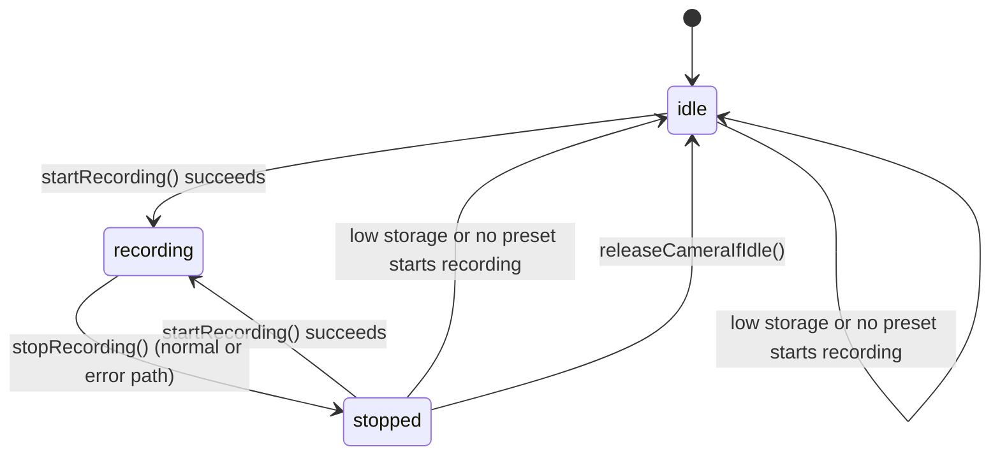
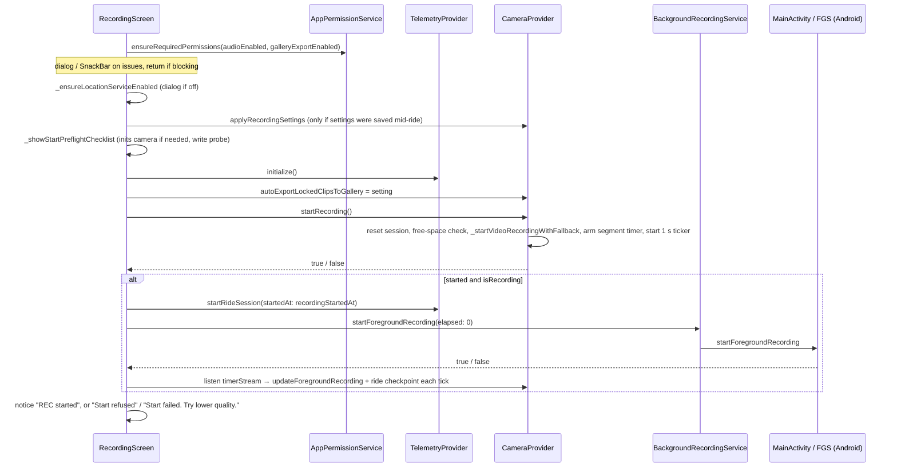

# Recording pipeline

How MotoCam turns a press of START into a series of video segment files on disk: camera setup, the recording state machine, segment rollover, the stop sequence, storage, retention, and how the app behaves when it leaves the foreground. Most of the logic lives in `CameraProvider`. `RecordingScreen` coordinates it with telemetry, settings and the Android foreground service.

## Contents

- [Components](#components)
- [CameraProvider public surface](#cameraprovider-public-surface)
- [Camera initialization](#camera-initialization)
- [Recording state machine](#recording-state-machine)
- [Start flow](#start-flow)
- [Segment rollover](#segment-rollover)
- [Stop flow](#stop-flow)
- [Storage layout and file naming](#storage-layout-and-file-naming)
- [Incident locks and retention](#incident-locks-and-retention)
- [Lifecycle, background and the foreground service](#lifecycle-background-and-the-foreground-service)
- [Error handling and recovery](#error-handling-and-recovery)
- [Current constraints](#current-constraints)

## Components

| Component | File | Role in recording |
|---|---|---|
| `CameraProvider` | [camera_provider.dart](../lib/features/camera/providers/camera_provider.dart) | Owns the `CameraController`, the recording state, segment timer, segment files, locks, retention, free-space checks and gallery export. The root `MultiProvider` in [main.dart](../lib/main.dart) creates one instance, with `enableDebugLogging: kDebugMode`. |
| Retention rules | [recording_retention.dart](../lib/features/camera/providers/recording_retention.dart) | Pure functions used by `CameraProvider`: `selectSegmentsToEvict`, `segmentsEvictedByNextRegistration`, `unsettledSegmentSequences` and `findOrphanTelemetryFiles`. They take plain lists and paths, so they are unit-tested without the camera plugin. |
| `RecordingScreen` | [recording_screen.dart](../lib/features/recording/recording_screen.dart) | Home route. Runs the start and stop flows, handles app lifecycle events, blackout mode, PiP, incident auto-lock, ride checkpoints, recording faults and the one-time battery-optimization offer. It is the only code that passes data between `CameraProvider` and `TelemetryProvider`, `AppSettingsProvider` or the native services. The settings sheet and the rides list only read from the providers. |
| Screen helpers | [recording_screen_logic.dart](../lib/features/recording/recording_screen_logic.dart) | Pure helpers for the screen: `BackgroundStallTracker`, `RideCheckpointTracker`, `incidentLockNotice`, `formatRecordingElapsed` (delegates to `formatElapsed` in [format_utils.dart](../lib/core/utils/format_utils.dart)) and the START/STOP button colours. |
| `BackgroundRecordingService` (Dart) | [background_recording_service.dart](../lib/core/services/background_recording_service.dart) | Bridge to the Android foreground service over `com.example.motocam/background_recording`. The channel calls do nothing unless `defaultTargetPlatform` is Android; off Android `startForegroundRecording` returns `true`. It also stores the "battery-optimization exemption offered" flag in SharedPreferences. |
| `PipService` | [pip_service.dart](../lib/core/services/pip_service.dart) | Bridge to Picture-in-Picture over `com.example.motocam/pip`: `enterPipMode()` and the `pipModeStream` of mode changes. |
| `BackgroundRecordingService` (Kotlin) | [BackgroundRecordingService.kt](../android/app/src/main/kotlin/com/example/motocam/BackgroundRecordingService.kt) | Android-only foreground service: ongoing notification with a Stop action, and a partial wake lock. |
| `MainActivity` | [MainActivity.kt](../android/app/src/main/kotlin/com/example/motocam/MainActivity.kt) | Android-only handlers for the background-recording, PiP and media channels, the notification Stop relay, and automatic PiP entry. |

`CameraProvider` imports no other provider and no service except `AppPermissionService`, whose static `isPermissionGranted` check it uses. Every link between camera, telemetry, settings and the foreground service goes through `RecordingScreen`. For the overall structure see [architecture.md](architecture.md). For the channel reference see [platform-integration.md](platform-integration.md).

## CameraProvider public surface

Methods:

| Method | What it does | Caller |
|---|---|---|
| `initializeCamera({resolutionPreset, recordingFps, videoBitrateBps, audioEnabled, preferredCameraName, segmentDurationSeconds, segmentDurationMinutes, maxRollingSegments})` | Applies the given values and (re)creates the controller. Calls are serialized. See [Camera initialization](#camera-initialization). | `RecordingScreen._initializeCamera`, `applyRecordingSettings` |
| `applyRecordingSettings({...})` | Returns `false` while a recording is starting, active or stopping. Returns `true` without doing anything if nothing changed. Otherwise calls `initializeCamera()` with the values (segment 5..600 s, loop 1..120) and returns `isInitialized`. | `RecordingScreen._openSettingsSheet`, `_applySavedCameraSettings` |
| `startRecording()` | Starts a session. See [Start flow](#start-flow). | `RecordingScreen._runStartRecordingFlow` |
| `stopRecording()` | Ends a session and returns the final video path. See [Stop flow](#stop-flow). | `RecordingScreen._stopRecordingFlow` |
| `recoverRecordingPipeline({reason})` | Runs one segment cycle (stop, restart, then register the stopped file) without ending the session. | `RecordingScreen._attemptRecoveryFromPossibleVideoStall` |
| `markIncident({protectPastSegments = 2, protectCurrentSegment = true, reason = 'manual'})` | Locks recent segments. See [Incident locks](#incident-locks). | `RecordingScreen` (auto-lock and LOCK button) |
| `releaseCameraIfIdle()` | Waits for an in-progress initialization, then disposes the controller unless a recording is starting, active or stopping. | `RecordingScreen._openRideHistory` |
| `availableStorageBytes()` | Free bytes on the volume of the recordings directory, from the native `getAvailableStorageBytes` method. `null` when the platform does not answer. | Internal free-space checks |
| `getRecordings()` | Lists every file under the recordings directory and the Android legacy fallback roots, in no particular order. | [rides_list_screen.dart](../lib/features/history/rides_list_screen.dart) |
| `getAvailableCameras({refresh})`, `cameraLabel(camera)` | Cached camera list and a `Front/Back/External (name)` label. | `RecordingScreen._openSettingsSheet` (list), settings sheet (label) |
| `getSupportedFpsOptionsForPreset({preset})` | The cached FPS list for a preset on the active camera, or `[24, 30, 60]`. | `RecordingScreen._openSettingsSheet`, settings sheet |
| `resolvePresetForRequestedResolution(int)`, static `presetForResolution(int)`, static `resolutionForPreset(preset)` | Resolution and preset mapping (table below). | `RecordingScreen`, settings sheet |
| `resolveAppliedResolutionForRequested(int)` | Returns `resolutionForPreset(resolvePresetForRequestedResolution(resolution))`. | None in `lib/` |

Getters, grouped:

| Group | Getters |
|---|---|
| State | `controller`, `state`, `isInitialized`, `isInitializing`, `isRecording` (`state == recording`), `isStartingRecording`, `isStoppingRecording`, `lastRecordingError`, `lastGalleryExportMessage`, `recordingsDirectory`, `currentVideoPath`, `elapsedTime`, `recordingStartedAt`, `timerStream` (broadcast `Stream<Duration>`, one event per second while recording, no replay) |
| Applied settings | `resolutionPreset`, `recordingFps`, `videoBitrateBps`, `videoBitrateMbps`, `supportsVideoBitrateControl`, `appliedVideoBitrateMbps`, `audioEnabled`, `preferredCameraName`, `activeCameraName`, `discoveredCameras`, `segmentDurationSeconds`, `segmentDurationMinutes`, `maxRollingSegments` |
| Session | `lastSessionSegmentPaths` (oldest first), `lastSessionSegmentTimeline` (list of `{path, startMs, endMs}`), `lockedSegmentPaths` (sorted by path, not by time), `lockedSegmentCount` |
| Instrumentation | `lastRollStopMs`, `lastRollRestartMs`, `lastRollRegisterMs`, `lastRollTotalMs`, `lastRollAt`, `recentRollTotalMs`, `averageRollTotalMs`, `recordingRecoveryCount`, `lastRecordingRecoveryAt`, `lastRecordingRecoveryReason` |
| Capability caches | `knownSupportedFpsOptions`, `knownSupportedResolutionOptions`, `knownUnsupportedResolutionPresets` |

There are also three public fields. `enableDebugLogging` gates the verbose `[MotoCam] ...` log lines; warnings and errors are logged in every build mode. `autoExportLockedClipsToGallery` (default `false`) enables the gallery export at stop. `platform` is the static `com.example.motocam/media` channel. The provider stores nothing in SharedPreferences. Its inputs come from `AppSettingsProvider` through `RecordingScreen` (see [settings.md](settings.md)).

## Camera initialization

`RecordingScreen` calls `initializeCamera` (through `_initializeCamera`):

- at bootstrap, after settings load and the permission audit (skipped while a required permission is missing);
- from the Retry button of the camera-unavailable panel, which re-runs the whole bootstrap, and after Open Settings once the app resumes;
- on resume while idle, when the camera is not initialized and camera (and, with audio on, microphone) permission is already granted;
- in the start preflight when the camera is not initialized;
- on return from ride history;
- through `applyRecordingSettings`, from the settings sheet and, before START, for settings saved during the previous recording.

Calls are serialized: a call made while another initialization runs waits for it, then runs with its own values. While a recording is starting, active or stopping, the call does nothing. In order, it:

1. Applies any non-null arguments. `segmentDurationSeconds` is clamped to 5..600 s. `segmentDurationMinutes` (1..10) is used only when seconds is null, and `RecordingScreen` never passes it. `maxRollingSegments` is clamped to 1..120.
2. If a controller exists, sets `controller` to null, notifies listeners so the preview stops using it, disposes it and waits 120 ms.
3. Requests `Permission.camera`, then `Permission.microphone` only when audio is enabled. Notification permission is left to the permission audit. If camera or microphone is not granted or limited, it aborts.
4. Runs `_setupRecordingsDirectory` (see [Storage layout](#storage-layout-and-file-naming)). It aborts if no directory results.
5. Calls `getAvailableCameras(refresh: true)` and aborts if the list is empty.
6. Selects a camera with `_resolveCamera`: an exact name match with the preferred camera name, else the first back camera, else the first camera. If no preference was set, the chosen camera's name becomes the preference.
7. Tries presets in fallback order, starting at the requested preset (details below).
8. On success, stores the controller, preset and FPS, sets `isInitialized = true` and notifies.

Each abort and any exception set `isInitialized = false` and notify. Once an attempt has finished, the preview area shows a "Camera not available" panel with **Retry** and **Open Settings** buttons instead of a spinner. The panel does not name the specific cause.

**Resolution mapping.** Settings store a vertical resolution. The provider maps it to a `ResolutionPreset`:

| Setting | `presetForResolution` | `resolutionForPreset` back |
|---|---|---|
| 480 | `medium` | `low` and `medium` → 480 |
| 720 | `high` | `high` → 720 |
| 1080 | `veryHigh` | `veryHigh` → 1080 |
| 2160 | `ultraHigh` | `ultraHigh` and `max` → 2160 |

`resolvePresetForRequestedResolution` returns the requested preset unless it is known to be unsupported on the active camera. In that case it returns the highest supported preset at or below the request, else the lowest supported one.

**Preset and FPS fallback.** The candidate list is the part of `[ultraHigh, veryHigh, high, medium, low]` that starts at the requested preset. A preset not in that list (`max`) uses `[high, medium, low]`. For each candidate:

- `nearestSupportedFps` picks the FPS from the cached list for that preset (default `[24, 30, 60]`): the requested value if offered, else 30, else the highest value below the request, else the lowest offered value.
- `_tryInitializeController` builds a `CameraController(camera, preset, enableAudio, fps, videoBitrate, imageFormatGroup: jpeg)` and calls `initialize()`. It then calls `lockCaptureOrientation(DeviceOrientation.portraitUp)` and ignores any error from that call. On failure the controller is disposed.
- If the attempt fails, that FPS is removed from the preset's cached list (30 is re-added if the list becomes empty). The provider retries once with 30, or with the last cached value when 30 is gone, but only if that differs from the FPS that just failed.
- If no attempt at the preset succeeds, the preset is marked unsupported for this camera.

If every preset fails, the camera is treated as busy or unavailable: the FPS and unsupported-preset caches of that camera are cleared, so the next attempt retries the rider's request. Otherwise the caches stay in memory for the process. A preset leaves the unsupported set when a later controller initializes at that preset. The FPS cache key is `<cameraName>_<preset>_<audio 0|1>`. The unsupported-preset cache key is `<cameraName>_<audio 0|1>`.

The negotiated preset and FPS never overwrite the saved settings. When they differ, the profile bar under the header shows the applied value next to the saved one, for example `720p (set 1080p)` or `30 FPS (set 60)`.

**Bitrate.** `videoBitrateBps` (settings Mbps × 1,000,000) is passed to `CameraController`. The Android implementation in use (camera_android_camerax 0.7.2) does not read `videoBitrate`; its recorder is created from a quality selector alone. `supportsVideoBitrateControl` is therefore `false` on Android and `appliedVideoBitrateMbps` is `null`. The settings sheet shows "No effect on this device" under the bitrate field, and the ride JSON stores `appliedBitrateMbps: null`.

**Orientation and preview.** [main.dart](../lib/main.dart) locks the UI to `portraitUp`, and capture orientation is locked to `portraitUp` as described above. `RecordingScreen._buildCameraPreview` shows the preview in portrait. It inverts `controller.value.aspectRatio` when that ratio is above 1, and uses 16:9 (shown as 9:16) when the ratio is not finite or ≤ 0. The preview is keyed by preset, FPS, camera name and controller hash, so a new controller rebuilds it.

## Recording state machine

`RecordingState` has four values. `paused` is declared but never assigned.



`startRecording` returns `false` at once while a session is recording, starting or stopping, or when the camera, controller or recordings directory is not ready. If it throws after resetting the session, it returns `false` and leaves `state` unchanged.

A recording fault is not a separate state. When a roll or recovery cannot continue, `lastRecordingError` is set, the segment timer is cancelled and listeners are notified, but `state` stays `recording` so the session's segments, locks and timeline can still be saved. `RecordingScreen` reacts by running its stop flow (see [Error handling](#error-handling-and-recovery)).

`stopRecording` sets `isStoppingRecording` and notifies at entry, sets `state = stopped` as soon as the plugin's `stopVideoRecording()` returns, and notifies again when it finishes.

The state is supported by these fields:

| Field | Set | Cleared | Purpose |
|---|---|---|---|
| `_isInitialized` | successful init | init start/abort, `releaseCameraIfIdle`, failed recording fallback | Controller is usable |
| `_initInFlight` | `initializeCamera` | its `finally` | Serializes initialization (`isInitializing`). `releaseCameraIfIdle` waits on it. |
| `_isStartingRecording` | `startRecording` | its `finally` | `isStartingRecording`. Blocks a second start, initialization, settings changes and release. |
| `_isStoppingRecording` | `stopRecording` | its `finally` | `isStoppingRecording`. Blocks new rolls, recovery, initialization and release, and skips the restart inside a running roll. |
| `_rollInFlight` | `_rollSegmentIfNeeded`, `recoverRecordingPipeline` | their `finally` | One segment cycle at a time. `stopRecording` awaits it. |
| `_lastRecordingError` | low storage at START, recording fault | next `startRecording` | Rider-facing reason. While set, no roll or recovery runs. |
| `_consecutiveRollStopFailures` | failed segment stop | cycle whose stop succeeded, `startRecording` | Two failed stops in a row cause a fault |
| `_activeSegmentSequence`, `_lastSettledSegmentSequence` | segment start, registration | `startRecording` | Number the segments of a session (1-based) for lock bookkeeping |
| `_pendingLockSequences` | `markIncident` | consumed by the registration of that sequence, `startRecording` | Locks waiting for a segment that is not registered yet |
| `_currentSegmentStartMs` | segment start | `startRecording` | Timeline start of the segment being recorded |
| `_isDeferredMaintenanceRunning` | deferred maintenance timer | same callback's `finally` | Prevents overlapping orphan prunes |
| `_isExportingToGallery` | `_enqueueDeferredGalleryExport` | after the queue drains | One gallery export drain at a time |

`RecordingScreen` has its own `_isStartingRecording`, `_isStoppingRecording` and `_isApplyingSettings` flags, which guard its flows and drive the button labels.

## Start flow

The START button calls `RecordingScreen._startRecordingFlow`. The button is disabled, with its label changed, while settings are being applied (`APPLYING SETTINGS...`), while a start is running (`STARTING...`), while a stop or a ride save is running (`SAVING RECORDING...`, which includes a Retry of a failed save), and while the camera initializes (`PREPARING CAMERA...`). The flow itself also returns at once while a start, a stop or a ride save is running, or while the camera already records.



Notes:

- The preflight (`_buildStartPreflightChecks`) has blocking checks for camera permission, microphone permission (only when audio is on), location permission, location services, camera ready and media write access. Its non-blocking warnings are notification permission and the battery-optimization exemption (both Android only), incident detection unavailable (no motion sensor), battery level below 15 %, and battery temperature of 43 °C or more. The media write check writes and deletes `.__motocam_write_probe.tmp` in the recordings directory. `startPreflightNeedsSheet` decides whether [start_preflight_sheet.dart](../lib/features/recording/widgets/start_preflight_sheet.dart) is shown: a failed blocking check or any warning opens it, and a blocking failure disables its Start button. The battery-optimization warning is the exception: once the one-time exemption offer has been shown, its row is built with `opensSheet: false`, so it no longer opens the sheet by itself and is listed only when another check opens it. If every check is `ok`, no sheet is shown. The rider-facing list is in [features.md](features.md#preflight-checks).
- `startRecording` sets `isStartingRecording` and notifies. It clears the session lists, locks, pending lock sequences, segment sequence counters, `currentVideoPath`, `lastRecordingError` and the recovery counters. Roll metrics and the gallery export queue are not reset.
- It then runs the free-space check (see [Free-space checks](#free-space-checks)). If there is not enough room, it sets `lastRecordingError` to "Storage is almost full. Free up space on the phone to keep recording.", sets `state = idle` and returns `false`. The screen shows "Recording did not start: <reason>" and the notice "Start refused".
- `_startVideoRecordingWithFallback` calls `startVideoRecording()` on the current controller. If the controller already records (or the plugin says a recording is already started), it returns `false` without any fallback. On any other error it disposes the failed controller, then tries each lower preset in turn: it initializes a new controller, swaps it in, notifies listeners and starts recording on it. Presets that fail are marked unsupported.
- `_recordingStartTime`, exposed as `recordingStartedAt`, is set when the first segment has started. It is the zero point of the segment timeline. `TelemetryProvider.startRideSession(startedAt:)` uses the same instant, so samples and segments share one clock. See [telemetry.md](telemetry.md).
- The camera plugin starts recordings as persistent recordings (`enablePersistentRecording` defaults to `true` in camera 0.12.0+2).
- **Android only:** `startForegroundRecording` returns whether the native side started the service. A `false` result or an exception shows "Background protection unavailable: recording may stop if the app is in the background or the screen turns off." Recording continues either way.
- **Battery optimization.** Neither START nor the foreground service asks for the exemption. After a ride whose JSON was saved from the STOP button, `_maybeOfferBatteryOptimizationExemption` shows a dialog ("Keep recording with the screen off?") on Android when the app is not exempt, at most once ever. The SharedPreferences flag `battery_optimization_exemption_offered` is set before the dialog, whatever the answer. "Open setting" calls `requestIgnoreBatteryOptimizations`.

## Segment rollover

`_armSegmentTimer` creates a one-shot `Timer(_segmentDuration)` that calls `_rollSegmentIfNeeded`. The duration comes from settings: 5, 10, 15, 30, 60, 120, 180, 300 or 600 s, default 300 s (see [settings.md](settings.md)).

`_rollSegmentIfNeeded` first waits for a recovery cycle that is still running; if that cycle armed a new timer, the new timer does the roll. It then returns without doing anything unless the session is recording, has a controller, no other cycle is running, no stop has begun and no fault is set. Otherwise it runs `_cycleSegment`, the same cycle that pipeline recovery uses:

1. **Free-space check.** Before the stop, so the platform call does not widen the gap, it checks whether one more segment fits, counting the space the loop is about to free (see [Free-space checks](#free-space-checks)).
2. **Stop.** Awaits `controller.stopVideoRecording()`, records `stopMs`, and stamps the stopped segment's `endMs` (time since `recordingStartedAt`) right after the stop returns.
3. **Restart.** Skipped if a stop has begun. If the free-space check failed, the restart is skipped and the fault message is the low-storage message. Otherwise `_restartRecordingAfterSegmentStop` calls `startVideoRecording()` up to twice, 500 ms apart. On success it increments the segment sequence, stamps the new segment's `startMs`, re-arms the timer and records `restartMs`.
4. **Register.** Awaits `_registerCompletedSegment` for the stopped file, with its sequence, `startMs` and `endMs`, and records `registerMs`. Registration never throws. It:
   - moves the file from the plugin's temporary location into the recordings directory (see [Storage layout](#storage-layout-and-file-naming)). If the result is missing or 0 bytes, nothing is registered and any pending lock for that sequence is dropped.
   - sets `currentVideoPath` and appends the path to the session list.
   - appends a timeline entry with the stamped `startMs` and `endMs`.
   - locks the segment if a pending lock exists for its sequence.
   - applies the per-session loop limit and deletes evicted files (see [Retention](#retention)).
5. Calls `_recordRollMetrics`, which stores the timings and keeps the last 10 totals. It does not notify listeners.
6. If recording did not restart and no stop has begun, enters a fault: "Recording stopped unexpectedly: the camera could not restart after a segment ended (storage full or camera unavailable).", or the low-storage message.

If the stop itself throws, the stopped file is unknown and nothing is registered. `_handleSegmentStopFailure` then re-arms the timer to retry at the next boundary, or enters a fault ("Recording stopped unexpectedly: the camera failed to end a segment.") when the controller no longer records or the stop failed twice in a row.

Instrumentation fields:

| Getter | Meaning |
|---|---|
| `lastRollStopMs` | Duration of `stopVideoRecording()` |
| `lastRollRestartMs` | Duration of the restart step, including a retry (0 if skipped) |
| `lastRollRegisterMs` | Duration of `_registerCompletedSegment` (file move and loop eviction) |
| `lastRollTotalMs`, `lastRollAt` | Whole cycle, and when it finished |
| `recentRollTotalMs`, `averageRollTotalMs` | Last ≤ 10 totals, and their rounded mean (0 when empty) |

Recovery cycles are measured the same way. These values live in memory only, and nothing in the app reads them. The debug log line for a cycle prints stop, register and total times. The restart time is logged on a separate line.

On camera_android_camerax 0.7.2, `stopVideoRecording` closes the recording, waits for the Finalize event and unbinds the VideoCapture use case. `startVideoRecording` binds it again, creates a new temporary file and waits for the Start event. No video is captured between the two calls. The timeline shows this gap: a segment's `endMs` is earlier than the next segment's `startMs`.

## Stop flow

`RecordingScreen._stopRecordingFlow` runs from the STOP button, from the notification's Stop action (Android) and after a recording fault. The last two pass `showSuccessMessage: false`. It:

1. Returns at once if a stop is already running. If nothing is recording (for example a late notification Stop), it only stops the foreground service.
2. Builds the `recordingSettings` map of requested values (current settings) and applied values (camera getters).
3. Cancels the timer subscription.
4. Awaits `camera.stopRecording()`, with the foreground service and wake lock still running. If that returns null, it falls back to the last session segment.
5. If a path exists, calls `telemetry.stopRideSessionAndPersist(path, segmentPaths, lockedSegmentPaths, segmentTimeline, recordingSettings)`. Otherwise it calls `telemetry.cancelRideSession()`. If the camera stop threw, it still saves the ride with the segments registered so far.
6. In `finally`, stops the foreground service (errors are caught and logged) and leaves blackout mode if it is on.
7. Reports the result: a stop error SnackBar; or, when the ride JSON could not be written, "Telemetry could not be saved. The video was kept." with a **Retry** action that calls `telemetry.retryPendingPersist()`; or, with `showSuccessMessage`, the notice "Recording saved" or "Recording + telemetry saved", followed by the one-time battery-optimization offer when the JSON was written.

`CameraProvider.stopRecording`:

1. Returns null if not recording or already stopping.
2. Sets `_isStoppingRecording`, notifies and cancels the segment timer.
3. Awaits an in-flight roll or recovery, for up to 60 s (an error is logged if it is still running), then cancels a timer that roll re-armed.
4. Cancels the 1 s elapsed ticker.
5. Awaits `stopVideoRecording()` and stamps the final segment's `endMs`. If it throws a `CameraException` with code `'No video is recording'`, it uses the last session segment (or `currentVideoPath`) as the candidate instead. That code comes from the camera package's Dart-side `CameraController` check (`value.isRecordingVideo`), which also covers a session whose segment restart failed. Any other code is rethrown, including the code `'videoRecordingFailed'` that CameraX itself uses when no recording is active.
6. Sets `state = stopped`.
7. Registers the candidate if it is not already in the session list, with the final segment's sequence, `startMs` and `endMs`. Then clears `_recordingStartTime`.
8. `_resolveReadyFinalVideoPath` picks the first file that exists and is non-empty from `currentVideoPath`, the stop candidate, then session segments newest first. It makes two passes 300 ms apart. If none is ready it returns the first candidate.
9. **Android only, opt-in:** if `autoExportLockedClipsToGallery` is set, queues locked segments, in session order, for gallery export. The export runs 2 s later (see [Storage layout](#storage-layout-and-file-naming)).
10. Schedules the orphan-sidecar prune 2 s later (see [Retention](#retention)) and returns the path. In `finally`, clears `_isStoppingRecording` and notifies.

If an exception escapes, `stopRecording` sets `state = stopped` and returns the last session path (or `currentVideoPath`). No export or prune is scheduled on that path.

## Storage layout and file naming

`_setupRecordingsDirectory` runs on every `initializeCamera` that gets past the permission check, and lazily in `getRecordings`. The recordings root is resolved once per process and kept: `<base>/MotoCam Recordings`. On Android `<base>` is `getExternalStorageDirectory()`, which is app-specific external storage; on iOS it is the documents directory. If the base directory is unavailable, setup fails and initialization aborts; there is no fallback to the cache or documents directory. Each run creates the directory if it is missing and, on Android, a `.nomedia` file in it. Once per process it also removes temporary telemetry files left by an interrupted write. No storage permission is requested for the recordings directory. The base directory for each platform is listed in [data-formats.md](data-formats.md#storage-locations).

```
MotoCam Recordings/                 one flat directory for all rides
  .nomedia                          Android: keeps loop footage out of the media index
  REC<random>.mp4                   segment (Android CameraX temp-file name)
  REC<random>_1.mp4                 same name already taken: _1, _2, ...
  ride_<sessionId>.telemetry.json   per-ride sidecar written by TelemetryProvider
```

- **Segment names** come from the plugin: a `File.createTempFile("REC", ".mp4", cacheDir)` file from CameraX on Android, `REC_<UUID>.mp4` on iOS. `_persistSegmentToRecordingsDirectory` keeps that name, adds `_<n>` before the extension if the name is taken, and uses `segment_<epochMillis>.mp4` if the name is blank. Names carry no timestamp. The full naming rules are in [data-formats.md](data-formats.md#directory-layout-and-file-naming).
- **Move.** The file is first renamed into the recordings directory. On Android the plugin's cache directory and the recordings root are on different mounts, so the rename fails and the file is copied; the source is deleted once the copy is non-empty. If the copy fails, a partial copy is deleted and the original plugin path is kept, which is registered only if that file is non-empty.
- **Not media-scanned.** Private segments are never handed to the media scanner. Together with `.nomedia`, this keeps loop footage out of gallery apps.
- **Sidecar.** `TelemetryProvider` writes `ride_<sessionId>.telemetry.json` in the first segment's directory. During the ride it writes sealed checkpoints with `sessionComplete: false`: `RecordingScreen` calls `checkpointRideSession` on the 1 s timer tick whenever `RideCheckpointTracker` sees a changed segment list (its length or its newest path, which also changes when a roll at the loop limit adds one segment and evicts another) or lock count, and after a lock; after the first checkpoint, `TelemetryProvider` also rewrites it every 30 s. `stopRideSessionAndPersist` writes the final file with `sessionComplete: true`; segment hashing runs in a background isolate. `CameraProvider` reads sidecars only in the orphan prune. Schemas are in [data-formats.md](data-formats.md).
- **Legacy roots.** On Android, `getRecordings` also lists `<documents>/MotoCam Recordings` and `<cache>/MotoCam Recordings`, the roots earlier builds fell back to, so rides stored there stay visible. Nothing new is written there.
- **Gallery export (Android only, opt-in).** The "Copy locked clips to gallery" switch in the settings sheet (setting `export_locked_clips_to_gallery`, default off) sets `autoExportLockedClipsToGallery` at each START. At stop, locked segments are queued. About 2 s later they are sent one at a time to `exportVideoToGallery` on the `com.example.motocam/media` channel with `sourcePath`, `displayName` and `relativePath: 'Movies/MotoCam/Recordings'`. If the native side answers `PERMISSION_DENIED` (Android 9 and lower), Dart requests `Permission.storage` once per drain and retries that clip once. Other failures are counted; there is no Dart-side copy fallback. The result ("2 locked clips copied to the gallery", or the failures) is published as `lastGalleryExportMessage`, and the screen shows it in a SnackBar. The queue lives in memory only. Exported copies are never deleted by the app. The native side is described under Android details in [platform-integration.md](platform-integration.md#android-details).

## Incident locks and retention

### Incident locks

`markIncident` clamps `protectPastSegments` to 0..10 and adds the last *n* registered session segments to the lock set. If `protectCurrentSegment` is true and recording is active, it adds every segment sequence that is not registered yet to `_pendingLockSequences`: the segment being recorded and, during a roll, the stopped segment that is still being saved. Each registration locks its segment if its sequence is pending. Repeated calls within one segment lock nothing extra. Both callers pass 2 past segments plus the current one:

- the auto-lock from `TelemetryProvider.lastIncidentDetectedAt`, with reason `'auto-crash'` (detection is covered in [telemetry.md](telemetry.md)). `_handleIncidentAutoLock` runs from the telemetry listener and calls `markIncident` immediately, so the lock is made even while the app is hidden and frames are not drawn. Only the haptic feedback and the notice wait for the next frame.
- the LOCK button, with reason `'manual-emergency'`. It is disabled while a stop is running.

Both show a notice from `incidentLockNotice`, for example "Locked: current clip + 2 previous" or "Incident detected. Locked: current clip". The REC pill shows a LOCKED badge for the rest of the session after the first lock; the badge is not tied to a particular segment. Both callers then write a ride checkpoint if the lock count changed.

Locks are in memory, keyed by path, and reset at each `startRecording`. They reach disk through the sidecar's `lockedSegmentPaths`, in checkpoints and in the final save.

### Retention

Two mechanisms delete files. Neither deletes a locked segment or a video of an earlier ride.

**1. Per-session loop limit** (inside every `_registerCompletedSegment`). `selectSegmentsToEvict` counts only the unlocked segments of the current session against `maxRollingSegments` (setting options 6, 12, 18, 24, 36, 48; default 24). When there are more, it returns the oldest unlocked surplus, which is removed from the session list and timeline and deleted. A segment counts as locked when its path, or a locked path with the same file name, is in the lock set. Locked segments do not use up the loop budget, so a session can hold any number of locked segments plus up to `maxRollingSegments` unlocked ones. The newest registered segment is never evicted.

**2. Orphan sidecar prune** (`_pruneOrphanTelemetryFiles`). Scheduled once per stop, 2 s after `stopRecording` returns. `findOrphanTelemetryFiles` runs on a background isolate (`Isolate.run`) and scans every `*.telemetry.json` under the recordings directory. A sidecar is an orphan when its `segmentPaths` is empty, or when none of its segments exists at the stored path or under the same file name next to the sidecar. Sidecars that list any `lockedSegmentPaths`, and files that cannot be read or parsed, are skipped. Orphans are then deleted.

Earlier rides are never aged out automatically. They are removed only by deleting them in Ride History (see [playback-and-history.md](playback-and-history.md)).

### Free-space checks

`_hasRoomForNextSegment` runs before START and before the stop of every segment cycle. It asks `availableStorageBytes()`, which calls the native `getAvailableStorageBytes` method (Android `StatFs` on the recordings directory). With:

- `segmentBytes = segmentDurationSeconds × max(videoBitrateBps, 20,000,000) ÷ 8` (20 Mbps is assumed because Android ignores the requested bitrate),
- `margin = 100 MiB` (100 × 1024 × 1024 bytes),
- `reclaimable` = the size of the unlocked session segments the loop will delete once the segment being recorded is registered (`segmentsEvictedByNextRegistration`; 0 at START),

there is room when `free ≥ segmentBytes` and `free + reclaimable ≥ segmentBytes + margin`. The first condition is there because the stopped segment is copied before the loop deletes anything. When the platform does not report free space (iOS has no handler, or the call fails), the check never blocks recording.

## Lifecycle, background and the foreground service

`RecordingScreen.didChangeAppLifecycleState`:

| State | Action |
|---|---|
| `inactive`, `hidden`, `paused` | Leave blackout if it is on. Feed `BackgroundStallTracker`: the first `hidden` or `paused` while recording stores the time; `inactive` is ignored. |
| `resumed` after a system settings screen | Completes the waiter of the flow that opened it (permission audit, location settings, camera Open Settings), which then re-checks. Nothing else runs. |
| `resumed` while idle | Retries camera initialization if the camera is not initialized and its permissions are granted. |
| `resumed` while recording | If the tracker reports at least 8 s spent hidden or paused, calls `recoverRecordingPipeline(reason: 'resume-after-background-<N>s')` and shows a SnackBar with the result. |
| `detached` | Nothing. |

The tracker keeps the first hidden or paused timestamp, so the `hidden` and `inactive` states Flutter delivers again just before `resumed` do not reset it. Time in PiP, under the notification shade or behind a system dialog is `inactive` and does not trigger recovery. A recovery runs one segment cycle (stop, restart, register), which creates an extra segment boundary.

**Foreground service (Android only).** `startForegroundRecording` sets `MainActivity.isRecordingActive = true` and starts `BackgroundRecordingService` with `ACTION_START`. On API 34+ it returns `false` without starting the service when no foreground-service type is permitted. The service acquires a partial wake lock with a 12 h timeout and goes to the foreground with the service types whose permissions are granted (camera, location, microphone; manifest types below API 30). Its ongoing notification shows the elapsed time with a system chronometer and has a Stop action. `updateForegroundRecording` is called each second, but `MainActivity` sends `ACTION_UPDATE` only when Dart's elapsed time drifts more than 2 s from the notification's clock. `stopForegroundRecording` sets `isRecordingActive = false` and sends `ACTION_STOP`, which releases the wake lock and stops the service. The stop flow calls it only after the final segment is registered and the ride JSON is written. The service also stops when the task is removed or `MainActivity` is destroyed. Intent actions, the notification and the wake lock are detailed in [platform-integration.md](platform-integration.md#foreground-service).

**Notification Stop (Android only).** The action sends the `ACTION_STOP_REQUESTED` broadcast, protected by the `INTERNAL_BROADCAST` signature permission, and replaces the notification with a "stopping" one. The foreground service and wake lock stay up; if Dart has not stopped the service within 10 minutes, it tears itself down. `MainActivity` registers its receiver in `onCreate` and unregisters it in `onDestroy`, so the broadcast is forwarded as `onStopRequested` while the activity exists, including in the background. The Dart service turns it into a `BackgroundRecordingEvent.stopRequested` event, and the screen runs the stop flow with `showSuccessMessage: false`. If nothing listens to the events, the Dart service stops the foreground service itself.

**Screen off.** Apart from the foreground service, the wake lock and the resume recovery above, the app does nothing specific for screen-off capture. The CameraX plugin binds its use cases to the activity as `LifecycleOwner`, so recording ends when `MainActivity` stops: on screen lock or timeout, or when the rider leaves the app without entering PiP.

**PiP (Android 8.0+).** `MainActivity` calls `maybeEnterRecordingPip` from `onUserLeaveHint` and `onPause`. It enters PiP at 9:16 when `isRecordingActive` is true and the activity is not already in PiP. From Dart, the system back gesture while recording (`PopScope(canPop: !isRecording)`) and the HISTORY button, which reads **MINIMISE** with a PiP icon while recording, call `PipService.enterPipMode()`. It returns the real result of `enterPictureInPictureMode`, and `false` when the device lacks PiP, the system refuses, or there is no handler (iOS). On `false`, the notice "Recording active. Stop first to exit." is shown. The PiP layout shows a blinking dot, REC and the elapsed time, and "Return to app for controls", with no camera preview.

**Blackout.** Available only while recording; the header toggle is disabled otherwise. It awaits `controller.pausePreview()` and covers the screen with a black overlay that shows a dim REC dot with the elapsed time and "Hold 2 s anywhere to exit". In-app notices are drawn above the overlay. Holding anywhere for 2 s, the `inactive`, `hidden` or `paused` lifecycle state, or the end of the stop flow calls `resumePreview()`. On CameraX these calls unbind and rebind only the Preview use case.

**Settings during a ride.** The settings button is disabled only while settings are being applied or a start or stop is running. Settings saved while recording are persisted, but `applyRecordingSettings` returns `false`; the screen shows "Camera settings saved. They apply to the next recording." and applies them at the next START, before the preflight. The gallery export switch also takes effect at the next START. Speed refresh and incident sensitivity apply to telemetry at once.

**Ride history.** Allowed only when not recording. `releaseCameraIfIdle` disposes the controller and `TelemetryProvider.pauseTracking()` stops GPS and sensors before navigation. `_initializeCamera` runs again on return.

**Disposal.** `CameraProvider.dispose` cancels its timers, closes the timer stream and disposes the controller. It does not stop an active recording. `RecordingScreen.dispose` calls `stopForegroundRecording()` without awaiting it, and does not stop the camera.

## Error handling and recovery

| Failure | Handling |
|---|---|
| Camera or microphone permission denied, no recordings directory, no camera, all presets fail | `initializeCamera` aborts with `isInitialized = false`. The preview shows the camera-unavailable panel with Retry and Open Settings. The preflight "Camera Ready" check fails and blocks START. |
| Not enough free space at START | `startRecording` returns false with the low-storage `lastRecordingError`. The screen shows "Recording did not start: ..." and "Start refused". |
| `startVideoRecording` fails at start | Lower presets are tried with new controllers. If all fail, state is `idle`, `startRecording` returns false, and the screen shows "Start failed. Try lower quality." |
| Exception in `startRecording` after the session reset | Returns false. State is unchanged. |
| Segment stop throws during a roll or recovery | The timer is re-armed to retry at the next boundary. If the controller no longer records, or two stops failed in a row, the session enters a fault. |
| Restart fails twice, or not enough free space at a roll | The stopped segment is registered, then the session enters a fault. |
| Recording fault (`lastRecordingError` set while recording) | `RecordingScreen._onCameraChanged` runs the stop flow once, from a microtask, so it also works while the app is hidden. The ride is saved, then the notice "Recording stopped" and a SnackBar "Recording stopped: <reason>" say what was kept. |
| Segment file missing or empty after the move | Not registered, and the pending lock for that segment is dropped. |
| Rename into the recordings directory fails | Copy, then delete the source. If the copy fails, the partial copy is deleted and the plugin path is registered if that file is non-empty. |
| `stopVideoRecording` throws `'No video is recording'` | The last known segment becomes the result. Other codes take the stop error path (see [Stop flow](#stop-flow)). |
| `recoverRecordingPipeline` fails | Returns false (also when a cycle or stop is already running or a fault is set). A failed restart enters a fault. The screen shows "Recording resumed from background. If video appears frozen, stop and restart recording." |
| Ride JSON save fails | The ride stays queued in `TelemetryProvider`. The SnackBar offers Retry (`retryPendingPersist`). START stays disabled while a save or retry runs. |
| `startForegroundRecording` returns false or throws (Android) | Caught. Recording continues, and the screen warns that background protection is unavailable. |
| `stopForegroundRecording` throws (Android) | Caught and logged in the stop flow's `finally`. |
| Gallery export errors | Counted and summarised in `lastGalleryExportMessage`. The private segment stays in the recordings directory. |

Segment registration and roll metrics do not notify listeners; the screen picks up new segments and locks on the next 1 s timer tick for its checkpoint. A fault, a successful recovery, a lock and a finished export notify.

## Current constraints

- **Recording ends when the activity stops.** CameraX is bound to `MainActivity`, so a screen lock or timeout, or leaving the app without PiP, ends the capture. The foreground service and wake lock do not prevent this.
- **Gap at every rollover.** Each roll stops one recording and starts the next, so the segments are not continuous. About a second is lost at each boundary (`lastRollStopMs + lastRollRestartMs`). The timeline records the gap.
- **iOS** has no foreground service, PiP, free-space or media channel handlers, and nothing disables the idle timer while recording, so Auto-Lock interrupts the capture. Recording relies only on the camera plugin while the app is in the foreground.
- **Bitrate setting.** It has no effect on Android with camera_android_camerax 0.7.2. The ride JSON records `appliedBitrateMbps: null` there.
- **Retention is per session.** Earlier rides are never aged out or counted against a storage budget. The free-space checks stop a ride before storage runs out, but space is reclaimed only by deleting rides in Ride History.
- **Gallery export queue in memory.** Pending exports are lost if the process dies before the drain. Exported copies are not tracked and are never removed by the app.
- **Failed saves.** Retry is offered only for the save that failed in the current stop. An earlier failed save that is still queued has no visible indicator.
- **Camera-unavailable panel** does not name the specific failure.
- **One flat directory.** All rides share `MotoCam Recordings`. The orphan prune and `getRecordings` scan it recursively.
