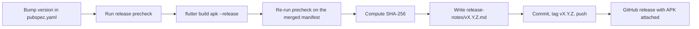
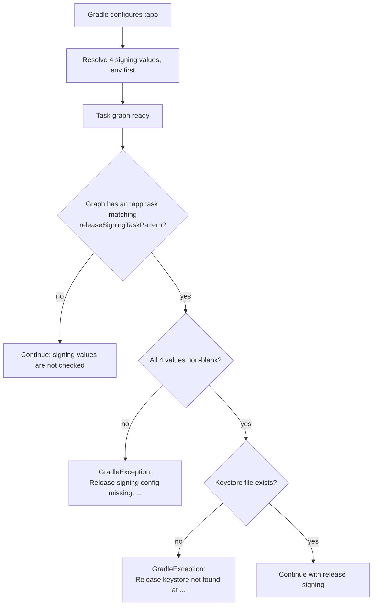

# Release process

How MotoCam versions, signs, checks, builds, tags and documents a release today, including the places where past practice has been inconsistent. Releases are Android APKs built on a maintainer machine. CI builds a debug APK on every run but publishes nothing.

## Contents

- [Release checklist](#release-checklist)
- [Versioning as practised](#versioning-as-practised)
- [Signing of published APKs](#signing-of-published-apks)
- [Signing setup (Android)](#signing-setup-android)
- [Application ID](#application-id)
- [Release security precheck](#release-security-precheck)
- [Building release artifacts](#building-release-artifacts)
- [Computing artifact checksums](#computing-artifact-checksums)
- [Tagging and publishing](#tagging-and-publishing)
- [Writing release notes](#writing-release-notes)
- [Changelog index](#changelog-index)

For toolchain installation, CI and day-to-day commands see [development.md](development.md). For the manifest, permissions and method channels see [platform-integration.md](platform-integration.md).

## Release checklist



1. Bump `version:` in [pubspec.yaml](../pubspec.yaml).
2. Run `pwsh ./scripts/release-security-precheck.ps1`. It stops with an error if an assertion fails or if `flutter analyze` or `flutter test` fails (see [the precheck section](#release-security-precheck)).
3. Make sure signing material is available, then run `flutter build apk --release`.
4. Run `pwsh ./scripts/release-security-precheck.ps1 -SkipAnalyze -SkipTests` again, so it also checks the merged release manifest that the build produced.
5. Record the artifact's size and SHA-256.
6. Write `release-notes/vX.Y.Z.md` from the [template](#writing-release-notes). Until a release-key APK has been published, include the upgrade note from [Signing of published APKs](#signing-of-published-apks).
7. Commit, tag, push the tag, and create the GitHub release with the APK attached.

A Google Play upload needs a different applicationId first; see [Application ID](#application-id).

## Versioning as practised

### Where the version comes from

| Stage | What happens | Source |
|---|---|---|
| pubspec | `version: 1.0.1+13` (build name `1.0.1`, build number `13`) | [pubspec.yaml](../pubspec.yaml) |
| Flutter tool | Writes `flutter.versionName` and `flutter.versionCode` into `android/local.properties` (git-ignored, machine-local) on each build | Flutter tooling |
| Gradle | `flutterVersionCode` / `flutterVersionName` read those keys and feed `defaultConfig.versionCode` / `versionName`. If a key is missing, they fall back to `1` and `"1.0"` | [android/app/build.gradle.kts](../android/app/build.gradle.kts) |
| Result (Android) | versionName `1.0.1`, versionCode `13` | |

Reading the version from `local.properties` arrived in commit cd39097, first tagged as v0.1.13. From V0.1.1 to v0.1.12 the Gradle file hard-coded `versionCode = 1` and `versionName = "1.0"` (V0.1.0 still used the template's `flutter.versionCode` / `flutter.versionName`), and every tag before v0.1.13 set the release build to `signingConfig = signingConfigs.getByName("debug")` (for example `git show v0.1.12:android/app/build.gradle.kts`). The APKs published for v0.1.5 to v0.1.12 came from such trees, so they report version 1 / "1.0" and are debug-signed regardless of pubspec; the v0.1.5 asset, for example, reports `versionCode='1' versionName='1.0'` and is signed by `CN=Android Debug`. The consequences are described in [Signing of published APKs](#signing-of-published-apks).

### Tags

Git tags are the release identifiers. The GitHub repository [Sarthak195/MotoCam](https://github.com/Sarthak195/MotoCam) is public.

| Tag | Type | Commit | Date |
|---|---|---|---|
| `V0.1.0` | lightweight | d2f7033 | 2026-02-21 |
| `V0.1.1`, `V0.1.2` | lightweight | 0d94a5b (both) | 2026-03-17 |
| `v0.1.3` | lightweight | f5adf98 | 2026-03-19 |
| `v0.1.4` to `v0.1.7` | annotated | bce1e03, c2e6fde, 83b2a00, a51a2b3 | 2026-03-22 |
| `v0.1.8`, `v0.1.9` | lightweight | 08eae19, 3277731 | 2026-03-28, 2026-03-31 |
| `v0.1.10` to `v0.1.12` | annotated | ef2dfb5, 76974c1, 055b9e1 | 2026-04-02 to 2026-04-05 |
| `v0.1.13` | lightweight | a33a583 | 2026-07-07 |

Release notes live in [release-notes/](../release-notes/) as `vX.Y.Z.md` with a lowercase `v`. Files exist only for v0.1.8 to v0.1.14; v0.1.14.md is marked as a draft that is not released.

### Current inconsistencies

- **Two version schemes.** pubspec says `1.0.1+13` (so Android reports 1.0.1 / 13), while the tag and release notes say v0.1.13. Earlier pubspec values followed the tags from v0.1.5 (`0.1.5+5` ... `0.1.11+11`; the tags before v0.1.5 carried `1.0.0+1`); build number 12 never appears in pubspec history, and the tree tagged v0.1.12 still had `0.1.11+11`.
- **Tag case.** `V0.1.0`, `V0.1.1` and `V0.1.2` use an uppercase `V`; all later tags use lowercase. `V0.1.1` and `V0.1.2` point at the same commit.
- **GitHub release bodies differ from the notes files.** The v0.1.13 GitHub release ("v0.1.13: Performance Optimization, Telemetry Memory Leak Fix, and Unit Tests", published 2026-07-07, no assets) has a different text from [v0.1.13.md](../release-notes/v0.1.13.md), and the v0.1.11 release carries the v0.1.12 APK (see [Computing artifact checksums](#computing-artifact-checksums)). Replacing the body and relabelling the asset on GitHub are owner tasks that have not been done.
- **Mixed tag types.** Lightweight and annotated tags are both in use (see the table).

## Signing of published APKs

Every APK attached to a GitHub release (v0.1.5 to v0.1.12) is signed with an Android debug certificate (`CN=Android Debug`) and reports versionCode 1 / versionName 1.0. The v0.1.13 release has no APK. Builds from the current tree are signed with a dedicated release key, and the precheck refuses debug signing.

- Android does not update an installed app across signing keys. Installing a release-key build over one of the published APKs fails with `INSTALL_FAILED_UPDATE_INCOMPATIBLE`.
- The debug key that signed the published APKs is not the debug keystore on the maintainer machine. Unless the original keystore is recovered, no build can update those installs, not even through APK signature key rotation.
- A debug keystore is not handled as a secret. Whoever holds the key that signed those APKs can produce APKs that Android accepts as updates to them.

What riders on v0.1.12 or earlier must do, as [v0.1.13.md](../release-notes/v0.1.13.md) states:

1. Export any locked clips they want to keep.
2. Uninstall the old app. Uninstalling removes its settings; the app disables Android backup, so they are not restored.
3. Install the release-key build.

Rides recorded by v0.1.11 and v0.1.12 are stored in the public `Movies/MotoCam/Recordings` folder. Uninstalling does not delete them, but Ride History lists only the app's own storage and has no import, so they do not appear in it.

Re-signing or withdrawing the old APKs, and importing rides from the old public folder, are owner tasks that have not been done.

## Signing setup (Android)

Signing applies to the Android release build only. Configuration lives at the top of [android/app/build.gradle.kts](../android/app/build.gradle.kts).

### Signing values

| Value | `android/key.properties` key | Environment variable | Gradle value |
|---|---|---|---|
| Keystore path | `storeFile` | `MOTOCAM_KEYSTORE_FILE` | `releaseStoreFilePath` |
| Keystore password | `storePassword` | `MOTOCAM_KEYSTORE_PASSWORD` | `releaseStorePassword` |
| Key alias | `keyAlias` | `MOTOCAM_KEY_ALIAS` | `releaseKeyAlias` |
| Key password | `keyPassword` | `MOTOCAM_KEY_PASSWORD` | `releaseKeyPassword` |

- **Precedence is per value.** `resolveSigningValue` returns the trimmed environment variable if it is non-empty, otherwise the trimmed `key.properties` value, otherwise null. Sources can therefore be mixed (for example the path from the environment and the alias from the file). Gradle reads `key.properties` from `android/`.
- **Keystore path resolution.** `storeFile` is set with the `:app` project's `file()`, so a relative path resolves against `android/app/`. [android/key.properties.template](../android/key.properties.template) says so and ships `storeFile=../release.keystore`, which is `android/release.keystore`, the default output of [generate-keystore.ps1](#creating-a-keystore-with-scriptsgenerate-keystoreps1). An absolute path also works.
- **What is ignored by git.** The root `.gitignore` ignores `key.properties`, `*.jks`, `*.keystore` and `*.p12` anywhere in the tree; `android/.gitignore` also ignores `key.properties`, `**/*.keystore` and `**/*.jks` under `android/`. A keystore with another extension, such as `.pfx`, is not ignored. The precheck fails if a `*.jks`, `*.keystore` or `*.p12` file or `android/key.properties` is tracked.

### The release-build guard



- The guard runs in `gradle.taskGraph.whenReady`, so it looks at every task that will run, not at the task names typed on the command line.
- `releaseSigningTaskPattern` is `^(validateSigning|package)\w*Release$|^sign\w*ReleaseBundle$|^package\w*ReleaseUniversalApk$`. It matches the tasks that package or sign a release artifact: `packageRelease` and `validateSigningRelease` (APK), `signReleaseBundle` (app bundle) and `packageReleaseUniversalApk`, with an optional flavor name before `Release`. It does not match `packageReleaseResources` or other tasks that sign nothing.
- Gated: `flutter build apk --release`, `flutter build appbundle --release`, `flutter run --release`, and plain `./gradlew assemble` or `build`, which include the release packaging tasks. Not gated: debug and profile builds, `flutter build appbundle --debug` (`bundleDebug`), `lintRelease` and `testReleaseUnitTest`.
- `missingSigningValues` lists each value that is null or blank. The first error names them, for example: `Release signing config missing: storeFile (MOTOCAM_KEYSTORE_FILE), keyPassword (MOTOCAM_KEY_PASSWORD). Provide them in android/key.properties or through the environment variables MOTOCAM_KEYSTORE_FILE, MOTOCAM_KEYSTORE_PASSWORD, MOTOCAM_KEY_ALIAS and MOTOCAM_KEY_PASSWORD.`
- When all four are set, the guard checks that the keystore is a file: `Release keystore not found at <absolute path>. A relative storeFile/MOTOCAM_KEYSTORE_FILE path is resolved against android/app/.`
- The guard does not check that the passwords or the alias are correct; those failures surface later, when the signing task runs.

### Creating a keystore with scripts/generate-keystore.ps1

[scripts/generate-keystore.ps1](../scripts/generate-keystore.ps1) wraps `keytool -genkeypair`. It requires `keytool` (from a JDK) on `PATH` and is interactive.

| Parameter | Default |
|---|---|
| `-OutFile` | `android/release.keystore`. A relative path is resolved against the repository root, not the current directory. |
| `-Alias` | `moto_release` |
| `-ValidityDays` | `10000` |
| `-KeyAlg` | `RSA` |
| `-KeySize` | `2048` |

Behaviour:

1. Throws `keytool not found. Install JDK and ensure keytool is on PATH.` when keytool is missing.
2. Prompts for the store password and the key password as secure strings. Pressing Enter at the key-password prompt reuses the store password. Both must have at least 6 characters, or the script throws.
3. Prompts for a distinguished name, defaulting to `CN=MotoCam Developer, OU=Dev, O=MotoCam, L=Unknown, ST=Unknown, C=US`.
4. Creates the output directory and runs keytool with an argument array. The passwords reach keytool through the process-local environment variables `MOTOCAM_KEYTOOL_STOREPASS` and `MOTOCAM_KEYTOOL_KEYPASS` (`-storepass:env`, `-keypass:env`), which are cleared afterwards, so they never appear on the command line or in the console output.
5. Throws `keytool failed with exit code <n>.` on a non-zero exit code. Otherwise it reports success if the keystore file exists, prints its path and tells you to create `android/key.properties` from the template; if the file is missing it throws `Failed to generate keystore.`

keytool's default store type is PKCS12, which uses a single password for the store and the key, so press Enter at the key-password prompt and set `keyPassword` equal to `storePassword`.

Then copy `android/key.properties.template` to `android/key.properties` and fill in the four values, or export the four environment variables instead. The template's `keyAlias` placeholder must be replaced with the alias you used (`moto_release` by default).

## Application ID

The Android `applicationId` and `namespace` in [android/app/build.gradle.kts](../android/app/build.gradle.kts) are `com.example.motocam`, the Flutter template placeholder. The owner has decided to keep this id for now.

Google Play rejects package names that start with `com.example`; the Play Console reports the prefix as restricted. The id therefore has to change before the first Play upload. Sideloaded APKs and the GitHub releases are not affected.

To migrate:

1. Choose the final reverse-DNS id, under a domain or account you control (for example `io.github.sarthak195.motocam`).
2. Change `applicationId` in android/app/build.gradle.kts. Changing `namespace` as well is optional. The namespace sets the package of the generated `R` class, which the Kotlin code uses (`R.drawable.ic_stat_recording`) from package `com.example.motocam`, so a new namespace also needs the Kotlin package moved or an import of the new `R`. The manifest names `MainActivity` and `BackgroundRecordingService` by their fully qualified class names, so they keep working while the Kotlin package stays.
3. In [AndroidManifest.xml](../android/app/src/main/AndroidManifest.xml), change the hard-coded name `com.example.motocam.permission.INTERNAL_BROADCAST` in both the `<permission>` and the `<uses-permission>` element to `${applicationId}.permission.INTERNAL_BROADCAST`. `MainActivity` and `BackgroundRecordingService` already build the name from `packageName`. If the manifest keeps the old literal, the permission they use is no longer declared and the notification Stop relay stops reaching Dart.
4. Relax the precheck rule in [scripts/release-security-precheck.ps1](../scripts/release-security-precheck.ps1) that requires exactly one `<permission>` named `com.example.motocam.permission.INTERNAL_BROADCAST`, so it accepts the new name.
5. In the same change, update `MapSourceConfig.userAgentPackageName` in [map_source_config.dart](../lib/features/map/map_source_config.dart), which identifies the app to the OpenStreetMap tile servers.
6. The method-channel names (`com.example.motocam/<area>`, the same literals in Dart and Kotlin) and the Kotlin intent action strings (`com.example.motocam.action.*`) are fixed literals, not derived from the package name. They keep working and can stay.
7. Update the documentation that names `Android/data/com.example.motocam/...` or runs `adb` commands against the package.

A new applicationId is a different app to Android and to Google Play. Existing installs do not upgrade to it; the old app stays installed next to the new one, and its settings and recordings stay with the old app. Riders have to export any locked clips they want to keep before they uninstall the old app.

## Release security precheck

[scripts/release-security-precheck.ps1](../scripts/release-security-precheck.ps1) is a PowerShell script of file checks. It parses the Android manifests as XML, so it sees elements and attributes rather than text inside comments; the Gradle checks are regex matches on raw text. It changes the working directory to the repository root with `Set-Location` (when the script runs in-process, for example `./scripts/release-security-precheck.ps1` typed at a PowerShell prompt, the caller's location stays changed afterwards; `pwsh ./scripts/...` runs it in a child process and does not), runs the assertions below, then optionally runs `flutter analyze` and `flutter test`. Any failed assertion throws its message and stops the script.

| # | File | Check | Failure message | Rationale |
|---|---|---|---|---|
| 1 | `android/app/build.gradle.kts` | text contains `signingConfig = signingConfigs.getByName("release")` | Release signing config is not set to release key. | Release APKs must be signed with the release key |
| 2 | `android/app/build.gradle.kts` | text does not contain `signingConfig = signingConfigs.getByName("debug")` | Debug signing is still configured for release build. | Releases from v0.1.5 to v0.1.12 were built with debug signing |
| 3 | `AndroidManifest.xml` (main) | no `<uses-permission>` or `<uses-permission-sdk-23>` for `MANAGE_EXTERNAL_STORAGE` or `ACCESS_BACKGROUND_LOCATION` | `android.permission.<NAME> must not be declared (android/app/src/main/AndroidManifest.xml).` | No all-files access and no background location |
| 4 | `AndroidManifest.xml` | no element has a `tools:ignore` value containing `ScopedStorage` | Scoped storage lint suppression should not be present. | Removed together with all-files access |
| 5 | `AndroidManifest.xml` | `<application>` exists and has `android:allowBackup="false"` | Manifest has no \<application\> element. / android:allowBackup must be false. | App data is kept out of Android backup |
| 6 | `AndroidManifest.xml` | `android:dataExtractionRules="@xml/data_extraction_rules"` on `<application>` | Manifest must reference data extraction rules. | Excludes data from cloud backup and device transfer |
| 7 | `AndroidManifest.xml` | `android:fullBackupContent="@xml/backup_rules"` on `<application>` | Manifest must reference full backup rules. | Same, for the pre-Android 12 backup mechanism |
| 8 | `AndroidManifest.xml` | exactly one `<permission>` named `com.example.motocam.permission.INTERNAL_BROADCAST`, with `android:protectionLevel="signature"` | Internal broadcast \<permission\> element is missing. / Internal broadcast permission must have android:protectionLevel="signature". | Protects the app's internal broadcasts (see [platform-integration.md](platform-integration.md)) |
| 9 | `res/xml/backup_rules.xml` | file exists | backup_rules.xml is missing. | Target of item 7 |
| 10 | `res/xml/data_extraction_rules.xml` | file exists | data_extraction_rules.xml is missing. | Target of item 6 |
| 11 | Merged release manifest | the same permission check as item 3 | `android.permission.<NAME> must not be declared (merged release manifest).` | Checks what ships, including permissions added by plugins |
| 12 | Tracked files | `git ls-files` lists no `*.a.conf`, `*.a.olf`, `*mappls*`, `*.jks`, `*.keystore`, `*.p12` or `android/key.properties` | Credential or signing files must not be tracked: \<files\> | Keeps SDK credentials and signing material out of the repository |
| 13 | `android/app/src/main/assets` | absent or empty | android/app/src/main/assets must be empty; files there are packaged into every APK. | MotoCam ships no Android assets |

Item 11 reads `build/app/intermediates/merged_manifests/release/processReleaseManifest/AndroidManifest.xml`. It runs only when that file exists and is not older than the source manifest; otherwise the script prints a warning that the merged release manifest is missing or stale and continues. Item 12 runs only when `git` is available and the repository has a `.git` directory, and a failing `git ls-files` stops the script.

Optional steps: `flutter analyze` unless `-SkipAnalyze`, then `flutter test` unless `-SkipTests`. A non-zero exit code from either throws `flutter analyze failed with exit code <n>.` (or the same for `flutter test`). Finally it prints `Release security precheck passed.`

Things to know when relying on it:

- The regex checks (items 1 and 2) also match text inside comments.
- It does not read signing credentials or check that the keystore exists (the Gradle guard does that), and it does not check the applicationId or that the version increased. Item 8 hard-codes the `com.example.motocam` permission name; see [Application ID](#application-id).
- CI runs it as `./scripts/release-security-precheck.ps1 -SkipTests -SkipAnalyze`, with analyze and test as separate CI steps (see [development.md](development.md#continuous-integration)). CI builds only a debug APK, so item 11 is skipped there.

## Building release artifacts

Android only. With signing values in place:

| Command | Output (default path) |
|---|---|
| `flutter build apk --release` | `build/app/outputs/flutter-apk/app-release.apk` (plus `app-release.apk.sha1`) |
| `flutter build appbundle --release` | `build/app/outputs/bundle/release/app-release.aab` |

The release build type in [android/app/build.gradle.kts](../android/app/build.gradle.kts) uses the `release` signing config, enables R8 (`isMinifyEnabled = true`) and resource shrinking (`isShrinkResources = true`), and applies `proguard-android-optimize.txt` plus [android/app/proguard-rules.pro](../android/app/proguard-rules.pro), which keeps `io.flutter.**` classes. [android/build.gradle](../android/build.gradle) sets `layout.buildDirectory` so that the Gradle output lands in `<repo>/build/`.

Every asset attached to a GitHub release so far is an APK (v0.1.5 to v0.1.12); the pre-releases V0.1.1, V0.1.2 and v0.1.3 and the v0.1.13 release have no assets, V0.1.0 and v0.1.4 have no GitHub release, and no AAB has been published. MotoCam has no `android/app/src/main/assets` directory, so the APK packages no Android assets of its own; the precheck fails if files appear there.

## Computing artifact checksums

The release notes record an uppercase hex SHA-256, which matches PowerShell's output:

```powershell
Get-FileHash -Algorithm SHA256 build/app/outputs/flutter-apk/app-release.apk
(Get-Item build/app/outputs/flutter-apk/app-release.apk).Length   # size in bytes
```

Equivalents: `sha256sum build/app/outputs/flutter-apk/app-release.apk` (lowercase hex) or `certutil -hashfile <apk> SHA256`. The `.sha1` file Flutter writes next to the APK is SHA-1 and is not what the notes record. Compute the hash on the exact file you upload, and record bytes and MiB (bytes / 1,048,576).

Past inconsistency: the GitHub assets for v0.1.11 and v0.1.12 are the same file, the v0.1.12 build (53,979,745 bytes, 51.48 MiB, SHA-256 `539F2BB9…0889`). [v0.1.11.md](../release-notes/v0.1.11.md) records this and lists the original v0.1.11 build (53,963,149 bytes, SHA-256 `F9D67BFB…CB94`) as not published.

## Tagging and publishing

Tag the release commit after the notes are committed, using a lowercase `v` and the `vX.Y.Z` form that matches the notes file:

```bash
git tag -a v0.1.14 -m "MotoCam v0.1.14"   # annotated (used for v0.1.4-v0.1.7, v0.1.10-v0.1.12)
git push origin v0.1.14
gh release create v0.1.14 build/app/outputs/flutter-apk/app-release.apk \
  -R Sarthak195/MotoCam --title "MotoCam v0.1.14" --notes-file release-notes/v0.1.14.md
```

Lightweight tags (`git tag v0.1.14`) have also been used (V0.1.0 to v0.1.3, v0.1.8, v0.1.9, v0.1.13). Asset names have varied: `MotoCam.v0.1.5.apk` to `MotoCam.v0.1.10.apk`, then `app-release.apk` for v0.1.11 and v0.1.12. Use `--notes-file` so the GitHub release body matches the notes file; it has not always matched (v0.1.13's body is a different text).

## Writing release notes

The existing notes use a level-2 title and a common set of sections. v0.1.8 and v0.1.9 use **Highlights**; v0.1.10 to v0.1.12 use **Issue Summary** plus **Resolution**; v0.1.13 uses **Upgrade notes / breaking changes** plus **Summary**. v0.1.11 and v0.1.12 also contain a "Git Commit Message" or "Git Commit" section, which is optional.

Conventions for new notes (v0.1.12 and v0.1.13 follow them; older notes only in part):

- The release date line names the tag and commit when they are known, for example `Release date: 2026-04-05 (tag v0.1.12, commit 055b9e1)`.
- Anything a rider must do before installing (uninstalling, lost data, removed permissions, moved storage) goes first, under **Upgrade notes / breaking changes**.
- When a later release changes behaviour that older notes describe, the older notes keep their text and get an italic line such as `*Superseded in v0.1.13: ... (see v0.1.13.md).*` next to the affected item.
- The **Artifact** section describes the file that is actually attached to the GitHub release, including its signing certificate and versionCode / versionName. If no file is attached, it says so.

Template:

```markdown
## MotoCam vX.Y.Z

Release date: YYYY-MM-DD (tag `vX.Y.Z`, commit `abc1234`)

### Upgrade notes / breaking changes   <!-- when riders must act before installing -->

- ...

### Highlights            <!-- or: ### Issue Summary + ### Resolution -->

- ...

### Included Changes

- path/to/changed/file.dart

### Tested On             <!-- optional: device model (Android version) -->

### Validation

- `flutter analyze` passed.
- `flutter test` passed.
- `pwsh ./scripts/release-security-precheck.ps1` passed (after the release build, so the merged manifest was checked).

### Known Limitations     <!-- optional -->

### Artifact

- File: app-release.apk (published as ...)
- Size: N bytes (X.XX MiB)
- SHA256: <uppercase hex>
- Build timestamp (UTC): YYYY-MM-DDTHH:MM:SSZ
- Signing: release key; versionName A.B.C, versionCode N

### Release Traceability

- Git tag: `vX.Y.Z`
- pubspec version: `A.B.C+N` (Android versionName A.B.C, versionCode N)

### Notes                 <!-- optional -->
```

The pubspec line under Release Traceability is not in the existing notes; it makes the two version schemes visible side by side.

## Changelog index

| Version | Release date (notes) | Headline | Notes |
|---|---|---|---|
| v0.1.8 | 2026-03-28 | Runtime permission audit, device status (battery, temperature, thermal), capability-aware resolution fallback | [v0.1.8.md](../release-notes/v0.1.8.md) |
| v0.1.9 | 2026-03-31 | Recording preflight checklist, OpenStreetMap route map, fullscreen playback, timeline event markers | [v0.1.9.md](../release-notes/v0.1.9.md) |
| v0.1.10 | 2026-04-02 | Fix for rides missing from history: persistent recording storage and recovery of video-only rides | [v0.1.10.md](../release-notes/v0.1.10.md) |
| v0.1.11 | 2026-04-05 | Android storage hardening and permission recovery, missing-segment seekbar, seconds-based segment duration. The attached APK is the v0.1.12 build | [v0.1.11.md](../release-notes/v0.1.11.md) |
| v0.1.12 | 2026-04-05 | Segment rollover optimization, click-through popup, Blackout Mode | [v0.1.12.md](../release-notes/v0.1.12.md) |
| v0.1.13 | 2026-07-07 | Release-key signing and pubspec-driven version codes (uninstall required), recordings in app-specific storage, storage permissions removed, backups disabled, CI and release scripts, unit tests. No APK published | [v0.1.13.md](../release-notes/v0.1.13.md) |

Statements in older notes describe the code at their tag, not today. For example, the v0.1.11/v0.1.12 "public folder only" storage policy no longer applies; see [recording-pipeline.md](recording-pipeline.md) and [data-formats.md](data-formats.md) for current behaviour.
