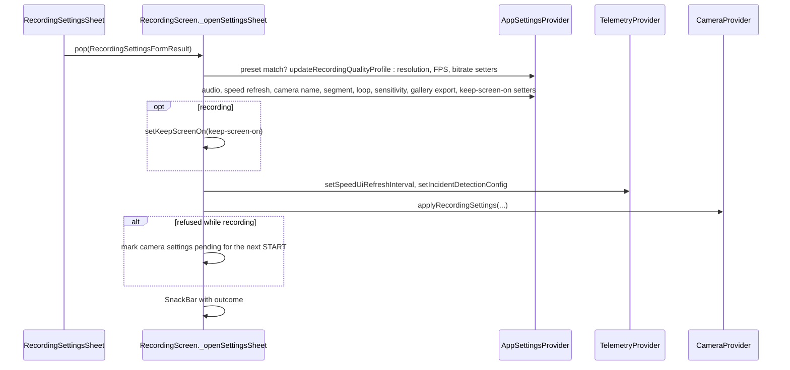

# Settings reference

MotoCam's rider settings live in one `ChangeNotifier`, `AppSettingsProvider`, and are stored with the `shared_preferences` package. This document lists every setting, its storage key, default, normalization and effect, explains the legacy keys, lists the other `SharedPreferences` keys the app uses, and walks through adding a new setting.

## Contents

- [How settings work](#how-settings-work)
- [Settings table](#settings-table)
- [Where each setting takes effect](#where-each-setting-takes-effect)
- [The settings sheet and the save flow](#the-settings-sheet-and-the-save-flow)
- [Legacy keys and migration](#legacy-keys-and-migration)
- [Other persisted preferences](#other-persisted-preferences)
- [Persistence scope](#persistence-scope)
- [How to add a new setting](#how-to-add-a-new-setting)
- [Related documents](#related-documents)

## How settings work

| Piece | File | Role |
|---|---|---|
| `AppSettingsProvider` | [app_settings_provider.dart](../lib/core/providers/app_settings_provider.dart) | Holds the values in memory, loads them once, normalizes them, persists every change and notifies listeners. Also exposes option lists, quality presets, label helpers and the incident thresholds derived from sensitivity. It never touches the camera or sensors. |
| `MotoCamApp` | [main.dart](../lib/main.dart) | Creates the single instance in the root `MultiProvider` and starts `load()` without awaiting it (`unawaited(settings.load())`). |
| `RecordingSettingsSheet` | [recording_settings_sheet.dart](../lib/features/recording/widgets/recording_settings_sheet.dart) | The settings UI (bottom sheet). Edits a local copy and returns a `RecordingSettingsFormResult`; it writes nothing itself. |
| `RecordingScreen` | [recording_screen.dart](../lib/features/recording/recording_screen.dart) | Opens the sheet, calls the setters, and pushes values into `CameraProvider` and `TelemetryProvider`. |

**Storage.** All reads and writes use the legacy `SharedPreferences.getInstance()` API with the package's default `flutter.` key prefix (no `setPrefix` call exists). Settings are cross-platform; no MotoCam method channel is involved (the plugin's own platform code does the storage).

**Load timing.** The provider starts with in-memory defaults (`isLoaded == false`). `load()` reads every key once (except the preset id, which it never reads), normalizes the values, recomputes the quality preset id, sets `isLoaded = true` and calls `notifyListeners()`. After that, `load()` returns immediately and the store is never re-read during the process. The `ChangeNotifierProvider` is lazy, so the instance (and the first `load()`) is created when `RecordingScreen._bootstrapRuntimePrerequisites` first reads it; that method then sees `isLoaded == false` and awaits its own `load()`. Because `_isLoaded` only flips after the `await SharedPreferences.getInstance()`, both calls run to completion on a cold start: the platform store is fetched once (`getInstance()` caches its future), but both `load()` bodies run and `notifyListeners()` fires twice. `_initializeCamera` and `_openSettingsSheet` also call `load()` if `isLoaded` is still false. Until the first load completes, widgets show the defaults.

**Setter pattern.** Every `update*` method:

1. Normalizes the input (see the table).
2. Returns early if the normalized value equals the current one. `updateRecordingQualityProfile` has no such check; it returns early only for an unknown profile id.
3. Assigns the field. Resolution, FPS and bitrate setters then call `_syncQualityProfileIdFromValues()`.
4. Calls `notifyListeners()` synchronously, before any I/O.
5. Awaits `SharedPreferences.getInstance()` and the `set*` call(s). Write results are ignored and there is no try/catch; exceptions propagate to the caller.

Resolution, FPS, bitrate and preset all persist through `_persistVideoSettings`, which writes four keys in sequence (resolution, FPS, bitrate, preset id). Setters do not check `isLoaded`; callers are expected to await `load()` first.

**Listeners.** Only two widgets listen: the profile chip bar (`Consumer2<AppSettingsProvider, CameraProvider>` in `RecordingScreen._buildActiveProfileBar`) and the main recording button (`Consumer2<CameraProvider, AppSettingsProvider>` inside a `Selector<TelemetryProvider, bool>` in `_buildControls`). Every other access, including the settings sheet, uses `context.read`.

## Settings table

Normalization styles: **range clamp** pins out-of-range values to the nearest bound; **snap** replaces any value that is not in the option list with the default (not the nearest option), despite the private helpers being named `_clamp*`. The same normalization runs in `load()` and in the setter.

| UI label (sheet) | Getter / setter | Key | Type | Default | Allowed values and normalization |
|---|---|---|---|---|---|
| Recording resolution | `recordingResolution` / `updateRecordingResolution` | `recording_resolution_p` | int (lines) | 1080 (or mapped from legacy `recording_quality`, see below) | Snap to `resolutionOptions` {480, 720, 1080, 2160}, else 1080 |
| Frame rate (FPS) | `recordingFps` / `updateRecordingFps` | `recording_fps` | int | 30 | Range clamp [24, 60]. No list check; the sheet offers {24, 30, 60} minus any rate that has already failed to initialize at that preset in this session (an in-memory `CameraProvider` cache per camera, preset and audio setting, not a camera query). When the saved rate is not offered, the sheet starts at 30, else the last offered rate (`resolveInitialFps`), and marks the preset Custom |
| Video bitrate | `videoBitrateMbps` / `updateVideoBitrateMbps` | `video_bitrate_mbps` | int (Mbps) | 8 | Snap to `bitrateOptionsMbps` {4, 8, 12, 16}, else 8 |
| Recording quality preset | `qualityProfileId` / `updateRecordingQualityProfile` | `recording_quality_profile_id` | String | `1080p_30_8` in memory; on load always recomputed | `720p_30_4`, `1080p_30_8`, `1080p_60_12`, `2160p_24_16` or `custom`. The stored value is written but never read: `load()` derives the id with `_syncQualityProfileIdFromValues()`, which picks the preset whose (resolution, FPS, bitrate) triple matches exactly, else `custom` |
| Camera lens | `selectedCameraName` / `updateSelectedCameraName` | `camera_name` | String | `''` (auto) | Any string; trimmed on write, not on load. Not validated against the available cameras |
| Segment length | `segmentDurationSeconds` / `updateSegmentDurationSeconds` | `dashcam_segment_duration_seconds` | int (s) | 300 (or legacy minutes × 60) | Snap to `segmentDurationOptionsSeconds` {5, 10, 15, 30, 60, 120, 180, 300, 600}, else 300 |
| Loop buffer size | `loopSegmentCount` / `updateLoopSegmentCount` | `dashcam_loop_segment_count` | int | 24 | Snap to `loopSegmentCountOptions` {6, 12, 18, 24, 36, 48}, else 24 |
| Storage budget for all rides | `recordingsStorageBudgetGb` (also `recordingsStorageBudgetBytes`, GB × 1024³) / `updateRecordingsStorageBudgetGb` | `recordings_storage_budget_gb` | int (GB) | 0 (Off) | Snap to `storageBudgetOptionsGb` {0, 4, 8, 16, 32, 64}, else 0. The sheet labels 0 as Off (`storageBudgetLabel`) and shows one line under the dropdown: "When recordings exceed it, the oldest unlocked rides are deleted while you record. Locked rides are never deleted." |
| Speed UI refresh | `speedRefreshMs` / `updateSpeedRefreshMs` | `speed_refresh_ms` | int (ms) | 100 | Range clamp [100, 1000]. The sheet offers only 100, 200, 300, 500 (a list literal in the sheet, not a provider constant) |
| Incident sensitivity | `incidentSensitivity` / `updateIncidentSensitivity` | `incident_sensitivity` | String (`IncidentSensitivity.name`) | `medium` | `low`, `medium`, `high`; any other stored string loads as `medium` |
| Record audio | `audioEnabled` / `updateAudioEnabled` | `recording_audio_enabled` | bool | `true` | Any bool |
| Copy locked clips to gallery | `exportLockedClipsToGallery` / `updateExportLockedClipsToGallery` | `export_locked_clips_to_gallery` | bool | `false` | Any bool. The switch is shown only on Android |
| Keep screen on while recording | `keepScreenOnWhileRecording` / `updateKeepScreenOnWhileRecording` | `keep_screen_on_while_recording` | bool | `true` | Any bool. The switch is shown only on Android |
| Quality group | not persisted | none | `QualityPresetTier` | Tier of the current preset, else Balanced | Balanced or High Detail. Sheet-only filter for the preset dropdown |

Quality presets (`AppSettingsProvider.qualityProfiles`):

| Id | Resolution | FPS | Bitrate | Tier | Label |
|---|---|---|---|---|---|
| `720p_30_4` | 720 | 30 | 4 Mbps | Balanced | `720p / 30 FPS / 4 Mbps` |
| `1080p_30_8` | 1080 | 30 | 8 Mbps | Balanced | `1080p / 30 FPS / 8 Mbps` |
| `1080p_60_12` | 1080 | 60 | 12 Mbps | Balanced | `1080p / 60 FPS / 12 Mbps` |
| `2160p_24_16` | 2160 | 24 | 16 Mbps | High Detail | `2160p / 24 FPS / 16 Mbps` |

Incident sensitivity derives two read-only getters:

| Sensitivity | Sheet label | `incidentTriggerGForce` | `incidentDebounce` |
|---|---|---|---|
| `low` | Low (fewer auto-locks) | 4.5 g | 10 s |
| `medium` | Medium | 3.5 g | 6 s |
| `high` | High (more auto-locks) | 2.8 g | 3 s |

`AppSettingsProvider` does not import the camera plugin. The only mapping between resolutions and camera presets is `CameraProvider.presetForResolution` and its reverse, `CameraProvider.resolutionForPreset`.

## Where each setting takes effect

`RecordingScreen._initializeCamera` (at startup and from the camera-unavailable panel's Retry, once no required permission is missing, after returning from ride history, when the app returns to the foreground idle with the camera uninitialized and its permissions granted, and from the start preflight when the camera is not initialized), `RecordingScreen._applySavedCameraSettings` (before START, for camera settings saved during the previous ride) and `RecordingScreen._openSettingsSheet` (after a save) pass the values on. Details of the camera side are in [recording-pipeline.md](recording-pipeline.md); incident detection is in [telemetry.md](telemetry.md).

The saved values are the rider's request and are never overwritten with what the camera negotiated. When the initialized camera runs at a different resolution or FPS, the chip bar shows both, for example `720p (set 1080p)` or `30 FPS (set 60)`.

| Setting | Consumer | Notes |
|---|---|---|
| Resolution | `CameraProvider.resolvePresetForRequestedResolution`, then `initializeCamera` / `applyRecordingSettings` | Mapped by `CameraProvider.presetForResolution`: 480 to `ResolutionPreset.medium`, 720 to `high`, 1080 to `veryHigh`, 2160 to `ultraHigh`. Presets known to be unsupported fall back to a lower (then any) supported one; initialization also walks down the preset list until one works. The unsupported-preset memory is per camera and audio setting, lasts until the app restarts, and is cleared for the camera when every preset fails (a busy or unavailable camera). |
| FPS | `CameraController(fps:)` via `CameraProvider` | For each preset tried, `CameraProvider.nearestSupportedFps` picks the saved FPS when it is still offered, else 30, else the highest offered rate below it, else the lowest offered rate. A rate that fails is dropped for that camera, preset and audio setting, and 30 (or the last offered rate) is tried next. |
| Bitrate | `CameraController(videoBitrate:)` | Passed as Mbps × 1,000,000. The Android camera plugin ignores it (`CameraProvider.supportsVideoBitrateControl` is false on Android), so the sheet shows a no-effect note there and the ride's `appliedBitrateMbps` is `null`. Also used for the free-space estimate, with a 20 Mbps floor. |
| Camera lens | `CameraProvider._resolveCamera` | Preferred name if present, else the first back camera, else the first camera. |
| Segment length | `CameraProvider` segment timer | Re-clamped to 5-600 s by `CameraProvider`. |
| Loop buffer size | `CameraProvider` retention (max rolling segments) | Re-clamped to 1-120 by `CameraProvider`. Only unlocked segments of the current ride count; locked segments are never deleted. |
| Storage budget for all rides | `CameraProvider.storageBudgetBytes` (set at each START, with `currentRideSessionIdSource` returning `TelemetryProvider.rideSessionId`) | Off by default. While recording, 5 s after START and 3 s after each segment roll, the oldest unlocked rides are deleted until the recordings root fits; locked rides, the ride being recorded and quarantined rides never are. A change saved during a recording applies from the next START. See [recording-pipeline.md](recording-pipeline.md#storage-budget). |
| Speed UI refresh | `TelemetryProvider.setSpeedUiRefreshInterval` | Re-clamped to 100-1000 ms; minimum interval between throttled telemetry UI notifications. |
| Incident sensitivity | `TelemetryProvider.setIncidentDetectionConfig(triggerGForce:, debounce:)` | No validation in the telemetry provider. |
| Record audio | `CameraController(enableAudio:)`; `AppPermissionService.ensureRequiredPermissions(audioEnabled:)`; the start preflight | Also decides whether the microphone permission is requested and checked. |
| Copy locked clips to gallery | `CameraProvider.autoExportLockedClipsToGallery` (set at each START); `AppPermissionService.ensureRequiredPermissions(galleryExportEnabled:)` | When on, the ride's locked segments are copied to the gallery at stop (Android). On Android 9 and lower it also makes the permission audit ask for the storage permission. |
| Keep screen on while recording | `BackgroundRecordingService.setKeepScreenOn` after START, and when saved during a recording | Android only. `MainActivity` sets `FLAG_KEEP_SCREEN_ON` while a recording is active and the setting is on, and clears it at every stop. It is the fallback in case recording with the screen off, which the app is designed for, does not work on a phone. |

`RecordingScreen._recordingSettingsSnapshot` builds a `recordingSettings` map with `requested*` values from this provider and `applied*` values from `CameraProvider`. `TelemetryProvider` writes it into the ride's telemetry JSON at every checkpoint (`checkpointRideSession`) and at stop (`stopRideSessionAndPersist`); see [data-formats.md](data-formats.md). The gallery-export, keep-screen-on and storage budget settings are not part of the snapshot.

## The settings sheet and the save flow

The gear icon in `RecordingScreen` opens the sheet. It is disabled while settings are being applied and while a recording starts or stops; it stays enabled during recording. Before showing the sheet, the screen fetches the supported FPS list for the preset resolved from the saved resolution, the camera list (`getAvailableCameras(refresh: true)`) and the known-unsupported presets.

In `_RecordingSettingsSheetState.initState` the sheet copies the provider's values, with three adjustments: when the saved FPS is not in the offered list, `resolveInitialFps` picks 30 (or the last offered rate) and the preset becomes Custom; an empty camera name is replaced by the active camera (or the first camera), so the first save stores an explicit name; and if the current resolution is known unsupported, the highest supported resolution is pre-selected and the preset becomes Custom. In the sheet, picking a resolution, FPS or bitrate by hand switches the preset to Custom; picking a preset or quality group fills resolution, bitrate and (if supported) FPS. The **Copy locked clips to gallery** and **Keep screen on while recording** switches are shown only on Android. Dismissing the sheet discards everything.

The last entry of the sheet, below SAVE SETTINGS, is **About and licences**. It opens Flutter's `showLicensePage` for the app name `MotoCam` (the app exposes no version string and does not depend on `package_info_plus`, so none is shown). The page lists every package's licence plus the OpenStreetMap data notice, which `registerMapLicence` (called from `main`) adds. It changes no setting.

A result whose triple matches a preset is saved with `updateRecordingQualityProfile`, even if the sheet showed Custom. Otherwise three separate setters run; each one whose value changed notifies and writes all four video keys, so listeners can briefly see mixed values. `CameraProvider.applyRecordingSettings` returns `false` while a recording is starting, active or stopping. If the save happened during a recording, the snack bar reads "Camera settings saved. They apply to the next recording."; the camera keeps its current configuration, and the next START applies the saved camera settings (re-initializing the camera when they differ) before its preflight. Telemetry values and the keep-screen-on setting are applied live regardless. When the camera applies a lower resolution than requested, the snack bar names both; when initialization fails, it reads "Unable to initialize camera with the selected settings on this device."

## Legacy keys and migration

| Legacy key | Type | Read | Written | Migration |
|---|---|---|---|---|
| `recording_quality` | String | Every `load()`, used only when `recording_resolution_p` is absent | Never by current code; never deleted | `_legacyResolutionFromQuality`: `low` 480, `medium` 720, `high` 1080, `veryHigh` 1080, `ultraHigh` 2160, anything else or absent 1080 |
| `dashcam_segment_minutes` | int | When `dashcam_segment_duration_seconds` is absent; default 5 | On every segment-length change, by `updateSegmentDurationSeconds` | Read as minutes × 60, then snapped. Written as `(seconds / 60).ceil()`, so 5-60 s are all stored as 1 (the comment says this keeps older minute-based builds in sync) |

Values that are no longer offered, such as resolutions outside {480, 720, 1080, 2160}, snap to the default on load, and the preset id is recomputed from the resulting values. Never rename a key or an `IncidentSensitivity` value: a renamed key loses the stored value, and an unknown `incident_sensitivity` silently becomes `medium`. Renaming a preset id loses nothing, because the stored `recording_quality_profile_id` is never read; the id is recomputed from the (resolution, FPS, bitrate) values on load. The getters are typed casts, so a key whose stored type changes would throw on load.

## Other persisted preferences

Four keys are stored outside `AppSettingsProvider`, with the same `SharedPreferences` API and prefix. They have no UI in the settings sheet and no reset in the app.

| Key | Type | Default | Read | Written |
|---|---|---|---|---|
| `ride_playback_show_route_map` | bool | `false` | `RidePlaybackScreen._loadPlaybackPreferences` ([ride_playback_screen.dart](../lib/features/history/ride_playback_screen.dart)) when the playback screen opens; honoured only when the consent key below is `true` | Each time the rider expands or collapses the "Route Map" card (`_toggleRouteMapVisibility`) |
| `ride_playback_online_map_consent` | bool | `false` | Same place; while `false` the route map stays collapsed | Set to `true` once, when the rider answers **Show map** in the "Show online map?" dialog. Never set back to `false` |
| `battery_optimization_exemption_offered` (`BackgroundRecordingService.batteryOptimizationOfferedKey`) | bool | `false` | `BackgroundRecordingService.hasOfferedBatteryOptimizationExemption`: by `shouldOfferBatteryOptimizationExemption` after a ride is saved, and by `RecordingScreen._handlePermissionAuditResult`, which then leaves the battery item out of the recommended-permissions SnackBar | Set to `true` by `markBatteryOptimizationExemptionOffered` just before the one-time "Keep recording with the screen off?" dialog opens, whatever the rider answers ([background_recording_service.dart](../lib/core/services/background_recording_service.dart)) |
| `signed_ride_registry` (`SignedRideRegistry.prefsKey`) | String (JSON) | absent | `SignedRideRegistry.idsFor`, from `loadRideSignerContext` when Ride History loads, and only when this phone's signing key could be read ([ride_signing_service.dart](../lib/core/services/ride_signing_service.dart)) | `SignedRideRegistry.add` after a ride's final save was written signed, and `remove` after a ride is deleted in Ride History (only when the deleted telemetry file has the ride's own name `ride_<id>.telemetry.json`). The value is `{"keyFingerprint": <SHA-256 hex of the key's SubjectPublicKeyInfo DER>, "rideSessionIds": [...], "segmentFileNames": {<rideSessionId>: [<segment file name>, ...]}}`; `segmentFileNames` is optional (values written before it existed lack it, and it is left out when empty). A value stored for another key reads as empty and is replaced by the next `add`. Rides deleted outside the app (retention never deletes a ride JSON with locked paths; orphan pruning can delete others) stay listed, which is harmless. See [data-formats.md](data-formats.md#who-signed-a-ride) |

See [playback-and-history.md](playback-and-history.md) for the route map and [platform-integration.md](platform-integration.md) for the battery-optimization exemption and the ride signing key. No other `SharedPreferences` use exists in `lib/`, and no Kotlin code reads these values.

## Persistence scope

On Android, settings are device-local. The manifest sets `android:allowBackup="false"`, and both `backup_rules.xml` (full-backup content) and `data_extraction_rules.xml` (its cloud-backup and device-transfer sections) exclude domain `root`, path `.`, domain `file`, path `.` (the recordings, the migration journal and the ride index) and domain `external`, path `.` (the legacy recordings root), so settings reset after reinstall or migration. This exclusion is Android-only; iOS has no equivalent configuration.

## How to add a new setting

1. **Provider: storage.** In `AppSettingsProvider`, add a private key constant (`static const _fooKey = 'foo';`), a private field with its default, and a public getter. If the value has a fixed option set, add a `static const` option list.
2. **Provider: normalization.** Add a `_clampFoo` helper (range clamp or snap to the option list). Use it in both `load()` and the setter.
3. **Provider: load.** In `load()`, read the key with the matching typed getter and a `?? default` fallback, before `_isLoaded = true`. If the setting replaces an older key, read the old key as a fallback here, as the segment and resolution settings do.
4. **Provider: setter.** Add `Future<void> updateFoo(...)` following the setter pattern: normalize, return if unchanged, assign, `notifyListeners()`, then persist. If it is part of the video triple, persist through `_persistVideoSettings` and call `_syncQualityProfileIdFromValues()`.
5. **Sheet.** In [recording_settings_sheet.dart](../lib/features/recording/widgets/recording_settings_sheet.dart), add a field to `RecordingSettingsFormResult`, a `late` state field initialized from the provider in `initState`, a control in `build` (use `_buildSettingsLabel` and `_settingsInputDecoration` to match the others), and pass it in the `SAVE SETTINGS` `pop`.
6. **Save flow.** In `RecordingScreen._openSettingsSheet`, call the new setter with the result value. If something consumes it at runtime, apply it there and in `_initializeCamera` so it also takes effect at startup.
7. **Optional UI and records.** Add a chip in `_buildActiveProfileBar` if riders should see it, and a `requested*` entry in `RecordingScreen._recordingSettingsSnapshot` if it should be stored with each ride (update [data-formats.md](data-formats.md)).
8. **Tests.** Add load, normalization and setter cases to [app_settings_provider_test.dart](../test/core/providers/app_settings_provider_test.dart), which seeds stored values with `SharedPreferences.setMockInitialValues`. The widget test in [widget_test.dart](../test/widget_test.dart) also completes `load()` and checks a few loaded values.
9. **Docs.** Add a row to the settings table and the effects table in this file.

## Related documents

- [architecture.md](architecture.md): provider graph and app structure.
- [recording-pipeline.md](recording-pipeline.md): how `CameraProvider` uses resolution, FPS, bitrate, segment length and loop size.
- [telemetry.md](telemetry.md): speed refresh throttling and incident detection.
- [data-formats.md](data-formats.md): the `recordingSettings` snapshot in ride telemetry JSON.
- [platform-integration.md](platform-integration.md): the battery-optimization exemption and its one-time offer.
- [features.md](features.md): the rider-facing view of these settings.
