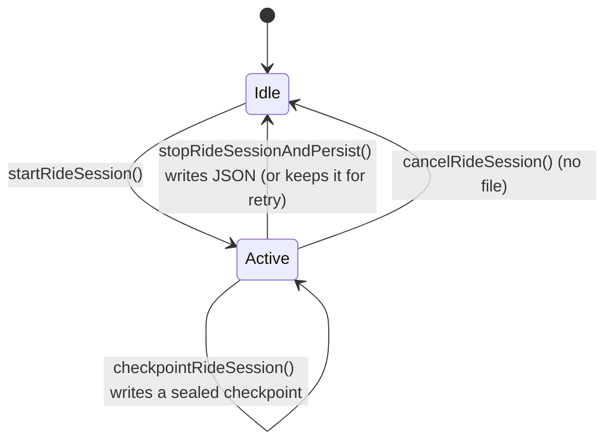
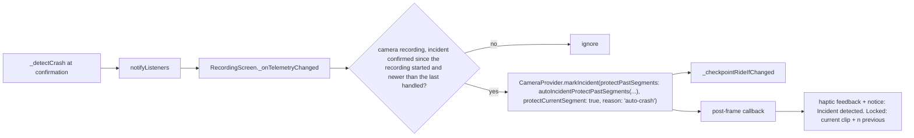

# Telemetry and incident detection

MotoCam collects GPS and gravity-removed accelerometer data in a single app-wide `TelemetryProvider`, derives filtered speed, distance and ride statistics from it, detects incidents (crash-like acceleration) that auto-lock video segments, and writes one telemetry JSON file per ride. This document describes how that works in the code today.

## Contents

- [Components at a glance](#components-at-a-glance)
- [Data sources](#data-sources)
- [TelemetryProvider lifecycle](#telemetryprovider-lifecycle)
- [The TelemetryData sample model](#the-telemetrydata-sample-model)
- [Derived metrics](#derived-metrics)
- [Incident detection](#incident-detection)
- [Persistence](#persistence)
- [Memory bounds and UI notifications](#memory-bounds-and-ui-notifications)
- [Device status (Android-only)](#device-status-android-only)
- [Test coverage](#test-coverage)
- [Related documents](#related-documents)

## Components at a glance

| Component | File | Role |
|---|---|---|
| `TelemetryProvider` | [telemetry_provider.dart](../lib/features/telemetry/providers/telemetry_provider.dart) | `ChangeNotifier` and `WidgetsBindingObserver` that owns the GPS stream, a fallback GPS poll, the location-service status stream, the accelerometer stream, the ride session, incident detection, checkpoints and persistence. Created once in `MultiProvider` in [main.dart](../lib/main.dart). |
| `TelemetryData` | [telemetry_data.dart](../lib/features/telemetry/models/telemetry_data.dart) | Immutable class used for the live reading, persisted samples and playback samples. |
| `DeviceStatusService` | [device_status_service.dart](../lib/core/services/device_status_service.dart) | Battery level, battery temperature, thermal status and Android API level over a method channel. Android-only. |
| `RecordingScreen` | [recording_screen.dart](../lib/features/recording/recording_screen.dart) | The only caller: initializes and pauses telemetry, starts and stops ride sessions, writes checkpoints, applies settings, turns incidents into segment locks, shows the sensor and location warnings, polls device status. |

## Data sources

### GPS (geolocator)

`TelemetryProvider._startLocationTracking` subscribes to `Geolocator.getPositionStream` with per-platform settings from `_buildLocationSettings` and feeds every fix to `_updateLocation`. Stream errors go to `_onPositionStreamError`.

| Platform | Settings class | Accuracy | distanceFilter | Other |
|---|---|---|---|---|
| Android | `AndroidSettings` | `bestForNavigation` | 0 m | `intervalDuration: 500 ms`, `forceLocationManager: true` (legacy `LocationManager` instead of the fused client, whose settings check raises "turn on location" dialogs); no `foregroundNotificationConfig` |
| iOS | `AppleSettings` | `bestForNavigation` | 0 m | `activityType: automotiveNavigation`, `pauseLocationUpdatesAutomatically: false` |
| Other | `LocationSettings` | `high` | 0 m | none |

**Fallback poll.** The same method starts a 1 s `Timer.periodic` that calls `_pollLocationIfStale`. It does nothing if a poll is already in flight, if location services are reported off, if the last accepted fix arrived less than 2 s ago, or if the back-off time has not passed. Otherwise it calls `Geolocator.getCurrentPosition` with the same platform settings as the stream plus `timeLimit: 2 s`, so on Android the poll also uses `LocationManager`. The result goes to `_updateLocation` while tracking runs. A successful poll resets the back-off. A failed poll waits before the next attempt: 2 s at first, doubling on each failure up to 30 s. The poll runs whether or not a ride is active.

**Location turned off and on.** `_startLocationTracking` also listens to `Geolocator.getServiceStatusStream()` (errors are logged; where the platform does not support it, the poll still notices outages).

- A position-stream error of type `LocationServiceDisabledException` cancels the stream subscription and marks location services as off. A poll that fails with the same exception does the same marking.
- A service-status event `disabled` cancels the position subscription. An `enabled` event re-subscribes the position stream and resets the poll back-off, if location was off or the subscription is gone.
- A change detected by a position-stream error, a service-status event or a failed poll notifies listeners. While `isTracking` is true and `isLocationServiceEnabled` is false, `RecordingScreen` shows "Location is off: no speed, distance or route is recorded."

If location services are off when `initialize()` runs, tracking does not start (see [Start conditions](#start-conditions)). START asks the rider to turn location on and does not start the recording without it.

**Background.** On Android, GPS continuity while the app is in the background during recording relies on the app's own foreground service, which includes the `location` type when a location permission is granted. It is started by `RecordingScreen` over `com.example.motocam/background_recording`; see [platform-integration.md](platform-integration.md). On iOS, `Info.plist` declares `UIBackgroundModes` `location`. While that service runs, video capture is designed to continue with the screen off too (not yet confirmed on a device); see [recording-pipeline.md](recording-pipeline.md).

Resolved plugin versions (pubspec.lock): geolocator 14.1.2, geolocator_android 5.2.1, geolocator_apple 2.4.2.

### Accelerometer (sensors_plus)

`TelemetryProvider._startAccelerometerTracking` listens to `userAccelerometerEventStream(samplingPeriod: SensorInterval.gameInterval)`: linear acceleration with gravity removed, in m/s², requested every 20 ms (about 50 Hz). On Android the plugin backs this stream with `Sensor.TYPE_LINEAR_ACCELERATION`, and Android treats the sampling period only as a hint. Each event's own timestamp is used for incident timing. A second subscription, `accelerometerEventStream(samplingPeriod: SensorInterval.uiInterval)` (raw acceleration with gravity, about 15 Hz), feeds only the orientation used by the tip-over check (see [Incident detection](#incident-detection)); if it fails, only the abrupt-stop rule can confirm an incident. No gyroscope or magnetometer data is read. Resolved version: sensors_plus 7.1.1.

**Raw-accelerometer fallback.** If the linear-acceleration stream fails with a `PlatformException` whose code is `NO_SENSOR` (Android: no such sensor) or `UNAVAILABLE` (iOS: device motion unavailable), `_startGravityFilteredAccelerometer` switches to `accelerometerEventStream` at the same 20 ms period (an internal flag; the UI does not show which source is used) and cancels the separate orientation stream, because the raw samples now feed the orientation too. The fallback removes gravity in software:

1. The first sample only seeds the gravity estimate.
2. For each later sample, `alpha = τ / (τ + dt)` with τ = 800 ms and `dt` the time since the previous event, clamped to 5–250 ms.
3. `gravity = alpha × gravity + (1 − alpha) × raw` per axis, and `raw − gravity` is handled like a linear-acceleration event.

If the raw accelerometer also fails, the subscription is cancelled and `isIncidentDetectionAvailable` becomes `false`. `RecordingScreen` then shows "Incident detection unavailable (no motion sensor): clips are not auto-locked. Use LOCK.", and the start preflight adds a non-blocking "Incident Detection" warning.

### Start conditions

`TelemetryProvider.initialize` starts both sources or neither:

1. Return if tracking has already started.
2. If `Geolocator.isLocationServiceEnabled()` is false, record that location services are off and return.
3. `Geolocator.checkPermission()`; if `denied`, `Geolocator.requestPermission()` (this can show the system permission dialog).
4. Return if the result is `denied` or `deniedForever`.
5. Register the lifecycle observer (once), then start the accelerometer and location tracking.

So accelerometer-based incident detection also depends on location services being on and location permission being granted. `RecordingScreen` calls `initialize()` from `_initializeCamera`, which runs whenever the screen re-initializes the camera (including at launch and on return from Ride History), and again in the start flow, before `camera.startRecording()`.

## TelemetryProvider lifecycle

The provider has two independent states.

**Tracking** (GPS stream, service-status stream, fallback poll and accelerometer) runs between `initialize()` and `pauseTracking()` or `dispose()`, and also pauses itself in the background:

- `pauseTracking()` stops every source and is ignored while a ride is active. `RecordingScreen._openRideHistory` calls it before Ride History opens; the `_initializeCamera` call on return resumes tracking through `initialize()`.
- When the app enters `paused`, `hidden` or `detached` with no ride active, `didChangeAppLifecycleState` stops tracking and remembers that it did. On `resumed` it re-checks the location permission (a denied permission leaves tracking off) and the location-service status, then restarts tracking unless the app went back to the background meanwhile.
- A ride that ends while the app is in the background also pauses tracking.
- During a ride the provider never pauses tracking.
- `dispose()` cancels the timers, stops tracking and removes the lifecycle observer.

**Ride session** state:



| Method | What it does |
|---|---|
| `startRideSession({startedAt})` | Sets the ride start time to `startedAt` (default now; a future value is clamped to now) and a new session ID `<UTC epoch ms>_<16 hex chars>` (two `Random.secure().nextInt(1 << 30)` values). Clears the telemetry path and checkpoint state, and the segment-hash cache unless a save is still running. Resets distance, max and average speed, the incident count, last-incident state and recorded incidents, the mock-location flag, the crash detector's pending candidate and debounce, the speed-filter state and the distance anchor. Clears samples. Zeroes speed, acceleration, `elapsedMs` and distance in `currentData` but keeps the previous latitude, longitude, bearing and fix state. Captures sample #0 immediately, then starts a `Timer.periodic(sampleInterval)` (default 1 s) that calls `_captureSample`. |
| `checkpointRideSession({segmentPaths, lockedSegmentPaths, segmentTimeline, recordingSettings})` | Does nothing without an active ride. Otherwise stores the segment state, starts a 30 s timer that rewrites the checkpoint (once per ride), starts hashing new segments on a background isolate and writes a sealed checkpoint (`sessionComplete: false`). Returns the path, or `null` when nothing was written; a write error is only logged. See [data-formats.md](data-formats.md#checkpoints-and-the-final-save). |
| `stopRideSessionAndPersist(videoPath, {segmentPaths, lockedSegmentPaths, segmentTimeline, recordingSettings})` | If no ride is active: cancels the timers, notifies, returns `null`. Otherwise captures the ride (samples, incidents, statistics, mock flag, session ID, checkpoint path) and ends the ride state before its first `await`, so a ride started while it saves is not affected. Ending the ride state also drops the crash detector's pending candidate and debounce and clears the last-incident state. Then writes the file (see [Persistence](#persistence)) and returns its path, or `null` if the save failed. Distance, max and average speed are **not** reset; they keep the last ride's values until the next start. |
| `retryPendingPersist()` | Retries every failed save, oldest first. Returns the last path when all of them succeeded, or `null` when nothing was pending, a retry is already running, or any save failed again (it then stays pending). |
| `cancelRideSession()` | Ends the ride without writing; clears samples, incidents and session ID, the crash detector's pending candidate, its debounce and the last-incident state; resets distance, max, average and speed-filter state. The incident count and `currentData` are untouched. `RecordingScreen._stopRecordingFlow` calls it when the stop yields no video path, or when the stop failed and no segment was registered. |
| `pauseTracking()` | Stops tracking while no ride is active (see above). |
| `clearHistory()` | Marked `@visibleForTesting`. Clears samples, statistics and fix state and resets `currentData` to `TelemetryData.empty()`. It does not end the ride, stop the timer or reset the incident count. Only the tests call it. |

**Segment boundaries.** The provider learns about video segments only through `checkpointRideSession` and, once, `stopRideSessionAndPersist`. `RecordingScreen._checkpointRideIfChanged` calls `checkpointRideSession` with `camera.lastSessionSegmentPaths`, `camera.lockedSegmentPaths` and `camera.lastSessionSegmentTimeline` when `RideCheckpointTracker` sees a change in the session's segment list (its length or its newest path) or in the number of locked segments. It checks on every tick of the camera's 1 s timer and straight after a LOCK press or an automatic incident lock. The 30 s rewrite reuses the segment state of the last call. A roll at the loop limit deletes one segment and adds one, which keeps the count but changes the newest path, so it still triggers a new call. Segment rotation is described in [recording-pipeline.md](recording-pipeline.md).

**Ordering in the recording flow.** `startRideSession(startedAt: camera.recordingStartedAt)` runs right after `camera.startRecording()` succeeds, so the sample `elapsedMs` values and the segment timeline share one zero point. At stop, `stopRideSessionAndPersist` runs after `camera.stopRecording()` returns, and the foreground service (with its wake lock) is stopped only after the save has finished or failed. START is refused while `isPersistingRide` is true.

## The TelemetryData sample model

| Field | Type | Unit | Source |
|---|---|---|---|
| `latitude` | double | degrees (WGS 84) | `Position.latitude`. `0.0` until the first fix. |
| `longitude` | double | degrees (WGS 84) | `Position.longitude`. `0.0` until the first fix. |
| `speed` | double | km/h | Filtered speed (see [Derived metrics](#derived-metrics)). |
| `bearing` | double | degrees | `Position.heading % 360` when the heading is finite and not negative. Otherwise (iOS reports −1 for an invalid course) the previous value is kept; it starts at 0.0. |
| `accelerationG` | double | g | EMA-smoothed linear-acceleration magnitude. |
| `elapsedMs` | int | ms | Wall-clock time since the ride start. Set only on captured samples; `currentData.elapsedMs` stays 0. |
| `distanceKm` | double | km | Cumulative ride distance at capture time. |
| `timestamp` | DateTime | local time in memory | Time of the last update (live) or of capture (samples). Written to JSON in UTC. |
| `hasFix` | bool | | Whether a GPS fix arrived at most `TelemetryProvider.maxFixAge` (5 s) before the sample. `false` before the first fix and when the last fix is stale; the position and speed are then repeated values. The live `currentData` gets `true` with each fix. |
| `fixAgeMs` | int? | ms | Age of the last fix at capture time, or `null` when the provider has not received any fix yet. |

Methods: `TelemetryData.empty()` (all zero, `hasFix: false`, `timestamp: DateTime.now()`), the constructor (`hasFix` defaults to `true`), `copyWith` (null keeps the current value, so `fixAgeMs` cannot be reset to `null`), `toJson` and `TelemetryData.fromJson`. `toJson` writes the timestamp as `toUtc().toIso8601String()` and omits `fixAgeMs` when it is `null`.

`fromJson` is lenient: numbers and numeric strings are accepted, and a missing, `null`, unparsable or non-finite numeric value becomes `0`. The timestamp is parsed with `DateTime.tryParse` and converted to local time; a missing or unparsable timestamp becomes `DateTime.now()`. When `hasFix` is not a bool (files written before it existed), a sample at exactly (0, 0) is treated as having no fix. The file format is in [data-formats.md](data-formats.md#samples-entries).

A sample is a copy of `currentData` at the moment the sample timer fires, with `elapsedMs`, `distanceKm`, `timestamp`, `hasFix` and `fixAgeMs` set by `_captureSample`. Samples without a fix are kept in the file but are skipped by the speed statistics, by the route map ([route_points.dart](../lib/features/map/route_points.dart)) and by position interpolation in playback. Playback interpolates the bearing along the shortest arc (`RideRecord.interpolateBearing`), so 350° to 10° passes through 0°. See [playback-and-history.md](playback-and-history.md).

## Derived metrics

### Speed (`_updateLocation`)

Each fix goes through these steps:

1. Drop the fix if its latitude or longitude is not finite. During a ride, drop it if its platform timestamp is before the ride start.
2. Drop the fix if its platform timestamp is not newer than the last accepted fix (for example a poll answering with an older fix than the stream delivered), unless it is at least 1 minute older. Such a jump back is treated as a clock correction, and the fix is accepted.
3. Record the arrival time. During a ride, a fix with `Position.isMocked` sets the mock-location flag.
4. **GPS speed** = `position.speed × 3.6` km/h; NaN, infinite or negative becomes 0.
5. **Displacement speed** (if a previous fix exists) = `distanceBetween(prev, cur) / dt × 3.6` km/h, where `dt` is the difference in **arrival** times clamped to 250–10 000 ms.
6. **Stationary test**: `likelyStationary` is true when the smoothed acceleration is below 0.035 g, the movement is below `clamp(accuracy × 0.25, 0.8, 2.5)` m, GPS speed < 1.4 km/h and displacement speed < 1.8 km/h. A streak counter increments on each stationary fix and resets otherwise.
7. **Candidate**: GPS speed if `0 < speedAccuracy ≤ 1.5` m/s, otherwise `0.55 × GPS + 0.45 × displacement`.
8. **Force zero**: candidate = 0 if streak ≥ 5, GPS < 1.0 km/h, displacement < 1.5 km/h and the device is not moving by acceleration. A non-finite candidate also becomes 0.
9. **EMA**: α = 0.60 when the candidate is below the current filtered value, 0.32 otherwise. If the filtered value is exactly 0, the candidate is adopted unsmoothed.
10. **Floor**: filtered = 0 if it is below 0.6 km/h or the streak is ≥ 6.

The filtered value becomes `currentData.speed`. It keeps updating outside rides as well.

### Distance, max, average and duration

Ride distance uses a distance **anchor**: the last fix that was added to the distance.

- At ride start there is no anchor. The first fix becomes the anchor only if its reported accuracy is at most 25 m (`maxDistanceAccuracyMeters`) or unknown; otherwise a later fix does. A fix accepted as a clock correction replaces the anchor under the same accuracy rule and adds no distance.
- Each later fix is measured from the anchor with `Geolocator.distanceBetween`. `TelemetryProvider.shouldAccumulateDistance` accepts it only when all of these hold:
  - the distance is finite and above 0;
  - the fix timestamp is after the anchor's timestamp;
  - the reported accuracy is at most 25 m (a non-finite or non-positive accuracy is treated as unknown and accepted);
  - the implied speed from the anchor is at most 350 km/h (`maxPlausibleSpeedKmh`);
  - the distance is at least `max(3 m, accuracy)` (`minDistanceStepMeters`), or GPS speed is at least 2 km/h.
- An accepted fix adds its distance and becomes the new anchor. A rejected fix leaves the anchor in place, so jitter around a stationary point does not add up.

| Metric | Formula | Notes |
|---|---|---|
| `rideDistanceKm` | Sum of the accepted anchor-to-fix distances / 1000 while a ride is active | Haversine with Earth radius 6 378 137 m (geolocator_platform_interface). |
| `maxSpeedKmh` | Maximum `speed` over captured samples with `hasFix` | Computed per sample (1 Hz by default), not per fix. |
| `averageSpeedKmh` | Running mean of `speed` over captured samples with `hasFix` | Includes stopped (0 km/h) samples that have a fix. |
| Duration | Not computed by the provider | Each sample's `elapsedMs` is wall-clock time since ride start. The on-screen Duration tile comes from the camera timer. Ride-list duration is covered in [playback-and-history.md](playback-and-history.md). |

The recording screen shows speed as `toStringAsFixed(0)` km/h and distance as `toStringAsFixed(2)` km.

## Incident detection

Automatic crash detection is "jolt + confirm" (since v0.1.14). The logic is the pure `CrashDetector` in [crash_detector.dart](../lib/features/telemetry/crash_detector.dart); `TelemetryProvider` feeds it and records what it confirms. It runs whenever tracking runs, whether or not a ride is active. Before v0.1.14 any 40 ms of raw acceleration above the trigger was an incident; on a handlebar mount that turned vibration into 52 incidents in a 13-minute ride and locked every segment.

`_onLinearAcceleration` handles every linear-acceleration event (about every 20 ms; with the raw-accelerometer fallback the gravity-filtered values arrive the same way):

1. Samples with a non-finite axis are ignored.
2. `raw = sqrt(x² + y² + z²) / 9.81` g. `smoothed = 0.7 × smoothed + 0.3 × raw` (EMA α = 0.30) feeds `currentData.accelerationG`, the saved samples and the stationary test only.
3. The raw vector goes to `CrashDetector.addLinearAcceleration` with the event time.

**Jolt.** The detector averages the acceleration *vector* over the last 100 ms (`joltWindow`) and takes the magnitude of the average. Handlebar and engine vibration is zero-mean along each axis and cancels (a 100 ms boxcar keeps about 20 % of a 15 Hz and 13 % of a 25 Hz vibration), while an impact that pushes the phone one way keeps its value. A jolt is that average at or above the trigger for at least 60 ms of event time (`minJoltDuration`; four samples when the platform reports no usable times). At the medium 3.5 g trigger that is roughly a 3.5 to 5 m/s change of velocity within about 100 ms: a 15 g knock must last about 25 ms, an 8 g one about 50 ms, a 5 g one about 100 ms. The jolt's time is the first sample whose average reached the trigger; its peak is the largest raw magnitude in the window and the run.

**Candidate.** A jolt starts a candidate unless one is already pending (then it only raises the pending peak) or less than the debounce has passed since the last confirmation. At that moment the detector notes:

- the speed before the jolt: the speed of the last fix at most 3 s before the jolt (the fix's own speed, see rule (a)) (taken when the run started, so a fix arriving while the jolt builds does not replace it) (`maxPreJoltSpeedAge`), and only if it is at least 20 km/h (`minMovingSpeedKmh`); otherwise the abrupt-stop rule is off for this candidate;
- the orientation before the jolt: the orientation estimate from at least 0.5 s before it (`referenceLead`), so the impact has not moved it yet; without one the tip-over rule is off.

**Confirmation.** The candidate becomes an incident when, within 10 s of the jolt (`confirmWindow`), either rule holds; otherwise it expires silently.

- (a) **Abrupt stop.** A fix received after the jolt reports under 8 km/h (`nearStopSpeedKmh`) no later than `abruptStopDeadline(speedBefore)`: the time a 0.6 g stop from that speed would take, plus 2 s for the receiver's own smoothing, the delivery delay and the wait for the next 1 Hz fix (`abruptStopMinDecelerationG`, `stopGpsLag`). From 50 km/h that is about 4.0 s. Normal stops mostly brake at about 0.1 to 0.3 g (the seven stops of the 2026-11-13 ride peaked at 0.25 g on the saved, filtered speed, though undoing the filter suggests one-second drops near 0.5 g in a few hard stops), so a pothole followed by a normal stop at the lights does not count, but one followed within about 2.5 s by a hard stop from 20 to 35 km/h can (see [Thresholds](#thresholds)). The speed used, here and before the jolt, is each fix's own speed (`Position.speed`), not `_filteredSpeedKmh` (the value the HUD shows and the ride saves): that filter keeps 40 % per fix, so after an instant stop it needs two fixes to fall under 8 km/h from 20 to 49 km/h and three from 50 to 124 km/h, which would use up the lag allowance. A fix whose speed cannot be trusted (not finite, negative, above 350 km/h, or 0 with no speed accuracy, which is how Android reports a fix without speed) passes the filtered value instead (`_crashDetectorSpeedKmh`). Each fix is stamped in the accelerometer's time base at its arrival (`_sensorTimeNow`). Without fixes this rule never fires, and a stale pre-jolt speed switches it off.
- (b) **Tip-over.** The raw accelerometer (the separate 15 Hz stream, or the fallback's raw samples) feeds a low-pass orientation estimate (τ = 500 ms). When it differs from the pre-jolt orientation by more than 60 degrees (`tipOverMinAngleDegrees`) without a break for 2 s (`tipOverHold`), the candidate is confirmed: the bike on its side or the phone thrown off the mount. Leaning in a turn does not count: in a coordinated lean gravity plus the centripetal acceleration stays along the bike's own vertical axis, so the measured direction does not change (only its size grows). A bike on its side stand leans only about 10 to 15 degrees, and even 1 g of braking tilts the measured direction by only 45 degrees. Readings under 0.5 g (free fall) are not used.

With no GPS fix only (b) can confirm.

**Record.** `_detectCrash(ConfirmedCrash)` sets `lastIncidentDetectedAt` to the wall-clock confirmation time (the screen watches it), `lastIncidentGForce` to the jolt's peak and `lastIncidentJoltElapsedMs` to the jolt's `elapsedMs`, increments `incidentCount` and notifies listeners. If a ride is active it appends an incident record with the jolt's time (`elapsedMs` since the ride start, never negative, and the UTC `timestamp`), the peak `gForce`, `triggerGForce` and `reason: "auto-crash"`. The jolt's wall time is the confirmation time minus the confirmation delay measured on the accelerometer's event clock, so a sensor clock offset from the wall clock does not move it. The detector logs every candidate (`Telemetry: jolt candidate: peak ..., speed before ..., orientation ...`), every expiry (`Telemetry: jolt not confirmed within 10 s`) and every confirmation (`Telemetry: incident confirmed by abruptStop|tipOver ... ms after the jolt`). How an incident was confirmed is not saved, so the ride JSON schema is unchanged.

`startRideSession()` and the end of a ride (stop or cancel) drop a pending candidate and the debounce, and clear `lastIncidentDetectedAt` and `lastIncidentJoltElapsedMs`, so a jolt pending at STOP never confirms afterwards; pausing tracking also forgets the acceleration window, the orientation and the last speed.

### Thresholds

Defaults in the provider are 3.5 g and 6 s. `RecordingScreen` applies the user's setting through `setIncidentDetectionConfig` in `_initializeCamera` and after the settings sheet is saved. The mapping lives in `AppSettingsProvider.incidentTriggerGForce` / `incidentDebounce` ([app_settings_provider.dart](../lib/core/providers/app_settings_provider.dart)); see [settings.md](settings.md).

| Sensitivity | Trigger | Debounce |
|---|---|---|
| low | 4.5 g | 10 s |
| medium (default) | 3.5 g | 6 s |
| high | 2.8 g | 3 s |

These trigger values have not been calibrated against 50 Hz riding data. The confirmation rules were checked against the 1 Hz speeds of one 13-minute handlebar ride (2026-11-13), whose 52 jolts under the old 40 ms rule would all have been rejected by the abrupt-stop rule. The saved speeds are filtered, so the fixes' own speeds were estimated by undoing the filter (a noisy estimate: the saved samples come from a 1 s timer, not from the fixes). With a jolt placed at every moving second, 11 to 19 of 629 such jolts at 20 km/h or more would confirm, depending on where in the second the jolt falls, mostly at 20 to 35 km/h up to 2.5 s before a hard but normal stop (1 to 4 of 610 on the filtered speed).

### What an incident triggers



The lock runs at the confirmation, up to 10 s after the jolt, and keeps what a lock at the jolt would have kept. `autoIncidentProtectPastSegments` ([recording_screen_logic.dart](../lib/features/recording/recording_screen_logic.dart)) returns 2 plus the number of registered segments whose `endMs` in `lastSessionSegmentTimeline` is after `lastIncidentJoltElapsedMs`, so a jolt late in segment N confirmed after a roll keeps N-2, N-1 and N, and the unregistered segments (N+1, and N while it is still being saved) are covered by `protectCurrentSegment`. With 5 s segments that rolled twice the number grows accordingly (`markIncident` clamps it to 10). See [recording-pipeline.md](recording-pipeline.md). The lock and the checkpoint request run synchronously in the telemetry listener, so they also happen while the app is `paused` or `hidden` (for example with the screen off). Only the haptic feedback and the in-app notice wait for the next frame. The notice says how many previous clips were kept. `RecordingScreen` acts only on incidents that `shouldAutoLockIncident` ([recording_screen_logic.dart](../lib/features/recording/recording_screen_logic.dart)) accepts: while recording, once each, and never one confirmed before `CameraProvider.recordingStartedAt`. Detection keeps running between rides, and START awaits the camera before `startRideSession()` clears the last incident, so without that check an incident confirmed between rides could lock the new recording.

Incidents detected during a ride are saved in the ride JSON's `incidents` list, and playback draws its incident markers from that list. For files without the list, playback derives markers from the persisted 1 Hz samples with its own rule (`incidentMarkerThresholdG` 3.2 g and `incidentMarkerDebounceMs` 5000 ms in [playback_timeline.dart](../lib/features/history/widgets/playback_timeline.dart)); see [playback-and-history.md](playback-and-history.md).

### Debug crash log

Debug builds only (`kDebugMode`; release builds never write it, and `flutter test` leaves it off unless a test asks for it). `TelemetryProvider` attaches a `CrashDebugLog` ([crash_debug_log.dart](../lib/features/telemetry/crash_debug_log.dart)) to the detector for the length of each ride and writes one JSON Lines file, `files/crash_debug/<rideSessionId>.jsonl` in the app's private storage (`getApplicationSupportDirectory()/crash_debug/`). It exists because the phone keeps only error-level logcat during rides and an unplugged ride has no live logcat: a ride with no incidents could not otherwise show whether the vibration filter leaks or rejects everything. It only listens (`CrashDetector.observer`); no threshold or decision depends on it.

Every line has `e` (the type), `t` (ride-elapsed ms) and `s` (the sensor clock, ms since the epoch of the accelerometer's event time), except `start` and `summary`:

| `e` | When | Fields |
|---|---|---|
| `start` | Ride start | `ride`, `startUtc`, `trigG` and the detector constants (`joltWindowMs`, `minJoltMs`, `confirmS`, `minMoveKmh`, `nearStopKmh`, `tipDeg`, `tipHoldMs`) |
| `sec` | Once per second of accelerometer samples | `avgG` (max of the 100 ms averaged magnitude, g), `rawG` (max raw magnitude, g), `n` (samples), `trig` (current trigger), `gps` (see below), `grav` (the detector's low-passed gravity unit vector `[x, y, z]` when the line is written, 3 decimals, so other tip-over rules can be tried offline; observation only). This is the tuning data: compare `avgG` with `trig`. |
| `cand` | A jolt started a candidate (`t`, `s` are the jolt's) | `peakG` so far, `preKmh` and `preAgeMs` (the last speed before the jolt and its age, also when too slow or stale to arm rule (a)), `ruleA` (whether the abrupt-stop rule is armed), `deadlineMs` (its deadline), `ruleB` (whether a pre-jolt orientation exists), `gps` (the pre-jolt fix) |
| `peak` | The pending peak rose by at least 0.5 g | `peakG` |
| `confirmed` | Rule (a) or (b) confirmed it | `by` (`abruptStop` or `tipOver`), `delayMs` since the jolt, `peakG` |
| `expired` | The 10 s window passed | `delayMs`, `peakG`, `ruleA` (`off`, `noFixAfterJolt`, `nearStopTooLate` or `neverBelowNearStop`), `minKmh` (lowest speed after the jolt), `fixes` (fixes after the jolt), `ruleB` (`off`, `noOrientationAfterJolt`, `tiltBelowLimit` or `tiltNotHeld`), `maxTiltDeg`, `holdMs` (longest time the tip-over angle held) |
| `dropped` | A pending candidate was discarded at ride stop (or when tracking stopped) | as `expired`, without `delayMs` |
| `capped` | The file reached 5 MB; nothing but the summary follows | none |
| `summary` | Ride end | `seconds`, `candidates`, `abruptStop`, `tipOver`, `notConfirmed`, `dropped`, `maxAvgG` |

The `gps` object describes the latest fix at that moment and never holds a position: `kmh` (`Position.speed` in km/h), `acc` (`speedAccuracy`, m/s), `hasSpd` and `hasAcc` (Android's `hasSpeed` and `hasSpeedAccuracy`), `age` (seconds since the fix arrived), `fed` (the speed the detector received) and `src` (`raw`, or `smooth` when the fix reported speed 0 without a speed accuracy and the detector was fed the smoothed speed instead). Counting `smooth` lines in a real ride shows how often this phone's fixes lack a speed accuracy.

Lines are buffered in memory and appended every 3 s, so the sensor path never waits on the file; the file is closed at ride stop, cancel or dispose. Any I/O error disables the log for that ride (one `debugPrint`), and the file stops growing at 5 MB. Speeds and g values are written, never GPS coordinates.

To read a ride's log from a USB-connected phone with a debug build installed:

```
adb shell run-as com.example.motocam ls files/crash_debug
adb exec-out run-as com.example.motocam cat files/crash_debug/<rideSessionId>.jsonl > crash_debug.jsonl
```

A ride with no incidents still has its `sec` lines: if `avgG` stays well under `trig` on rough road the filter rejects the vibration, and `cand` lines without a `confirmed` mean only the confirmation rules were saving it.

### Roll stall diagnostics (debug builds only)

Diagnostic, temporary and debug-only: release builds (`kDebugMode` false in Dart, `BuildConfig.DEBUG` false in Kotlin) create none of it, and `flutter test` leaves it off unless a test asks for it. It exists to find why the video stalls for 1 to 3 s twice in the first seconds after each segment roll and once more 11 to 22 s in, by switching parts of the roll work off and timing the main thread. Code: [roll_stall_diag.dart](../lib/features/telemetry/roll_stall_diag.dart) (Dart) and [DiagHeartbeats.kt](../android/app/src/main/kotlin/com/example/motocam/DiagHeartbeats.kt) (native).

**Switches.** Empty files in `files/diag/` (the same `getApplicationSupportDirectory()` as `files/crash_debug/`). START reads them once, after the preflight and before the camera starts, and the ride keeps those states until it ends; adding or removing a file mid-ride changes nothing.

| File | Effect on this recording |
|---|---|
| `skip_prehash` | `checkpointRideSession` does not start the background segment hashing. Checkpoints then list no unhashed segment, so a roll's checkpoint usually writes nothing. STOP still hashes every segment. |
| `skip_checkpoint` | `_checkpointRideIfChanged` never calls `checkpointRideSession` (no prehash, no checkpoint, no 30 s checkpoint timer); lock-triggered checkpoints are skipped too. The final save at STOP is unchanged. |
| `control_stall` | Positive control: once, 60 s after START, Dart asks the debug-only `com.example.motocam/diag` channel (`controlStall`) to block the Android main thread for 1500 ms (`Thread.sleep`), and both logs record its start and end. |

```
adb shell run-as com.example.motocam sh -c 'mkdir -p files/diag && touch files/diag/skip_prehash'
adb shell run-as com.example.motocam rm -f files/diag/skip_prehash
```

The switch states are also printed to logcat at START (`flutter : Diag: recording <rideSessionId> switches: ...`).

**Dart event log** `files/diag/<rideSessionId>.jsonl`, one per ride, written like the crash debug log (buffered, appended every 3 s and at stop, 5 MB cap, any I/O error disables it). Every line has `e` and `ms` (epoch ms):

| `e` | Fields |
|---|---|
| `start` | `ride`, `skipPrehash`, `skipCheckpoint`, `controlStall`, `periodMs` (100), `lateMs` (50) |
| `prehashStart` | `files` and `bytes` of the not-yet-hashed segments the background hash starts on |
| `prehashEnd` | `durMs`, `hashed` |
| `checkpointStart` | `seq`, `segments` (a roll's checkpoint or the 30 s timer's) |
| `checkpointEnd` | `seq`, `durMs`, `waitMs` (of it waiting for the prehash), `wrote` |
| `checkpointSkipped` | `segments` (`skip_checkpoint`) |
| `late` | `lateMs`: a 100 ms heartbeat on the main isolate (one-shot timers, measured on a `Stopwatch`) ticked more than 50 ms late |
| `controlStall` | `requestMs`, `calledMs` (Dart), `startMs` and `endMs` (native), or `error` |
| `capped` / `stop` | The file reached 5 MB / the ride ended (`elapsedMs`) |

**Native log** `files/diag/native.jsonl`, for the app process, from `MainActivity.onCreate` to `onDestroy`: two 100 ms heartbeats, one on the main looper and one on a background `HandlerThread`, timed on `SystemClock.uptimeMillis`. Each tick more than 50 ms late writes `{"e":"late","ms":<epoch>,"src":"main"|"bg","lateMs":<n>}`; ticks 500 ms or more late are also logged at warning level (`MotoCamDiag`). Other lines: `start` (with `pid`), `controlStall` (`startMs`, `endMs`, `requestMs`), `capped` and `stop`. All file I/O runs on the background thread (the main heartbeat posts its line there) and is appended every 2 s. The file is shared by every run: at app start one over 5 MB is moved to `native.prev.jsonl`, so delete it between runs for a clean file.

```
adb exec-out run-as com.example.motocam cat files/diag/native.jsonl > native.jsonl
adb exec-out run-as com.example.motocam cat files/diag/<rideSessionId>.jsonl > diag.jsonl
adb shell run-as com.example.motocam rm -f files/diag/native.jsonl
```

A `late` line's stall began `lateMs` before its `ms`. Main-thread stalls that show in both `src: main` and the Dart `late` lines block the merged platform and UI thread (where CameraX's MediaCodec callbacks run); stalls only in the Dart log are Dart work; `bg` stalls point at the whole process (for example GC or CPU starvation).

## Persistence

A ride's file is written as sealed checkpoints during the ride (see `checkpointRideSession` above) and completed by `stopRideSessionAndPersist`. The schema, the checkpoint rules and the integrity envelope are in [data-formats.md](data-formats.md#checkpoints-and-the-final-save). The final save:

1. Captures the ride state and ends the ride synchronously, then waits for any background segment hashing started by checkpoints.
2. Resolves the files with the ride-file codec's `resolveRideFileContent` ([ride_telemetry_codec.dart](../lib/core/ride_file/ride_telemetry_codec.dart)): normalizes the segment list (`normalizeSegmentPathList`: trim, de-duplicate, append `videoPath` if missing), keeps only paths inside the video's parent directory, then only files that exist. If none remain and the video file exists, it uses `[videoPath]`. Locked paths and timeline entries are kept only for resolved segments; the timeline is clamped (`startMs ≥ 0`, `endMs ≥ startMs`) and sorted by `startMs` (`normalizeRideTimeline`, the same function the reader uses).
3. Builds the payload (the codec's `encodeRidePayload`: session metadata, segments, recording settings, statistics, mock-location flag, incidents, every sample via `TelemetryData.toJson`) and replaces every non-finite double with `null` (`sanitizeJsonValue`).
4. If some segments are already hashed, writes a checkpoint-form file with those segments first.
5. Hashes the remaining segments with `Isolate.run`, reusing cached hashes for files whose size and modification time are unchanged, then builds the integrity envelope in another `Isolate.run` and signs it (the codec's `sealAndSignRidePayload`): the payload hash is signed with this phone's Keystore key through the constructor's `rideSigner` (default `RideSigningService.instance.signPayloadHash`, on the UI isolate, 5 s timeout), and the answer is checked on a background isolate. It writes the final file with `sessionComplete: true` once: version 3 with the signature, or version 2 when signing is unavailable (iOS, tests), fails or times out, so a save is never lost or blocked by signing. After a signed write, the ride's `rideSessionId` and its segment file names are added to the signed-ride registry (`signedRideRegistry`, default `SignedRideRegistry.instance`). Checkpoints are never signed, so no Keystore call runs while recording. See [data-formats.md](data-formats.md#signature-version-3).

The file is `ride_<sessionId>.telemetry.json` (characters outside `[a-zA-Z0-9_-]` replaced by `_`, `rideTelemetryPathFor`) at the path the ride's first checkpoint used, or else in the directory of the first resolved segment, the video's directory, or as a bare relative file name. Every write goes through the provider's write queue and `writeTelemetryAtomically` (see [data-formats.md](data-formats.md#atomic-write-procedure)).

**Failed saves.** `_runPersist` wraps every save. While one runs, `isPersistingRide` is `true`. If a save throws, the error is logged, `lastPersistError` is set and the save is kept in memory, oldest first, for `retryPendingPersist`; `hasPendingPersist` is then `true`. A later ride's successful save does not discard an earlier failed one, and `lastPersistError` is cleared only when no failed save is pending.

`RecordingScreen._stopRecordingFlow` reports the outcome:

- Saved: "Recording + telemetry saved", except when the stop came from the foreground-service notification's Stop action or a recording fault (`showSuccessMessage: false`).
- Save failed: a SnackBar "Telemetry could not be saved. The video was kept." with a Retry action that calls `retryPendingPersist`. Success shows "Telemetry saved"; another failure shows the same SnackBar again.

Limitations: Retry is offered only when the current stop's save fails. An earlier failed save stays pending, with no indicator, after a later ride saves. Pending saves live only in memory, so they are lost if the process ends; the ride's last checkpoint, if any, stays on disk.

## Memory bounds and UI notifications

- `_activeRideSamples` grows by one `TelemetryData` per `sampleInterval` with no cap. It is cleared at `startRideSession`, when the ride ends (stop or cancel) and in `clearHistory`. A failed save keeps its captured copy of the samples (as JSON maps) until a retry succeeds.
- `activeRideSamples` returns a new unmodifiable copy on every call; only tests use it.
- Every checkpoint (at least every 30 s during a ride) and the final save convert all samples with `toJson` and JSON-encode the payload for writing on the UI isolate. Canonicalization and hashing run on background isolates, which receive a copy of the payload.
- The segment-hash cache keeps one entry per hashed segment of the current ride. Entries are removed after the final save, and the cache is cleared at the next start unless a save is still running.
- **Notification throttle**: `_notifyUiIfNeeded` (GPS fixes, accelerometer events) drops a notification if the previous one was less than the refresh interval ago; there is no trailing notification. Default 100 ms. Sample capture, incidents, start, stop, cancel, the start and end of a save, location-service changes, sensor fallback changes, `clearHistory` and `setSpeedUiRefreshInterval` always notify. `setSpeedUiRefreshInterval` clamps to 100–1000 ms; the settings UI offers 100, 200, 300 and 500 ms ("Speed UI refresh", stored as `speed_refresh_ms`).

## Device status (Android-only)

`DeviceStatusService.getBatteryAndThermalStatus` returns a `DeviceStatusSnapshot` with `batteryLevelPercent`, `batteryTemperatureC`, `thermalStatus` and `androidSdkInt`. Missing or mistyped entries become `null`. It returns `DeviceStatusSnapshot.empty` when `defaultTargetPlatform` is not Android, when the native call returns null, or on any exception.

The native handler is `getBatteryStatus` on `com.example.motocam/device_status` in [MainActivity.kt](../android/app/src/main/kotlin/com/example/motocam/MainActivity.kt). It reads the sticky battery intent (temperatures at or below 0 °C are reported), the thermal status on API 29+ and `Build.VERSION.SDK_INT`; how each field is computed is in [platform-integration.md](platform-integration.md#battery-and-thermal-status).

`RecordingScreen` polls it immediately and then every 15 s, and calls `setState` only when the snapshot changes. It is used in two places:

- The telemetry bar shows Battery (`<n>%`) and Temp (`<t.t> C`), or `--` when the value is null (always on iOS).
- The start preflight checklist adds non-blocking warnings for battery below 15 % and temperature at or above 43.0 °C.

`AppPermissionService` uses `androidSdkInt` to decide whether the legacy storage permission is needed for gallery export. `thermalStatus` is parsed but not read by any UI code. Device status is not part of the telemetry samples or file.

## Test coverage

[telemetry_provider_test.dart](../test/features/telemetry/providers/telemetry_provider_test.dart) has 34 tests, [crash_detection_test.dart](../test/features/telemetry/providers/crash_detection_test.dart) has 19 and [telemetry_data_test.dart](../test/features/telemetry/models/telemetry_data_test.dart) has 6 and [crash_debug_log_test.dart](../test/features/telemetry/providers/crash_debug_log_test.dart) has 12 (the debug crash log, see above) and [roll_stall_diag_test.dart](../test/features/telemetry/providers/roll_stall_diag_test.dart) has 15 (the roll stall diagnostics: switch reading, read once per ride, the event log's format, flush, cap and I/O errors, the heartbeat lateness and the control stall), out of 653 tests in the project. The provider tests construct `TelemetryProvider(sampleInterval: 1 s)` directly and never call `initialize()`, so no plugin channels are involved; the signing tests inject a fake `rideSigner` and mock SharedPreferences, and every other save meets no `integrity` handler and is saved as version 2. Fixes are injected with `updateLocationForTesting`, linear acceleration with `updateAccelerometerForTesting`, the orientation stream with `updateOrientationForTesting` and raw acceleration with `updateRawAccelerometerForTesting`; all four call the production handlers. The crash tests drive them, and the provider's `clock`, on one synthetic clock through `RideSim` ([ride_sim.dart](../test/support/ride_sim.dart)), whose fixes report a speed accuracy so GPS speed is trusted. The `createMockPosition` helper sets `speedAccuracy: 0.0`, so every test fix takes the blended (unreliable GPS speed) path.

| Group | Checks |
|---|---|
| `TelemetryProvider Tests` (17) | Initial state; `startRideSession` reset, ride zero point and future clamp; `hasFix` before and after a fix; fixes before ride start, older than the last fix, or with an invalid course; distance from real movement, stationary jitter and a poor first fix; mock-location flag; stationary speed; non-finite accelerometer samples; `clearHistory`; `pauseTracking` during a ride |
| `Crash detection (jolt + confirm)` (18) | Vibration at speed starts no candidate; a sustained jolt at steady speed; a jolt then an abrupt near-stop (one incident at the jolt's time and peak); a fix arriving while the jolt builds; a pothole then a gradual stop; 0.6 g stops from 50 and 80 km/h seen through fixes 1 to 2 s late; a 0.25 g stop starting at the pothole; a pre-jolt fix older than 3 s; a fix without speed read as the filtered speed; a jolt pending at STOP (no incident after the stop or in the next ride); a jolt and a tip-over without GPS; a tip-over that does not hold; a jolt at a standstill; leaning in a turn; two jolts in one window (one incident, raised peak); the gravity-filtered fallback; the debounce after an incident |
| `CrashDetector.abruptStopDeadline` (1) | The 0.6 g plus 2 s deadline |
| `TelemetryProvider.shouldAccumulateDistance` (7) | Real movement, noise floor, GPS-speed override, poor accuracy, non-newer fixes, implausible jumps, unknown accuracy |
| `sanitizeJsonValue` (1, the codec function) | Non-finite doubles become `null` at any depth |
| `TelemetryProvider persistence` (6) | A stopped ride is written sealed and `RideRecord` verifies it; a checkpoint is written sealed and incomplete and stop completes it; no checkpoint without a ride; a failed save is kept for retry; a ride started during a save is not affected; a later save does not discard an earlier failed one |
| `TelemetryData` (5) | UTC on write and local time on read; offset-less timestamps; numeric strings and bad values; legacy (0, 0) samples without `hasFix`; `empty()` and constructor defaults |

Not covered: `initialize` and the per-platform settings, the fallback poll and its back-off, location-service changes and re-subscription, the lifecycle pause and resume, the linear-acceleration stream error that switches to the fallback, notification throttling, and the speed EMA details. `DeviceStatusService` is tested in [device_status_service_test.dart](../test/core/services/device_status_service_test.dart). Reading telemetry files is tested separately in [ride_record_test.dart](../test/features/history/models/ride_record_test.dart) and [ride_file_golden_test.dart](../test/features/history/models/ride_file_golden_test.dart), and the codec's writer-to-reader round trip in [ride_telemetry_codec_test.dart](../test/core/ride_file/ride_telemetry_codec_test.dart).

## Related documents

- [architecture.md](architecture.md): where the provider sits in the app.
- [recording-pipeline.md](recording-pipeline.md): segments, locking and the start/stop flow.
- [data-formats.md](data-formats.md): telemetry JSON schema, checkpoints and integrity envelope.
- [playback-and-history.md](playback-and-history.md): how samples drive the overlay, route map and incident markers.
- [settings.md](settings.md): incident sensitivity and speed refresh settings.
- [platform-integration.md](platform-integration.md): method channels, foreground service and permissions.
